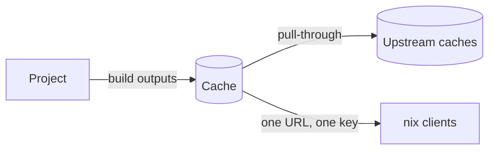

# Caches

Gradient includes a own Nix binary cache. A **cache** stores build outputs so any machine with `nix` can substitute from it.

Projects subscribe to caches. Every build a project produces goes into each cache the project subscribed to.

## Using a Cache

The cache page lists two values needed for Nix configuration: the substituter URL and the public key. Public caches accept any client. Private caches require credentials. See [Authentication](../guides/share-a-cache.md#1-use-the-cache-on-a-machine) for details.

Each cache sends a priority to `nix`. The default value is `10`, and lower numbers take precedence. A cache can also send a separate priority to machines on the local network. Those machines then prefer the Gradient cache over remote caches.

## Upstream Types

Find upstream caches under **Settings -> Upstream Caches** on the cache page.

| Type | Upstream Cache | Modes |
|---|---|---|
| Internal | Another cache on the same Gradient instance | Read & Write, Read Only, Write Only |
| Gradient Proto | A cache on another Gradient instance, reached over that instance's cache protocol | Read & Write, Read Only, Write Only |
| HTTP | Any Nix binary cache, e.g. `cache.nixos.org` | Read Only |

The modes control traffic direction:

- **Read & Write**: pull through and push results upstream.
- **Read Only**: pull through only.
- **Write Only**: push only.

Caches declared in [`services.gradient.state`](../reference/state.md#cachesname) accept Internal and HTTP upstream caches (`external` in Nix). Configure Gradient Proto upstream caches in the UI.

Use **Deactivate** to disable an upstream cache while keeping the entry. Use **Activate** to switch it back on. Inactive upstream caches keep their settings. Gradient never queries an inactive upstream cache. Paths then come from the remaining upstream caches. Declared caches also accept **Deactivate** and **Activate**. The next server start will restore the declared `active` value.

Use **Test** on an HTTP upstream cache to fetch its `nix-cache-info` over HTTP/1.1 and over HTTP/2. Both results appear in a notification.

Some HTTP upstream caches break HTTP/2 transfers. Enable **HTTP/1.1 only** in the add or edit form for such an upstream cache. Declared caches take the value from `http1_only`. These upstream caches show an **HTTP/1.1** badge.

## Pull-Through

Pull-through lets a cache serve paths it does not store. On a request for a missing path, the cache fetched the copy from an upstream cache, re-signed it with its own key, and sent it to the client. Clients therefore needed only one URL and one key, no matter where a path came from.

To disable pull-through, toggle **Pull-Through** under **Settings** on the cache page. A cache with pull-through off served only the paths it held. Builds could still [substitute](#substitution) from the upstream caches.

## Substitution

Gradient will decide per derivation whether a build is needed at all, before building anything.

1. Outputs present in a cache on the instance require no work.
2. For outputs absent on the instance, check the upstream caches of the subscribed caches.
3. Builds with every needed output found count as **substituted**. Workers download those outputs. Builds and downloads below the derivation never happen.
4. Needed outputs cover every output of an entry point. They also cover each output a wanted build above the derivation can read. No cache copy and no reader leave an output out of the list. One case: the `dev` output of a `nix copy` upload.
5. Derivations with a missing needed output land on a worker for building. Their inputs pass through the same check. A left-out output read by a later build can turn the derivation into a real build.

Lookups only cover derivations an evaluation actually needs. Unresponsive upstream caches pause for a minute instead of slowing every lookup.

## Sharing

Projects subscribe to a cache for pushing outputs there and substituting from there. Subscribing needs rights on both sides. Subscriptions without cache rights turn into a request. A cache admin can approve the request under **Subscriptions** on the cache page.

## Roles

| Role | Access |
|---|---|
| Admin | Full control: settings, members, roles and subscriptions |
| Write | Read access plus path uploads |
| View | Cache visibility plus path downloads |

[Members and Roles](../ui/members-and-roles.md#cache-roles) explains how to build custom roles from individual permissions.

## Related

- [First Project](../get-started/first-project.md) - create a cache, then subscribe a project to it
- [Share a Cache](../guides/share-a-cache.md) - grant client access to a cache
- [Projects and Tasks](projects-and-tasks.md) - how builds produce cache entries
