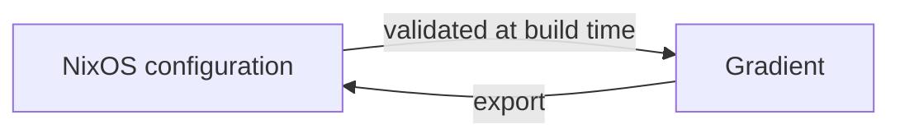

# Declarative State

Gradient supports declaring State in Nix under `services.gradient.state`. Each startup applies this state to the server. Entities that come from Nix appear as read-only in the UI, so the Nix configuration acts as the single source of truth.



## Declarable Entities

| Entity | Content |
|---|---|
| Users | Accounts with a password or OIDC-only login, plus superusers |
| Projects | Member lists, an SSH key, workers, and cache subscriptions |
| Tasks | Repository, wildcard, triggers, actions, and concurrency settings |
| Integrations | Connections to a Git host for incoming events and outgoing status updates |
| Caches | Signing key, upstream caches, and members |
| Roles | Custom roles for projects and caches |
| Teams | Members, OIDC and SCIM groups, and grants on projects and caches |
| API Keys | Scoped keys, with the token hash read from a secret file |
| Workers | Workers at the project level and the team level |

## UI-Managed and Nix-Managed

| | Created in the UI | Declared in Nix |
|---|---|---|
| Editing | Through the UI and the API | Through Nix alone. The UI shows the controls but keeps them disabled |
| Removal | Via the delete button | By dropping the entry from Nix, after which the next start deletes it |
| Validation | At save time | During the NixOS configuration build |
| Activate / Deactivate | Through the UI and the API | Through the UI as well, for caches, upstream caches and workers. The declared value comes back on the next start |

Both kinds coexist. A declared project can contain tasks created in the UI.

## Validation

State declarations can be checked while the NixOS configuration builds. Enable this through `services.gradient.state.validate`, which is on by default. The check catches unknown users or projects, duplicate ids, and broken references. Errors surface at build time rather than at server start.

## Secrets

The Nix store never uses secret material. Each `*_file` option points to a path on the server, commonly managed with sops-nix or agenix. The server loads these files at startup.

| Option | Content | Generate |
|---|---|---|
| `users.<name>.password_file` | Argon2id hash of the password | `gradient hash > alice-password` |
| `projects.<name>.private_key_file` | SSH private key for cloning | `ssh-keygen -t ed25519 -N "" -C gradient-acme -f acme-ssh-key` |
| `caches.<name>.signing_key_file` | Nix signing key, base64 only | `nix-store --generate-binary-cache-key main main-key main-key.pub`, then `sed -i 's/^[^:]*://' main-key` |
| `api_keys.<name>.key_file` | SHA-256 hex digest of the token, without `GRAD` | See [API Key Files](#api-key-files) |
| `workers.<name>.token_file` | Worker registration token | `openssl rand -base64 48` |
| `integrations.<name>.secret_file` | Webhook secret shared with the Git host | `openssl rand -hex 32` |
| `integrations.<name>.access_token_file` | Git host access token | From the Git host |

- Run `gradient hash` to enter the password twice and get the hash. Piping a password through `<<<` puts a trailing newline into the hash, and later sign-ins then fail.
- Upload `acme-ssh-key.pub` to the Git host as the deploy key.
- `nix-store` writes the key as `main:<key>`. Store only the key in the file, without the `main:` prefix. Gradient can derive the public key itself.
- A user without `password_file` can sign in through OIDC only.

### API Key Files

The server stores only a digest of each API key. Put that digest in `key_file`. Clients send the token with a `GRAD` prefix.

```sh
gradient generate apikey
```

The command outputs two values: the `API token` for clients (`Authorization: Bearer GRAD...`) and the `key_file digest` for the `key_file`.

??? note "Without the CLI"
    ```sh
    TOKEN=$(openssl rand -hex 32)
    printf %s "$TOKEN" | sha256sum | cut -d' ' -f1 > ci-key # (1)!
    echo "GRAD$TOKEN"
    ```

    1.  `printf %s` excludes the trailing newline from the digest.

## Removal

The `services.gradient.state.delete` option controls removal of users, projects and caches that no longer appear in the configuration. Removal is on by default. Turn the option off to keep those entities in the database, where they remain editable in the UI.

## Export

A `GET /api/v1/admin/state` request returns the live configuration in the `services.gradient.state` format. This output can serve as a starting point for a Nix setup built through the UI.

## Related

- [State reference](../reference/state.md): all options, each with examples
- [Projects and Tasks](projects-and-tasks.md): definitions of these entities
