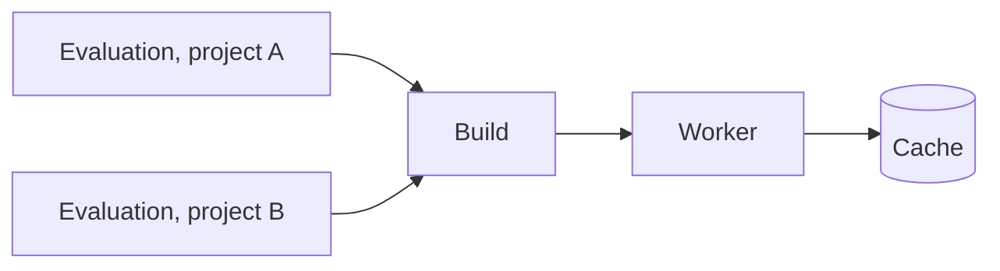

<!--
SPDX-FileCopyrightText: 2026 Wavelens GmbH <info@wavelens.io>
SPDX-License-Identifier: AGPL-3.0-only
-->

# Evaluations and Builds

**Evaluations** read a flake at one commit and find every derivation matching the task's wildcard. The derivations found this way turn into **builds**. Builds can start before the evaluation is done. The whole instance will build each derivation only once.

## Evaluation

| Status | Meaning |
|---|---|
| Queued | The evaluation awaits an evaluating worker |
| Fetching | A worker clones the repository and gathers its flake inputs from the store, the cache or a download by a worker with `network` |
| Evaluating | A worker walks the flake and reports derivations in batches |
| Building | All derivations are known. Builds are running |
| Waiting | No connected worker can make progress, e.g. no worker with the needed system or features. The evaluation resumes on its own. Builds needing a system or features absent from every connected worker abort the evaluation after 5 minutes with a warning. A task can opt into waiting for workers instead |
| Completed | Every build succeeded |
| Failed | The evaluation or at least one build failed |
| Aborted | Stopped by hand or replaced by a newer evaluation |

Evaluations skip every dependency subtree that previous evaluations recorded. Run **Reevaluate all inputs** from the task menu to walk the whole closure again. The result is a new evaluation.

Task option **Only Evaluate** (`only_evaluate`, off by default) can end each evaluation right after Evaluating. Such evaluations build nothing and start no exec jobs.

The evaluation page groups builds by status, with each entry point above its dependencies. The merged live log and **Abort** appear on the same page. Right-click a build to reach **Graph**, **Show Job** (the [Job Board](../ui/job-board.md) assignment), **Artefacts** and **Download Log**.

## Summary

The evaluation menu has a **Summary** entry. Click it to reach a report page for package maintainers. Share the link freely. Public projects need no login to view it.

The page lists build outcomes in a table.

| Part | Content |
|---|---|
| Headline | Number of packages that did not build |
| **Newly failing** | Failed builds that break a package which built in the previous evaluation |
| **Still failing** | Failed builds where every affected package was already broken in the previous evaluation |
| **Failed to evaluate** | Attributes without a derivation, with the first line of the error |
| **Fixed** | Packages broken in the previous evaluation that built now |

Rows list only builds that failed themselves. Packages blocked by a failed dependency appear under that dependency's build. Click a row to open the build on the evaluation page. **Timed out** and **Worker fault** mark failures not caused by the package.

## Build

Builds belong to a derivation, not to an evaluation. Every evaluation that needs the same derivation shares one build and one log, across all projects.

| Status | Meaning |
|---|---|
| Queued | Wait for dependencies or for a free worker |
| Building | Run on a worker |
| Completed | The build succeeded |
| Substituted | No build ran. The outputs already exist in a cache or an upstream cache |
| Failed | The builder failed or timed out. Infrastructure errors such as out of memory, a full disk or a network problem get retried first |
| Dependency Failed | The build never started because a dependency failed |
| Aborted | Cancelled by hand or together with the evaluation |
| Skipped | An unneeded build-time dependency whose outputs already sit in a cache |

## Abort and Retry

- **Abort** on a running build can stop that build in the current evaluation. Dependent builds fail afterward. The evaluation can end with status Aborted. A later evaluation can run that build again.
- **Retry** on a failed or aborted build queues the build again, together with the dependents that failed through it. This queueing happens inside the running evaluation.
- **Retry** on a finished evaluation starts a new evaluation of the same commit. That new evaluation queues all failed builds again.
- Both kinds of retry query the [upstream caches](caches.md#upstream-types) again. A worker can then substitute a build found there.
- A new evaluation can query the upstream caches again about a failed build, one hour after the last query.
- A new evaluation can queue every failed build it needs again. The task option **Retry failed builds on new evaluation** (`retry_failed_builds`, on by default) can keep permanent failures failed until a retry instead.

## Imported Derivations

Import from derivation (IFD) allow a flake to read a derivation's output during evaluation.

- A worker with a matching system can build the imported derivation like any other build.
- The evaluating worker can wait for that build and then fetch the outputs from the cache.
- On the task page, the build can be listed under the entry point `other.<system>.<name>` with an **IFD** tag.
- An imported build and all its unfinished dependencies below it receive a priority lift, see [Scheduler Policies](../reference/scheduler-policies.md).
- When an import fail, every attribute that depend on it fail too, with the error `import from derivation '<name>' failed: build <build id> <status>`.
- If no connected worker has the target system, the import fail after 5 minutes. A task can opt into waiting for workers instead.

## Restricted Evaluation

Evaluations use the Nix setting `restrict-eval` by default. Fetches during evaluation (`builtins.fetchTree`, `fetchurl`, `fetchTarball`, `fetchGit`) can access only the URLs below.

- The exact URLs of inputs locked in `flake.lock`. Nix can build those URLs the same way Nix can fetch those inputs during flake load.
- Prefixes from the server option `GRADIENT_EVAL_ALLOWED_URI_PREFIXES` (comma-separated). See [Configuration](../reference/configuration.md).
- URL prefixes that a project can allow in addition (`extra_allowed_uri_prefixes`).

All other fetches fail with `forbidden in restricted mode`.

- Prefixes match the same URL, or a longer URL with `/` right after the prefix.
- Prefixes that end in `:` (for example, `github:`) match an entire URL scheme.
- Prefixes can't be empty and can't contain whitespace.

Use the project option `restrict_evaluation_fetches` (enabled by default) to disable the restriction for one project. Use the project settings page, API `patchProject`, or [declarative state](../reference/state.md) to change both project options.

Builds of [imported derivations](#imported-derivations) run inside the same restricted evaluator.

Limitations:

- Earlier unrestricted evaluations of the same locked flake fill the eval cache. Restricted evaluations still read from that cache.
- Nix does not check URLs for top-level fetches of `builtins.getFlake`.
- The restriction does not apply to flake inputs. A repository can fetch any URL for inputs that `flake.nix` or `flake.lock` specify. Nix can fetch locked inputs before any allowlist exists.

## Related

- [Projects and Tasks](projects-and-tasks.md): where evaluations come from
- [Overview](overview.md): how workers and caches work
- [First Project](../get-started/first-project.md): run an evaluation for the first time
