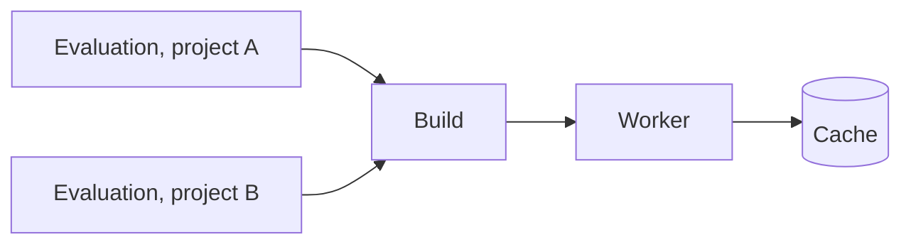

<!--
SPDX-FileCopyrightText: 2026 Wavelens GmbH <info@wavelens.io>
SPDX-License-Identifier: AGPL-3.0-only
-->

# Evaluations and Builds

**Evaluations** read a flake at one commit and find every derivation matching the task's wildcard. The derivations found this way turn into **builds**. Builds can start before the evaluation is done. The whole instance will build each derivation only once.

## Evaluation

| Status | Meaning |
|---|---|
| Queued | The evaluation awaits an evaluating worker |
| Fetching | A worker clones the repository and gathers its flake inputs from the store, the cache or a download by a worker with `network` |
| Evaluating | A worker walks the flake and reports derivations in batches |
| Building | All derivations are known. Builds are running |
| Waiting | No connected worker can make progress, e.g. no worker with the needed system or features. The evaluation resumes on its own. Builds needing a system or features absent from every connected worker abort the evaluation after 5 minutes with a warning. A task can opt into waiting for workers instead |
| Completed | Every build succeeded |
| Failed | The evaluation or at least one build failed |
| Aborted | Stopped by hand or replaced by a newer evaluation |

Evaluations skip every dependency subtree that earlier evaluations already recorded. To walk the whole closure again, run **Full rewalk** from the task menu. This starts a new evaluation.

The evaluation page groups builds by status, with each entry point above its dependencies. The merged live log and **Abort** appear on the same page. Right-click a build to reach **Graph**, **Show Job** (the [Job Board](../ui/job-board.md) assignment), **Artefacts** and **Download Log**.

## Summary

The evaluation menu has a **Summary** entry. Click it to reach a report page for package maintainers. Share the link freely. Public projects need no login to view it.

The page lists build outcomes in a table.

| Part | Content |
|---|---|
| Headline | Number of packages that did not build |
| **Newly failing** | Failed builds that break a package which built in the previous evaluation |
| **Still failing** | Failed builds where every affected package was already broken in the previous evaluation |
| **Failed to evaluate** | Attributes without a derivation, with the first line of the error |
| **Fixed** | Packages broken in the previous evaluation that built now |

Rows list only builds that failed themselves. Packages blocked by a failed dependency appear under that dependency's build. Click a row to open the build on the evaluation page. **Timed out** and **Worker fault** mark failures not caused by the package.

## Build

Builds belong to a derivation, not to an evaluation. Every evaluation that needs the same derivation shares one build and one log, across all projects.

| Status | Meaning |
|---|---|
| Queued | Wait for dependencies or for a free worker |
| Building | Run on a worker |
| Completed | The build succeeded |
| Substituted | No build ran. The outputs already exist in a cache or an upstream cache |
| Failed | The builder failed or timed out. Infrastructure errors such as out of memory, a full disk or a network problem get retried first |
| Dependency Failed | The build never started because a dependency failed |
| Aborted | Cancelled by hand or together with the evaluation |
| Skipped | An unneeded build-time dependency whose outputs already sit in a cache |

## Abort and Retry

- **Abort** on a running build stops that build for the current evaluation. Dependents in the same evaluation then fail, and a later evaluation can build the build again.
- **Retry** on a failed or aborted build queues the build again, together with the dependents that failed through it. This queueing happens inside the running evaluation.
- **Retry** on a finished evaluation starts a new evaluation of the same commit. That new evaluation queues all failed builds again.
- Both kinds of retry query the [upstream caches](caches.md#upstream-types) again. A worker can then substitute a build found there.
- A new evaluation can queue every failed build it needs again. The task option **Retry failed builds on new evaluation** (`retry_failed_builds`, on by default) can keep permanent failures failed until a retry instead.

## Imported Derivations

Import from derivation (IFD) allow a flake to read a derivation's output during evaluation.

- A worker with a matching system can build the imported derivation like any other build.
- The evaluating worker can wait for that build and then fetch the outputs from the cache.
- On the task page, the build can be listed under the entry point `other.<system>.<name>` with an **IFD** tag.
- An imported build and all its unfinished dependencies below it receive a priority lift, see [Scheduler Policies](../reference/scheduler-policies.md).
- When an import fail, every attribute that depend on it fail too, with the error `import from derivation '<name>' failed: build <build id> <status>`.
- If no connected worker has the target system, the import fail after 5 minutes. A task can opt into waiting for workers instead.

## Related

- [Projects and Tasks](projects-and-tasks.md): where evaluations come from
- [Overview](overview.md): how workers and caches work
- [First Project](../get-started/first-project.md): run an evaluation for the first time
