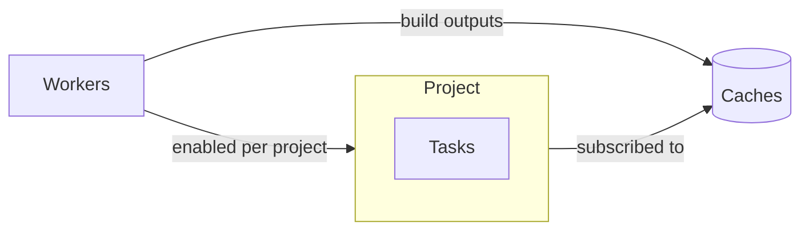

# Projects and Tasks

A **project** is a group of people, machines and caches. A **task** inside a project is one repository plus the flake outputs to build from that repository.

## Project

- **Members and Roles**: Admin, Write, View, or custom roles built from single permissions.
- **SSH Key**: one Ed25519 key per project, generated automatically, for cloning private repositories.
- **Workers**: workers only receive jobs from projects with the worker enabled.
- **Teams**: granted [teams](teams.md) bring their users with a role, their workers, or both.
- **Cache Subscriptions**: build outputs of a project go to every subscribed cache.
- **Integrations**: connections to GitHub, Gitea / Forgejo or GitLab for incoming events and outgoing status.

## Task

| Part | Purpose |
|---|---|
| Repository URL | Location of the flake |
| Evaluation Wildcard | Which flake outputs to build, see [wildcards](../reference/wildcards.md) |
| Triggers | Start condition and branch of an evaluation: push, pull request, polling (every 300 s by default) or a cron schedule |
| Actions | Follow-up steps: mail, web request, Git host status, flake update pull request |
| Flake Input Overrides | Replace a flake input for every evaluation, e.g. a newer nixpkgs |
| Keep Evaluations | How many finished evaluations stay, 30 by default |

## Concurrency

Tasks allow a single active evaluation per branch. Triggers firing during a running evaluation of the same branch follow the task's concurrency policy. Evaluations of other branches keep running.

| Trigger | Branch of the evaluation |
|---|---|
| Push | Pushed branch or tag |
| Pull request | Pull request number, shared by every push to the pull request |
| Polling | Polled branch, or the default branch of the remote without a configured branch |
| Cron schedule, manual start, API | Default branch of the remote |

Polls, cron schedules, manual starts and API starts look up the name of the default branch on the remote. A push to `main` and a poll of the default branch `main` share the branch.

Evaluations of a pinned commit and `gradient build` requests belong to no branch. Concurrency policies skip them.

| Policy | Running evaluation | Running builds |
|---|---|---|
| `auto` (default) | Running on until the new evaluation starts building, then aborted. Finishes after a failed evaluation of the new commit | Builds wanted by the new evaluation keep running. The rest are cancelled |
| `soft_abort` | Aborted, with the new evaluation taking over | Finish, and the new evaluation will reuse the outputs |
| `hard_abort` | Aborted | Cancelled |
| `skip` | Running on | Keep running. The new event is dropped |
| `all` | Running on, with the new evaluation running alongside | Keep running |

## Related

- [First Project](../get-started/first-project.md): create a project and a task
- [Overview](overview.md): the whole path from evaluation and build to worker and cache
