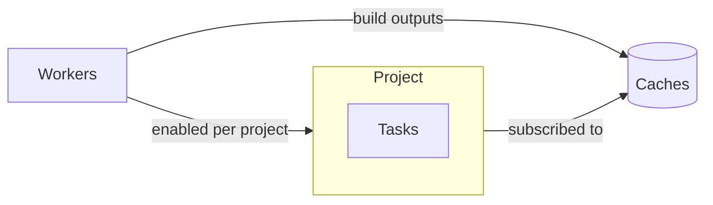

<!--
SPDX-FileCopyrightText: 2026 Wavelens GmbH <info@wavelens.io>
SPDX-License-Identifier: AGPL-3.0-only
-->

# Projects and Tasks

A **project** bundles people, machines and caches. Each **task** in a project points to one repository and lists the flake outputs that need building from it.

## Project

- **Members and Roles**: Admin, Write, View, or custom roles assembled from single permissions.
- **SSH Key**: Each project receive one Ed25519 key, generated automatically, for cloning private repositories.
- **HTTPS Credentials**: A project can store one pair of username and password per Git host for private repositories over HTTPS.
- **Workers**: Jobs from a project reach workers only when the worker flag on that project enable.
- **Teams**: A granted [team](teams.md) bring its users with a role, its workers, or both.
- **Cache Subscriptions**: Build outputs of a project go to every subscribed cache.
- **Git Host Connections**: Connections to GitHub, Gitea / Forgejo, or GitLab receive events and report commit status. A project can use its own connections freely. Connections of the owner team and the instance require [repository grant](#repository-grants).

## Task

| Part | Purpose |
|---|---|
| Repository URL | Location of the flake, see [Repository URL](#repository-url) |
| Evaluation Wildcard | Which flake outputs to build, see [wildcards](../reference/wildcards.md) |
| [Triggers](triggers.md) | Start condition and branch of an evaluation: push, pull request, polling (every 300 s by default) or a cron schedule |
| Git Host Connection | A connection to a Git host for task events. This connection can report commit status when **Report commit status** is on. Team connections and instance connections need a [repository grant](#repository-grants). See [Connect GitHub](../guides/github.md#4-choose-the-connection-on-the-task). |
| Actions | Follow-up steps: email, web request, Matrix or Slack message, flake update pull request |
| Flake Input Overrides | Replace a flake input for every evaluation, e.g. a newer nixpkgs |
| Keep Evaluations | Number of completed evaluations to keep. Default 30. Server option `eval.maxKeep` can set the upper limit for this value. The settings page can show that limit as **Instance limit**. **Delete old evaluations** in the task's **Danger Zone** can remove completed evaluations created before the specified date. |

## Repository Grants

A task can use the connection to the Git host of an instance or team only with a grant for the task repository on that connection. Grants specify one project and one repository owner. A grant can also include one repository.

| Connection owner | Grant needed | Granted by |
|---|---|---|
| Project | No | - |
| Team | Yes, for projects of that team only | Team Admin |
| Instance | Yes | Superuser |

- **Owner Grant**: Grants with no repository name apply to every repository of that owner on the Git host.
- **Letter Case**: Owner and name of a grant in Gradient stay lowercase. Comparisons ignore case.
- **Team Connections**: Projects outside the team don't get a grant for the team connection.
- **Host**: The repository URL must point to the host of the connection. Gitea and Forgejo connections need a base URL for this check.
- **Declarative Tasks**: Tasks declared in `services.gradient.state` get a grant from the state file for exactly their own repository. `open_pr` actions with an instance connection or a team connection also get their own grant from the state file, for exactly the repository of each action. Tasks that leave the state file no longer have a grant.

A task without a grant:

- The **Git host connection** list on the task doesn't include the connection.
- Selecting the connection, an `open_pr` action with it and moving the task to another project all fail with `403`. Error messages show the name of the missing permission, `This task can't use Git host connection <id>: This connection has no grant for this repository in the task's project.`.
- The connection's webhooks don't start an evaluation of the task. Commit statuses and pull requests stop too.

Grants don't have a UI page yet. Superusers and team admins manage grants through the API.

| Method | Route | Purpose |
|---|---|---|
| `GET` | `/api/v1/admin/git-host-connections/{id}/repository-grants` | List grants of an instance connection with project name and source |
| `PUT` | `/api/v1/admin/git-host-connections/{id}/repository-grants` | Create a grant, body `{ "project": "acme", "repository_owner": "acme", "repository_name": "app" }` |
| `DELETE` | `/api/v1/admin/git-host-connections/{id}/repository-grants/{grant}` | Delete a grant |
| `GET`, `PUT`, `DELETE` | `/api/v1/teams/{team}/git-host-connections/{id}/repository-grants[/{grant}]` | The same for a team connection |

- **`repository_name`**: Optional. Omit the field for an owner grant. GitLab subgroups belong in the name. Take owner `group` and name `sub/app`. That grant matches only `group/sub/app`.
- **`project_name`**: The project name is empty in the team list after the project left the team. Deleting the grant still works.
- **Takeover**: Create requests for a grant made by the state file or a version upgrade turn that grant into an admin grant. Task removals from the state file leave that admin grant in place.
- **`400`**: An owner that isn't a single path segment. A name with an empty segment, `.` or `..`, or `.git` at the end. An owner or name over 255 characters. A project outside the team.
- **`404`**: The connection belongs to another owner, or the project doesn't exist.
- **`409`**: Identical admin grants already exist.
- **State-managed Teams**: Teams declared in `services.gradient.state` reject any change to grants through the API.

## Repository URL

| Form | Example |
|---|---|
| SSH URL | `ssh://git@git.example.com/org/repo.git` |
| SSH URL with port | `ssh://git@git.example.com:2222/org/repo.git` |
| SCP-like SSH | `git@git.example.com:org/repo.git` |
| HTTPS | `https://git.example.com/org/repo.git` |
| Flake directory | `https://git.example.com/org/repo.git?dir=nix/hosts` |

- **SSH Key**: Both SSH forms use the project SSH key for authentication. Add that key as a deploy key on the Git host.
- **HTTPS Login**: HTTPS URLs use the saved HTTPS credentials of the project for that host. Evaluation, flake inputs and workers all use them. Declare them in [`git_https_credentials`](../reference/state.md#projectsname) of the declarative state project, or save them through the API.
- **Port**: A port number alone can follow the host in an `ssh://` URL. A path directly after `host:` can appear in the SCP-like form alone, without `ssh://`.
- **Local Files**: `file://` URLs don't work.
- **Flake Directory**: Use `?dir=<rel-dir>` on any URL form to target the flake in that directory. The path can't leave the repository. Other query keys don't work.
- **Checkout**: Workers check out the full repository. Polling, webhooks and pull requests skip the query in the URL. Flake lock pull requests commit `<rel-dir>/flake.lock`.
- **Worker Version**: Older worker releases evaluate the repository root. Upgrade the workers first. A task can use `?dir=` after the upgrade.

## Default Trigger

Exactly one trigger per task is the default trigger. The "Run" button and the API start the default trigger.

- **Branch**: The branch that a polling trigger or cron trigger can set, or the first push branch or pull request branch without glob characters. Otherwise, the remote default branch.
- **Inactive**: An inactive default trigger can still fire on a manual start, but never on its own.
- **Deletion**: Locked until "Make Default" on another trigger.
- **New Tasks**: New tasks use the triggers selected at creation. The first trigger is the default. Tasks with no trigger list get one polling trigger on the chosen branch. That trigger is the default.

## Skip a Commit

Pushes and polls start no evaluation for a head commit with a skip marker in its message.

| Marker | Example |
|---|---|
| `[skip ci]`, `[ci skip]`, `[no ci]` | `docs: fix typo [skip ci]` |
| `[skip gradient]`, `[gradient skip]` | `docs: fix typo [skip gradient]`, for other CI systems to still build |
| `skip-checks: true` trailer | A line in the last paragraph of the message |

- **Letter Case**: Markers match in any letter case and anywhere in the message.
- **Multiple Commits**: Markers on earlier commits of a push have no effect, only the head commit can skip.
- **Exempt**: Pull requests, merge queues, releases, cron schedules, manual starts and API starts ignore markers.

## Concurrency

Each task allows one active evaluation per branch. A trigger that fires while the same branch already has an evaluation in progress follows the task's concurrency policy. Evaluations on other branches continue unaffected.

| Trigger | Branch of the evaluation |
|---|---|
| Push | Pushed branch or tag |
| Pull request | Pull request number, shared by every push to the pull request |
| Polling | Polled branch, or the default branch of the remote without a configured branch |
| Cron schedule | Configured branch or remote default branch |
| Manual start, API | Branch of the [default trigger](#default-trigger) |

Polls, cron schedules, manual starts and API starts resolve the default branch name on the remote. A push to `main` and a poll of the default branch `main` therefore share one branch.

Evaluations of a pinned commit and `gradient build` requests belong to no branch. Concurrency policies skip them.

| Policy | Running evaluation | Running builds |
|---|---|---|
| `auto` (default) | Kept running until the new evaluation starts building, then aborted. Finished after a failed evaluation of the new commit | Builds wanted by the new evaluation keep running. The rest get cancelled |
| `soft_abort` | Aborted, with the new evaluation taking over | Finish, and the new evaluation reuses the outputs |
| `hard_abort` | Aborted | Cancelled |
| `skip` | Kept running | Kept running. The new event got dropped |
| `all` | Kept running, with the new evaluation running alongside | Kept running |

Evaluations of a branch that still wait for workers or a cache never block a newer commit. Trigger events abort that evaluation under any policy and start a new evaluation. One Waiting card is on the task. Aborted evaluations record the user who aborted them or the evaluation that replaced them as the reason.

## Related

- [First Project](../get-started/first-project.md): set up a project with a task
- [Overview](overview.md): the full flow from evaluation and build to worker and cache
