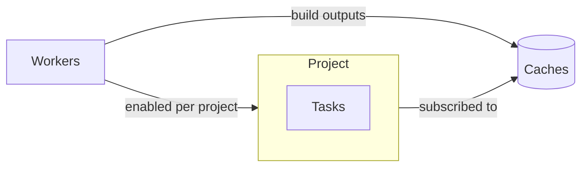

# Projects and Tasks

A **project** bundles people, machines and caches. Each **task** in a project points to one repository and lists the flake outputs that need building from it.

## Project

- **Members and Roles**: Admin, Write, View, or custom roles assembled from single permissions.
- **SSH Key**: Each project receive one Ed25519 key, generated automatically, for cloning private repositories.
- **Workers**: Jobs from a project reach workers only when the worker flag on that project enable.
- **Teams**: A granted [team](teams.md) bring its users with a role, its workers, or both.
- **Cache Subscriptions**: Build outputs of a project go to every subscribed cache.
- **Integrations**: Connections to GitHub, Gitea / Forgejo or GitLab handle incoming events and outgoing status.

## Task

| Part | Purpose |
|---|---|
| Repository URL | Location of the flake, see [Repository URL](#repository-url) |
| Evaluation Wildcard | Which flake outputs to build, see [wildcards](../reference/wildcards.md) |
| Triggers | Start condition and branch of an evaluation: push, pull request, polling (every 300 s by default) or a cron schedule |
| Actions | Follow-up steps: mail, web request, Git host status, flake update pull request |
| Flake Input Overrides | Replace a flake input for every evaluation, e.g. a newer nixpkgs |
| Keep Evaluations | How many finished evaluations stay, 30 by default |

## Repository URL

| Form | Example |
|---|---|
| SSH URL | `ssh://git@git.example.com/org/repo.git` |
| SSH URL with port | `ssh://git@git.example.com:2222/org/repo.git` |
| SCP-like SSH | `git@git.example.com:org/repo.git` |
| HTTPS | `https://git.example.com/org/repo.git` |
| Flake directory | `https://git.example.com/org/repo.git?dir=nix/hosts` |

- **SSH Key**: Both SSH forms use the project SSH key for authentication. Add that key as a deploy key on the Git host.
- **Port**: A port number alone can follow the host in an `ssh://` URL. A path directly after `host:` can appear in the SCP-like form alone, without `ssh://`.
- **Local Files**: `file://` URLs don't work.
- **Flake Directory**: Use `?dir=<rel-dir>` on any URL form to target the flake in that directory. The path can't leave the repository. Other query keys don't work.
- **Checkout**: Workers check out the full repository. Polling, webhooks and pull requests skip the query in the URL. Flake lock pull requests commit `<rel-dir>/flake.lock`.
- **Worker Version**: Older worker releases evaluate the repository root. Upgrade the workers first. A task can use `?dir=` after the upgrade.

## Default Trigger

Exactly one trigger per task is the default trigger. The "Start Evaluation" button and the API start fire the default trigger.

- **Branch**: The configured branch of a polling trigger, or the first push or pull request branch without glob characters. Otherwise the default branch of the remote.
- **Inactive**: An inactive default trigger can still fire on a manual start, but never on its own.
- **Deletion**: Locked until "Make Default" on another trigger.
- **New Tasks**: New tasks start with a polling trigger as the default.

## Concurrency

Each task allows one active evaluation per branch. A trigger that fires while the same branch already has an evaluation in progress follows the task's concurrency policy. Evaluations on other branches continue unaffected.

| Trigger | Branch of the evaluation |
|---|---|
| Push | Pushed branch or tag |
| Pull request | Pull request number, shared by every push to the pull request |
| Polling | Polled branch, or the default branch of the remote without a configured branch |
| Cron schedule | Default branch of the remote |
| Manual start, API | Branch of the [default trigger](#default-trigger) |

Polls, cron schedules, manual starts and API starts resolve the default branch name on the remote. A push to `main` and a poll of the default branch `main` therefore share one branch.

Evaluations of a pinned commit and `gradient build` requests belong to no branch. Concurrency policies skip them.

| Policy | Running evaluation | Running builds |
|---|---|---|
| `auto` (default) | Kept running until the new evaluation starts building, then aborted. Finished after a failed evaluation of the new commit | Builds wanted by the new evaluation keep running. The rest get cancelled |
| `soft_abort` | Aborted, with the new evaluation taking over | Finish, and the new evaluation reuses the outputs |
| `hard_abort` | Aborted | Cancelled |
| `skip` | Kept running | Kept running. The new event got dropped |
| `all` | Kept running, with the new evaluation running alongside | Kept running |

## Related

- [First Project](../get-started/first-project.md): set up a project with a task
- [Overview](overview.md): the full flow from evaluation and build to worker and cache
