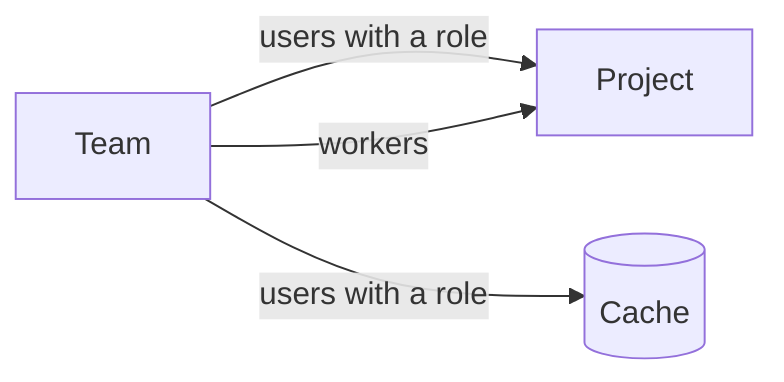

<!--
SPDX-FileCopyrightText: 2026 Wavelens GmbH <info@wavelens.io>
SPDX-License-Identifier: AGPL-3.0-only
-->

# Teams

A **team** bundles users and workers into one unit. A single grant on a project or cache then applies to all members of that team. Teams never own projects or caches.

## Members

| Role | Rights |
|---|---|
| Admin | Change settings, members, invitations, workers and grants. Approve requests. Delete the team |
| Member | See the team page |

- **Invitations**: An Admin can invite a user by name. To join, the user can accept the invitation under `Settings -> My Invites`. A superuser can add members directly.
- **Last Admin**: Every team must have at least one Admin. Removing or demoting the last Admin is refused.
- **Creation**: `permissions.createTeam` controls who can create teams. The creator is the first Admin.

## Grants

A grant links one team to one project or cache. Each grant controls one kind of access.

| Target | Grant | Effect |
|---|---|---|
| Project | Users with a role | Members receive that role in the project |
| Project | Workers | Team workers take the project's jobs |
| Cache | Users with a role | Members receive that cache role |

Roles stack. A user with both a direct role and a team role receives the permissions of both. Direct membership can be removed without affecting team access.

## Requests

A grant requires consent from two parties: the project or cache, and the team.

| Caller | Outcome |
|---|---|
| Members & Roles rights on the project or cache, plus Admin in the team | Grant becomes active immediately |
| Members & Roles rights only | A pending request appears on the team page and stays there until a team Admin approves it |
| Either party | Can revoke the grant |

Activation of the team's workers within an existing grant requires a team Admin.

## Team Workers

Register a team worker once on the team's **Workers** page. The worker can then take jobs from every project that grants access to the team's workers.

- **Peers file**: one line per token, in the form `<team id>:<token>` or `*:<token>`. Details in the [peers file](../guides/remote-worker.md#peers-file).
- **Caches**: projects without a [cache subscription](caches.md) do not accept team workers.
- **Removal**: when a grant, the team or the worker goes away, running jobs in the affected projects end.

## New Projects

Team settings can assign a role to every new project for each team user, add the team's workers, or do both. Only superusers can edit these fields. The [local worker](workers.md#access) is a worker of the team `server`, declared in the system state. Every new project receives this worker through the mechanism above.

## Single Sign-On

A team can sync with an identity provider group. See [Single Sign-On](../guides/sso.md) for setup instructions.

- `oidc_group`: users in that group join the team at sign-in. Removal from the claim removes them from the team.
- `scim_group`: the provider can manage the team's membership directly.

Only superusers can edit these two fields.

## Mail and Dashboard

- **Mail actions**: `team:<name>` as a `send_mail` recipient can reach every verified member of a team granted with users on the project. See [Actions](../guides/actions.md).
- **Dashboard**: tasks of team projects rank after starred and active tasks, and before tasks of direct memberships.

## Related

- [Projects and Tasks](projects-and-tasks.md) covers the project side of a grant
- [Workers](workers.md) describes project workers, team workers and the local worker
- [Declarative State](../reference/state.md#teamsname) shows teams as NixOS options
