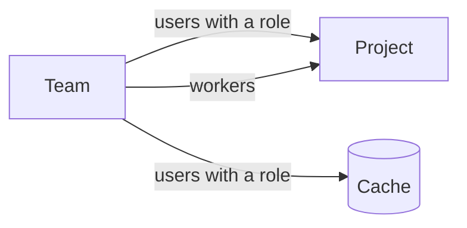

<!--
SPDX-FileCopyrightText: 2026 Wavelens GmbH <info@wavelens.io>
SPDX-License-Identifier: AGPL-3.0-only
-->

# Teams

A **team** bundles users and workers into one unit. A single grant on a project or cache then applies to all members of that team. Teams can own projects and caches.

## Members

| Role | Rights |
|---|---|
| Admin | Change settings, members, invitations, workers and grants. Approve requests. Delete the team |
| Member | See the team page |

- **Invitations**: Admins invite users by name. Users join when they accept an invitation at **My Invites** in the user menu in the header. Instance admins select **Add now** to add members without an invitation.
- **Last Admin**: Every team must have at least one Admin. Removing or demoting the last Admin is refused.
- **Creation**: `permissions.createTeam` controls who can create teams. The creator is the first Admin.

## Grants

A grant links one team to one project or cache. Each grant controls one kind of access.

| Target | Grant | Effect |
|---|---|---|
| Project | Users with a role | Members receive that role in the project |
| Project | Workers | Team workers take the project's jobs |
| Cache | Users with a role | Members receive that cache role |

Set that person's role with direct membership. Team grants apply only to people who don't have direct membership. Remove direct membership to fall back to the team role. Find every person with access and the origin of that access on the **Members** page for a project or cache.

## Requests

A grant requires consent from two parties: the project or cache, and the team.

| Caller | Outcome |
|---|---|
| Members & Roles rights on the project or cache, plus Admin in the team | Grant becomes active immediately |
| Members & Roles rights only | A pending request appears on the team page and stays there until a team Admin approves it |
| Either party | Can revoke the grant |

Activation of the team's workers within an existing grant requires a team Admin.

## Team Workers

Register a team worker once in the **Workers** section of the team page. The worker can then take jobs from every project that grants access to the team's workers.

- **Peers file**: one line per token, in the form `<team id>:<token>` or `*:<token>`. Details in the [peers file](../guides/remote-worker.md#peers-file).
- **Caches**: projects without a [cache subscription](caches.md) do not accept team workers.
- **Removal**: when a grant, the team or the worker goes away, running jobs in the affected projects end.

## Owner Team

Every project and cache can have an owner team. Choose an owner team at project or cache creation, or pass `--team` to `gradient project create`. Only team members can select that team as owner.

The team setting **Default role of members on team projects** can grant every team user their role on projects that the team owns. Access has one source. One grant with the mark of the owner grant is that source. Project admins don't need an invitation to add members of the owner team. They can also add users who already have project access through team grants.

**Add team workers to all new projects**: this setting can grant the team workers to all new projects regardless of the owner team. Only superusers can edit these settings. Team `server` is in system state. [local worker](workers.md#access) is the worker for that team. All new projects receive this worker through this setting.

## Single Sign-On

A team can sync with an identity provider group. See [Single Sign-On](../guides/sso.md) for setup instructions.

- `oidc_group`: users in that group join the team at sign-in. Removal from the claim removes them from the team.
- `scim_group`: the provider can manage the team's membership directly.

Only superusers can edit these two fields.

## Mail and Dashboard

- **Mail actions**: `team:<name>` as a `send_mail` recipient can reach every verified member of a team granted with users on the project. See [Actions](../guides/actions.md).
- **Dashboard**: tasks of team projects rank after starred and active tasks, and before tasks of direct memberships.

## Related

- [Projects and Tasks](projects-and-tasks.md) covers the project side of a grant
- [Workers](workers.md) describes project workers, team workers and the local worker
- [Declarative State](../reference/state.md#teamsname) shows teams as NixOS options
