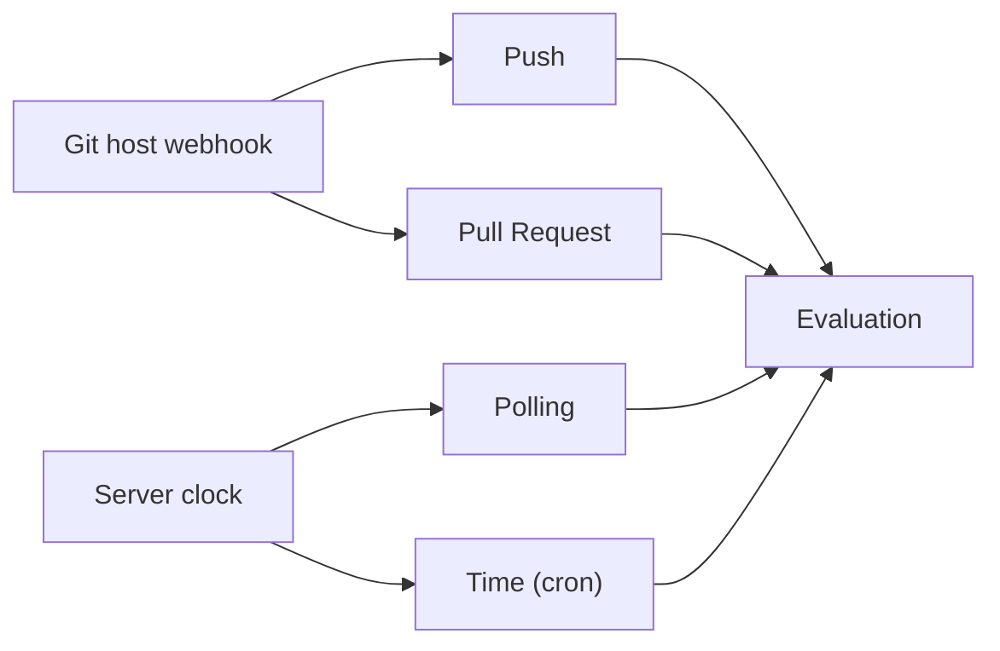

<!--
SPDX-FileCopyrightText: 2026 Wavelens GmbH <info@wavelens.io>
SPDX-License-Identifier: AGPL-3.0-only
-->

# Triggers

Triggers determine when to evaluate a task and which commit to use for that evaluation. Git host triggers react to webhooks in seconds. Polling triggers and cron triggers need no webhook. They work with any Git remote.

| `type` | UI label | Fires on | Commit already evaluated |
|---|---|---|---|
| `polling` | Polling | A new head commit on the polled branch | Skipped |
| `time` | Time (cron) | Each time of the cron schedule | Evaluated again |
| `reporter_push` | Push (reporter) | A push, a release or a merge queue entry | Skipped |
| `reporter_pull_request` | Pull Request (reporter) | A pull request event or a `/gradient run` comment | Skipped, except for `/gradient run` |

A task can have triggers in any combination. Use [declarative state reference](../reference/state.md#trigger-types) to list the options for each type. Use [concurrency table](projects-and-tasks.md#concurrency) to get the branch name of each evaluation.

Git host connections do not add triggers to a task. The **Triggers** page of a task and the last step of **Connect repository** suggest push and pull request triggers. These suggestions appear when the project can use a Git host connection that can receive events and match the repository host. Suggested triggers start unchecked. The same suggestions come from `GET /projects/{project}/trigger-suggestions?repository=<URL>`.

## Polling

- **Interval**: `interval_secs`, at least 10, default 300. Each round can include a random delay of up to 10% of the interval to spread load across many tasks.
- **First Round**: Immediately after creation or enabling.
- **Branch**: `branch`, or the remote default branch if that branch is absent.
- **New Commit**: An evaluation can start only for a remote head that is different from the branch's latest evaluation.
- **Skip Markers**: A head commit with a [skip marker](projects-and-tasks.md#skip-a-commit) starts no evaluation.
- **Fallback**: Polling triggers next to active push triggers catch only missed webhooks. A **Pause polling** button on the **Triggers** page can pause the polling trigger.

## Time (cron)

- **Schedule**: `cron` expression. Always UTC. Schedule checks happen on the server every 5 seconds.
- **First Fire**: The first scheduled time after trigger creation. A new trigger doesn't run right away.
- **Commit**: the HEAD of `branch`, or the HEAD of the remote default branch if `branch` is absent. A trigger can evaluate that HEAD even with no new commits.
- **Downtime**: A restart can combine all schedule times missed while the server was down into one evaluation.
- **Fields**: 5 fields as in crontab, or 6 or 7 fields with a seconds field added at the start. Gradient stores a 5-field expression with the seconds field `0`.

| Position | Field | Values |
|---|---|---|
| 1 | Second | `0`-`59` |
| 2 | Minute | `0`-`59` |
| 3 | Hour | `0`-`23` |
| 4 | Day of month | `1`-`31` |
| 5 | Month | `1`-`12` or `Jan`-`Dec` |
| 6 | Day of week | `1`-`7` with `1` = Sunday, or `Sun`-`Sat` |
| 7 | Year, optional | `1970`-`2100` |

- **Operators**: Use `*` for any value, `a-b` for ranges, `a,b` for lists, and `*/n` or `a/n` for steps. The two day fields read `?` as `*`.
- **Names**: Day names and month names are case-insensitive, even in ranges like `Mon-Fri`.
- **Shorthands**: `@hourly`, `@daily`, `@weekly` (Sunday at 00:00), `@monthly`, `@yearly`.
- **Both Day Fields**: Always require both a restricted day of month and a restricted day of week to match. `0 0 0 13 * Fri` can fire only on Friday the 13th.

!!! warning
    Day of week values count ``1`` as Sunday. Classic crontab rules define ``1`` as Monday. The day of week and month fields reject ``0`` in the 5-field format too. Day names avoid the off-by-one trap.

| Expression | Fires |
|---|---|
| `0 2 * * *` | Daily at 02:00 UTC |
| `30 6 * * Mon-Fri` | Monday to Friday at 06:30 UTC |
| `0 0 */6 * * *` | Every 6 hours, at 00:00, 06:00, 12:00 and 18:00 UTC |
| `0 3 1 * *` | On the first day of each month at 03:00 UTC |

## Flake Input Updates

Tasks with an active **PR** action and tracked flake inputs start an input update at each polling or cron fire. These updates replace a normal evaluation. See [Update Flake Inputs](../guides/flake-updates.md).

A push trigger with `include_flake_inputs` set can also start an input update on a push to the repository of a tracked input. See [Pushes to Flake Inputs](#pushes-to-flake-inputs).

## Push

Push triggers need a connection to a Git host that can receive events. Select that connection on the **Repository** page of the task. See the [GitHub](../guides/github.md), [Gitea or Forgejo](../guides/gitea.md), or [GitLab](../guides/gitlab.md) guides. Add a push trigger on the **Triggers** page.

| Event | Fires when | Filter |
|---|---|---|
| Branch push | `releases_only` is off | `branches` against the pushed branch |
| Tag push | `releases_only` is off | `tags` against the pushed tag |
| Release | `releases_only` is on | `tags` against the tag of the release |
| GitHub merge queue entry | `releases_only` is off | `branches` against the target branch of the queue |

- **Patterns**: `*` can match any text, and `/` can appear inside that match. All other characters match only themselves.
- **Empty Filter**: An empty `branches` or `tags` list can match everything. Triggers with no filter fire on every branch push and every tag push.
- **Releases Only**: Triggers ignore normal pushes and merge queue entries. Nothing can start on a tag push with no release.
- **Skip Markers**: Valid only for branch and tag pushes.

### Pushes to Flake Inputs

`include_flake_inputs` is off by default. When on, a push to the repository of a tracked flake input starts the task's input update. Such a push never starts a normal evaluation.

- **Repositories**: Match only repositories other than the task's own repository. Use owner name and repository name for matching on any host.
- **Input Types**: `github`, `gitlab`, `sourcehut`, and `git`. Tarballs, paths, and indirect inputs never match. An input that follows another input never matches.
- **Branch**: Use the ref or branch of an input in `flake.lock`. Inputs without that ref or branch follow the default branch from the webhook.
- **Ignored Events**: Pushes of tags and releases.
- **Filters**: The `branches`, `tags`, and `releases_only` settings do not apply to these pushes.
- **First Update**: Gradient can discover the input repositories during an update round. A push cannot start anything before the first update round of the task from polling, a cron schedule, or **Poll now**.
- **Webhooks**: Deliver webhooks for input repositories to the task's Git host connection. Use the GitHub App installed on the fork, or webhooks on the fork.
- **Skipped Pushes**: Tasks skip the push with reason `input_update_not_configured` when they have no active **PR** action and no tracked input. Gradient can skip a push during an active update with reason `input_update_running`.

## Pull Request

Pull request events from the Git host activate this trigger. Push events don't activate this trigger. A push to the source branch of a pull request can reach Gradient twice. Push events go to the Push trigger. Pull request events with action `synchronize` go to the Pull Request trigger.

| Option | Matches |
|---|---|
| `actions` | Action names of the event, by default `opened`, `synchronize`, `reopened`. An empty list fires on every action. |
| `branches` | The source branch of the pull request, not the target branch |
| `require_approval` | Pull requests from forks wait for a maintainer, by default on. A pull request from the same repository or by a repository writer starts right away |

- **Action Names**: GitHub names stay as sent. GitLab names map to `opened`, `synchronize`, `reopened`, `closed` and `merged`.
- **Missing Event**: Webhooks without a pull request event, or `actions` without `synchronize`, block evaluation for a push to a branch with a pull request.

Users with write permission to the repository can steer a pull request with comments. One command per comment. Quoted lines that start with `>` contain no command.

| Comment | Effect |
|---|---|
| `/gradient run` | Release of a waiting pull request. Otherwise a new evaluation of the current head commit, even when that commit got evaluated before |
| `/gradient run <wildcard>` | The same with a different [wildcard](../reference/wildcards.md) |
| `/gradient approve` | Release of a pull request waiting for approval |
| `/gradient summary` | One comment with the built, failed and unchanged packages, updated after every push |

`/gradient run` fire pull request triggers with action `synchronize`. Triggers without `synchronize` in `actions`, or with a `branches` filter that does not match, ignore that command.

## Related

- [Projects and Tasks](projects-and-tasks.md): Default triggers, skip markers, concurrency
- [Declarative State](../reference/state.md#trigger-types): All trigger options
- [Update Flake Inputs](../guides/flake-updates.md): Polling and cron triggers for pull requests on `flake.lock`
