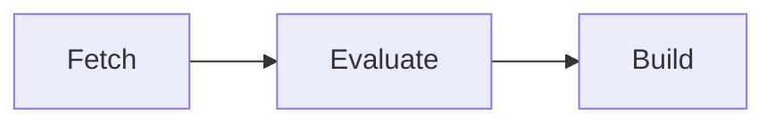

# Workers

A **worker** is a machine with `gradient-worker` installed. Workers connect to the server, take jobs from the queues of projects with the worker feature enabled, and return the results to the server. The server holds no Nix. A worker handles every clone, evaluation and build.

## Capabilities

Each worker declares which job kinds it accepts. Three kinds exist.

| Capability | Job |
|---|---|
| Fetch | Clone the repository and download the flake inputs |
| Evaluate | Walk the flake and report derivations |
| Build | Build derivations and upload the outputs |

A single machine can handle all three kinds. Splitting them across machines also works: one machine with a lot of memory can evaluate, while several smaller machines build.

## Matching Builds

Builds only go to workers supporting the derivation's system (e.g. `aarch64-linux`) and every required system feature (e.g. `kvm`, `big-parallel`). Systems come from `worker.system.architectures`, with the host platform as default. Features come from the local Nix of the worker. `worker.system.features` can override the detected features.

The scheduler will score each queued job among the matching workers. The scheduler will also keep heavy builds and evaluations away from workers lacking free memory for the predicted peak. Earlier builds are the source of this prediction. `services.gradient.worker.build.metrics` can record the per-build measurements behind this prediction.

## Zones

Workers in a single datacenter can share a zone label, `services.gradient.worker.zone`. By default, workers carry no label. A [cluster job](../contributors/scheduler/clusters.md) that needs a fast interconnect places all of its members in one zone. Workers without a label together form one unnamed zone.

`services.gradient.worker.endpoint` specifies the address at which cluster peers can reach a worker. At cluster start, the server hands every member the endpoints of all other members.

## Access

| Kind | Registered | Serving |
|---|---|---|
| Project worker | Under one project | That project |
| Team worker | Under one [team](teams.md) | Every project granting the team's workers |
| Local worker | On the server host, automatically | Every new project, as a worker of the state-declared team `server` |

Workers only receive jobs from projects with a cache subscription.

## Team Workers

Each [team](teams.md) can have workers. A team worker works with a single token for the entire team. Projects that granted the team get read-only access to these workers.

Manage team workers on the team's **Workers** page.

| Setting | Effect |
|---|---|
| Grant with workers | Team worker active in the project |
| `new_projects.workers` | Team workers granted to every new project |
| `enabled` | Global switch for the worker in every granted project |

A worker ID can point to a team worker or to a set of project registrations. Never to both at once.

## Worker Stop

Workers can stop at any time. This include throwaway VMs. A stop never lose a job.

- The stopping worker will announce draining. The server will then send no new jobs.
- The worker will abort its running jobs.
- The server will queue those jobs again for other workers.

## Related

- [Quick Start](../get-started/quick-start.md): run a worker locally
- [Add a Remote Worker](../guides/remote-worker.md): hook up extra build machines
- [Evaluations and Builds](evaluations-and-builds.md): the work a worker performs
