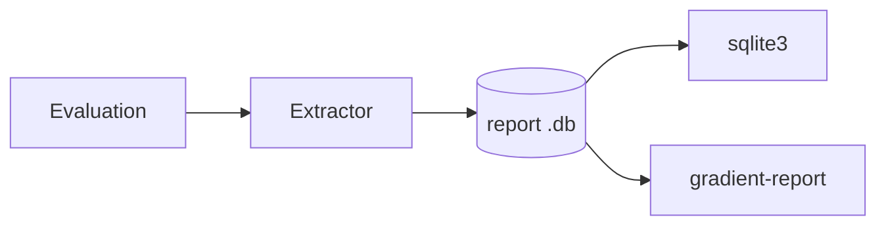

# Diagnostic Reports

A diagnostic report is one SQLite file with tables never shown in the UI. These are assignment conditions on `derivation_build`, the attempt history behind a self-heal loop, disconnect reasons, upstream probe metrics and the resolved server settings. Generation and attachment are part of [Report a Bug](../guides/diagnostic-report.md). The file's contents and the way to read the data are the topic of this page.



## Code

| Part | Path | Role |
|---|---|---|
| Extractor | `backend/gradient-report` | Writing the SQLite file: `schema.rs` (tables, `SCHEMA_VERSION`), `extract.rs`, `redact.rs`, `logs.rs`, `config_snapshot.rs` |
| Inspector | `nix/tools/report-inspector` | The `gradient-report` tool: Python stdlib only, running on any maintainer machine. Pytest suite in `tests/`, executed by the package build |

## Anonymisation

- Stable pseudonyms, not deletion. Equal inputs map to the same token within one report (`repo-a1b2`, `worker-7f3c`). Dependency reasoning will still work.
- A fresh salt per report. Two reports of one instance cannot be correlated. The salt is never written.
- Free text (build logs, commit messages) is rewritten against every pseudonym in one pass, shared across all logs.
- The rewrite cost will grow with the report size, not size times package count.
- Nix store **hashes always stay**. They are one-way and let a maintainer check a path against a public cache.

| API parameter | Default without the parameter |
|---|---|
| `anonymize_identities` | `true` |
| `anonymize_packages` | `false` |
| `include_logs` | `true` |
| `include_instance` | `true`, requiring `manageWorkers` |

All four values get sent explicitly by the dialog on every call.

## Never Exported

- No export contains API keys, sessions, device-authorization records, worker token hashes, upstream cache keys, password hashes or Git host credentials. These fields stay absent from the output rather than redacted.
- The extractor names every exported column. A secret column added to a table later cannot appear in exports, because the extractor never picks it up.
- The `cached_path_signature` export holds only a flag that a signature exists. The signature value itself cannot appear.

## Scope

The `report_manifest` table records, for each table, how many rows existed and how many the report included, along with the scope and the filter. A report that lacks logs states this explicitly, so it can never pass as an evaluation without logs.

| Scope | Tables |
|---|---|
| This evaluation only | The evaluation's own rows in `dispatched_job` and `dispatched_job_phase` |
| Shared builds | `build_attempt`, `phase_event`, `derivation`, `derivation_build`, `derivation_output`, `derivation_dependency`. Rows created for other evaluations of the same derivation, including older attempts |
| Whole instance | `worker_registration`, `team_worker`, `upstream_metric` |
| This project | `team_project` |
| This evaluation's derivations, while it ran | `derivation_metric` |
| Workers of this evaluation | `worker_connection` and `worker_sample`, from worker creation until finish or until the report |

- Check the `scope` column before trusting any count.
- `worker_connection` and `worker_sample` carry no project. Their telemetry rows describe the worker itself.
- Under a fleet of team workers, `worker_registration` stays empty. Worker names live in `team_worker`.

## Closure Boundary

The start counters count edges. The far end of every edge is in the file. An absent row will then show that the *instance* never had the path, not a skipped export.

| Table | Contents |
|---|---|
| `derivation`, `derivation_build`, `derivation_output` | The evaluation's derivations **and their direct dependencies** |
| `derivation_dependency` | The evaluation's own edges with `kind`, both ends exported |
| `cached_path` | Those derivations' outputs **and every path they reference** |
| `build_job` | The evaluation's jobs **and every job an exported attempt was running under** |

- One hop is enough. The `blocking_deps` counter will count one per build edge and read the dependency's own shared build, outputs and cached paths.
- Deeper levels are summarised in the dependency's stored `blocking_deps`.
- `missing_runtime_deps` is the same count over the runtime dependencies (`derivation_dependency.kind IN (1, 2)`).
- A dependency row without a `build_job` row is evidence, not work of its own. The `why-stuck` command can tell the two apart this way.
- The `build_job` table can reach past the evaluation. The substitute-miss budget is scoped per `(shared build, evaluation)` through `build_attempt.build_job`.

## Queries

Open the file with any SQLite client.

**Substitute-miss loops** per shared build and evaluation.

```sh
sqlite3 report.db \
  'SELECT d.name, j.evaluation, count(*) AS misses
     FROM build_attempt a
     JOIN build_job j ON j.id = a.build_job
     JOIN derivation_build db ON db.id = a.derivation_build
     JOIN derivation d ON d.id = db.derivation
    WHERE a.reason = 0
    GROUP BY 1, 2 HAVING misses > 2 ORDER BY misses DESC'
```

**Job Time per Phase:** The `dispatched_job_phase` table can hold one row per span, nested through the `parent_seq` column. `phase` is the numeric discriminant, named on the [Job Board](../ui/job-board.md#job-inspection).

```sh
sqlite3 report.db \
  'SELECT j.worker_id, p.phase, p.end_ms - p.start_ms AS ms
     FROM dispatched_job_phase p
     JOIN dispatched_job j ON j.id = p.dispatched_job
    ORDER BY ms DESC LIMIT 20'
```

`dispatched_job.outcome`: `0` completed, `1` failed, `2` abandoned (disconnect, restart, overdue abort), null while running.

**Cached but Not Delivered:** The cache will only deliver a path with a `cached_path_signature` row for that cache and `signed = 1` set. The query below will join both. Without such a row, a stored path is present for the graph but not deliverable.

```sh
sqlite3 report.db \
  'SELECT cp.package, s.cache_name, s.signed
     FROM cached_path cp
     LEFT JOIN cached_path_signature s ON s.cached_path = cp.id
    WHERE s.id IS NULL OR s.signed = 0'
```

**Incomplete Closures:** A shared build has a *complete closure* when two conditions hold: each output has a NAR, and `missing_runtime_deps` count at zero. The `fetchable` flag and all assignment conditions read this state. A non-zero count blocks every assignment from trusting the shared build. A negative count points to a lost counter update.

```sh
sqlite3 report.db \
  'SELECT d.name, b.missing_runtime_deps
     FROM derivation_build b JOIN derivation d ON d.id = b.derivation
    WHERE b.missing_runtime_deps <> 0
    ORDER BY b.missing_runtime_deps DESC'
```

- `cached_path.references` is the narinfo `References:` line behind the count, for checking a counter by hand.
- The server will recount table-wide on every consistency check and log mismatches as `runtime_drift` entries.
- `commit` is a reserved word and is only queryable in quotes as `"commit"`.

## Signs in the Data

| Shape | Meaning |
|---|---|
| Evaluation stuck in `EvaluatingFlake` / `EvaluatingDerivation` with a `finished_at` on the newest eval job | The terminal report did not arrive. The `eval-completion-watchdog` pass can re-drive the transition |
| `evaluation_input_update` row present on an active evaluation | No further input-update round for the task can start while that row stays active. A wedged row blocks the flake updater |
| Shared build in `Created` with `cache_available` and not wanted | No process will fetch the shared build. A cached output that references its path remains without a complete closure |

## Inspector

The `nix develop` shell has `gradient-report` on `PATH`. Outside the shell, run `nix run .#gradient-report`.

| Command | Output |
|---|---|
| `summary` | Status, timings, build and failure counts (default) |
| `timeline` | Phase events, assignments and attempts in order |
| `why-stuck` | The condition holding each waiting shared build |
| `failed` | Failed attempts. Dump one log with `--log ATTEMPT` |
| `workers` | Registration and connection history |
| `manifest` | The report's contents and omissions |
| `estimate-accuracy` | The recorded time estimate of each job against the job's phases. List the jobs of an element with `--element NAME` |
| `sql "QUERY"` | Raw access |
| `store-spec -o FILE` | A `gradient-daemon` store spec replaying the evaluation |

Start with **`why-stuck`** on a hung evaluation. The command covers every shared build driven by the evaluation that never finished.

- The output names the holding condition (`walked`, `wanted`, `probed`, `blocking_deps`).
- The output lists every dependency below that is not `fetchable` yet.
- A complete `.drv` closure appears as the only condition left when that closure is absent from the report.

```text
vendor-registry: Queued, waiting on walked, blocking_deps = 1
    dep openssl-3.6.3 is a stub: never walked
    dep curl-8.21.0 walked over 2 unwalked inputs
```

| Dependency line | Meaning |
|---|---|
| `not in this report` | The row is absent from the file. A closed export has none, reports before schema 12 many |
| `is a stub: never walked` | A walk named the derivation but never read the derivation |
| `walked over N unwalked inputs` | `derivation.unwalked_inputs`: a subtree below was never recorded, as after a walk abandoned between batches |

- The `wanted` condition is outside the `(cache_available OR blocking_deps = 0)` arm. The `wanted` marking stops at passthroughs and finished builds.
- The line `ed-1.22.5: Created, waiting on wanted` describes a shared build nothing will ever fetch.
- A stub or unwalked line can point at the walk, not the build.

**`estimate-accuracy`** compares the time estimate of each finished job with the phases the worker recorded.

| Element | Phase |
|---|---|
| `download` | `NarFetch` |
| `paths` | `Prefetch` without its `NarFetch` spans |
| `build` | `Build` |
| `substitute` | `SubstituteFetch` and `Download`, for jobs without a `Build` span |
| `upload` | `Compress`, with `NarPush` and `UploadWait` inside |
| `eval`, `total` | `dispatched_job.worker_elapsed_ms` |

- Ratios above `x1.00` mark jobs slower than their estimate.
- The `zero` column counts jobs with an estimate of 0 that still took time.
- The `fallbacks` lines name the inputs the estimate had to guess. Their ratios stand against the jobs without the guess.
- `--element build` lists the build jobs, the worst estimate first.
- The out of memory line also counts failed jobs. A build killed for memory ends its job.

## Schema Versions

- The inspector reads one schema only. Version 20 works; all others get rejected with an error that names both the expected and the actual version.
- A schema bump requires two changes in lockstep: `SCHEMA_VERSION` in `backend/gradient-report/src/schema.rs` and `SUPPORTED_SCHEMA` in `nix/tools/report-inspector/gradient_report/db.py`.
- While these two values differ, the inspector package cannot be evaluated.
- Schema versions move independently of releases. Version 1.3.0 contained the jump from 12 to 16.
- Build the matching inspector with `nix build .#gradient-report` on the revision that produced the report.
- A `nix develop` shell opened before a schema bump keeps the old inspector. Re-enter the shell to pick up the new one.
- Reports older than schema 19 lack the `team_worker` table.
- Reports older than schema 20 lack the `derivation_metric` table, `worker_elapsed_ms` and estimates.
