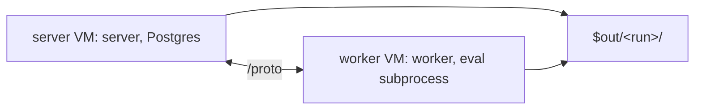

# Eval Benchmark

`gradient-evalbench` can measure how much eval time the server and the eval worker each take. The benchmark uses a NixOS VM test on the e2e hello flake with four passes. Every pass leaves one capture bundle in the output directory. Open a bundle in a viewer to drill into the details.



## Running

```sh
nix build .#gradient-evalbench -L
cat result/summary.txt
```

- `nix flake check` skips the benchmark. Perf and strace slow it down and produce noisy output.
- A Gradient-built benchmark exposes four downloads on the evaluation page through its `nix-support/hydra-build-products` file.
- The downloads: `evalbench.tar.gz` (the full bundle), `summary.txt`, `summary.json` and `index.html` (the [report](#report)).
- The builder needs the `kvm` and `nixos-test` system features.
- The summarizer ships with its own cheap check: `nix build .#checks.x86_64-linux.evalbench-summarize`.

## Benchmark Passes

| Pass | State before | Captured data |
|---|---|---|
| `cold-clean` | Fresh `gradient` database, worker eval cache empty | Spans, pcaps, Postgres statistics, wait samples |
| `warm-clean` | The same commit, evaluated a second time | Spans, pcaps, Postgres statistics, wait samples |
| `cold-instrumented` | Database reset in the same way as `cold-clean` | Spans, perf, strace, `auto_explain` |
| `warm-instrumented` | The same commit, evaluated a second time | Spans, perf, strace, `auto_explain` |

- A cold reset drops the database and recreates it. The server re-provisions the database from `services.gradient.state`.
- Fetched sources stay in the worker's Nix store.
- Capture runs from the start of the manual evaluation until the evaluation leaves the `EvaluatingDerivation` status.
- The pass waits for `Completed` before the next pass can start.
- `summary.txt` covers only the `cold-clean` and `warm-clean` passes. Perf, strace and `auto_explain` distort timings.
- The test can fail only on a failed evaluation or a missing capture file. No timing thresholds apply.

## Multinode Benchmark

Use `gradient-evalbench-multinode` to measure the speedup of [split evaluations](scheduler/clusters.md#split-evaluations) on 1 to 4 eval workers.

```sh
nix build .#gradient-evalbench-multinode -L
cat result/summary.txt
```

| Part | Setup |
|---|---|
| Server | One VM with 4 cores and 8 GiB |
| Workers | Four eval-only VMs with 4 cores and 6 GiB each, `eval.maxConcurrent = 1` |
| Links | `netem` on every worker: 40 ms delay and 100 Mbit in each direction, 80 ms round trip |
| Large flake | `hydraJobs.perl` and `hydraJobs.python` from nixpkgs, task wildcard `hydraJobs.**` |
| Small flake | The e2e hello flake |

- Cost estimates come from a warm-up evaluation of the large flake on a single worker.
- Measured rounds commit a changed comment, wipe the worker eval caches, collect garbage, then stop the surplus workers.
- Wall clock measures the first start to the last end of the `eval_flake` and `eval_derivations` phases across all jobs.
- Statements come from `pg_stat_statements` calls of the `gradient` role, reset before each evaluation.

| Target | Check |
|---|---|
| Speedup | Wall clock on 1 worker divided by the wall clock on N workers, at least 0.8 x N, on more than one job |
| Statements | At most 10 extra statements per finished shard, compared to 1 worker |
| Small flake | One job with 4 workers up, at most 10% slower than standalone |

- A missed target can fail the test. The failure can only occur after `summary.txt` and `evalbench-multinode.tar.gz` exist.
- Set at least 20 CPUs on the builder. QEMU threads of each VM pin to separate cores. Fewer CPUs trigger an immediate test failure.
- The report check can run with `nix build .#checks.x86_64-linux.evalbench-multinode-report`.

## Report

The `gradient-evalbench-inspector` tool turn a bundle into a single self-contained HTML page. Each chart can also appear as a standalone SVG next to that page. The benchmark itself place its bundle in the `result/report/` directory. A downloaded bundle work with the same tool.

```sh
nix run .#gradient-evalbench-inspector -- evalbench.tar.gz -o report
xdg-open report/index.html
```

- **All passes:** Mode, evaluated seconds, traced wall time, `evaluation_metric`, and span totals, shown side by side.
- **Assignment per pass:** The assignment path. Each step from the evaluate request down to the worker's `job` span, plus the wait before each step.
- **Jobs per pass:** Job phase totals, plus a phase Gantt chart for each assigned job.
- **Spans per pass:** A span timeline with one lane per process, a span flame graph folded by nesting, and span totals.
- **Database per pass:** The `pg_stat_statements` view, `auto_explain` statements ranked by total plan time, and the slowest plans.
- **CPU per pass:** The perf flame graphs.
- Hover over any bar to see its details in a title tooltip.
- The page directory also hold a copy of `<run>/trace.json` for Perfetto.

## Bundle

| Path | Open with | Contents |
|---|---|---|
| `summary.txt`, `summary.json` | Any editor | Per pass: wall time, worker clock offset, `evaluation_metric`, spans ranked by total time |
| `<run>/trace.json` | [ui.perfetto.dev](https://ui.perfetto.dev) | Server, worker and eval subprocess on a single timeline |
| `<run>/trace/*.jsonl` | `jq` | Raw spans, one file per process |
| `<run>/proto.pcap` | Wireshark | Worker to server `/proto` traffic: round trips and frame sizes |
| `<run>/pg.pcap` | Wireshark (`pgsql` dissector) | Every statement the server sent, with latency |
| `<run>/pg/pg_stat_statements.json` | `jq` | Top 100 statements of the `gradient` role by total time, including planning time |
| `<run>/pg/wait_samples.json` | `jq` | State and wait event of busy `gradient` backends, sampled every 100 ms (clean passes) |
| `<run>/pg/job_phases.json` | `jq` | Job phases as reported by the worker (`dispatched_job_phase`) |
| `<run>/pg/auto_explain.log` | Any editor | `ANALYZE` plans for every statement, without per-node timing (instrumented passes) |
| `<run>/perf.data`, `<run>/flame.svg` | `perf report`, a browser | CPU profile of the server VM (instrumented passes) |
| `<run>/worker/perf.data`, `<run>/worker/flame.svg` | `perf report`, a browser | CPU profile of the worker VM, eval subprocess included |
| `<run>/worker/strace/worker.<pid>` | Any editor | Syscalls with timestamps and durations, one file per thread and child |
| `<run>/run.json` | `jq` | Evaluation id and the number of seconds until the evaluation left `EvaluatingDerivation` |

## Spans

Set `services.gradient.log.traceDir` and `services.gradient.worker.log.traceDir` in the [Configuration](../reference/configuration.md). With a trace directory in place, each process writes every closed `gradient*` span at level `debug` or higher as a single JSON line. The console log level does not change this output.

```json
{"name":"flush","target":"gradient_graph::writer","ts_us":1759140000123456,"dur_us":8123,"pid":812,"process":"server","fields":{"batches":2,"rows":100}}
```

| Process | Spans |
|---|---|
| `server` | `assign_queued_evals`, `offer_jobs`, `on_request_job_chunk`, `record_scores`, `on_request_job`, `request_job`, `claim_dispatch`, `send_credentials`, `assign_job`, `job_event` (`kind`, `queue_wait_us`), `handle_eval_result`, `record`, `flush`, `record_one`, `commit_one`, `transact_once`, `apply_batch` plus one span per batch step, the `advance_can_start` steps (`lock_seed_shared_builds`, `became_fetchable`, `seed_blocking_deps`, `promote`, `unpromote_ungated`, `emit_transition_effects`, `move_batch_need`), `after_commit`, `known_derivations`, `eval_stream_completed`, `on_upload_request`, `on_upload_admitted` (`already_stored`, `open_transfer`), `on_upload_chunk`, `on_upload_finished`, `upload_commit` (`place_upload`, `upload_graph_commit`) |
| `worker` | `on_job_offer`, `score_candidates`, `send_scores`, `request_job`, `job`, `fetch_repository` (`clone_and_checkout`, `run_input_update`, `fetch_inputs`, `missing_paths`), `evaluate_flake`, `evaluate_derivations`, `wave`, `parse_drv_wave`, `query_known_derivations`, `report_eval_result` |
| `eval` | `open`, `lock_flake`, `discover`, `plan_shards`, `resolve` (`attr`) |

- Subtract `flush` from `record` to get the time a batch spent waiting in the graph writer's mailbox.
- `job_event.queue_wait_us` measures how long a report waited behind earlier reports from the same worker.

## Clock Alignment

Server and worker run on separate VMs, so their clocks differ. `summarize.py` shifts the worker and eval subprocess spans onto the server clock.

- Upstream pairs: the n-th `report_eval_result` of a job matched with the n-th `job_event` of the same job where `kind = eval_result`. Receive time: start minus `queue_wait_us`.
- Downstream pairs: the end of `assign_job` matched with the start of the worker's `job`.
- Offset: (minimum upstream delay - minimum downstream delay) / 2. The fastest message in each direction then carries the same delay.
- A pass without pairs in both directions will remain unaligned (`offset 0`, marked `unaligned`).
