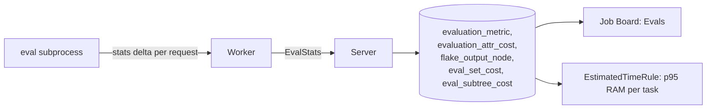

<!--
SPDX-FileCopyrightText: 2026 Wavelens GmbH <info@wavelens.io>
SPDX-License-Identifier: AGPL-3.0-only
-->

# Evaluation Metrics

Each evaluation run produces metrics, collected the same way build jobs collect resource metrics. The Job Board's **Evals** tab shows these numbers. They also drive routing: evaluations that need a lot of RAM go to large machines.

## Tables

| Table | Contents |
|---|---|
| `evaluation_metric` | Per evaluation: thunks, function calls, primop calls, lookups, allocated bytes, peak GC heap and RSS (MB), `total_eval_ms`, `worker_id`, plus the phase columns `fetch_ms`, `eval_flake_ms`, `eval_drv_ms` |
| `evaluation_attr_cost` | Per attribute: thunks, function calls, wall clock and allocated bytes of resolving its derivation. The discovery walk of a request stays with its wildcard target |
| `flake_output_node` | The walked flake-output tree: `path`, `parent`, `name`, `kind`, `is_derivation`, `drv_path` |
| `eval_set_cost` | Per task and split attribute set: estimated startup cost (`startup_ms`), peak RSS (MB), sample count |
| `eval_subtree_cost` | Per task and subtree (one child of a split set): estimated attribute count, wall clock per attribute, sample count |

- The Nix stats do not contain the phase columns.
- The phase columns hold the sum of the job timeline's `fetch`, `eval_flake` and `eval_derivations` spans. The server computes them on the job's terminal message.
- The phase columns read 0 between `EvalStats` and completion. They also stay 0 when the worker vanished before reporting. Phase names appear on the [Job Board](../ui/job-board.md#job-inspection).
- Eval subprocesses measure every attribute they resolve. The resolver adds these costs up over all requests of an evaluation.
- `worker_id` is the session id of the reporting worker, never a value from the report.
- `flake_output_node` records only the nodes visited by the discovery walk. No extra evaluation happens.
- The frontend renders the rows as a `nix flake show`-like tree.

## Cost Estimates

Two estimate tables predict the cost for each flake part. Paths persist across commits. Segment lists (`text[]`) hold those paths.

- Split sets hold the attribute path before the first wildcard of a listing call (`packages.*.*` -> `[packages]`).
- `EvalStats` reports update the rows of the task with a moving average. The new sample and the stored value each weigh half.
- Workers take startup samples from fresh eval subprocesses only. The attributes of a call add nothing to its walk time.
- Compute a startup sample as the walk time of the first call of a subprocess minus the median walk time of later calls of that set.
- Sets listed only by reused subprocesses keep their stored startup cost.
- Rows without an update for 30 days disappear on the next report of the task.
- Tables take one statement per 1000 rows, never one per attribute.

## RAM Routing

`EstimatedTimeRule` (see [Scoring](scheduler/scoring.md)) can use a rolling per-task p95 of `peak_rss_mb` from the last 24 h. Predicted RAM above a worker's free memory can add the expected time of a repeated evaluation to the score. Tasks with heavy memory needs then go to workers with large free memory. As evaluations finish, the prediction can improve on its own, with no manual thresholds.

## Endpoints

| Endpoint | Response |
|---|---|
| `GET /api/v1/board/evals/expensive-by-resource?metric=...&window_days=N` | Project-scoped rankings of evaluations by `time`, `rss`, `heap`, `thunks`, `fncalls` or `alloc`. The `metric` parameter must match a closed list of values |
| `GET /api/v1/evals/{evaluation}/flake-graph` | The full flake-output tree for a single evaluation, produced by walking it |

## Overhead

- `GRADIENT_WORKER_EVAL_METRICS` controls capture. It defaults to `true`. Set it to `false` to skip the stats read entirely.
- With capture on, each resolver request triggers one cumulative-counter read per worker, and the metrics come from diffing those counters. No `--count-calls`-style instrumentation involved.
