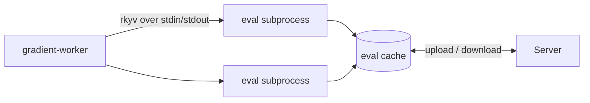

# Eval Worker Setup

Flake evaluations take place in a pool of `--eval-subprocess` processes driving the embedded Nix C API. The pool can split one evaluation into shards. The pool can spread those shards across its subprocesses. The pool can size itself to the host's memory. Results land in a local eval cache per locked flake. Workers share new cache rows with the fleet through the server. See [Shared Eval Cache](#shared-eval-cache). Repeat evaluations of the same locked flake hit the cache on most runs.

## Subprocess IPC

- **Frames:** each frame start with a `u32` little-endian length prefix, followed by an rkyv payload (`gradient-eval/src/ipc.rs`).
- **Version byte:** before the first frame, subprocesses write `EVAL_IPC_VERSION` (currently 15). A binary swapped mid-evaluation then fail the handshake instead of sending undecodable frames.
- **Fetch byte:** parents reply with one byte. Subprocesses given `1` ask the parent for [missing inputs](#missing-inputs). Subprocesses given `0` let Nix download them.
- **Responses:** each request pair with one response. `Stats` ticks and [build requests](#import-from-derivation) can arrive before that response. `List` responses carry the derivation path of every attribute found, resolved in the subprocess that forced the attribute.
- **Shards:** `Plan` can split each include at its first wildcard.
    - With more segments after the wildcard, each child receive a sub-pattern (`packages.**.hello` -> `packages.x86_64-linux.hello`).
    - With the wildcard at the end, the pattern stay unchanged and the child names (`only`) get read without forcing any child.
    - The parent can list those names in batches of `names / (pool * 4)` (at most 64).
    - `List` can restrict the first wildcard to one batch.
- **Deferred sets:** under a trailing `**`, `List` can skip the children of a nested set (all checks of a system).
    - Those children appear in `deferred` as a `*` shard.
    - The parent can queue those names in batches.
    - One heavy set then spread across the pool instead of keeping one subprocess busy while the rest sit idle.
- **Warm walker:** a subprocess can keep one walker (locked flake plus open eval cache) across consecutive requests for the same repository. A Plan / List sequence then pay for the lock and the cache open only once.

## Import From Derivation

An import from a derivation (IFD) requires a build in the middle of an evaluation. Subprocesses cannot build through the local daemon. The parent has to request a Gradient build from the server instead.

| Frame | Direction | Content |
|---|---|---|
| `NeedsBuild` | subprocess -> parent | `derived_paths`: `.drv` paths with their outputs (`/nix/store/<hash>-x.drv^out`) |
| `BuildDone` | parent -> subprocess | `error`: empty after a successful build |

- The patched Nix of Gradient can hand an import to a realise hook instead of the local daemon.
- The hook in the subprocess must send `NeedsBuild` and block until `BuildDone` arrives.
- A different request during the wait counts as a protocol error. Subprocesses then stop reading and exit.
- Nix can raise the `error` of `BuildDone` as the error of the import. Later attributes with the same import receive the same error.

### Import Builder (`gradient-worker/src/executor/dependencies.rs`)

1. Record the closure, with the imported derivation as the entry point `other.<system>.<name>` and `ifd` set. Repeated names within a job end with `-<first 8 hash characters>`.
2. Send [`ImportRequest`](proto/messages.md) and wait for `ImportResult`.
3. Pull the outputs and their closure from the Gradient cache.
4. Answer `BuildDone`, with `import from derivation '<name>' failed: build <id> <status>` after a failure.

- Requests for the same `.drv` from different subprocesses share the wait and the answer.
- Fingerprint calls, input fetches and `--eval-driver` calls all reject imports. The error message is `import from derivation is not available during <call>`.

## Missing Inputs

Evaluation subprocesses of the worker never download an input. The patched Nix of Gradient hands every missing non-`path` input to a fetch hook instead.

| Frame | Direction | Content |
|---|---|---|
| `NeedsInput` | subprocess -> parent | `request`: JSON with `builtin` (`fetchTree`, `fetchTarball` or `fetchurl`), `args` and the expected `storePath` where known |
| `InputDone` | parent -> subprocess | `response`: JSON with `storePath` and, for `fetchTree`, the locked `attrs`. Or `error` |

Workers answer from the first source holding the input.

1. The Gradient cache, for a request with a known `storePath`.
2. An [`InputRequest`](proto/messages.md) to the server, followed by a pull of the fetched path.

- The server can hand the download to a worker with `network`, plus `secrets` for an SSH URL. That worker can start one subprocess with fetch byte `0`, outside the eval pool. Downloads hold one build slot of that worker until `InputFetched`.
- Requests of one job for the same input share the wait and the answer. Failed inputs keep their error for the rest of the evaluation.
- The fetch step can request every locked input of `flake.lock` up front. Failures there remain warnings. The evaluation can retry such an input through the hook.
- `gradient eval` and the `--eval-driver` mode use fetch byte `0`.

## Parent Side

The pool code sits in `gradient-eval/src/pool/`. Both `gradient eval` and the worker drive it.

| File | Role |
|---|---|
| `transport.rs` | Subprocess handle, frame wire, typed requests. Setting `oom_score_adj` |
| `workers.rs` | Checkout and return with test-on-borrow |
| `memory.rs` | The memory guard, its victim choice and its reaper |
| `fan_out.rs` | Shard batching and crash isolation |
| `mod.rs` | The `EvalPool` facade: plan, list, fingerprint |
| `live_thunks.rs` | Live thunk counters |
| `dependencies.rs` | The seam for imports and missing inputs, with `RefuseDependencies` as the refusal |
| `download.rs` | The `@nix` log parser and the download progress seam |
| `driver.rs` | The hidden `--eval-driver <file>` mode: JSONL requests through the real transport, JSON responses out. The NixOS VM test can drive both sides of the wire through this mode from Python |

The worker adapter sits in `gradient-worker/src/worker_pool/`.

| File | Role |
|---|---|
| `resolver.rs` | `WorkerPoolResolver`, the `gradient_sources::DerivationResolver` over `EvalPool` |
| `eval_stats.rs` | Per-attribute evaluation statistics |

## Memory Safety

Evaluation memory is guarded at three layers.

| Layer | Option | Behavior |
|---|---|---|
| Recycling | `worker.eval.maxRss` (2 GiB) | Subprocesses above the limit restart **between** calls. Pool size: `worker.eval.forkWorkers`, independent of the limit |
| Free-RAM reaper | `worker.system.minFreeRamMb` (`0` = 10% of RAM, clamped to 128 MiB - 1 GiB) | Sample `MemAvailable` every 500 ms. If free RAM drops below the margin, SIGKILL the largest evaluation subprocess, chosen so its resident memory covers the whole shortfall. Wait 5 s afterwards |
| Pool ceiling | `worker.eval.maxMemory` (MiB) | Sample every subprocess every 500 ms. If the sum exceeds the ceiling, kill the largest subprocess. Wait 5 s afterwards |

- The recycle check happen after a call. A single unit (a large aggregate, IFD chains, runaway recursion) can grow the Boehm heap past the cap within one call. The reaper guard against that peak.
- No evaluation large enough to cover the shortfall means nothing is killed. The pressure then originate elsewhere.
- A fixed 1 GiB floor on a 2 GiB host killed evaluations that were never the cause (#579).
- A killed subprocess close its pipe. The parent retry the call once, then fail only that attribute.
- One bounded failure replace a host OOM that could kill the worker and strand the job. The server only register a clean disconnect.
- Idle subprocesses shut down once discovery is over. Their heaps do not sit through the rest of the closure walk.
- The next evaluation start fresh subprocesses.
- `acquire` serialise evaluations under sustained pressure and always allow one to proceed.
- `worker.system.minFreeRamMb` and `worker.eval.maxMemory` are alternatives. A worker with both set fail at startup.
- Evaluation subprocesses run with `oom_score_adj = 600` as the kernel's last resort.

## Shared Eval Cache

Workers place one SQLite file per flake fingerprint in the eval cache directory. The file name is `eval-cache-v6/<fp>.sqlite`. Rows move between workers as segments. Segments hold zstd-compressed batches of rows. Segments become separate objects on the server (`gradient-worker/src/executor/eval_cache_sharing.rs`).

| Step | Worker side |
|---|---|
| Pull | Before discovery: `EvalCachePull` with the keys of the segments already applied. The answer holds only the missing segments |
| Apply | One immediate transaction per segment. A placeholder never replaces a value or a failure. Applied rows stay out of the change log |
| Change log | Triggers on the Nix `Attributes` table: every inserted or updated row noted in `gradient_changed_attribute` |
| Export | Every 30 s and after a successful evaluation: the change log turned into segments of at most 8 MiB. Complete attribute sets hold a list of their child names. `Missing` rows stay absent from that list. Export and log clear in one transaction |
| Attribute Sets | A complete set on apply: a placeholder for every listed child without a row, then removal of the `Missing` children. A `Missing` row outside the listing of a complete parent stays out |
| Upload | Each segment kept in `gradient_unsent_segment` until the server committed the upload. A failed upload: another attempt at the next flush, also in a later job of the same fingerprint |

- **Bad Segments:** the worker can skip a segment without a valid decode and leave the segment unapplied. The next pull can offer that segment again.
- **Busy File:** a lock longer than the busy timeout (30 s) can end the apply early. Evaluations then go on with the local rows only.
- **Replaced Parents:** the export can skip a row whose parent Nix replaced in the meantime. Nix can write the row again under the new parent.

| Step | Server side |
|---|---|
| Store | A new key `eval-cache-segments/<cache>/<fp>/<uuidv7>` per upload, in the first writable cache of the project |
| Record | One `eval_cache_store` row per cache and fingerprint, plus one `EvalCacheCompact` pending delivery, delayed by 15 min |
| Compact | All listed segments merged into new segments of at most 8 MiB, without `Missing` rows under a complete attribute set. Then removal of only the listed keys. The other writable caches of the project each receive a copy of every new segment |
| Pull | A listing of every readable cache. Segments sent as presigned URLs, or inline as `EvalCacheChunk` streams |
| Heal | `CorruptEvalCache`: removal of the fingerprint's segments, `purged_at` set. A second corruption within one hour: evaluation `Failed` |

## Compared to nix-eval-jobs

| | Gradient | nix-eval-jobs |
|---|---|---|
| Parallelism | Long-lived worker pool. One evaluation can be sharded across it | Short-lived children forked from a warm parent |
| Warmth across evaluations | A persistent eval cache keyed by flake fingerprint | None. Copy-on-write warmth lasts for a single evaluation |
| Across machines | A local `<fp>.sqlite` per worker. New rows reach the server as segments every 30 s and at the end. Pulls fetch only the segments not applied yet | None |
| Concurrent writers | Shards write to one shared file, each write in its own immediate transaction. Segment apply and export take an immediate transaction too, with up to 30 s of wait for a busy file | Not applicable |
| Memory | The pool can size itself. A flake with many systems can degrade to a single shard and still complete | Manual `--workers` and `--max-memory-size` |
| Pipeline | Discovery writes rows, and build assignment can start mid-evaluation. The closure walk will skip derivations already known to the server | A JSON job stream for consumers such as Hydra |
| Failure isolation | A bad attribute turn into an error while the evaluation continue. A crashed batch come back attribute by attribute, down to the one that sank the subprocess | Per-job errors across the fork boundary |
| Compute across machines | A single-host pool today | Single host |

## Related

- [Evaluation Metrics](eval-metrics.md): per-evaluation records kept by the pool
- [Transfer](proto/transfer.md): the upload of eval cache segments (`UploadObject::EvalCacheSegment`)
- [Configuration](../reference/configuration.md#worker): a list of all worker options
