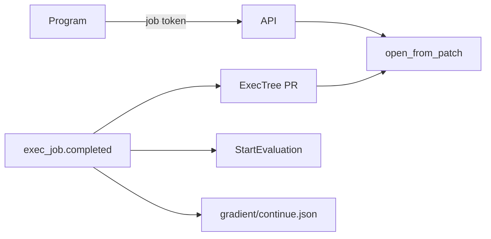

# Exec Actions

Exec jobs talk back to Gradient in two ways. Programs call the API with a job token. Finished jobs fire task actions, open pull requests and add entry points to their evaluation. The user side is in [Use Exec Job Results](../../guides/exec-job-results.md).

## Crate Map

| Crate | Part |
|---|---|
| `gradient-types` | `mint_job_token`, `hash_job_token`, `job_token_expiry`, `ContinueFile`, `ActionConfig::StartEvaluation`, `PatchGeneratorKind::ExecTree` |
| `gradient-web` | `Principal`, `job_scope`, `POST /tasks/{project}/{task}/pull-requests` |
| `gradient-ci` | `pull_requests::open_from_patch`, `execute_exec_tree_pr`, `execute_start_evaluation`, `CheckContextKind::ExecJob` |
| `gradient-graph` | `continuation_ended` and the continuation hooks in `exec.rs` |
| `gradient-scheduler` | Token minting, `assign_continuations` |

## Job Principal

`decode_jwt` can resolve a `GRJ_` token through `tokens::resolve` before the `GRAD` branch. Revoked and expired tokens answer `401`.

| Part | Value |
|---|---|
| Principal | `Principal::Job(JobPrincipal { job, attempt, project, task })` as a request extension |
| Acting user | `COALESCE(evaluation.started_by, task.created_by)` |
| Mask | `job_mask()`: `ViewProject` and `TriggerEvaluation` |
| Project pin | `ApiKeyContext.project = Some(job.project)` |

- Permission checks narrow to the read and trigger rights of the acting user.
- `job_scope` can add a `403` with `job tokens only reach their own project and task`. Without the scope check, the project pin alone can answer `404`.
- `authorize` and `authorize_optional` both call `job_scope`. Job tokens on a public route of another project never fall back to an anonymous read.

| List | Routes |
|---|---|
| `JOB_READ_PREFIXES` | `GET` and `HEAD` under `/projects/{project}`, `/tasks/{project}`, `/evals/{evaluation}`, `/builds/{build}`, `/exec-jobs/{job}` |
| `JOB_WRITE_ROUTES` | The `/build-requests/*` upload and dispatch routes, `POST /evals/{evaluation}/builds`, `/builds/{build}/log`, `/tasks/{project}/{task}/evaluate`, `/tasks/{project}/{task}/pull-requests` |

- `project` path parameters match the job's project name or ID only. `task` parameters match its task name or ID only.
- Build requests with a job token get their own job as `evaluation.parent_exec_job`. No job can claim a different parent.

## Pull Requests from a Patch

`open_from_patch` can open or update a pull request from a unified diff. The in-job endpoint and the `ExecTree` generator share the service.

1. Find the active `open_pr` action of the task (`pull_request_integration`). No action: `NoIntegration`.
2. Clone the start commit into a fresh checkout (`checkout_commit`, project SSH key).
3. Apply the patch (`apply::patched_files`). Added and modified paths keep their new contents.
4. Build the reporter of the integration.
5. Push the files onto the base branch with `upsert_branch`, one commit with the title as message.
6. Call `open_or_update_pr`. Record the pull request on `exec_job_pull_request` for a job caller.

| Error | Status | Message |
|---|---|---|
| `NoIntegration` | `409` | `the task has no open_pr action naming a Git host integration` |
| `NoCommit` | `409` | `the job's evaluation has no git commit to apply the patch to` |
| `DeletesFile` | `422` | `the patch deletes <path>; deleting files is not supported` |
| `DoesNotApply` | `422` | The `git2` reason |
| `Empty` | `422` | `the patch changes nothing` |
| `Forge` | `502` | The Git host answer |

- `upsert_branch` can only add or replace files. Patches deleting a file end with `DeletesFile`, never with a pull request still holding the file.
- Patch bodies hold at most 8 MiB (`MAX_PULL_REQUEST_PATCH_BYTES`).
- The base is `base` from the request, else the default branch of the repository.
- Job callers use the commit of their evaluation as the start commit. User callers pass `commit`. Requests without both end with `400` and `commit is required outside an exec job`.
- Requests without a branch get `default_branch_name`: `gradient/<first 8 hex of the job id>/<first 8 hex of sha256 over the sorted touched paths>`. Equal paths reach the same pull request.

## Exec Events in Actions

| Event | Git host status |
|---|---|
| `exec_job.started` | `Running` |
| `exec_job.completed` | `Success` |
| `exec_job.failed` | `Failure` |
| `exec_job.aborted` | `Error` |

- Mail, web request, Matrix and Slack actions subscribe to exec events through `events`, like any event.
- `CheckContextKind::ExecJob` can report one status per exec entry point. The context is `build_check_context(task, entry_point_name)` on the evaluation commit.

### `ExecTree` Generator

- `open_pr_gate_events` can bind `ExecTree` to `exec_job.completed`. `FlakeLock` stays bound to `input_update`.
- `execute_exec_tree_pr` can read the job from the event payload, then the output `gradient/tree.patch`.
- Missing or empty patches end with `204`, without a pull request.
- `title_template` and `body_template` accept `{entry_point}` and `{job}`. Defaults: `update from {entry_point}` and `Opened by Gradient from exec job {job}.`
- `branch_pattern` can hold `{entry_point}`. `update_existing` acts like in the flake lock generator.

### `StartEvaluation`

| Field | Value |
|---|---|
| Type | `ActionType::StartEvaluation = 6`, wire name `start_evaluation` |
| Config | `{ "task": "<task id>" }`, a task of the action's project |
| Refusal | `400` with `the task to start belongs to another project` |

- `execute_start_evaluation` can resolve the head commit of the target task and call `trigger_evaluation` with `concurrent = true`.
- New evaluations take `parent_exec_job` from the payload's `job`. The action result is `{"evaluation": "<id>"}`.
- Jobs of that evaluation see the parent in `GRADIENT_PARENT_JOB`.

## Continue Evaluation

Programs can upload `gradient/continue.json` to add entry points to the running evaluation. The format is `{ "attributes": [ "<attr path>", .. ] }`.

| Status | Meaning |
|---|---|
| `Recorded` (0) | Output uploaded, the attempt still open |
| `Queued` (1) | Job completed, eval job pending or active |
| `Done` (2) | Entry points added |
| `Failed` (3) | Eval job failed, the evaluation fails too |

1. The output commit can parse the file with `ContinueFile::parse` and call `continuations::record`.
2. New attempts call `continuations::forget_recorded`. Files from an earlier attempt never reach a later one.
3. `attempt_ended` with `End(Completed)` can set the row `Queued` in the job's transaction. `has_open` can force `check_evaluation_done` to exit early. Evaluations with an open row remain `Building`.
4. `assign_continuations` can dispatch each `Queued` row as an eval job keyed `continue:<job>`.
5. Attributes act as wildcards on the archived `flake_source`, or on repository and commit. The input overrides of the evaluation apply too.
6. Batches of that job reach the graph as `RecordBatch { continuation: Some(job), .. }`.
7. `apply_batch` can accept them while the evaluation is `Building` or `Waiting`. Existing entry points stay single through `ON CONFLICT (evaluation, eval) DO NOTHING`.
8. `ContinuationEnded { Done }` can start the repair pass and exec jobs for new apps. The evaluation check can start once rows finish as `Done`.
9. `ContinuationEnded { Failed { error } }` can add the evaluation message `continue.json: <error>`, then fail the evaluation. `Retry` can keep the row `Queued`.
10. The scheduler can map completion and failure reports of the eval job to `ContinuationEnded`.

- Files hold at most 65536 bytes and list concrete paths only, without `*` or `?`. Duplicates drop out.
- Aborts of the evaluation fail every open row (`fail_open_of_evaluation`).
