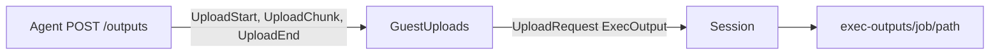
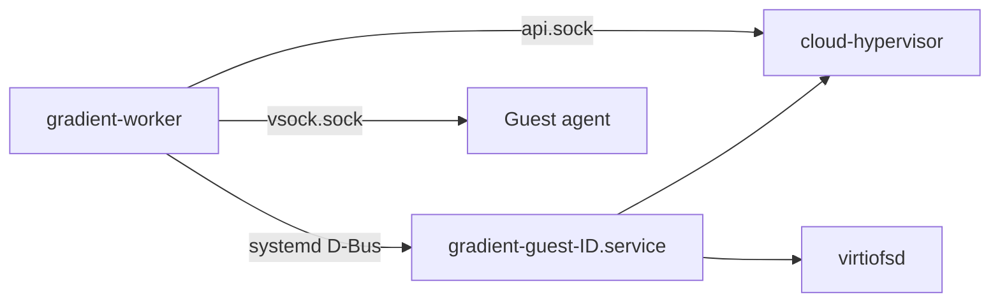
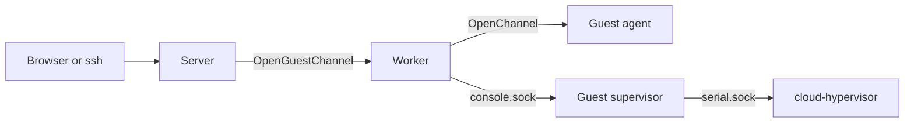

# Exec Jobs

Exec jobs start a flake app on a worker once the program is in the cache. Apps turn into entry points during evaluation. Jobs wait for the program build and then go to a matching worker. The user side is in [Gradient Exec](../../exec/index.md).

## Crate Map

| Crate | Part |
|---|---|
| `gradient-wire` | `ExecSpec`, `ExecRequirement`, `ExecInventory`, device strings, defaults and caps |
| `gradient-types` | `gradient_types::exec`, wait reasons, `exec_job.*` events, the `exec.enable` option |
| `gradient-eval` | The app leaf in the flake walk and `EXEC_APP_EXPR` |
| `gradient-worker` | Conversion of the eval result into an `ExecSpec` (`worker_pool::exec_app`), the job side in `exec/` |
| `gradient-vm` | Guest units, warm pool, devices, reattach and the guest supervisor |
| `gradient-guest-agent` | The agent inside the guest |
| `gradient-db` | Every exec statement under `gradient_db::exec_jobs` |
| `gradient-graph` | Every exec job transition and event |
| `gradient-pool` | Matching (`WorkerCaps::fits_exec`) and device holds |
| `gradient-scheduler` | Loading, placement, dispatch, wait reasons and pre-warm counts |
| `gradient-proto` | Phases, program start, logs and the inventory on the session |
| `gradient-web` | `/exec` endpoints, browser terminals and the project and task switches |
| `gradient-ssh` | SSH logins into exec jobs |

## Entry Points

- Attrsets with `type = "app"` and `passthru.gradient` are walk leaves. Other apps stay opaque.
- `EXEC_APP_EXPR` can read the block. Apps without exactly one derivation output in the string context of `program` fail with a message.
- The eval cache can resolve `image` to `config.system.build.toplevel`. Images get a second entry point, `<attr>.passthru.gradient.image`.
- Specs live as JSON in `entry_point.exec`. Exec entry points reference the program derivation in `entry_point.derivation`.
- The graph writer can refuse an entry point before insertion, with a message.

| Message | Check |
|---|---|
| `exec jobs are disabled on this instance` | `exec.enable` off, checked first |
| `exec jobs are disabled for this project` | `project.exec_enabled` off |
| `exec jobs are disabled for this task` | `task.exec_enabled` off, checked last |

- Refused programs also lose the image entry point, even in a later batch.
- Restarts copy `entry_point.exec` along with the entry point.

## Placement

- `ExecSpec::requirement_on` can build the `ExecRequirement` from the spec and the worker `defaults`. Defaults only fill fields the app left out.
- `ExecInventory.allow` can restrict every field. Requirements outside `allow` make the worker unfit, without a downgrade.
- `ExecSpec::limits_on` can clamp `timeout`, `maxSilent` and `retries` to the caps of `allow` at dispatch.
- Placed jobs hold their devices and guest size until the end of the attempt, see [Guest Sizes](#guest-sizes). Held parts are never free, even before the next `WorkerMetrics`.
- Exec jobs skip the build scoring rules, see [Scoring](#scoring).
- Exec jobs count as `RamNeed::Predicted(memory_mb)` for builds placed on the same worker.
- Only workers without draining and with access to the job's project count, for placement and for wait reasons.
- `WaitingReason::ExecWorkers` can name the unmet labels, devices, mounts, guest size, node count or custom image.
- `ExecUnmet` can hold only the architecture when zero exec workers of the job's architecture connect.

### Scoring

`gradient_pool::score::exec` can rank the exec jobs for a worker asking for one. The terms add up, and the highest total wins.

| Term | Points |
|---|---|
| `ExecWarmGuest` | `30` for a worker with a usable warm guest |
| `ExecProgramCached` | `300` minus the download seconds of the missing program closure at 100 MB/s, `0` without a measurement |
| `ExecDeviceFit` | `600` times the share of the idle worker devices in the request, `600` on a worker without idle devices |
| `ExecWaitTime` | One point per second in the queue, at most `3600` |

- Usable warm guests need a job without a custom image and the same `cpus` and `memory_mb` as `ExecInventory.warm_guest_size`.
- `ExecWarmGuestElsewhere` can veto a worker without a usable warm guest. The veto needs another worker with free capacity and a usable warm guest for the job.
- Vetoes end after 2 dispatch rounds, and the cold worker can start the job then.

### Multi-Node Jobs

Apps with `nodes > 1` turn into one `exec_job` row per node and a single [cluster job](../scheduler/clusters.md#exec-jobs). The cluster planner can place, prepare and start those nodes.

| Part | Value |
|---|---|
| Rows | `exec_job.node_index` from 0 to `nodes - 1`, unique per entry point (`idx-exec_job-entry_point-node`) |
| Cluster | `cluster_job` with `same_zone = true`, `retry_budget = 3` |
| Members | One `cluster_member` per row, `role = "node"`, `primary = false`, no `pin`, member index = node index |
| Requirement | `ExecRequirement.nodes` against `allow.nodes`. `nodes > 1` sets `network` |
| Master | Node 0 |
| Master port | `master_port` in `take_placement`, from `allow.ports` of the node 0 seat |
| Devices | Held per seat until the end of each node attempt |
| Wait reason | `unmet.nodes = N` while no zone holds `N` workers with a fit against device totals |

- Master port: 29500 when the range boundaries cover it and the job's `ports` exclude it. Other setups take the lowest port of the range outside `ports`.
- Warnings go out for fully forwarded ranges. Such ranges leave the cluster unplaced.
- Node attempts keep the port in `exec_job_attempt.master_port`. Nodes get the port from `JobContext.master_port`.
- Each node has its own job key `exec:<id>`, attempts, phases, logs, outputs and job token.
- List views and job pages treat node 0 as the job. Endpoints accept any node row ID and resolve the siblings with `nodes::nodes_of`.
- List views and events pull the combined node status from `nodes::aggregate_status`. Any open node: `Running` if one node runs, else the lowest open status. All final: `Aborted`, then `Failed`, then `Completed`.
- Status events go out under node 0 only. `exec_job.phase` events go out for every node with the field `node`.

## Pre-Warm Counts

Workers get `ServerMessage::PreWarmVms { count }` as an absolute target of guests to boot ahead.

- Exec entry points from a running evaluation without a job join the upcoming set. Jobs in `Created` or `Queued` belong to the same set.
- Custom images keep their jobs out of the count. Jobs waiting for a manual start stay out of the count too.
- Upcoming jobs add `nodes` to every worker without draining, with a fit against device totals and with access to the job's project.
- The scheduler can refresh the counts after new capabilities, an exec pass, a recorded eval result and an abort.
- Counts go out only on change. New connections start at 0.

## Lifecycle

| Status | Meaning |
|---|---|
| `Created` | Waiting for the program (and image) build, or for a manual start |
| `Queued` | Builds cached, waiting for a worker |
| `Starting` | Attempt open, program not started yet |
| `Running` | The worker reported `ProgramStarted` |
| `Completed`, `Failed`, `Aborted` | Final |

- Dispatches open an attempt in `exec_job_attempt`. Attempt end reasons are `Completed`, `Failed`, `Timeout`, `Lost` and `Aborted`.
- `Failed` and `Timeout` lead to a restart while `retries_left > 0`, one retry per restart.
- `Lost` attempts never use a retry. Ten losses in a row fail the job.
- Late reports for a closed attempt change nothing. Aborted jobs don't restart.
- Specs with `manual_start` (Nix `autostart = false`) create rows with `waits_for_manual_start`. Those rows stay `Created` and don't queue.
- Waiting rows stay out of `has_open_exec_jobs` and the consistency check. Evaluation can finish without them.
- `run_again::requeue` can clear the flag on every node. The next settle pass can queue those nodes once builds finish.
- Waiting rows carry the wait reason `manual_start` in the job JSON.
- Status changes emit `exec_job.queued`, `started`, `phase`, `completed`, `failed` or `aborted`, see [Events and Webhooks](../../reference/events.md).
- Logs share the build log storage per attempt ID. The deep GC can keep the log of every exec attempt.

The single-job rules above don't apply to multi-node jobs. `exec_verdict` can decide one fate for all nodes. A single `ExecClusterSettled` graph transition can assign that fate.

| Fate | When | Nodes | Retries |
|---|---|---|---|
| `Complete` | Every node completed | `Completed` | - |
| `Abort` | A node aborted | Every node `Aborted`, no restart | - |
| `Retry` | A node lost (`Lost` end reason) | Every node `Queued` from its last phase | None used, counts against `retry_budget` |
| `Restart` | A node failed or timed out, without `keepRunning`, `retries_left > 0` | Every node `Queued` from its last phase | One per restart on every row |
| `Fail` | Same without retries, or a failure with `keepRunning` after the last node ended | Each node with its own end, survivors `Aborted` | - |

- `ExecCluster.retries_left` is the lowest `min(retries_left, retries_cap)` over the seats.
- `Restart` counts in `cluster_job.attempts_outside_budget` and never against `retry_budget`.
- Requeues from a server restart also fall outside the budget.
- Members never survive a lost worker connection or a server restart. Both end in a restart from the last phases.
- Late reports of a survivor after a restart change nothing.
- Only node 0 can activate `gradient/continue.json`, once every node completed.

### Held Guests

`exec_job.keep_vm_running` can hold the guest after the program exit. `ExecJob.keep_vm_running` carries the switch at dispatch, `ServerMessage::ExecKeepVmRunning` later.

| Step | Effect |
|---|---|
| `Exited` while held | The worker sent `JobUpdateKind::ProgramExited`. `exec_job.program_exit_code` keeps the code, the job stays `Running` |
| Release | The worker reported the result of the recorded code |
| `GuestShutdown` while held | Same as a release |
| `GuestShutdown` during the program | The worker sent `JobUpdateKind::AbortRequested`. `abort_exec_job` ended the job `Aborted` |

- A switch set after dispatch makes the server send it again through `ProgramStarted`.
- The worker stores the switch in `guests/<id>/keep-vm-running`. A reattach after a restart reads it from there.
- A new attempt clears `program_exit_code`. A finished job clears `keep_vm_running`.
- The worker waits up to 30 s for the abort after `AbortRequested`. A guest lost during that wait never ends the attempt as `Lost`.

### Job Tokens

| Step | Effect |
|---|---|
| Dispatch | `mint_job_token` can mint `GRJ_` plus 64 alphanumeric characters into `JobContext.token` |
| Attempt insert | The graph writer can store the lowercase hex SHA-256 in `exec_job_token`, in the attempt transaction |
| Attempt close | `attempts::close` can revoke the tokens of the attempt in the same statement batch |

- Tokens expire `timeout + 3600 s` after dispatch. 30 days cover the case with no timeout.
- New attempts get a fresh token. Route scope and the acting user live in [Exec Actions](actions.md#job-principal).

### Phases

- Programs post phases to the agent with `gradient-phase`. Agents append `::gradient-phase:: <name>` to the output log. They send `Phase` afterwards.
- Names hold 1 to 128 printable characters. Payloads cap at 65536 bytes. A call to `SecretRedactor::redact` can process each payload.
- The scheduler can put the last phase into `JobContext.last_phase` of the next attempt.

### Outputs

| Part | Step |
|---|---|
| Agent | Streams the request body over vsock, refuses `gradient/tree.patch` from the program |
| Worker | Stages each upload in `guests/<id>/outputs/<upload_id>`, then `push_exec_output` with a passthrough grant |
| Server | `place_exec_output` adopts the file into `exec-outputs/<job>/<path>`, `record_exec_output` upserts `exec_job_output` |

- `follow` can wait for open uploads before mapping `Exited`. All outputs reach the store before the attempt is over.
- The agent can upload `gradient/tree.patch` after the post-script. The upload can happen before `Exited`.
- Paths pass `check_output_path` when relative and `/`-separated. Paths don't allow empty, `.` or `..` segments. The limit is 1024 bytes.
- Per-task evaluation GC can delete the outputs of `GcReport.deleted_exec_jobs` right away. Task and project deletions leave objects behind. The deep GC pass `exec-outputs` can remove those objects.

### Continuations

`exec_job_continuation` can hold one row per job with a `gradient/continue.json` output. Rows move from `Recorded` to `Queued`, then `Done` or `Failed`.

- New attempts drop a `Recorded` row.
- Queued rows keep evaluation `Building`. Find the full sequence in [Exec Actions](actions.md#continue-evaluation).

## Guests

Exec jobs start in their own cloud-hypervisor guests. Guest units, pools and devices belong to `gradient-vm`. Jobs don't appear in `gradient-vm`. Code in `gradient-worker/src/exec/` can convert an `ExecJob` to `gradient-vm` calls.

| Part | Location |
|---|---|
| Guest unit | Transient `gradient-guest-<id>.service` in `gradient-guests.slice`, started over D-Bus |
| Supervisor | Main process of the unit, `gradient-worker --guest-supervisor <dir>` as root with the worker's group |
| Guest directory | `/var/lib/gradient-worker/guests/<id>/`, mode `0770` |
| Files | `state.json`, `console.log`, `serial.sock`, `console.sock`, `api.sock`, `vsock.sock`, `control.sock`, `store.sock`, `work.img`, `mounts/<name>.sock` |

- Supervisors own cloud-hypervisor, every virtiofsd, the taps and the USB/IP bindings. Guests never belong to the worker process.
- Workers drive the cloud-hypervisor API, the supervisor control socket and the agent over hybrid vsock.
- Supervisors check every request against the configured devices, mounts and bridge.
- State files hold the unit, the vsock CID, held devices, mounts and a job record without the token.

### Pre-Warm

- Guests boot with `/nix/store` shared read-only over virtiofs. Workers pause a guest after the first agent answer.
- Warm target: `max(preWarm, min(count, maxPreWarm))`, with `count` from the last `PreWarmVms`.
- New connections start at count 0. Warm guests above the target stop.
- Jobs take a warm guest, or boot a new one when none is warm. Replacement boots launch right after.
- Server `Draining` can end new boots. Warm guests stop once no exec job is active.

### Cloud-Hypervisor Calls

| Call | Use |
|---|---|
| `vm.create`, `vm.boot` | Boot from `kernel`, `initrd` and `guest.json` of the image |
| `vm.pause`, `vm.resume` | Warm guests |
| `vm.add-device` | VFIO devices |
| `vm.add-disk` | `work.img` as `/work`, serial `work` |
| `vm.add-fs` | Mounts, one virtiofsd each. `/work` for agents below guest protocol 5 |
| `vm.add-net` | Tap on `exec.bridge` for networked jobs |
| `vm.remove-device`, `vm.shutdown`, `vmm.shutdown` | Teardown |
| `vm.info` | Paused check of a warm guest after a restart |

### Devices, Mounts and Network

| Kind | Path into the guest |
|---|---|
| VFIO | PCI hot-plug, device bound to `vfio-pci` on the host |
| `/dev` file | Byte copy over vsock, a pty at `/dev/gradient/<name>` in the guest |
| USB | `usbip bind` on the host, attached in the guest over vsock |
| Mount | virtiofs at `/mnt/<name>`, `perJob` mounts get `<path>/<guest id>` |
| Network | Tap `gr-tap-<cid>`, a leased guest address, bridge address as gateway |

- Devices keep their hold until teardown. Held devices don't appear in the advertised inventory.
- `GuestAddresses` lease the lowest free host above the bridge address of `exec.subnet`. Leases end with the guest teardown or a released cluster hold.
- Full subnets end the job with `no free guest address in exec.subnet`.
- Guests resolve names through the forwarder on the bridge, or through `exec.nameservers`.
- Teardown is always an explicit step. Dropped tasks leave the guest running.

### Guest Sizes

Guest sizes follow the device path. `GuestSize { cpus, memory_mb, disk_mb }` travels in `ExecSpec.guest` and `ExecRequirement.guest`.

| Step | Part |
|---|---|
| Worker | `GuestBudget` in `gradient-vm/src/budget.rs` with the total from `ExecArgs::guest_budget`. `hold` returns a `BudgetHold` or `None` |
| Report | `ExecInventory.guest_capacity` with `{ total, free }` per resource |
| Server hold | `AssignedJob.guest` through `WorkerPool::hold_exec`, subtracted by `effective_free_amount` |
| Fit | `guest_fits` in `fits_exec`, free for placement, total for wait reasons and pre-warm counts |

- Old workers report all-zero capacity. Such workers fit every size.
- Old servers send all-zero `ExecRequirement.guest`. Workers then boot the image size with the virtiofs `work` share.
- Warm guests hold a `BudgetHold` of the image size. Refills start only when the budget can hold a boot.
- `GuestPool::take` can hand out a warm guest only when `cpus` and `memory_mb` match. Other sizes boot cold from `GuestImage::sized`.
- Missing budgets at boot end the attempt with `the worker has no guest budget left for this job`, a transient error.
- Job holds drop in `retire` with the devices and the guest address.
- Reattach operations adopt `GuestState.size` with `GuestBudget::adopt`, even above the total.

`build_work_disk` in `gradient-worker/src/exec/work_disk.rs` can turn the checkout in `work-staging/` into `work.img`.

1. A sparse image results from `mkfs.ext4 -q -F -L work -d <staging> work.img <diskMb>M`. Budget totals cover the full size, not the sparse one.
2. A full image can fail the job with `the checkout does not fit in diskMb = <n>`. That error is permanent.
3. Cleanup steps remove the staging directory. `vm.add-disk` can attach the image.
4. The agent can mount `/dev/disk/by-id/virtio-work` as ext4 on `/work`, but only with `work_disk` in the guest setup.

### Worker Restart

| `stopGuestsWithWorker` | Stop | Next start |
|---|---|---|
| `true` | Abort of every exec job, reported `Canceled`, then all guest units stop | Leftover guest units stop |
| `false` | Exec jobs stay active, builds and evaluations abort | Reattach |

Reattach can sort guest units and state files into four groups.

| Unit | State file | Result |
|---|---|---|
| Active | With job | Busy, the job resumes |
| Active | Without job | Warm, adopted when `vm.info` reports `Paused` |
| Inactive | Present | Lost, directory removed |
| Any | Unreadable | Unit stopped, directory removed |

- Resumed jobs show up in `RunningJobs` of the first connection. The server can keep their assignments for the reclaim grace.
- Agents replay output from the byte count in `job-logs/<key>.accepted`.
- Busy guests without a sent job never resume. The server can count a lost attempt.

### Custom Images

Jobs with `passthru.gradient.image` boot a NixOS toplevel of their own. Placement can pick only workers with `ExecAllow.custom_images` (`exec.allow.customImages`).

1. `guest_source` in `gradient-worker/src/exec/job.rs` can return `Warm` or `Custom(<toplevel>)`. Workers without custom images fail the job with `custom images are not allowed on this worker`.
2. `ensure_path` can realise the toplevel. A GC root can keep the toplevel alive until teardown.
3. `image_from_toplevel` in `gradient-vm/src/custom_image.rs` can build the boot description. Toplevels without `kernel` or `initrd` fail with `image <path> is not a NixOS system: no <file>`.
4. `GuestPool::boot_custom` can take a CID from `next_cid` for `Guest::boot`. Warm guests, the warm target and `PreWarmVms` stay untouched.
5. Checkout, plug, `RunJob`, follow and teardown match a warm guest job. Custom guests never go back to the pool.

| `vm.create` field | Value |
|---|---|
| `payload.kernel` | Canonical `<toplevel>/kernel`, a bzImage on x86_64 or an `Image` on aarch64 |
| `payload.initramfs` | Canonical `<toplevel>/initrd` |
| `payload.cmdline` | `init=<toplevel>/init` and the trimmed `<toplevel>/kernel-params` |
| `cpus`, `memory.size` | The job size, through `GuestImage::sized` of the worker image |
| `memory.shared`, `fs`, `vsock`, `serial`, `console` | Same as a warm guest |

- A boot wait can take up to `GUEST_BOOT_TIMEOUT` (120 s). Toplevels with no `etc/systemd/system/gradient-guest-agent.service` then fail with `guest image has no gradient agent, import the gradient.guest module`.
- `attempt_end_reason` can move `GuestBoot` to `Failed` when a job has an image.
- These attempts consume one retry. Warm guest boot failures stay `Lost`.
- `nixosModules.guest` can build the `guest.json` cmdline by the same rule as `payload.cmdline`.

## Guest Agent

The agent `gradient-guest-agent` can accept the worker on vsock port 7000. Frames use the codec of `gradient-wire`, versions agree on `GUEST_PROTO_VERSIONS`.

| Worker to agent | Effect |
|---|---|
| `Attach { output_offset }` | Output replay from the offset, then `ProgramStarted` and `Exited` once known |
| `RunJob` | The job, accepted once per agent life |
| `Kill` | SIGTERM to the program group, SIGKILL after 10 s |
| `UploadSettled { upload_id, error }` | Answer of the server to one output upload |

| Agent to worker | Worker result |
|---|---|
| `ProgramStarted` | `JobUpdateKind::ProgramStarted`, the job moves to `Running` |
| `Output`, `OutputDropped` | Log chunks, a note on dropped bytes |
| `Phase` | `JobPhase`, dropped above 64 KiB |
| `UploadStart`, `UploadChunk`, `UploadEnd` | One output upload, guest protocol version 3 |
| `SetupFailed` | `Permanent` |
| `Exited` | `Permanent` for a non-zero code, or a [held guest](#held-guests) |
| `JobLost` | `Transient`, sent by a restarted agent |
| `GuestShutdown` | Guest protocol version 6, see [Held Guests](#held-guests) |

- Stops of `gradient-guest-shutdown` trigger `gradient-guest-agent shutdown`. Calls to `POST /shutdown` on the local API of the agent yield `GuestShutdown`.
- Polkit rules in `nixosModules.guest` allow `poweroff`, `reboot` and `halt` for `gradient`.

### Job Steps

1. Resolve placeholders in `args` and `env`. Unknown placeholders fail the setup.
2. Write `/run/gradient/context.json` and `/run/gradient/secrets/<name>` with mode `0400`. Write the CLI config `/home/gradient/.config/gradient/config.toml` with mode `0600`.
3. Write `/run/gradient/phase-payload` for a job with an earlier phase.
4. Mount the `/work` disk and the virtiofs shares.
5. Configure the network and `/etc/resolv.conf`.
6. Start the device bridges over vsock and attach USB devices.
7. Execute `/etc/gradient/pre-script` as root. Start the program as `gradient` in `/work/<RunJob.flake_dir>`. Then run `/etc/gradient/post-script` as root.
8. Upload the diff of `/work` against the start commit as `gradient/tree.patch`. Untracked files count too. An empty diff triggers no upload.

- `GRADIENT_*` variables win over app `env` of the same name.
- Output from programs can land in `/run/gradient/output.log`. Only the last 64 MiB stay.
- `127.0.0.1:7777` handles `POST /phases?name=<name>`, `POST /outputs/{*path}` and `POST /redact`. `gradient-phase`, `gradient-upload` and `gradient pr open` hit those routes.
- Timeouts belong to the worker watchdog. Workers send `Kill` and log the timeout line.

### Guest Channels

Numbered guest channels connect browser terminals and SSH sessions to a running job. The server can issue a new `channel_id` for every channel.

| Kind | Worker side | Guest side |
|---|---|---|
| `Shell { pty, attach: false }` | Agent | A new `bash` next to the program |
| `Shell { pty, attach: true }` | Agent | The terminal of the program |
| `Forward { port }` | Agent | A TCP connection to `127.0.0.1:<port>` |
| `Console` | Supervisor, over `console.sock` | The serial console |

- The agent frames `OpenChannel`, `ChannelData`, `Resize` and `CloseChannel` require guest protocol version 2. Server messages live in [Messages](../proto/messages.md).
- Data frames top out at 32 KiB. Agents queue 256 input chunks per channel. Agents close a full channel with `the guest stopped reading the channel input`.
- Shells and forwards of a job without `ssh` fail the worker checks. Ports outside `ports` and agents below version 2 fail too.
- Channel traffic can never move the `maxSilent` deadline.

| Program terminal | Behaviour |
|---|---|
| Start | `ssh = true` sets `RunJob.program_pty`. The program starts on a PTY with `TERM=xterm-256color` at 80x24 |
| Output | PTY output goes into the output log like piped output. Typed input echoed by the PTY counts as output |
| Attach | Attached channels follow the output log from the attach point. Input and resizes go to the program PTY |
| Close | Closing an attached channel leaves the program active. The program exit closes every attached channel with its exit code |

| New shell | Behaviour |
|---|---|
| User | `setpriv --reuid=gradient --regid=gradient` with the job groups, behind `setsid --ctty` on a PTY |
| Environment | `/work`, the environment of the program, `TERM=xterm-256color` only on a PTY |
| Without PTY | Pipes, stderr merged into stdout |
| Close | SIGHUP to the process group, SIGKILL after 2 s |

| Console | Behaviour |
|---|---|
| Supervisor | Holds `serial.sock`, appends every byte to `console.log`, accepts one client on `console.sock` (mode `0660`) |
| Replay | New clients get the last 64 KiB of `console.log` first. Clients lose the connection after 5 s of no reads |
| Viewers | The worker keeps its own 64 KiB scrollback for each new viewer. The oldest viewer holds the input |
| Read-only | Later viewers get a read-only notice once. The next viewer takes the input when the holder leaves |
| Old guests | Guests without `console.sock` close the console channel with `this guest has no console socket` |

| Close | Effect |
|---|---|
| Either side | `CloseGuestChannel` ends the route on both sides. Later frames for the id go nowhere |
| Session end | The worker closes every channel of its exec jobs. The server closes them with `the worker disconnected` |
| Slow client | A full server buffer of 256 events closes the channel with `the terminal could not keep up` |
| Forward refused | `nothing listens on port <port> in the guest` |
