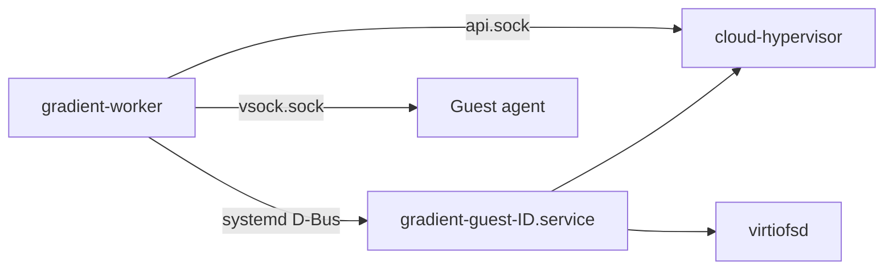

# Exec Jobs

Exec jobs start a flake app on a worker once the program is in the cache. Apps turn into entry points during evaluation. Jobs wait for the program build and then go to a matching worker. The user side is in [Run Exec Jobs](../../guides/exec-jobs.md).

## Crate Map

| Crate | Part |
|---|---|
| `gradient-wire` | `ExecSpec`, `ExecRequirement`, `ExecInventory`, device strings, defaults and caps |
| `gradient-types` | `gradient_types::exec`, wait reasons, `exec_job.*` events, the `exec.enable` option |
| `gradient-eval` | The app leaf in the flake walk and `EXEC_APP_EXPR` |
| `gradient-worker` | Conversion of the eval result into an `ExecSpec` (`worker_pool::exec_app`), the job side in `exec/` |
| `gradient-vm` | Guest units, warm pool, devices, reattach and the guest supervisor |
| `gradient-guest-agent` | The agent inside the guest |
| `gradient-db` | Every exec statement under `gradient_db::exec_jobs` |
| `gradient-graph` | Every exec job transition and event |
| `gradient-pool` | Matching (`WorkerCaps::fits_exec`) and device holds |
| `gradient-scheduler` | Loading, placement, dispatch, wait reasons and pre-warm counts |
| `gradient-proto` | Phases, program start, logs and the inventory on the session |
| `gradient-web` | `/exec-jobs` endpoints and the project switch |

## Entry Points

- Attrsets with `type = "app"` and `passthru.gradient` are walk leaves. Other apps stay opaque.
- `EXEC_APP_EXPR` can read the block. Apps without exactly one derivation output in the string context of `program` fail with a message.
- The eval cache can resolve `image` to `config.system.build.toplevel`. Images get a second entry point, `<attr>.passthru.gradient.image`.
- Specs live as JSON in `entry_point.exec`. Exec entry points reference the program derivation in `entry_point.derivation`.
- The graph writer can refuse an entry point before insertion, with a message.

| Message | Check |
|---|---|
| `exec jobs are disabled on this instance` | `exec.enable` off, checked first |
| `exec jobs are disabled for this project` | `project.exec_enabled` off |
| `exec jobs with more than one node are not supported yet` | `nodes > 1` |

- Refused programs also lose the image entry point, even in a later batch.
- Restarts copy `entry_point.exec` along with the entry point.

## Placement

- `ExecSpec::requirement_on` can build the `ExecRequirement` from the spec and the worker `defaults`. Defaults only fill fields the app left out.
- `ExecInventory.allow` can restrict every field. Requirements outside `allow` make the worker unfit, without a downgrade.
- `ExecSpec::limits_on` can clamp `timeout`, `maxSilent` and `retries` to the caps of `allow` at dispatch.
- Placed jobs hold their devices until the end of the attempt. Held devices are never free, even before the next `WorkerMetrics`.
- Exec jobs skip the RAM fit rule. Queue age orders the matching workers.
- Only workers without draining and with access to the job's project count, for placement and for wait reasons.
- `WaitingReason::ExecWorkers` can name the unmet labels, devices, mounts, node count or custom image.
- `ExecUnmet` can hold only the architecture when zero exec workers of the job's architecture connect.

## Pre-Warm Counts

Workers get `ServerMessage::PreWarmVms { count }` as an absolute target of guests to boot ahead.

- Upcoming jobs are exec entry points of a running evaluation without a job yet, plus jobs in `Created` or `Queued`.
- Jobs with a custom image never count.
- Upcoming jobs add `nodes` to every worker without draining, with a fit against device totals and with access to the job's project.
- The scheduler can refresh the counts after new capabilities, an exec pass, a recorded eval result and an abort.
- Counts go out only on change. New connections start at 0.

## Lifecycle

| Status | Meaning |
|---|---|
| `Created` | Waiting for the program (and image) build |
| `Queued` | Builds cached, waiting for a worker |
| `Starting` | Attempt open, program not started yet |
| `Running` | The worker reported `ProgramStarted` |
| `Completed`, `Failed`, `Aborted` | Final |

- Dispatches open an attempt in `exec_job_attempt`. Attempt end reasons are `Completed`, `Failed`, `Timeout`, `Lost` and `Aborted`.
- `Failed` and `Timeout` lead to a restart while `retries_left > 0`, one retry per restart.
- `Lost` attempts never use a retry. Ten losses in a row fail the job.
- Aborted jobs never restart. Late reports for a closed attempt change nothing.
- Status changes emit `exec_job.queued`, `started`, `phase`, `completed`, `failed` or `aborted`, see [Events and Webhooks](../../reference/events.md).
- Logs share the build log storage per attempt ID. The deep GC can keep the log of every exec attempt.

## Guests

Exec jobs start in their own cloud-hypervisor guests. Guest units, pools and devices belong to `gradient-vm`. Jobs don't appear in `gradient-vm`. Code in `gradient-worker/src/exec/` can convert an `ExecJob` to `gradient-vm` calls.

| Part | Location |
|---|---|
| Guest unit | Transient `gradient-guest-<id>.service` in `gradient-guests.slice`, started over D-Bus |
| Supervisor | Main process of the unit, `gradient-worker --guest-supervisor <dir>` as root |
| Guest directory | `/var/lib/gradient-worker/guests/<id>/`, mode `2770` |
| Files | `state.json`, `console.log`, `api.sock`, `vsock.sock`, `control.sock`, `store.sock`, `work/`, `mounts/<name>.sock` |

- Supervisors own cloud-hypervisor, every virtiofsd, the taps and the USB/IP bindings. Guests never belong to the worker process.
- Workers drive the cloud-hypervisor API, the supervisor control socket and the agent over hybrid vsock.
- Supervisors check every request against the configured devices, mounts and bridge.
- State files hold the unit, the vsock CID, held devices, mounts and a job record without the token.

### Pre-Warm

- Guests boot with `/nix/store` shared read-only over virtiofs. Workers pause a guest after the first agent answer.
- Warm target: `max(preWarm, min(count, maxPreWarm))`, with `count` from the last `PreWarmVms`.
- New connections start at count 0. Warm guests above the target stop.
- Jobs take a warm guest, or boot a new one when none is warm. Replacement boots launch right after.
- Server `Draining` can end new boots. Warm guests stop once no exec job is active.

### Cloud-Hypervisor Calls

| Call | Use |
|---|---|
| `vm.create`, `vm.boot` | Boot from `kernel`, `initrd` and `guest.json` of the image |
| `vm.pause`, `vm.resume` | Warm guests |
| `vm.add-device` | VFIO devices |
| `vm.add-fs` | `/work` and mounts, one virtiofsd each |
| `vm.add-net` | Tap on `exec.bridge` for networked jobs |
| `vm.remove-device`, `vm.shutdown`, `vmm.shutdown` | Teardown |
| `vm.info` | Paused check of a warm guest after a restart |

### Devices, Mounts and Network

| Kind | Path into the guest |
|---|---|
| VFIO | PCI hot-plug, device bound to `vfio-pci` on the host |
| `/dev` file | Byte copy over vsock, a pty at `/dev/gradient/<name>` in the guest |
| USB | `usbip bind` on the host, attached in the guest over vsock |
| Mount | virtiofs at `/mnt/<name>`, `perJob` mounts get `<path>/<guest id>` |
| Network | Tap `gr-tap-<cid>`, guest address = subnet + CID, bridge address as gateway |

- Devices stay held until teardown. Held devices stay out of the advertised inventory.
- Guests resolve names through the forwarder on the bridge, or through `exec.nameservers`.
- Teardown is always an explicit step. Dropped tasks leave the guest running.

### Worker Restart

| `stopGuestsWithWorker` | Stop | Next start |
|---|---|---|
| `true` | Abort of every exec job, reported `Canceled`, then all guest units stop | Leftover guest units stop |
| `false` | Exec jobs stay active, builds and evaluations abort | Reattach |

Reattach can sort guest units and state files into four groups.

| Unit | State file | Result |
|---|---|---|
| Active | With job | Busy, the job resumes |
| Active | Without job | Warm, adopted when `vm.info` reports `Paused` |
| Inactive | Present | Lost, directory removed |
| Any | Unreadable | Unit stopped, directory removed |

- Resumed jobs show up in `RunningJobs` of the first connection. The server can keep their assignments for the reclaim grace.
- Agents replay output from the byte count in `job-logs/<key>.accepted`.
- Busy guests without a sent job never resume. The server can count a lost attempt.

## Guest Agent

The agent `gradient-guest-agent` can accept the worker on vsock port 7000. Frames use the codec of `gradient-wire`, versions agree on `GUEST_PROTO_VERSIONS`.

| Worker to agent | Effect |
|---|---|
| `Attach { output_offset }` | Output replay from the offset, then `ProgramStarted` and `Exited` once known |
| `RunJob` | The job, accepted once per agent life |
| `Kill` | SIGTERM to the program group, SIGKILL after 10 s |

| Agent to worker | Worker result |
|---|---|
| `ProgramStarted` | `JobUpdateKind::ProgramStarted`, the job moves to `Running` |
| `Output`, `OutputDropped` | Log chunks, a note on dropped bytes |
| `Phase` | `JobPhase`, dropped above 64 KiB |
| `SetupFailed` | `Permanent` |
| `Exited` | `Permanent` for a non-zero code |
| `JobLost` | `Transient`, sent by a restarted agent |

### Job Steps

1. Resolve placeholders in `args` and `env`. Unknown placeholders fail the setup.
2. Write `/run/gradient/context.json` and `/run/gradient/secrets/<name>`, both mode `0400`.
3. Write `/run/gradient/phase-payload` for a job with an earlier phase.
4. Mount the virtiofs shares.
5. Configure the network and `/etc/resolv.conf`.
6. Start the device bridges over vsock and attach USB devices.
7. Run `/etc/gradient/pre-script` as root, the program as `gradient` in `/work`, then `/etc/gradient/post-script` as root.

- `GRADIENT_*` variables win over app `env` of the same name.
- Output from programs can land in `/run/gradient/output.log`. Only the last 64 MiB stay.
- `127.0.0.1:7777` can answer `POST /phase` and `POST /upload` with `501` for now.
- Timeouts belong to the worker watchdog. Workers send `Kill` and log the timeout line.
