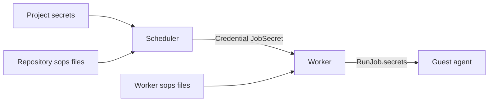

# Exec Secrets

Exec jobs list secret names. Values can come from exactly one of three sources. Guests get each value as a file, a variable and a placeholder. The guest agent and the worker mask every value in text output. The user side is in [Run Exec Jobs](../../guides/exec-jobs.md#secrets).

## Crate Map

| Crate | Part |
|---|---|
| `gradient-redact` | `Replacements`, `SecretRedactor`, `StreamRedactor`, `secret_forms` |
| `gradient-sops` | `SopsKey`, `sops_recipient`, `decrypt_file` |
| `gradient-scheduler` | `exec_secrets`: resolution of names to sources |
| `gradient-proto` | `JobSecret` credentials at hand-out |
| `gradient-worker` | `WorkerSecrets`, the merge into `RunJob.secrets`, the console redactor |
| `gradient-guest-agent` | `pump_output` and the shell redactors |

## Sources

| Order | Source | Storage | Input |
|---|---|---|---|
| 1 | Project secrets | `project_secret`, encrypted with the crypt file | Project **Settings -> Secrets**, the API or `secret_files` in the state |
| 2 | Repository sops files | The repository, listed in `sops` | `sops` with the project recipient |
| 3 | Worker sops files | The worker host | `exec.sops.files` and `exec.sops.keyFile` |

- Names hold 1 to 64 characters of `[a-z0-9-]` and start with a letter or digit (`validate_secret_name`).
- Variable names follow `GRADIENT_SECRET_` plus the upper-case name, with `-` as `_`.
- Project values hold at most 65536 bytes. Repository sops files hold at most 1 MiB.
- State files arrive as systemd credentials `gradient_project_<project>_secret_<name>`. The server can read them verbatim, without a trim.
- State rows get `managed = true`. Each apply can delete managed rows no longer listed. Rows from the API stay.
- Changes to a managed row over the API end with `409`.

## Sops Recipient

The project SSH key doubles as the sops key. `GET /projects/{project}/sops-recipient` can derive the recipient from `project.public_key` alone.

| Key type | `age` recipient | SSH recipient |
|---|---|---|
| `ssh-ed25519` | `age1...`, the Ed25519 point converted to X25519 | The `ssh-ed25519` age stanza |
| `ssh-rsa` | None | The `ssh-rsa` age stanza only |
| Other | `409` on the endpoint | Job failure naming the key type |

- The X25519 secret is the first 32 bytes of the SHA-512 hash of the Ed25519 seed. Both sides match `ssh-to-age`.

## Sops Envelope Reader

`gradient-sops` can read the sops layout on its own. The `age` crate can only open the data key.

1. Pick the format by extension: `.yaml`, `.yml` or `.json`. JSON documents go through the YAML parser in document order.
2. Refuse encrypted comments (`type:comment`). `yaml_serde` can drop comments. Those comments remain inside the MAC.
3. Open the first `sops.age[].enc` entry with the project identities.
4. Decrypt each `ENC[AES256_GCM,...]` value with the 32-byte IV. The AAD is the key path joined by `:`, plus a trailing `:`.
5. Hash every value in document order with SHA-512, without the top-level `sops` key. Plain scalars count too, unless `mac_only_encrypted` is on.
6. Compare the hash with `sops.mac`, opened with the `lastmodified` string as AAD.
7. Keep the top-level string values. Nested maps and lists stay out.

| Error | Message |
|---|---|
| `UnsupportedFormat` | `sops file <file>: only YAML and JSON are supported` |
| `Parse` | `sops file <file>: <reason>` |
| `NotARecipient` | `sops file <file>: not encrypted for the project key` |
| `MacMismatch` | `sops file <file>: MAC mismatch` |
| `EncryptedComments` | `sops file <file>: encrypted comments not supported, remove the comments before encrypting` |
| `UnsupportedKey` | `<key type> keys cannot decrypt sops files, use an Ed25519 or RSA key` |
| `Key` | `unreadable SSH key: <reason>` |

## Resolution

`assign_exec_jobs` can resolve names before dispatch, in two steps.

| Step | Time | Function | Result |
|---|---|---|---|
| Sources | Once, at the first sight of a queued job | `resolve_secret_names` | Server names with their source, and worker names |
| Workers | Every pass | `secret_refusal` | A failure for a name no fitting worker can supply |

- Jobs without secrets skip the project key and the files.
- The scheduler can decrypt repository files at the first step. Wrong recipients fail the job before any dispatch.
- `secret_refusal` can fit workers against device totals, with both secret lists cleared. Zero fitting workers leave the job waiting.
- Fitting workers advertising a server name fail the job. Worker names missing on every fitting worker fail the job too.
- Failures go through `Transition::FailExecJob`. Such jobs end `Failed` without using a retry. The scheduler can close an open attempt with the end reason `Failed`.

| Message | Cause |
|---|---|
| `secret "<name>" found in two sources: <first>, <second>` | Two sources hold the name: `project secrets`, `sops file <file>` or `worker sops of <worker id>` |
| `secret "<name>" not found in project secrets, repository sops files or worker sops files` | No source holds the name |
| `project key unusable for sops: <reason>` | The project key failed to decrypt |

## Placement

| `ExecRequirement` field | Names | Worker condition |
|---|---|---|
| `secrets` | From worker sops files | Every name in `ExecInventory.secrets` |
| `server_secrets` | From the server | The `secrets` capability and none of the names in `ExecInventory.secrets` |

- `ExecUnmet.secrets` can list worker names without an advertising exec worker. Waiting jobs show `needs worker secret <name>`.

## Hand-Out

- Sessions send one `ServerMessage::Credential { kind: JobSecret { job_id, name }, data }` per server name, right before `AssignJob`.
- `server_secret_values` can read the values at hand-out, project store first, then repository sops.
- Workers without the `secrets` capability fail the dispatch with `worker <id> lacks the secrets capability`.
- Worker credential stores keep job secrets per job and name. Job snapshots keep them past the `clear()` at the end of another job.

## Worker Merge

`job_secrets` can build `RunJob.secrets` from the credentials and `WorkerSecrets`, with one source per name.

| Message | Cause |
|---|---|
| `secret "<name>" found in two sources: server, worker sops of <worker id>` | A credential and a worker file hold the name |
| `secret "<name>" not available on this worker` | Neither holds the name |

- Both errors fail the attempt as `Permanent`.
- Workers decrypt every worker file at start. Failures end the start.
- SIGHUP can reload all files, all or nothing. Failed reloads keep the previous values and names.
- `WorkerMetrics` advertise the names in `ExecInventory.secrets`, never the values.

## Redaction

| Rule | Value |
|---|---|
| Replacement | `[secret:<name>]`, the job token as `[secret:job-token]` |
| Floor | `MIN_SECRET_BYTES = 8`. Shorter values stay unmasked in every form |
| Forms | The value and the value without trailing newlines, each in plain text, standard base64 with and without padding, and URL encoding with upper-case hex |
| Lines | Each line of a multi-line value with at least 8 bytes |
| Matcher | Aho-Corasick, leftmost-longest |

- `StreamRedactor` can hold back the shortest tail able to start a pattern. Secrets split over two chunks stay masked.
- Longer secrets sharing a prefix with a shorter secret win across chunks.
- `finish` can release the held tail at the end of the stream.

| Output | Masking |
|---|---|
| Program output, pipes or the program PTY | Agent, `pump_output` before the output log |
| New shell, `Shell { attach: false }` | Agent, one stream redactor per channel |
| Attached shell, `Shell { attach: true }` | The masked output log |
| Phase payloads and text outputs | Agent, `SecretRedactor::redact` |
| Serial console | Worker, one stream redactor per console link in `GuestChannelMux` |
| Port forwards and binary outputs | None |

- Console bytes never pass the agent. Supervisor replays arrive over the same link. `ConsoleScrollback` can hold masked bytes only.
- `console.log` files in the guest directory stay unmasked, on the worker host only.
- Agents send `AgentToWorker::JobSecrets` after `Attach`. Resumed jobs get back the console redactor that way.

## Value Locations

| Place | Content |
|---|---|
| Database | `project_secret.value`, encrypted with the crypt file |
| Eval result | Sops ciphertext only. The eval worker cannot decrypt the files |
| Wire | `JobSecret` credentials to a worker with `secrets`, `RunJob.secrets` over vsock |
| Nix store | Nothing |
| Logs | Masked text only |
| Guest | `/run/gradient/secrets/<name>` (mode `0400`), `GRADIENT_SECRET_<NAME>` and `@gradient.secret.<name>@` |
