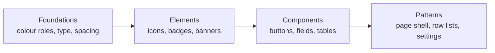

<!--
SPDX-FileCopyrightText: 2026 Wavelens GmbH <info@wavelens.io>
SPDX-License-Identifier: AGPL-3.0-only
-->

# Frontend Style Guide

A design system page at `/styleguide` renders every shared primitive, colour role and layout pattern in the browser. Check it for an existing primitive before building a new one.



## The Page

- Lazy-loaded at `/styleguide`, deliberately linked from nowhere, without an auth guard. No production data on the page.
- Source: `frontend/src/app/features/styleguide/`, one component per section page.

| Section | Contents |
|---|---|
| Overview | The rules below |
| Foundations | Colour roles, type scale, spacing, border radius |
| Elements | Icons, logo, badges, copy fields, read-only rows, message banners, tables, feedback, evaluation status, star button, status icon, charts, toasts |
| Components | Buttons, form field, name with availability check, selection, panel switcher, table, overlays |
| Patterns | Page shell, row list, index cards, card grid, settings, sections with an action, settings destinations, danger zone |

## Rules

- Wrap every store path, hash, key, ID and URL in a `gr-copy-field`. A bare code span is not enough.
- Take all colours from semantic roles. Hex values belong only in the palette, and components read roles rather than palette tokens.
- Put new shared classes in the design system. Component stylesheets take none.
- Build content layouts from `gr-row-list` or `gr-card-grid`. Avoid entity-specific names.
- Keep every element readable in both themes. Never hard-code black or white in a component.
- Color text on tinted status backgrounds with the matching `--gr-status-*-text` role. Never use plain status roles. Fix contrast violations in `tokens.ts`, not on the page side. `contrast.spec.ts` must keep all text roles at 4.5:1 on the base, raised, hover, and sunken surfaces in both themes. Underline links in body text.
- Render every page inside the single `<main id="main-content">` of the app shell, never add a second `<main>`. Give each page exactly one `h1`, hidden with `.sr-only` when the layout shows no title, and never skip a heading level. Card, chart and empty-state titles are `h2`.
- Give every icon-only button or link a name through `label` or `aria-label`, and name the target ("Remove bob", not "Remove"). `pnpm button-names:check` fails on an unnamed icon-only button. A `gr-copy-field` or `gr-select` inside a `gr-form-field` takes the field label. Outside one, pass `label` to the copy field and `ariaLabel` to the select.
- Add `grScrollRegion` to every element that scrolls on its own, so keyboard users can focus and scroll it while its content overflows. `gr-table` and the log viewer already do this.
- Keep text sizes within one step of body size: 16px for interactive text, 14px for secondary text, 12px for badges only.
- Report the result of every write through `NotifyService` (`success`, `failure`), which shows a `gr-toast`. A failed write submitted from an open `gr-dialog` keeps the dialog open and shows the reason through its `[error]` input. Take the reason from `apiErrorMessage(error, fallback)`, never from the `message` of an arbitrary error.
- Bind `[busy]` to `gr-dialog` while a request is active. Bind `[loading]` to the button that sent the request. The dialog can't close and a second request can't start. Set `[closable]="false"` on a dialog that can display a secret once.
- Confirm beforehand through `ConfirmService` from `@shared/confirm` on every deletion, removal, cancellation, rejection, abort, drain, and secret rotation. State the exact target and say the outcome. The dialog can run the action itself, remain locked during the action, and show failures inside. Never use the native browser `confirm()`.
- Pass every metric series to `gr-metric-chart`, also an empty one. A chart whose series hold no points says "No data" over the plot, so an empty chart never looks like a broken one. `ApiService` rejects a response without a body (except 204 No Content) as an `ApiError`, so a page shows its error state instead of crashing on `undefined`.
- Gate every write control by the permission that its endpoint can check, not by role name. Project, task and cache responses list the caller's own `permissions`. Build the gate with `accessTo(resource, ...permissions)` (or `injectTaskAccessTo` / `injectCacheAccessTo`) and pass it to `*appWritable` and `[appManagedDisable]`. Bind the busy flag to the same element as `[disabled]`. `appManagedDisable` can combine both. Show `missingPermissionText()` inside `gr-load-state` with `[retryable]="false"` on a page where callers lack a permission for the list endpoint. Send no request.
- Validate input on the client with ``fieldChecks`` in ``@shared/forms``. Use ``gr-form-field`` to show messages below the field before the request can leave the client. Track changes on the settings page with ``unsavedChanges()`` from ``@shared/forms``. Keep Save disabled when there are no changes. Register ``unsavedChangesGuard`` on the route and ask for confirmation before leaving with edits.

## Shared UI Package

The package `@gradient/ui` lives in the pnpm workspace at `frontend/packages/ui`. Two consumers build on it: Gradient itself and the frontend of [`gradient-proxy`](architecture.md) for servers.gradient.ci.

| Entry | Content |
|---|---|
| `@gradient/ui/ui` | Generic primitives, listed under [`gr-ui`](#gr-ui) |
| `@gradient/ui/chrome` | `gr-header` and `gr-footer`, configured through brand, nav and footer link inputs plus a `[slot=lang]` |
| `@gradient/ui/tokens` | Colour tokens from `tokens.ts` |
| `@gradient/ui/styles/*` | SCSS partials `variables`, `themes`, `grids` and the global `base` styles |

- The package must stay free of imports from `@core`, `@shared` or `@features`. Only primitives without such imports belong there.
- An ESLint rule blocks these imports in `packages/ui` code.
- `pnpm tokens:generate` and `pnpm tokens:check` delegate their work to the package.
- `ng test` runs the package specs as well.
- The `gradient-proxy` frontend can link the package with `link:../../frontend/packages/ui`.

## `gr-ui`

The generic building blocks live in `frontend/packages/ui/src/ui/` and build on `@angular/cdk`. Gradient-specific components (`gr-eval-status-badge`, `gr-status-icon`, `gr-metric-chart`, `gr-star-button`, `gr-label-help`) live in `frontend/src/app/shared/ui/`. Imports go through the barrel of each layer.

```ts
import { FormFieldComponent, PageLayoutComponent, SettingsSectionComponent } from '@gradient/ui/ui';
import { MetricChartComponent } from '@shared/ui';
```

| Group | Selectors |
|---|---|
| Actions | `button[grButton]`, `a[grButton]`, `gr-star-button`, `gr-menu` |
| Forms | `gr-form-field`, `input[grInput]`, `textarea[grInput]`, `select[grInput]`, `gr-password-input`, `gr-name-field`, `gr-select`, `gr-select-button`, `gr-checkbox`, `gr-autocomplete`, `gr-label-help` |
| Display | `gr-badge`, `gr-eval-status-badge`, `gr-status-icon`, `gr-icon`, `gr-logo`, `gr-copy-field`, `gr-field-row`, `gr-stat-card`, `gr-metric-chart`, `gr-table`, `gr-divider` |
| Feedback | `gr-message-banner`, `gr-toast` (with `MessageService`), `gr-loading-spinner`, `gr-empty-state`, `gr-load-state` |
| Overlays | `gr-dialog`, `gr-popover`, `[grTooltip]` |
| Layout | `gr-page-layout`, `gr-settings-section`, `gr-row-list` / `gr-row`, `gr-card-grid`, `gr-nav-card`, `gr-tab-switch`, `[grInView]`, `[grScrollRegion]` |

- `gr-page-layout`: a header with title and subtitle, a breadcrumb, optional `[slot=actions]` buttons and an optional `[slot=banner]`, then the content.
- `gr-settings-section`: a titled section with an optional description. A card contains it by default. Set `[card]="false"` to drop the card.
- `gr-load-state`: a wrapper for any content that can load its own data. The inputs `loading`, `error` and `empty` pick one of four states (a spinner, an error with a Try Again button, an empty state, or content). Errors always take precedence over the empty state. A failed request can never show the "nothing here yet" text. Use a "No permission" message in place of the server code on a 403 response. Keep the data visible on reload. Skip the spinner with data on screen. Put write errors (save, delete) outside `error`. Those errors belong next to the failed action.

## Grid Utilities

`frontend/packages/ui/src/styles/_grids.scss`, registered globally in `src/styles.scss`.

| Class | Layout |
|---|---|
| `.gr-grid-stats` | Auto-fit grid of stat cards, 220px minimum |
| `.gr-grid-form` | Two-column form, one column below `$breakpoint-md`. `.gr-grid-form__full` will span both |
| `.gr-grid-cards` | Auto-fill grid of cards, 280px minimum |
| `.gr-grid-rows` | Label, value, actions rows |
| `.gr-form-actions` | Row of form buttons. `--end` will align right |

## Related

- [Contributing](contributing.md#angular-and-typescript) covers the rules for dependencies and lockfiles.
