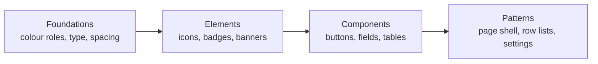

<!--
SPDX-FileCopyrightText: 2026 Wavelens GmbH <info@wavelens.io>
SPDX-License-Identifier: AGPL-3.0-only
-->

# Frontend Style Guide

A design system page at `/styleguide` renders every shared primitive, colour role and layout pattern in the browser. Check it for an existing primitive before building a new one.



## The Page

- Lazy-loaded at `/styleguide`, deliberately linked from nowhere, without an auth guard. No production data on the page.
- Source: `frontend/src/app/features/styleguide/`, one component per section page.

| Section | Contents |
|---|---|
| Overview | The rules below |
| Foundations | Colour roles, type scale, spacing, border radius |
| Elements | Icons, logo, badges, copy fields, read-only rows, message banners, tables, feedback, evaluation status, star button, status icon, charts, toasts |
| Components | Buttons, form field, name with availability check, selection, panel switcher, table, overlays |
| Patterns | Page shell, row list, index cards, card grid, settings, sections with an action, settings destinations, danger zone |

## Rules

- Surround store paths, hashes, keys, IDs, and URLs with `gr-copy-field`. A plain code span won't do. The multiline `gr-copy-field` can grow to fit the content.
- Take all colours from semantic roles. Hex values belong only in the palette, and components read roles rather than palette tokens.
- Put new shared classes in the design system. Component stylesheets take none.
- Build content layouts from `gr-row-list` or `gr-card-grid`. Avoid entity-specific names.
- Keep every element readable in both themes. Never hard-code black or white in a component.
- Color text on tinted status backgrounds with the matching `--gr-status-*-text` role. Never use plain status roles. Fix contrast violations in `tokens.ts`, not on the page side. `contrast.spec.ts` must keep all text roles at 4.5:1 on the base, raised, hover, and sunken surfaces in both themes. Underline links in body text.
- Never write color literals (hex, ``rgb()``, ``hsl()``, or color names) or palette variables outside ``tokens.ts``. Both make ``pnpm colors:check`` fail. The chart can take role names such as ``--gr-chart-cyan`` or ``--gr-graph-success`` in ``[colors]`` and SVG drawn in code can set ``style.fill`` or ``style.stroke`` to ``var(--role)``, so both follow the theme.
- Color statuses through phases with ``buildPhase``, ``evaluationPhase``, or ``execJobPhase``. Then use ``gr-status-badge``, ``gr-status-icon`` and ``PHASE_SEVERITY`` for ``gr-badge`` and ``PHASE_COLOR`` for graphics. Queued, running, waiting, failed, or cancelled jobs then have the same color on every page.
- Use severity colors on `gr-badge` only for a status or state. Badges for category names, such as trigger type or action type, stay neutral. Green, amber and red then always mean status. Neutral badges keep the case of their text, because they often show user values such as label, role or worker names. Status badges with a severity show their text in uppercase.
- Render every page inside the single `<main id="main-content">` of the app shell, never add a second `<main>`. Give each page exactly one `h1`, hidden with `.sr-only` when the layout shows no title, and never skip a heading level. Card, chart and empty-state titles are `h2`.
- Give every icon-only button or link a name through `label` or `aria-label`, and name the target ("Remove bob", not "Remove"). `pnpm button-names:check` fails on an unnamed icon-only button. A `gr-copy-field` or `gr-select` inside a `gr-form-field` takes the field label. Outside one, pass `label` to the copy field and `ariaLabel` to the select.
- Pass the display name of the starred item to `gr-star-button` (`starredItemDisplayName`). Use that name as the button label ("Star Web Shop"). Restore the button to its original state after a failed star or unstar action. Then show a failure toast with that name.
- User menu commands close the header drawer on narrow screens before they open a dialog or navigate. Dialogs never show behind the drawer.
- Add `grScrollRegion` to every element that scrolls on its own, so keyboard users can focus and scroll it while its content overflows. `gr-table` and the log viewer already do this.
- Table rows that open a page on click need a real link (`routerLink`) in the main cell too. Keyboard users can press Tab to reach the link and open the link in a new tab. Stop the click on that link from reaching the row handler. Use a button for rows that open a dialog. Don't rely on a click handler on `tr` or `div` alone.
- Sidebar rows with their own menu button (build rows in the evaluation log, the Log row of the exec job page) select the row with a transparent `.sidebar-row-link` button stretched over the row, from `shared/log/log-sidebar.scss`. The `.sidebar-kebab` menu button sits beside it, so both can be reached with Tab and no control is nested inside another. Open the same menu on right-click of the row.
- Make the full page fit at 375px and 768px widths without horizontal scroll. Set `min-width: 0` on flex and grid children. Allow the header row and action row to wrap. Wide tables scroll inside `gr-table`. Bind `[grDrawer]` and `(grDrawerClose)` on all side panels that slide over the page and overlap content on narrow screens. Escape can close the panel from anywhere. Move focus into the panel on open. Return focus to the button that opened the panel on close.
- Keep text sizes within one step of body size: 16px for interactive text, 14px for secondary text, 12px for badges only.
- Report the result of every write through `NotifyService` (`success`, `failure`), which shows a `gr-toast`. New results replace the previous toast. Later successes leave no old failure toast beside them. A failed write submitted from an open `gr-dialog` keeps the dialog open and shows the reason through its `[error]` input. Take the reason from `apiErrorMessage(error, fallback)`, never from the `message` of an arbitrary error.
- Use `ApiService.getBlob` and `saveResponse` from `@shared/download` to download a file through the API. Report failures through `NotifyService.failure`. Don't link to API download URLs with `[href]`. Failed requests show raw JSON outside the app. Only HTML files that open in a new tab keep a direct link.
- Bind `[busy]` to `gr-dialog` while a request is active. Bind `[loading]` to the button that sent the request. The dialog can't close and a second request can't start. Set `[closable]="false"` on a dialog that can display a secret once, and show the secret in `gr-copy-field` so it has a copy button.
- `gr-dialog` puts focus on the first form field when it opens. A dialog without fields focuses the first footer button, which is the safe action such as Cancel, never the close button. Mark a different start element with `cdkFocusInitial`. `gr-dialog` and `[grDrawer]` keep Tab inside while open and return focus to the opening element on every close.
- Set `confirmDiscard` to `gr-dialog` while unsaved edits exist in the form. Escape, the backdrop and the close button ask "Discard changes?" inside the dialog rather than close the dialog. Connect the Cancel button to the dialog's `close()` through a template reference. Cancel can ask too. Leave the input off for dialogs without edits. Track edits in `dialogFormChangesSinceOpen` of `@shared/forms`. Call `mark()` at dialog open, and bind `[confirmDiscard]` to `changed()`.
- Use `HtmlOverflowHiddenScrollStrategy` in `packages/ui/src/ui/overlay` to lock page scroll in `gr-dialog`, not the block strategy in `@angular/cdk/overlay`. Use the same strategy for any new overlay with a scroll lock. The block strategy can scroll back to the original position on close. That strategy can also cancel the scroll back to top after dialog actions open another page. Focus can move to `#main-content` on close when the original element that opened the dialog is gone.
- Option groups such as `gr-select-button` and `gr-tab-switch` keep only the selected option in the tab order. The arrow keys, Home, and End move between options through `getNextOptionIndexForKey()` from `packages/ui/src/ui/next-option-index-for-key.ts`. Use that helper for new option groups.
- Place the `app-server-configuration-managed-banner` of `@shared/access` at the top of all Project, Cache, Task and Team pages that use `[appManagedDisable]` to disable controls. Users see the banner only if they could edit without the server configuration. Read-only users and users without access see only their own state. Disabled controls show a visible reason, not only a tooltip. Actions that the backend can run on managed entities stay enabled. Examples include Activate/Deactivate for caches and upstreams and Test for upstreams. Settings pages (project, task, cache, team) also set `showReadOnlyNote` on the banner. Read-only users see a single note above the disabled form. These pages only show the save row and the danger zone, when `AccessService.isWritable(access)` is true. Set `gr-form-field` to hide the required asterisk on disabled or read-only controls.
- Confirm beforehand through `ConfirmService` from `@shared/confirm` on every deletion, removal, cancellation, rejection, abort, drain, and secret rotation. State the exact target and say the outcome. The dialog can run the action itself, remain locked during the action, and show failures inside. Never use the native browser `confirm()`. Set `isIrreversible` on irreversible actions instead of writing a custom "cannot be undone" sentence. The dialog can then close with a single fixed message. Callers get the result from `ConfirmService` only on dialog close, so move it into `subscribe` after deletion.
- Pass all metric series to `gr-metric-chart`, also an empty one. A chart whose series hold no points says "No data" over the plot, so an empty chart never looks like a broken one. `ApiService` rejects a response without a body (except 204 No Content) as an `ApiError`, so a page shows its error state instead of crashing on `undefined`.
- A failed source is not an empty source. On a page with several requests, a part whose request failed shows "Couldn't load" (stat card value, table empty row, `gr-metric-chart [error]`). Empty texts such as "No data" or "No connected workers." appear only for data that loaded and is empty. Start such signals at `null` and keep them `null` on failure.
- Pass a missing value to `gr-metric-chart` as `null`, never as 0 and leave out the hourly bucket that is still running. A zero bar or a line that drops to zero at the right edge then never stands for "not reported" or "not over yet". The default series colours leave out `--gr-graph-danger`, Show red only at the place `[colors]` can request on failure.
- Set every time-based Job Board chart to the same axis. Use `metricPointsTo24HourChartSeries()` from `features/board/hourly-metric-points-to-24-hour-slots.ts` as that axis, a full 24 hours before the current time. Hours without rows show 0 for counts and a gap (`null`) for gauges. Lines never connect two timestamps across an empty time bucket.
- Include the `hide-cell-below-small-breakpoint` mixin from `features/board/_phone-width-hide-cells.scss` in tables on the Job Board that don't fit in 375px. Add the class `job-board-table-cell-hidden-on-phone` to the secondary columns (rank, worker, method) in both `th` and `td`. The project, name and main value columns stay visible at all times. The table can stay within 375px on a smartphone without horizontal scroll.
- Two line series in `gr-metric-chart` can take the same values (for example, build closure size and runtime closure size). Set `isLineDashed` on the second series in that case. Otherwise the second line can hide the first line, and the chart can show only one series.
- Gate every write control by the permission that its endpoint can check, not by role name. Project, task and cache responses list the caller's own `permissions`. Build the gate with `accessTo(resource, ...permissions)` (or `injectTaskAccessTo` / `injectCacheAccessTo`) and pass it to `*appWritable` and `[appManagedDisable]`. Bind the busy flag to the same element as `[disabled]`. `appManagedDisable` can combine both. `[appManagedDisable]` can pass the reason to the button's `disabledReason` through `button[grButton]`, so the button can stay focusable. Bind a reason for a single row (a managed secret or worker, the last admin) with `[disabledReason]`, and use `MANAGED_ITEM_DISABLED_REASON` for managed rows.
- A role can grant only permissions available to the granting user (for example, API key permissions). In that case, pass the permissions available to that user to the `selectablePermissionIds` input of `app-permission-picker`. The picker can keep the other permissions visible and disable them. Don't filter the list on the page or check boxes again.
- Show a refused load through gr-load-state: pass the 403 or 404 error as it is, and the component shows one "No access" or "Not found or access denied" state with a lock icon and no Try Again button. A page that knows the role can't read a list passes `createMissingPermissionLoadStateError(owner, isViewerMember)` from `@shared/access` and sends no request. Pass `isViewerProjectMember(project)` or `isViewerCacheMember(cache)` as the second argument. Members get "Only the admins of this project can view this.", visitors outside the project or cache get the member-only text. No-access texts never name permissions. Pages where all sections need membership show one "No access" state for the whole page, not for each section. Never add a separate retryable flag or a page-specific no-access title.
- Only read requests during router navigation can replace the page with the error page or show the throttle notice (`PageRenderTracker` in `core/interceptors`). Read requests before the first render after navigation can do the same. Later read requests, such as polling, retries, load more and search, show the failure inline on the page.
- Mark reads that fill one section of a page with its own inline error state through `asSectionRequest()` of `@core/interceptors/request-context`. A busy server (429, 502, 503, 504) then leaves the page in place and the section shows the error, as the dashboard does. Reads that render the whole page stay unmarked and open the error page.
- Build a page from sections that each load their own data. Show one page-level `gr-message-banner` and one Retry on any section failure. Hide the failed sections. Make Retry reload only the failed sections. Don't show one error banner per section.
- Route guards and resolvers load the entity named in the URL (project, task, cache, team, evaluation, build, job, worker). They pass a refusal from ``@core/routing/access-denied`` through ``denyOnRefusal``. It treats 400 (a malformed id), 403 and 404 the same way. Signed-in users see the shared "Not Found or Access Denied" page instead. Anonymous visitors go to the sign-in page with the requested address set in ``next``. Sign-in can grant access.
- `denyOnRefusal` can check with the server that the session is still valid before the access denied page can appear for a signed-in user. Expired sessions go to the sign-in page with the reason visible and the address in `next`. The router can never send that session to the access denied page. The 403 page can show "Admin Only" only for addresses under `/admin`. That page can show "No Access" for every other address. Superusers don't see the Switch Account button.
- Place the gr-load-state for the page inside the gr-page-layout, never outside that layout. The breadcrumb trail and title remain visible during page load and after a failure.
- Teams have roles instead of permission lists. Team routes resolve the team once with `teamAccessResolver`, and pages read it with `injectTeam()` instead of fetching it again. Gate admin-only team controls and requests with `canManageTeam(team, user)`, which also lets superusers in. A page whose content only members or admins may read shows `createNoAccessLoadStateError(owner, group)` and sends no request.
- Endpoints for project members only cover roles, workers, SSH keys, cache subscriptions, SOPS recipients and task triggers. They also cover actions, overrides of flake inputs, task repositories, integration summaries and cache teams. These endpoints all return 404 to everyone outside the project or cache, including superusers. Use `requestIfProjectMember(projectOrTask, request)` to wrap these requests and `isViewerProjectMember(projectOrTask)` to hide links to these pages. Use `requestIfCacheMember(cache, request, permission?)` to wrap cache requests. Use `isViewerCacheMember(cache)` to hide links to these cache pages. Requests from outside the project or cache fail immediately with the matching access denied error and send nothing. Requests without the given cache permission follow the same rule.
- Signed-in users who change their own role or remove themselves from a project, cache, or team reload the resolved resource into the page's linkedSignal. Access gates then recompute. Send users without access to the project, cache, or team list page. Show pending invitations only to users who can manage members.
- Bind a save-on-change select to the pending value during the request. At all other times bind it to the saved value. Clear the pending value after a failed request. The select can show the saved value again. Write the new value into the list after a successful request. Don't reload the list.
- Show the role select in a member row only to users who can manage members (`*appWritable`). Other users see the role name as a neutral `gr-badge`, same as on the page for Team Members. They don't see an empty select or a disabled select. Team roles arrive in lowercase (`admin`, `member`). Pass them through the `teamRoleDisplayLabels` map from `@shared/access` to display them.
- Sort roles with `compareRoleNamesByBuiltInAccessThenName` from `@shared/access`. Built-in View, Write and Admin come first, from lowest to highest access. Custom roles follow by name. The role selector and dialog preselect the first role. New member and team grants start at the lowest access. Team member options list Member before Admin. Role rows display the member count from `countMembersByRoleName(members)`. Keep delete disabled for a member with that role. Use tooltip `[grTooltip]` for the reason. Server-side checks reject that delete.
- The Remove member and Revoke invitation dialogs show the person's name at `formatMemberNameForConfirmDialog(displayName, username)` from `@shared/access`. One example is "Carol Outsider (carol)".
- Save member role changes on project, cache, and team pages from `@shared/access` through `injectSaveMemberRoleChangeWithOwnRoleConfirmation()`. Ask for confirmation when a signed-in user lowers their own role (with `newRoleLacksCurrentRolePermission(roles, current, next)` for project and cache roles). Save all other changes at once. The member deletion dialog gets text from `getMemberRemovalConsequenceSentence(place, username, signedInUser)`, Use the second person for signed-in users.
- Save project and cache settings from `@shared/access` through `injectSaveSettingsWithPrivateToPublicConfirmation()`. Saves from private to public open a dialog. The dialog fields are target name, Save access details. Other saves run right away.
- An active subscription that can't write shows `app-project-no-active-writable-cache-subscription-warning` on the project page for cache subscriptions. Match `no_cache` to the waiting reason from the backend and link to the subscription page.
- Render `app-pending-invitations-banner` from `@shared/access` at the top of the dashboard and at the top of the `/projects`, `/teams` and `/caches` lists. Signed-in users with invitations can see them there even if their list is empty. List pages always show their own empty state when the list is empty, even with public items next to the list.
- Show the Settings button only to roles that can change a setting. Use `canOpenProjectSettings(project)` and `canOpenTaskSettings(task)` from `@shared/access` in every header with a link to a settings page. Hide links to pages that show only 'No access' for that role. Keep links to pages that the role can view.
- Show scheduler internals only to superusers. Those internals include the score, score breakdown, workers, job and instance context, and the Scheduler tab. The server can leave those fields out of the response for other users. The template must branch on that response field, not on role. Workers whose name the server does not return get the label "Not shared with this account" and no link. The viewer cannot view the project in that case. Never show the worker as a raw UUID.
- Name the project and task of a board row through `app-board-project-task-links` from `features/board/project-task-links.component.ts`. It shows the display names, links both and shows a dash when the server names no project. Assigned, Pending and both High Cost rankings use it.
- Print every scheduler score with one decimal through `schedulerScoreDecimalPipeDigitsFormat` from `features/board/scoring-rule-label.ts` and call the bar of a rule's part of the score "Share" on every page.
- Validate input on the client with ``fieldChecks`` in ``@shared/forms``. Use ``gr-form-field`` to show messages below the field before the request can leave the client. Track changes on the settings page with ``unsavedChanges()`` from ``@shared/forms``. Keep Save disabled when there are no changes. Register ``unsavedChangesGuard`` on the route and ask for confirmation before leaving with edits. The guard lets the page go without asking once the session has ended, because the edits can't be saved anymore.
- Display checks that don't block saving, such as flake URLs with no commit, through the ``warning`` input of ``gr-form-field``. Warnings show in place of the hint. Errors show in place of both.
- ``gr-dialog`` can display ``[error]`` above the footer and outside the scrolling content. A failed write can leave the result next to the button that the user pressed.
- When the server refuses a form field (for example a 422 about the URL), show its message under that field through `gr-form-field`, not in the dialog `[error]`. Keep the message only while the field holds the refused value, so editing the field clears it. Other refusals stay in `[error]`.
- List rows show up to three common actions as buttons. Webhook rows label these buttons "Test", "Deliveries", and "Edit". Rare destructive actions move to a single `gr-menu` behind an icon-only `more_vert` button with name "Actions for <name>". Examples include secret rotation, disabling, and deletion. Bind `[loading]` to that button while a menu action is active.
- Bind `(grSubmit)` instead of `(click)` on the submit button of every `gr-dialog` and `gr-settings-section` form. It blocks the submit while a `gr-form-field` in the same section shows an error. After each click it scrolls to the first field with an error and focuses it, also when the errors only appear after the submit. An error can stay visible and the button can still look enabled. Clicks then lead to the next problem, not to a greyed-out button for no reason. Call `injectRevealFirstInvalid()` from `@shared/forms` only on submit paths without that button, such as Enter in a field. Place the save result directly above `Save` on long settings pages. Scroll the result into view.
- Show rejections from the server under the field, not in a toast or banner. Keep the error code from the server in `ApiError.code`. Use `apiErrorCodeToFormFieldName` from `core/services/account-form-api-checks` to map `username_already_in_use` and `email_address_already_in_use` to form fields. A dialog can map `already_exists` to the name field. Call `injectRevealFirstInvalid()` on a rejection to scroll to that field. Keep the message visible until the first edit of that field. Use `checkUsernameAvailability()` from the same file to check a username at sign-up and during input on the profile page.
- A stored value can differ from the display text (for example, a team name behind a display name). Pass `{ label, value }` suggestions to `gr-autocomplete` in that case. The field can show a label and write the value. Users open the list by typing, clicking, or pressing ArrowDown. They select with the arrow keys and Enter. Escape can close the list and leave the surrounding dialog open. Set a `gr-form-field` label or placeholder on the field. That text can name the list.
- Build every link in the app with `links` from `@shared/routing`. Don't write paths as arrays or strings. The builder output is a `UrlTree` with query params. Bind that to `routerLink` only, without `queryParams`. Navigate through `router.navigateByUrl`. Pages that tasks or evaluations reach keep that context in the link. Back paths then return to the same evaluation and build. All pages show a `gr-breadcrumb` trail back to the parent, either through `gr-page-layout` or alone. Sibling pages such as user settings use `gr-link-tabs` for links and show tabs instead of a breadcrumb.
- Sign-in links and sign-up links put the current page into the `next` query parameter. Links between the sign-in page and sign-up page keep that parameter. Links from registration to sign-in do the same. The page can read the parameter with `readInAppNextPathFromRouteSnapshot()` from `@shared/routing`. This function can return null for addresses outside the app. Sign-in doesn't redirect to another site.
- Link each breadcrumb only to a page that the user can open. Keep the breadcrumb as plain text on pages that redirect the user (Admin, or Settings of a task where the user can't access settings).
- Pages save a new display name for a project, task, cache, or team. They then call the corresponding `remember*` method on `BreadcrumbsService`. The breadcrumbs and the title of the browser tab both read that name, so neither can show the old name.
- Link to the evaluation log with `links.evaluationLog`. `build` only selects a build and never narrows the build list, so a reload or a link from the summary, graph or board shows every build. Pass `package` only to open one package with its dependencies (the task page package rows do this). While the list is narrowed, the sidebar names the package above the list and offers a button that lists every build again. Never narrow a list without saying so on the page.
- gr-log-viewer reads the #L<n> line link from the URL itself and jumps to that line each time it changes, also on a page that is already open. Pages don't parse the fragment. A page that rewrites its query parameters before its first log shows sets preserveFragment, so the line link survives.
- Render the header row of the log itself in the log viewer (`gr-log-viewer`). Pass the title from the page as an element with the `logTitle` attribute. Add a line count and a search button to the viewer. Search must stay reachable without Ctrl+F and on touch screens.
- Show a waiting or stuck state through gr-waiting-notice, never as bare text. Its mapping, explainWaiting in @shared/evaluation, gives each reason a title, a detail and either an action (a link or Run) or a hint whom to ask, chosen by the viewer's permission. Add a new reason there, not on a page.
- When several items wait at once, render one gr-waiting-notice per item and pass its name and link through subjectLabel and subjectLink, never one notice for the first item.
- Show a package build time through `buildDurationText()` of `@shared/evaluation`. Pass the creation time of the evaluation, so that a build reused from an earlier evaluation shows "reused" instead of a time longer than the evaluation. Title an aborted evaluation without builds through `abortedWithoutBuildsTitle()` and a short wait reason in a row through `waitingReasonText()`, so the log, task page and exec job list use the same words.
- Use ``gr-live-status`` on every page that receives socket updates to show connection state. On task pages, show the badge only during socket reconnect. A connected badge there can look like task status. Build the `onLiveSocketConnectedChange` callback of `LiveService.connect` with `createResyncOnLiveSocketReconnectCallback(resync, onConnectedChange)` from `@core/services/live.service`. The callback can reload page data on each reconnect and feed data to the badge through `onConnectedChange`. These reloads leave no stale counters or missing evaluations from events that were missed while the socket was down. Don't write separate reconnect checks on the page.
- Use `buildStatusLabel()` from `@shared/evaluation` to display build status. Never show raw API values such as `FailedPermanent`.
- Strip terminal's color codes with `removeAnsiEscapeSequences()`, imported from `@shared/log`, before evaluator or build output can appear in tooltips or error lines outside the log viewer.
- Event names via `eventNameToReadableText()` of `@core/models`, never dotted like `build.failed_transient`. Server error chains in table cells via `getLastErrorCause()` of `@shared/text`. Put full text in `title`.
- Link sibling pages of one area, such as the user settings, with gr-link-tabs in the page banner slot, so every page reaches its siblings in one click.
- Show repository fetch failures in `app-repository-fetch-banner` of `@shared/git`. Members who can edit the task see the git error and how to fix the failure. Everyone else sees who to ask.
- Show the webhooks that a Git host sent to an integration with the `app-incoming-deliveries` of `@shared/git`. Rows contain the event, result, and rejection reason.
- Show outgoing deliveries of event notifications and task actions in app-outgoing-webhook-delivery-list-dialog of @shared/outgoing-deliveries. A click on a row shows the error, request body and response body. Rows wrap on narrow screens. Show the short result of a delivery with getDeliveryResultReason(): the HTTP status or the last cause of the error.
- Keep the initial bundle below the 500 kB budget. Load shell parts not needed for first render (dialogs, command palette, menus built on `@angular/cdk/overlay`) inside a `@defer (on idle)` block. Import lazy components from their own file, not from a barrel such as `@shared/confirm`. Imports from a barrel keep the component in the initial bundle. Triggers inside the shell store clicks that happen before the lazy code has loaded (see the user menu in the header). Those triggers replay the clicks after the block has rendered.
- Sections with their own guard, such as the job board, keep their routes in the `<feature>.routes.ts` file. Load them from `app.routes.ts` with `loadChildren`. The guard and the services that come with it stay out of the initial bundle.
- Put the Git settings for a task on that task's repository page. Repository setup flows reuse `app-repository-access` and `app-repository-events` instead of a separate form. UI labels show "receives events" and "reports status" instead of inbound and outbound.
- Use at most one primary button per view or section. A primary button can be the main action in a page header, the submit button in a form or dialog, or an empty-state action. Use `secondary` for section header actions, row actions, and all other actions. Assign the same severity to equivalent actions. Use `danger` for all destructive actions, namely delete, revoke, remove, abort, deny, disconnect. Keep `secondary` for disable, enable, deactivate and activate. These actions are reversible. Keep `secondary` for declining an invitation because it deletes nothing. Use the `pause` and `play_arrow` icons for deactivate and activate. Only these three severities exist under `button[grButton]`. Disabled buttons keep the fill for their severity at half opacity, so even a disabled primary button can still read as the primary action next to an enabled Cancel. Tests in `contrast.spec.ts` check the primary fill on a page at 3:1.
- Set `disabledReason` on `button[grButton]` for a button that the user can't use yet. One example is "Evaluation is already queued". The button can stay focusable and block clicks. The button can show the reason as a tooltip on hover and focus. The same button can announce the reason to screen readers through `aria-describedby`. `[grTooltip]` on the same button can display the reason when set. Use native `disabled` only for buttons that are temporarily blocked. Common cases are an invalid form or a request in progress.
- Set `disabledReason` on a `gr-menu` item that the user can't use yet, the same way as on `button[grButton]`. The item stays focusable and in the arrow key order, ignores clicks and shows the reason below its label on hover and focus. Screen readers announce the reason through `aria-describedby`. Use `disabled` only for entries that have no reason. Take the reason for build entries (Closure, Artefacts, SBOM, Download Log, Show job) from the `get*MenuItemDisabledReason` function in `@shared/evaluation`. Use the same wording on the evaluation log, the task page and the metrics page.
- Empty text and a pointer exit from a disabled host both hide `[grTooltip]`. To remove the tooltip, bind an empty string. Don't wrap the directive in another condition.
- Wrap the link to the list with ``withCreateDialogQueryParam()`` from ``@shared/forms`` for the create dialog on a list page (projects, teams, caches). List pages call ``openCreateDialogFromUrlIfAllowed(canCreate, open)`` in the constructor. Open the dialog only for users who can create. Remove the parameter from the URL. Back navigation and reload do not open the dialog again.
- Show the create action once per view. Put it only in the empty state with an empty list, and in the page header once items appear.
- Row actions have visible labels (Edit, Remove, Revoke, Delete). Keep the `aria-label` for the target. Use icon-only buttons only in table cells, toolbars, and zoom controls when the label doesn't fit. Buttons in the same row have the same size.
- Set the content width of a page with the `width` input of `gr-page-layout`. Don't set a fixed width on sections. Use `form` (720px) for creation flows, `settings` (880px) for all settings pages and their sibling pages, `detail` (1200px) for overviews and lists, and `full` for graphs and logs. Pages without `gr-page-layout` use the same `$content-width-*` variables. Button labels don't wrap. Wrap the button row with `.gr-form-actions` instead.
- The header menu can fill the full height below the header on narrow screens and use the font size of body text. A one-line row meta, such as a commit and its elapsed time, can cut off with an ellipsis and not wrap to a second line.
- Fit the graph canvas to the content on load. Small graphs fill the view rather than a small patch in blank space. Set legend text to 14px and color swatches to 12px.
- Mark the active tab of `gr-link-tabs` and every other tab row with a `--gr-accent` underline. Put badges on the name line of a row and separate the parts of the meta line with " · ". Don't nest a `gr-row-list` inside a card. Each row is already its own card, so set `[card]="false"` on the section around it.
- Use `gr-link-tabs` for every tab row on a page, including the job board. Add the global `gr-scroll-fade-row` class to every row that scrolls sideways, such as tab rows and card strips. It fades the row only on the side where more items are hidden. Keep the active tab in view. Use `gr-row` on narrow screens to move labeled buttons and selects to a separate line below the name, so the name can keep full width. The info bar on the log page can wrap to multiple lines instead of a horizontal scroll. Stat cards align values to the top. Values on the same row line up even with a label on multiple lines.
- Treat `duration` as runtime. Format `duration` with ``formatDuration()`` from ``@shared/text``. Measure an evaluation from the first fetch (``evaluationDuration()``). Measure a build from the start of an attempt (``buildDuration()``). Both are ``@shared/evaluation``. Never count queue time as duration. Table cells display "-" for a job or evaluation that didn't start. Page headers (evaluation log, summary) leave the duration out until the evaluation starts.
- Show the build count from `buildTally()` inside `@shared/evaluation` as `done / total builds`. Place that label next to `gr-segmented-bar`, which shows the same counts. Count completed, failed and cancelled builds as done. Dependency-failed builds count as cancelled. Count substituted builds only in the overall total. Don't add a second build counter with a different meaning. Running builds take the striped section of the bar, so the solid section and the completed count in the label line up.
- Show API timestamps in one format, "Nov 8, 2026, 11:38" in local time on a 24 hour clock, through the `serverDate` pipe (or `dateTimeText()` in code) from `@shared/text`. The pipe takes no format argument. Show elapsed time ("5m ago") in row meta lines and stat cards with the `relativeTime` pipe, and put the full date in `title`. Chart axes use `clockTime()`, `monthDay()` or `monthDayClockTime()`. Never use Angular's `date` pipe, `toLocaleString()` or `new Date()` on API timestamps: they arrive as UTC without a zone. Never call `Date.now()` in a template binding: read `CurrentTimeSignal`, which ticks once a second, so a relative time or a running duration keeps one value through a change detection pass.

## Shared UI Package

The package `@gradient/ui` lives in the pnpm workspace at `frontend/packages/ui`. Two consumers build on it: Gradient itself and the frontend of [`gradient-proxy`](architecture.md) for servers.gradient.ci.

| Entry | Content |
|---|---|
| `@gradient/ui/ui` | Generic primitives, listed under [`gr-ui`](#gr-ui) |
| `@gradient/ui/chrome` | `gr-header` and `gr-footer`, configured through brand, nav and footer link inputs plus a `[slot=lang]` |
| `@gradient/ui/tokens` | Colour tokens from `tokens.ts` |
| `@gradient/ui/styles/*` | SCSS partials `variables`, `themes`, `grids` and the global `base` styles |

- The package must stay free of imports from `@core`, `@shared` or `@features`. Only primitives without such imports belong there.
- An ESLint rule blocks these imports in `packages/ui` code.
- `pnpm tokens:generate` and `pnpm tokens:check` delegate their work to the package.
- `ng test` runs the package specs as well.
- The `gradient-proxy` frontend can link the package with `link:../../frontend/packages/ui`.

## `gr-ui`

The generic building blocks live in `frontend/packages/ui/src/ui/` and build on `@angular/cdk`. Gradient-specific components (`gr-eval-status-badge`, `gr-status-icon`, `gr-waiting-notice`, `gr-live-status`, `gr-metric-chart`, `gr-star-button`, `gr-label-help`) live in `frontend/src/app/shared/ui/`. Imports go through the barrel of each layer.

```ts
import { FormFieldComponent, PageLayoutComponent, SettingsSectionComponent } from '@gradient/ui/ui';
import { MetricChartComponent } from '@shared/ui';
```

| Group | Selectors |
|---|---|
| Actions | `button[grButton]`, `a[grButton]`, `gr-star-button`, `gr-menu` |
| Forms | `gr-form-field`, `input[grInput]`, `textarea[grInput]`, `select[grInput]`, `gr-password-input`, `gr-name-field`, `gr-select`, `gr-select-button`, `gr-checkbox`, `gr-autocomplete`, `gr-label-help` |
| Display | `gr-badge`, `gr-eval-status-badge`, `gr-status-icon`, `gr-icon`, `gr-logo`, `gr-copy-field`, `gr-field-row`, `gr-stat-card`, `gr-metric-chart`, `gr-table`, `gr-divider` |
| Feedback | `gr-message-banner`, `gr-toast` (with `MessageService`), `gr-loading-spinner`, `gr-empty-state`, `gr-load-state`, `gr-load-more` |
| Overlays | `gr-dialog`, `gr-popover`, `[grTooltip]` |
| Layout | `gr-page-layout`, `gr-breadcrumb`, `gr-link-tabs`, `gr-settings-section`, `gr-row-list` / `gr-row`, `gr-card-grid`, `gr-nav-card`, `gr-tab-switch`, `[grInView]`, `[grScrollRegion]`, `[grDrawer]` |

- `gr-page-layout`: a header with title and subtitle, a breadcrumb, optional `[slot=actions]` buttons and an optional `[slot=banner]`, then the content. Actions move to a dedicated row below the title on smartphones. Labels stay unchanged. The current breadcrumb item and the title of `gr-nav-card` shorten long names with an ellipsis. A tooltip shows the full name.
- `gr-settings-section`: a titled section with an optional description. A card contains it by default. Set `[card]="false"` to drop the card.
- `gr-load-state`: a wrapper for any content that can load its own data. The inputs `loading`, `error` and `empty` pick one of four states (a spinner, an error with a Try Again button, an empty state, or content). Errors always take precedence over the empty state. A failed request can never show the "nothing here yet" text. 403 or 404 responses show the inaccessible state without Retry. Keep the data visible on reload. Skip the spinner with data on screen. Put write errors (save, delete) outside `error`. Those errors belong next to the failed action.
- Board tabs load requests through `firstLoad()`. Board tabs can show an error state only when no requests in a load round respond. Some requests respond. Board tabs keep the content that did load and show the failure with a toast. Tabs with independent panels (Assigned and Pending in Live Jobs) give each panel its own `firstLoad()`. Keep panel switching outside load state. A failure in one panel can never remove the other panel from view.
- Mark `main` with `aria-busy` in the app shell if route guards, resolvers, or page code wait longer than 300 ms during navigation. Also show a "Loading page..." spinner on the first page of a visit. Don't add another loading state to a page for a route guard or resolver.
- Pickers that need another item (cache, team, integration) and have an empty list show the next step in a ``.gr-form-aside`` line below the field. Users who can create that item get the create dialog in place. Reopen the original dialog with the new item selected after creation. Links to the page for that item cover the other case. Don't show the create option to users who can't create. ``injectCanCreateCache()`` and ``injectCanCreateTeam()`` hold that check inside ``@shared/forms``.
- A different page can create the missing item (an integration for a trigger, for example). Set the link to include a return path in the query string (for example `links.integrationForTrigger`). Open the create dialog on that page. Wait for the secret dialog to close after creation, then show a "Back to trigger" banner. Make the banner link reopen the original dialog with the new item selected (through `links.editTrigger` in this case). Recheck permissions on both pages.
- Server-paginated lists (projects, tasks, caches) use `pagedList()` from `@shared/paging` and end with `gr-load-more`. Lists keep items on screen and add the next page. Show a toast on a failed page load. Keep the list.
- Keep lists that other users change (tasks, caches, members, subscription requests) current with `runReloadIntervalWhileTabVisible()` from `@shared/paging`. Pass `pagedList().refreshFirstPageSilently()` or a fetch that sets the signal. The helper skips hidden tabs, reloads when the tab shows again and keeps the shown items when a reload fails. Pages with a socket use `gr-live-status` instead. Pages built from sections that each load their own data call the helper once. They merge the silent reload of each rendered section, as on the dashboard.

## Grid Utilities

`frontend/packages/ui/src/styles/_grids.scss`, registered globally in `src/styles.scss`.

| Class | Layout |
|---|---|
| `.gr-grid-stats` | Auto-fit grid of stat cards, 220px minimum |
| `.gr-grid-form` | Two-column form, one column below `$breakpoint-md`. `.gr-grid-form__full` will span both |
| `.gr-grid-cards` | Auto-fill grid of cards, 280px minimum |
| `.gr-grid-rows` | Label, value, actions rows |
| `.gr-form-aside` | Auxiliary row below form fields. Prompt for the next action (e.g. create a missing item). |
| `.gr-form-actions` | Row of form buttons. `--end` will align right |

## Related

- [Contributing](contributing.md#angular-and-typescript) covers the rules for dependencies and lockfiles.
