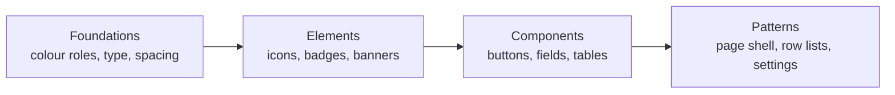

<!--
SPDX-FileCopyrightText: 2026 Wavelens GmbH <info@wavelens.io>
SPDX-License-Identifier: AGPL-3.0-only
-->

# Frontend Style Guide

A design system page at `/styleguide` renders every shared primitive, colour role and layout pattern in the browser. Check it for an existing primitive before building a new one.



## The Page

- Lazy-loaded at `/styleguide`, deliberately linked from nowhere, without an auth guard. No production data on the page.
- Source: `frontend/src/app/features/styleguide/`, one component per section page.

| Section | Contents |
|---|---|
| Overview | The rules below |
| Foundations | Colour roles, type scale, spacing, border radius |
| Elements | Icons, logo, badges, copy fields, read-only rows, message banners, tables, feedback, evaluation status, star button, status icon, charts, toasts |
| Components | Buttons, form field, name with availability check, selection, panel switcher, table, overlays |
| Patterns | Page shell, row list, index cards, card grid, settings, sections with an action, settings destinations, danger zone |

## Rules

- Wrap every store path, hash, key, ID and URL in a `gr-copy-field`. A bare code span is not enough.
- Take all colours from semantic roles. Hex values belong only in the palette, and components read roles rather than palette tokens.
- Put new shared classes in the design system. Component stylesheets take none.
- Build content layouts from `gr-row-list` or `gr-card-grid`. Avoid entity-specific names.
- Keep every element readable in both themes. Never hard-code black or white in a component.
- Color text on tinted status backgrounds with the matching `--gr-status-*-text` role. Never use plain status roles. Fix contrast violations in `tokens.ts`, not on the page side. `contrast.spec.ts` must keep all text roles at 4.5:1 on the base, raised, hover, and sunken surfaces in both themes. Underline links in body text.
- Never write color literals (hex, ``rgb()``, ``hsl()``, or color names) or palette variables outside ``tokens.ts``. Both make ``pnpm colors:check`` fail. The chart can take role names such as ``--gr-chart-cyan`` or ``--gr-graph-success`` in ``[colors]`` and SVG drawn in code can set ``style.fill`` or ``style.stroke`` to ``var(--role)``, so both follow the theme.
- Color statuses through phases with ``buildPhase``, ``evaluationPhase``, or ``execJobPhase``. Then use ``gr-status-badge``, ``gr-status-icon`` and ``PHASE_SEVERITY`` for ``gr-badge`` and ``PHASE_COLOR`` for graphics. Queued, running, waiting, failed, or cancelled jobs then have the same color on every page.
- Render every page inside the single `<main id="main-content">` of the app shell, never add a second `<main>`. Give each page exactly one `h1`, hidden with `.sr-only` when the layout shows no title, and never skip a heading level. Card, chart and empty-state titles are `h2`.
- Give every icon-only button or link a name through `label` or `aria-label`, and name the target ("Remove bob", not "Remove"). `pnpm button-names:check` fails on an unnamed icon-only button. A `gr-copy-field` or `gr-select` inside a `gr-form-field` takes the field label. Outside one, pass `label` to the copy field and `ariaLabel` to the select.
- Add `grScrollRegion` to every element that scrolls on its own, so keyboard users can focus and scroll it while its content overflows. `gr-table` and the log viewer already do this.
- Table rows that open a page on click need a real link (`routerLink`) in the main cell too. Keyboard users can press Tab to reach the link and open the link in a new tab. Stop the click on that link from reaching the row handler. Use a button for rows that open a dialog. Don't rely on a click handler on `tr` or `div` alone.
- Make the full page fit at 375px and 768px widths without horizontal scroll. Set `min-width: 0` on flex and grid children. Allow the header row and action row to wrap. Wide tables scroll inside `gr-table`. Bind `[grDrawer]` and `(grDrawerClose)` on all side panels that slide over the page and overlap content on narrow screens. Escape can close the panel from anywhere. Move focus into the panel on open. Return focus to the button that opened the panel on close.
- Keep text sizes within one step of body size: 16px for interactive text, 14px for secondary text, 12px for badges only.
- Report the result of every write through `NotifyService` (`success`, `failure`), which shows a `gr-toast`. A failed write submitted from an open `gr-dialog` keeps the dialog open and shows the reason through its `[error]` input. Take the reason from `apiErrorMessage(error, fallback)`, never from the `message` of an arbitrary error.
- Bind `[busy]` to `gr-dialog` while a request is active. Bind `[loading]` to the button that sent the request. The dialog can't close and a second request can't start. Set `[closable]="false"` on a dialog that can display a secret once, and show the secret in `gr-copy-field` so it has a copy button.
- Confirm beforehand through `ConfirmService` from `@shared/confirm` on every deletion, removal, cancellation, rejection, abort, drain, and secret rotation. State the exact target and say the outcome. The dialog can run the action itself, remain locked during the action, and show failures inside. Never use the native browser `confirm()`.
- Pass every metric series to `gr-metric-chart`, also an empty one. A chart whose series hold no points says "No data" over the plot, so an empty chart never looks like a broken one. `ApiService` rejects a response without a body (except 204 No Content) as an `ApiError`, so a page shows its error state instead of crashing on `undefined`.
- Gate every write control by the permission that its endpoint can check, not by role name. Project, task and cache responses list the caller's own `permissions`. Build the gate with `accessTo(resource, ...permissions)` (or `injectTaskAccessTo` / `injectCacheAccessTo`) and pass it to `*appWritable` and `[appManagedDisable]`. Bind the busy flag to the same element as `[disabled]`. `appManagedDisable` can combine both.
- Show a refused load through gr-load-state: pass the 403 or 404 error as it is, and the component shows one "No access" or "Not found or access denied" state with a lock icon and no Try Again button. A page that knows the role can't read a list passes `createMissingPermissionLoadStateError(permission, owner)` from `@shared/access` and sends no request. Never add a separate retryable flag or a page-specific no-access title.
- Route guards and resolvers that load a project, task, cache, or team pass refusals from ``@core/routing/access-denied`` through ``denyOnRefusal``. Signed-in users see the shared "Not Found or Access Denied" page instead. Anonymous visitors go to the sign-in page with the requested address set in ``next``. Sign-in can allow access.
- Place the gr-load-state for the page inside the gr-page-layout, never outside that layout. The breadcrumb trail and title remain visible during page load and after a failure.
- Teams have roles instead of permission lists. Team routes resolve the team once with `teamAccessResolver`, and pages read it with `injectTeam()` instead of fetching it again. Gate admin-only team controls and requests with `canManageTeam(team, user)`, which also lets superusers in. A page whose content only members or admins may read shows `createNoAccessLoadStateError(owner, group)` and sends no request.
- Endpoints for project members only (roles, workers, SSH keys, cache subscriptions, SOPS recipients) return 404 to everyone outside the project, superuser included. Use `requestIfProjectMember(project, request)` to wrap these requests. Use `requestIfCacheMember(cache, request, permission?)` to wrap cache requests. Requests from outside the project or outside the cache fail right away with the matching access-denied error and send nothing. Requests without the specified cache permission follow the same rule.
- Signed-in users who change their own role or remove themselves from a project, cache, or team reload the resolved resource into the page's linkedSignal. Access gates then recompute. Send users without access to the project, cache, or team list page. Show pending invitations only to users who can manage members.
- Bind a save-on-change select to the pending value during the request. At all other times bind it to the saved value. Clear the pending value after a failed request. The select can show the saved value again. Write the new value into the list after a successful request. Don't reload the list.
- Show the Settings button only to roles that can change a setting. Use `canOpenProjectSettings(project)` and `canOpenTaskSettings(task)` from `@shared/access` in every header with a link to a settings page. Hide links to pages that show only 'No access' for that role. Keep links to pages that the role can view.
- Show scheduler internals (score, score breakdown, hardware context of the worker, instance context) to superusers only. Give a worker with no name from the server (because the viewer can't see the project) the label "Not shared with this account" and no link. Never show that worker as a raw UUID.
- Validate input on the client with ``fieldChecks`` in ``@shared/forms``. Use ``gr-form-field`` to show messages below the field before the request can leave the client. Track changes on the settings page with ``unsavedChanges()`` from ``@shared/forms``. Keep Save disabled when there are no changes. Register ``unsavedChangesGuard`` on the route and ask for confirmation before leaving with edits.
- ``gr-dialog`` can display ``[error]`` above the footer and outside the scrolling content. A failed write can leave the result next to the button that the user pressed.
- Bind `(grSubmit)` instead of `(click)` on the submit button of every `gr-dialog` and `gr-settings-section` form. It blocks the submit while a `gr-form-field` in the same section shows an error. After each click it scrolls to the first field with an error and focuses it, also when the errors only appear after the submit. Call `injectRevealFirstInvalid()` from `@shared/forms` only on submit paths without that button, such as Enter in a field. Place the save result directly above `Save` on long settings pages. Scroll the result into view.
- Build every in-app link with links from @shared/routing. Never write a path as an array or a string. A builder returns a UrlTree with its query, so bind it to routerLink alone, without queryParams, and navigate with router.navigateByUrl. Pages that open from a task or an evaluation keep it in the link, so the way back returns to the same evaluation and build. Every page shows a gr-breadcrumb trail (through gr-page-layout or on its own) back to its parent.
- gr-log-viewer reads the #L<n> line link from the URL itself and jumps to that line each time it changes, also on a page that is already open. Pages don't parse the fragment. A page that rewrites its query parameters before its first log shows sets preserveFragment, so the line link survives.
- Show a waiting or stuck state through gr-waiting-notice, never as bare text. Its mapping, explainWaiting in @shared/evaluation, gives each reason a title, a detail and either an action (a link or Run) or a hint whom to ask, chosen by the viewer's permission. Add a new reason there, not on a page.
- Show connection status with `gr-live-status` on all pages that receive socket updates. Get status from the `onLiveSocketConnectedChange` callback of `LiveService.connect`. Refetch page data on each reconnect, so missed events while the socket is down don't skew counters.
- Use `buildStatusLabel()` from `@shared/evaluation` to display build status. Never show raw API values such as `FailedPermanent`.
- Link sibling pages of one area, such as the user settings, with gr-link-tabs in the page banner slot, so every page reaches its siblings in one click.
- Show repository fetch failures in `app-repository-fetch-banner` of `@shared/git`. Members who can edit the task see the git error and how to fix the failure. Everyone else sees who to ask.
- Show the webhooks that a Git host sent to an integration with the `app-incoming-deliveries` of `@shared/git`. Rows contain the event, result, and rejection reason.
- Keep the initial bundle below the 500 kB budget. Load shell parts not needed for first render (dialogs, command palette, menus built on `@angular/cdk/overlay`) inside a `@defer (on idle)` block. Import lazy components from their own file, not from a barrel such as `@shared/confirm`. Imports from a barrel keep the component in the initial bundle. Triggers inside the shell store clicks that happen before the lazy code has loaded (see the user menu in the header). Those triggers replay the clicks after the block has rendered.
- Put the Git settings for a task on that task's repository page. Repository setup flows reuse `app-repository-access` and `app-repository-events` instead of a separate form. UI labels show "receives events" and "reports status" instead of inbound and outbound.
- Use at most one primary button per view or section. A primary button can be the main action in a page header, the submit button in a form or dialog, or an empty-state action. Use `secondary` for section header actions, row actions, and all other actions. Assign the same severity to equivalent actions. Use `danger` for all destructive actions, namely delete, revoke, remove, abort, deny, decline, disconnect. Keep `secondary` for disable and enable because both actions are reversible. Only these three severities exist under `button[grButton]`. Disabled buttons drop severity and show a subdued outline, so they don't look like enabled buttons. Tests in `contrast.spec.ts` check the primary fill on a page at 3:1.
- Add the reason for every disabled button to `[grTooltip]`. One example is "Evaluation is already queued". Disabled `button[grButton]` elements still receive hover, so the tooltip can appear. Browsers still discard the click.
- Row actions have visible labels (Edit, Remove, Revoke, Delete). Keep the `aria-label` for the target. Use icon-only buttons only in table cells, toolbars, and zoom controls when the label doesn't fit. Buttons in the same row have the same size.
- Set the content width of a page with the `width` input of `gr-page-layout`. Don't set a fixed width on sections. Use `form` (720px) for creation flows, `settings` (880px) for all settings pages and their sibling pages, `detail` (1200px) for overviews and lists, and `full` for graphs and logs. Pages without `gr-page-layout` use the same `$content-width-*` variables. Button labels don't wrap. Wrap the button row with `.gr-form-actions` instead.
- The header menu can fill the full height below the header on narrow screens and use the font size of body text. A one-line row meta, such as a commit and its elapsed time, can cut off with an ellipsis and not wrap to a second line.
- Fit the graph canvas to the content on load. Small graphs fill the view rather than a small patch in blank space. Set legend text to 14px and color swatches to 12px.
- Mark the active tab of `gr-link-tabs` and every other tab row with a `--gr-accent` underline. Put badges on the name line of a row and separate the parts of the meta line with " · ". Don't nest a `gr-row-list` inside a card. Each row is already its own card, so set `[card]="false"` on the section around it.
- Use `gr-link-tabs` for every tab row on a page, including the job board. Put a fade on an overflowing tab row only on the side where more tabs are hidden. Keep the active tab in view. Use `gr-row` on narrow screens to move labeled buttons and selects to a separate line below the name, so the name can keep full width. The info bar on the log page can wrap to multiple lines instead of a horizontal scroll. Stat cards align values to the top. Values on the same row line up even with a label on multiple lines.
- Treat `duration` as runtime. Format `duration` with ``formatDuration()`` from ``@shared/text``. Measure an evaluation from the first fetch (``evaluationDuration()``). Measure a build from the start of an attempt (``buildDuration()``). Both are ``@shared/evaluation``. Never count queue time as duration. Display "-" for a job or evaluation that didn't start.
- Show the build count from `buildTally()` inside `@shared/evaluation` as `done / total builds`. Place that label next to `gr-segmented-bar`, which shows the same counts. Count completed, failed and cancelled builds as done. Dependency-failed builds count as cancelled. Count substituted builds only in the overall total. Don't add a second build counter with a different meaning.
- Use the `serverDate` pipe or `serverTime()` in `@shared/text` for API timestamps, never Angular's `date` pipe or `new Date()`. API timestamps come as UTC without a zone, so only these show the same local time on every page.

## Shared UI Package

The package `@gradient/ui` lives in the pnpm workspace at `frontend/packages/ui`. Two consumers build on it: Gradient itself and the frontend of [`gradient-proxy`](architecture.md) for servers.gradient.ci.

| Entry | Content |
|---|---|
| `@gradient/ui/ui` | Generic primitives, listed under [`gr-ui`](#gr-ui) |
| `@gradient/ui/chrome` | `gr-header` and `gr-footer`, configured through brand, nav and footer link inputs plus a `[slot=lang]` |
| `@gradient/ui/tokens` | Colour tokens from `tokens.ts` |
| `@gradient/ui/styles/*` | SCSS partials `variables`, `themes`, `grids` and the global `base` styles |

- The package must stay free of imports from `@core`, `@shared` or `@features`. Only primitives without such imports belong there.
- An ESLint rule blocks these imports in `packages/ui` code.
- `pnpm tokens:generate` and `pnpm tokens:check` delegate their work to the package.
- `ng test` runs the package specs as well.
- The `gradient-proxy` frontend can link the package with `link:../../frontend/packages/ui`.

## `gr-ui`

The generic building blocks live in `frontend/packages/ui/src/ui/` and build on `@angular/cdk`. Gradient-specific components (`gr-eval-status-badge`, `gr-status-icon`, `gr-waiting-notice`, `gr-live-status`, `gr-metric-chart`, `gr-star-button`, `gr-label-help`) live in `frontend/src/app/shared/ui/`. Imports go through the barrel of each layer.

```ts
import { FormFieldComponent, PageLayoutComponent, SettingsSectionComponent } from '@gradient/ui/ui';
import { MetricChartComponent } from '@shared/ui';
```

| Group | Selectors |
|---|---|
| Actions | `button[grButton]`, `a[grButton]`, `gr-star-button`, `gr-menu` |
| Forms | `gr-form-field`, `input[grInput]`, `textarea[grInput]`, `select[grInput]`, `gr-password-input`, `gr-name-field`, `gr-select`, `gr-select-button`, `gr-checkbox`, `gr-autocomplete`, `gr-label-help` |
| Display | `gr-badge`, `gr-eval-status-badge`, `gr-status-icon`, `gr-icon`, `gr-logo`, `gr-copy-field`, `gr-field-row`, `gr-stat-card`, `gr-metric-chart`, `gr-table`, `gr-divider` |
| Feedback | `gr-message-banner`, `gr-toast` (with `MessageService`), `gr-loading-spinner`, `gr-empty-state`, `gr-load-state`, `gr-load-more` |
| Overlays | `gr-dialog`, `gr-popover`, `[grTooltip]` |
| Layout | `gr-page-layout`, `gr-breadcrumb`, `gr-link-tabs`, `gr-settings-section`, `gr-row-list` / `gr-row`, `gr-card-grid`, `gr-nav-card`, `gr-tab-switch`, `[grInView]`, `[grScrollRegion]`, `[grDrawer]` |

- `gr-page-layout`: a header with title and subtitle, a breadcrumb, optional `[slot=actions]` buttons and an optional `[slot=banner]`, then the content.
- `gr-settings-section`: a titled section with an optional description. A card contains it by default. Set `[card]="false"` to drop the card.
- `gr-load-state`: a wrapper for any content that can load its own data. The inputs `loading`, `error` and `empty` pick one of four states (a spinner, an error with a Try Again button, an empty state, or content). Errors always take precedence over the empty state. A failed request can never show the "nothing here yet" text. 403 or 404 responses show the inaccessible state without Retry. Keep the data visible on reload. Skip the spinner with data on screen. Put write errors (save, delete) outside `error`. Those errors belong next to the failed action.
- Mark `main` with `aria-busy` in the app shell if route guards, resolvers, or page code wait longer than 300 ms during navigation. Also show a "Loading page..." spinner on the first page of a visit. Don't add another loading state to a page for a route guard or resolver.
- Pickers that need another item (cache, team, integration) and have an empty list show the next step in a ``.gr-form-aside`` line below the field. Users who can create that item get the create dialog in place. Reopen the original dialog with the new item selected after creation. Links to the page for that item cover the other case. Don't show the create option to users who can't create. ``injectCanCreateCache()`` and ``injectCanCreateTeam()`` hold that check inside ``@shared/forms``.
- A different page can create the missing item (an integration for a trigger, for example). Set the link to include a return path in the query string (for example `links.integrationForTrigger`). Open the create dialog on that page. Wait for the secret dialog to close after creation, then show a "Back to trigger" banner. Make the banner link reopen the original dialog with the new item selected (through `links.editTrigger` in this case). Recheck permissions on both pages.
- Server-paginated lists (projects, tasks, caches) use `pagedList()` from `@shared/paging` and end with `gr-load-more`. Lists keep items on screen and add the next page. Show a toast on a failed page load. Keep the list.
- Keep lists that other users change (tasks, caches, members, subscription requests) current with `runReloadIntervalWhileTabVisible()` from `@shared/paging`. Pass `pagedList().refreshFirstPageSilently()` or a fetch that sets the signal. The helper skips hidden tabs, reloads when the tab shows again and keeps the shown items when a reload fails. Pages with a socket use `gr-live-status` instead.

## Grid Utilities

`frontend/packages/ui/src/styles/_grids.scss`, registered globally in `src/styles.scss`.

| Class | Layout |
|---|---|
| `.gr-grid-stats` | Auto-fit grid of stat cards, 220px minimum |
| `.gr-grid-form` | Two-column form, one column below `$breakpoint-md`. `.gr-grid-form__full` will span both |
| `.gr-grid-cards` | Auto-fill grid of cards, 280px minimum |
| `.gr-grid-rows` | Label, value, actions rows |
| `.gr-form-aside` | Auxiliary row below form fields. Prompt for the next action (e.g. create a missing item). |
| `.gr-form-actions` | Row of form buttons. `--end` will align right |

## Related

- [Contributing](contributing.md#angular-and-typescript) covers the rules for dependencies and lockfiles.
