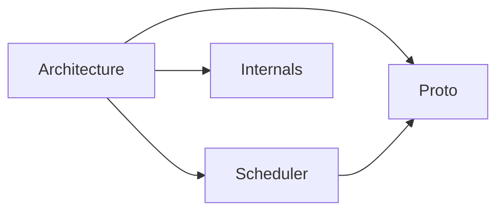

# Contributors

How Gradient is built, for anyone changing the code. Readers can start with the architecture and then read the part matching the change.

## Start Here

-   :material-sitemap: **[Architecture](architecture.md)**

    Crates, binaries and how server, workers and the database fit together.

-   :material-source-pull: **[Contributing](contributing.md)**

License, setup instructions, contribution workflow and coding standards.

-   :material-test-tube: **[Tests](tests.md)**

    Test locations, the Nix checks and the test database on a real Postgres.

## Core

-   :material-graph: **[Scheduler](scheduler/index.md)**

    Build sharing, start counters, upstream substitution, cache closure and scoring.

-   :material-lan-connect: **[Proto](proto/index.md)**

    The worker protocol under `/proto`: handshake, assignment, jobs, transfers and federation.

-   :material-code-braces: **[Internals](internals/index.md)**

    Git host webhooks, NAR storage, cache serving, graph queries and authentication.

-   :material-database-arrow-up: **[Migrations](migrations.md)**

    How to write, register and retire database migrations.

## Evaluation

-   :material-cpu-64-bit: **[Eval Worker Setup](eval-worker.md)**

    Covers the subprocess pool for evaluations, shard discovery across workers and the shared eval cache.

-   :material-chart-line: **[Evaluation Metrics](eval-metrics.md)**

    Explains per-evaluation Nix metrics, their storage format and display on the Job Board.

## Debugging and UI

-   :material-file-search: **[Diagnostic Reports](diagnostic-reports.md)**

    How to read the report file, its scopes and the `gradient-report` inspector.

-   :material-palette: **[Frontend Style Guide](frontend-style-guide.md)**

    A reference page covering the form, layout and grid primitives used across the web UI.

