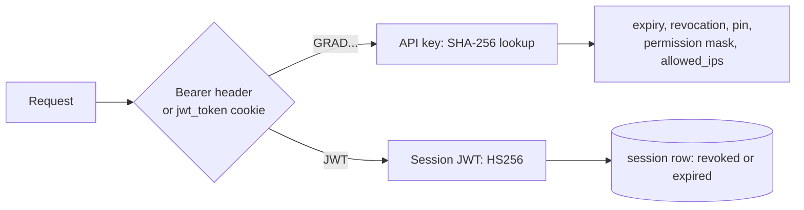
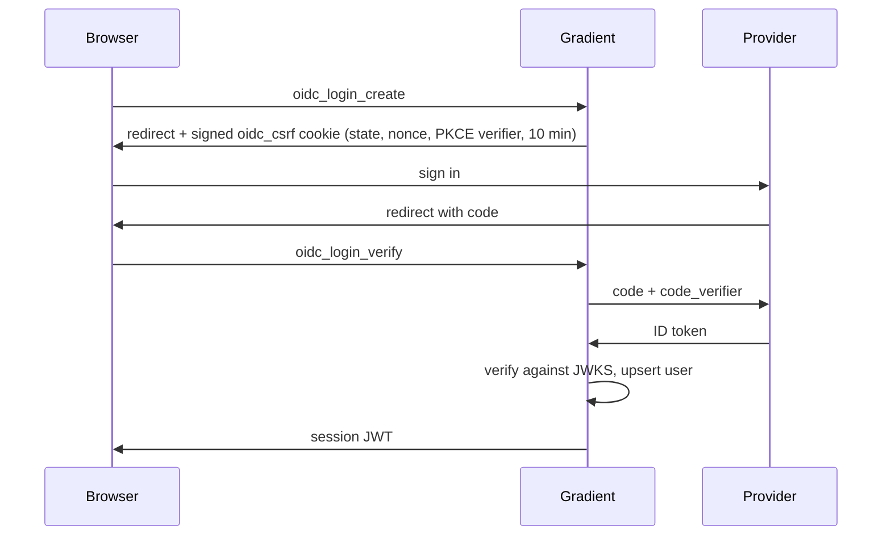

<!--
SPDX-FileCopyrightText: 2026 Wavelens GmbH <info@wavelens.io>
SPDX-License-Identifier: AGPL-3.0-only
-->

# Authentication

HTTP requests carry one of four credentials: a session JWT, an API key, a download token, or an OIDC sign-in. Worker authentication on `/proto` has its own page, [Connection](../proto/connection.md).

## Tokens

| Token | Format | Lifetime | Minted by |
|---|---|---|---|
| Session JWT | HS256 with `GRADIENT_SECRETS_JWT_FILE`. Claims `{ exp, iat, id, jti }`, where `jti` names the `session` row | 24 h, or 30 days with `remember_me` | `create_session_and_token` |
| API key | 64 random alphanumeric characters, stored as SHA-256 hex, returned with a `GRAD` prefix | Governed by `expires_at`, or no expiry | API key endpoints |
| Download token | HS256 JWT with `derivation` and `evaluation` claims | 1 h | `encode_download_token` |

- Requests verify the session row for revocation and expiry.
- API key rows carry `expires_at`, `revoked_at`, `allowed_ips`, a permission mask and an optional project or cache pin.
- The server updates `api.last_used_at` and `session.last_used_at` at most once per minute (`LAST_USED_STAMP_INTERVAL`).
- Failed updates end in a log line, never in a fatal error.

## OIDC

- PKCE with S256 is mandatory.
- Provider endpoints come from `<discoveryUrl>/.well-known/openid-configuration`.
- `oidc_login_verify` hands back the user record.
- The same endpoint can also create the session.

## Login Providers

- Extra sign-in methods over OAuth can live in `ServerExtensions::login_providers`, each behind the `LoginProvider` trait of `gradient-core`.
- The default list is empty. The login page then shows no extra buttons.
- `provider_authorize` signs a `login_csrf` cookie with the provider, the `state`, the PKCE verifier and a purpose, valid for 10 min.
- The purpose is `login`, or `connect` with the IDs of the signed-in user and session.
- Browsers drop the `SameSite=Strict` session cookie on the redirect back from the provider.
- `connect` callbacks take both IDs from the `login_csrf` cookie instead.
- Connections can only complete while that session is still active. API keys cannot start one.
- Callback failures redirect to `/account/login?login_error=<code>`. Providers can choose the code with a `LoginRefusal`.
- Providers with `replaces_password_login` switch off password login and registration, like `oidc.required`.

## External Identities

| Table | Columns | Constraints |
|---|---|---|
| `user_identity` | `user`, `issuer`, `subject`, `created_at` | unique `(issuer, subject)`, unique `(user, issuer)` |

- OIDC rows hold the ID token `iss` and `sub`.
- Provider rows hold the issuer of the provider and the subject from its identity.
- OIDC and login providers share `sign_in_external` in `authorization/external_login.rs`.
- `decide` can choose between four outcomes: update, claim, new account or refusal.
- Email matches ignore case. The slower of two racing first sign-ins can retry once and then find the user of the faster one.
- A claim needs an account with no identity row. Passwords prevent the claim too, unless a verified email matched and password login is off.

## Related

- [API](../../reference/api.md): how headers and API keys work
- [Set Up Single Sign-On](../../guides/sso.md): how to configure providers
