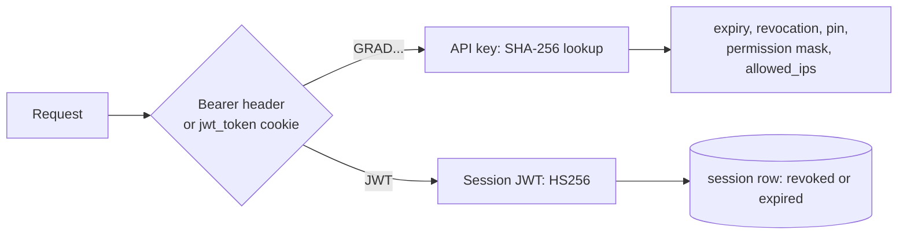
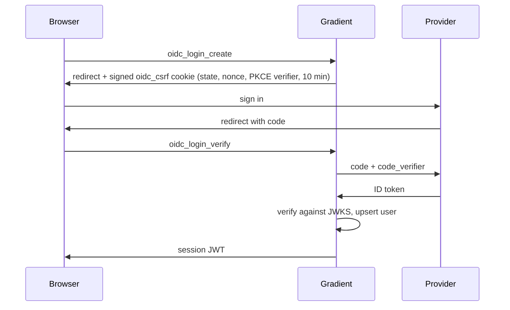

<!--
SPDX-FileCopyrightText: 2026 Wavelens GmbH <info@wavelens.io>
SPDX-License-Identifier: AGPL-3.0-only
-->

# Authentication

Every HTTP request carries one of four credentials: a session JWT, an API key, a download token, or an OIDC sign-in. Worker authentication on `/proto` works differently and is documented in [Connection](../proto/connection.md).

## Tokens

| Token | Format | Lifetime | Minted by |
|---|---|---|---|
| Session JWT | HS256 with `GRADIENT_SECRETS_JWT_FILE`. Claims `{ exp, iat, id, jti }`, where `jti` names the `session` row | 24 h, or 30 days with `remember_me` | `create_session_and_token` |
| API key | 64 random alphanumeric characters, stored as SHA-256 hex, returned with a `GRAD` prefix | Governed by `expires_at`, or no expiry | API key endpoints |
| Download token | HS256 JWT with `derivation` and `evaluation` claims | 1 h | `encode_download_token` |

- Each request must verify the session row for revocation and expiry.
- API keys store `expires_at`, `revoked_at`, `allowed_ips`, a permission mask and an optional project or cache pin.
- The server updates `api.last_used_at` and `session.last_used_at` at most once per minute (`LAST_USED_STAMP_INTERVAL`).
- A failed update produces only a log line and never a fatal error.

## OIDC

- PKCE with S256 is mandatory.
- All endpoints can be read from `<discoveryUrl>/.well-known/openid-configuration`.
- `oidc_login_verify` hands back the user record.
- The same endpoint also mints the session.

## Related

- [API](../../reference/api.md): how headers and API keys work
- [Set Up Single Sign-On](../../guides/sso.md): how to configure providers
