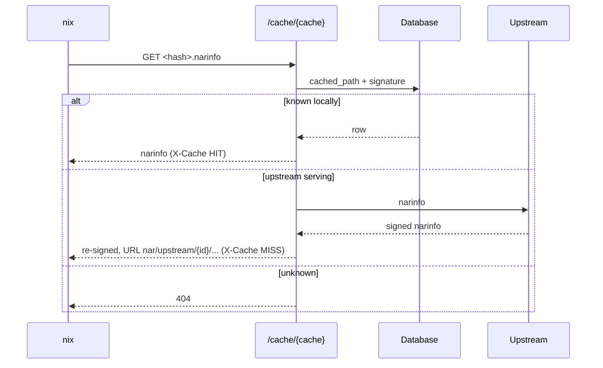

<!--
SPDX-FileCopyrightText: 2026 Wavelens GmbH <info@wavelens.io>
SPDX-License-Identifier: AGPL-3.0-only
-->

# Cache Serving

The `/cache/{cache}/` route will answer Nix requests. Topics here are signatures, narinfo from the database, pull-through from upstream caches, debug info and status codes for clients. Access and complete closures are on [Cache Closure](../scheduler/cache-closure.md) instead.



## Signing

- **Keys:** Each cache has one Ed25519 key, encrypted with the crypt secret.
    - To get the decrypted private key, call `format_cache_key`.
    - To get the public key as `<host>-<name>:<base64>`, call `format_cache_public_key`.
- **Signer:** Only the server can sign; the worker cannot. Most signatures come from the graph writer's transaction, which covers worker and REST uploads alike.
- **Signatures:** Caches of projects that require a path receive a `cached_path_signature` row for that path.
    - Projects need a path once any of their jobs run on the path's derivation. Commits to a cache with subscription `sign_outputs` off write that row without a signature.
    - Each NAR commit can sign into the caches of the upload (`sign_into_caches` in `gradient-graph/src/nar.rs`).
    - Projects with a job on a committed path then receive its signature in their caches (`gradient-graph/src/claims.rs`).
    - Claims also cover the store paths that a claimed path can reference. All caches track the count of deleted `cached_path_signature` rows in `binary_cache_deleted_path_signature_count`.
    - A trigger at statement level (`after_delete_cached_path_signature_trigger`) can increment a counter by one for each affected cache and for each DELETE statement. A row can reference a deleted path in that cache directly, or through other rows. The same trigger can set `reference_closure_established_at_cache_deletion_count` to NULL on each row of this kind. Rows in other caches keep their value. Triggers can also act on cascades from foreign keys. These cascades include the retired cached path, the demoted cache claim, garbage collection (`GC_DELETE_STALE_CLAIMS` of `gradient-graph/src/gc.rs`) and the deleted cache.
    - Garbage collection can delete rows. The same pass can use each row's own last fetch time or last pin time.
    - Scanned rows write the current count to `reference_closure_established_at_cache_deletion_count` when rows exist in the same cache for every path in the full reference closure. Rows with a missing path anywhere below remain NULL.
    - Rows with a non-NULL value stop the reference walk. Delete operations clear only rows above the deleted path. The next push can walk to the missing path. That push can create the rows again. Value writers first lock the count of their own cache with `FOR SHARE` (`lock_cache_deletion_counts_for_share_in_cache_id_order`). Count changes after the start of the walk mark that row as NULL. Delete operations wait for that lock. The same delete operation can clear those rows after a commit from the writer.
    - Placeholder insertion on push (`INSERT_PLACEHOLDERS_FOR_PROJECT_STORE_HASHES`) and signature backfill stop at rows with a non-NULL value. These inserts only need that row to exist. A later sweep can add a signature to that row.
        - The response to a push doesn't wait for this insert. The server can add the pushed hashes that were already stored to a per-project queue. One background pass (`pushed-store-path-unsigned-signature-placeholder-insert` in `gradient-cache/src/pushed_store_path_signature_placeholder_insert.rs`) can run one statement per project for all hashes queued so far. Queued hashes disappear on server restart. The next push of a path with those hashes in a closure can create the rows.
    - A signature claim can stop the reference walk only at a signed row that has a non-NULL value. Unsigned rows below that row can still reach the signer.
    - Recorded batches sign the already cached outputs of their jobs into their project's caches. Builds finished earlier for another project qualify too.
    - The sign sweep (`sign_missing_signatures` in `gradient-cache/src/signatures.rs`) fills rows inserted with a later subscription.
    - Subscriptions that start signing record the request time in `project_cache`. The backfill process for signatures (`signature-backfill` in `gradient-cache/src/signature_backfill_pass.rs`) can write unsigned rows for earlier project outputs. This process can then start the signature sweep. Those rows get their signatures from the sweep.
    - Signatures from the signature sweep also go on unsigned rows that pass `cache_can_sign_content_variant_sql_condition`.

## Narinfo

`GET /cache/{cache}/<hash>.narinfo` responses come straight from the database. The server never re-packs or re-hashes a NAR.

| Source | Fields |
|---|---|
| `derivation_output` | Output of a known derivation |
| `cached_path` | Sizes, hashes, references, and `CA:` for content-addressed paths. Also serve as fallback for `.drv` files and standalone paths |
| `cached_path_signature` | `Sig:` lines, plus the access check |

### Pull-Through

- The server rewrites the `URL:` of an upstream narinfo to `nar/upstream/{id}/...` paths.
- The server re-signs an upstream narinfo only, after it verify the upstream signature.
- The `X-Cache` header read `HIT` for a local narinfo and `MISS` for an upstream one.
- Caches with `pull_through` off skip the upstream lookup (`pull_through_upstream_caches` in `gradient-db/src/caches/upstream.rs`). Narinfo, upstream NAR, debug info and build log requests then answer `404` on a miss.

## Realisations

**Response:** Requests to `GET /cache/{cache}/build-trace-v2/{drv}/{output}.doi` return the output path that a build realised for a content-addressed derivation.

```json
{"outPath": "<hash>-<name>", "signatures": ["<cache key name>:<signature>"]}
```

- These rows originate in `derivation_output` with `path_known_after_build` set and a recorded `hash`.
- The out path must belong to this cache, like a narinfo.
- Answers carry a signature from the cache key.

## Debug Info

**Response:** The `GET /cache/{cache}/debuginfo/{build_id}` route mirrors Nix's `index-debug-info` format.

```json
{"archive": "../nar/<store hash>.nar.zst", "member": "lib/debug/.build-id/<xx>/<yy>.debug"}
```

- `archive` paths are relative to the requested key.
- Both `<build-id>` (Hydra) and `<build-id>.debug` (`nix copy`) spellings work as request keys.
- The signature join acts as the access check.
- The `debug_info` index gets built from NARs of paths ending in `-debug`, i.e. `separateDebugInfo` outputs.
- Each upload walks its own NAR on a detached task.
- The `cached_path.debug_info_indexed` column marks a scanned NAR, so the `debug-index` sweep reads each `file_hash` at most once.
- A miss falls through to the upstream caches. The `archive` value gets rewritten to `nar/upstream/{id}/...` paths.
- Absolute `archive` values and paths outside the upstream root get rejected.

## Browser Redirect

| Request path | Redirect for an HTML page request |
|---|---|
| `/cache/{cache}`, `nix-cache-info`, `gradient-cache-info` | `{frontend_url}/caches/{cache}` |
| `{hash}.narinfo`, `ls/{hash}` | `{frontend_url}/caches/{cache}/nars?hash={hash}` |

- HTML page requests have `text/html` in their `Accept` header. The `*/*` wildcard alone cannot match. Calls from Nix, curl, and `fetch()` keep the response unchanged.
- The `binary_cache_browser_redirect.rs` middleware can make this decision before authentication and before cache lookup. Redirect responses are the same for public caches, private caches, and caches that don't exist.
- Redirects include `Cache-Control: no-store`. All responses on these routes include `Vary: Accept`. Shared HTTP caches keep both responses separate.
- NAR downloads, `serve`, `log`, `debuginfo`, `build-trace-v2`, and `proto` never redirect.
- Cache names and hashes use percent encoding. Narinfo files and listings with an invalid store hash keep the response unchanged.
- `GRADIENT_FRONTEND_REDIRECT_BROWSER_REQUESTS_TO_FRONTEND_PAGES=false` can disable redirects. The NixOS module can disable redirects with `frontend.enable` off and `frontend.url` still equal to `serveUrl`.

## Status Codes

| Case | Answer |
|---|---|
| Unknown key | `404` only, never a different `4xx` code. Substituters and debuginfod clients treat any other code as a hard error and skip to the next source |
| Disabled cache | `400` |
| Private cache without credentials | `401` |
