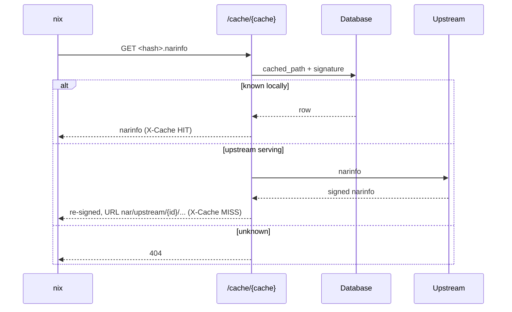

# Cache Serving

The `/cache/{cache}/` route will answer Nix requests. Topics here are signatures, narinfo from the database, pull-through from upstream caches, debug info and status codes for clients. Access and complete closures are on [Cache Closure](../scheduler/cache-closure.md) instead.



## Signing

- **Keys:** Each cache has one Ed25519 key, encrypted with the crypt secret.
    - To get the decrypted private key, call `format_cache_key`.
    - To get the public key as `<host>-<name>:<base64>`, call `format_cache_public_key`.
- **Signer:** Only the server can sign; the worker cannot. Most signatures come from the graph writer's transaction, which covers worker and REST uploads alike.
- **Signatures:** Every cache of a project that needs a path gets a signed `cached_path_signature` row for that path.
    - A project needs a path once its signing tasks have a job on the path's derivation. Tasks with `sign_cache` off add no row.
    - Each NAR commit can sign into the caches of the upload (`sign_into_caches` in `gradient-graph/src/nar.rs`).
    - Projects with a job on a committed path then receive its signature in their caches (`gradient-graph/src/claims.rs`).
    - Recorded batches sign the already cached outputs of their jobs into their project's caches. Builds finished earlier for another project qualify too.
    - The sign sweep (`sign_missing_signatures` in `gradient-cache/src/signatures.rs`) fills rows inserted with a later subscription.
    - The sweep also fills rows a commit left unsigned.

## Narinfo

`GET /cache/{cache}/<hash>.narinfo` responses come straight from the database. The server never re-packs or re-hashes a NAR.

| Source | Fields |
|---|---|
| `derivation_output` | Output of a known derivation |
| `cached_path` | Sizes, hashes, references, and `CA:` for content-addressed paths. Also serve as fallback for `.drv` files and standalone paths |
| `cached_path_signature` | `Sig:` lines, plus the access check |

### Pull-Through

- The server rewrites the `URL:` of an upstream narinfo to `nar/upstream/{id}/...` paths.
- The server re-signs an upstream narinfo only, after it verify the upstream signature.
- The `X-Cache` header read `HIT` for a local narinfo and `MISS` for an upstream one.
- Caches with `pull_through` off skip the upstream lookup (`pull_through_upstream_caches` in `gradient-db/src/caches/upstream.rs`). Narinfo, upstream NAR, debug info and build log requests then answer `404` on a miss.

## Debug Info

**Response:** The `GET /cache/{cache}/debuginfo/{build_id}` route mirrors Nix's `index-debug-info` format.

```json
{"archive": "../nar/<file_hash>.nar.zst", "member": "lib/debug/.build-id/<xx>/<yy>.debug"}
```

- `archive` paths are relative to the requested key.
- Both `<build-id>` (Hydra) and `<build-id>.debug` (`nix copy`) spellings work as request keys.
- The signature join acts as the access check.
- The `debug_info` index gets built from NARs of paths ending in `-debug`, i.e. `separateDebugInfo` outputs.
- Each upload walks its own NAR on a detached task.
- The `cached_path.debug_info_indexed` column marks a scanned NAR, so the `debug-index` sweep reads each `file_hash` at most once.
- A miss falls through to the upstream caches. The `archive` value gets rewritten to `nar/upstream/{id}/...` paths.
- Absolute `archive` values and paths outside the upstream root get rejected.

## Status Codes

| Case | Answer |
|---|---|
| Unknown key | `404` only, never a different `4xx` code. Substituters and debuginfod clients treat any other code as a hard error and skip to the next source |
| Disabled cache | `400` |
| Private cache without credentials | `401` |
