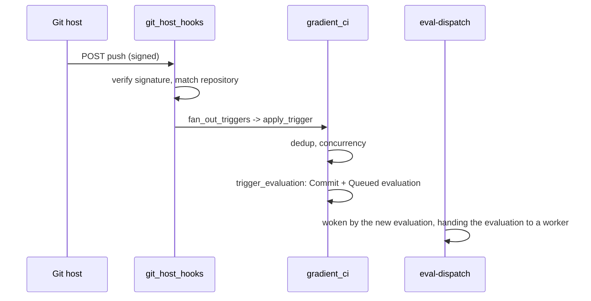

<!--
SPDX-FileCopyrightText: 2026 Wavelens GmbH <info@wavelens.io>
SPDX-License-Identifier: AGPL-3.0-only
-->

# Git Host Webhooks

Git hosts send events to the endpoints in `gradient-web/src/endpoints/git_host_hooks/`. These routes use no session. Each request must prove its origin through the Git host's signature before the endpoint acts on it. A push event results in a `Queued` evaluation.

## Routes

| Route | Verification |
|---|---|
| `POST /api/v1/hooks/github` | `X-Hub-Signature-256` checked against `GRADIENT_GITHUB_APP_WEBHOOK_SECRET_FILE`. `503` until the App is fully configured |
| `POST /api/v1/hooks/{connection_id}` | Gitea / Forgejo / GitLab connections. UUID for each. `gitea` / `forgejo`: HMAC from `X-Forgejo-Signature`, then `X-Gitea-Signature`. `gitlab`: constant-time comparison of `X-Gitlab-Token`. GitHub App connections respond with `404`. |
| `POST /api/v1/hooks/{git_host}/{project}/{connection_name}` | The alias for the project connection that `(project, name)` identifies. The connection type selects the signature check and the payload format. The `git_host` segment must match the connection type: `gitea` and `forgejo` match Gitea and Forgejo connections, `gitlab` matches GitLab connections. A segment that does not match returns `404`. GitHub App connections return `404`, other GitHub connections return `400`. |

- Both routes use the connection's `git_host_type` for signature checks and payload format.
- Connections with `receives_events` off and unknown connections return `404`.
- The crypt file can decrypt secrets on the server.
- Requests from other sources fail at `allowed_ips` with `403`.
- GitHub `installation` / `installation_repositories` events create or update an instance connection `github-<login>` with `save_github_app_installation_and_link_tasks_when_new` (with `github-<installation_id>` when the name is in use). GitHub `deleted` events delete that connection.
- A new install links every unmanaged task that has no connection and has a GitHub repository in the account. New installs link only tasks in projects that hold a repository grant for the new connection and the repository of the task. Other tasks stay unlinked. The install and link run in one transaction. An update to an existing install links nothing.
- The API or OAuth2 create project connections. Those connections link unmanaged project tasks on the same known host in the same way (`insert_and_link_fitting_tasks`). Team connections, instance connections without a GitHub install, and declarative state don't link tasks.

## GitHub App Events

GitHub App webhooks reach the following handlers:

| Event | Handler |
|---|---|
| `push` | Push chain below |
| `pull_request` | Pull request triggers |
| `release` | `route_github_app_release`: triggers with `releases_only` |
| `check_run` | `approval::handle_github_check_run` |
| `pull_request_review` | `approval::handle_pull_request_review` |
| `issue_comment` | `commands::handle_issue_comment`: comment commands |
| `installation`, `installation_repositories` | `handle_github_installation` |

## Push Chain

| Step | Code | Action |
|---|---|---|
| 1 | `fan_out_triggers` (`git_host_hooks/fanout.rs`) | Selects active `task_trigger` rows of type `ReporterPush` where the branch and tag globs match the push |
| 2 | `normalize_repo_url`, `event_repo_matches_task` | Strips a trailing `/` and `.git`, rewrites `git@` URLs. Compares `owner/repo` in lowercase and ignores the host |
| 3 | `gradient_ci::apply_trigger` | Drops a head commit with a [skip marker](../../concepts/projects-and-tasks.md#skip-a-commit) as `SkippedByCommitMessage`. Applies dedup and concurrency rules. A running evaluation can be aborted, or the new one parks in `Waiting`. A violation of `uq_evaluation_one_active_per_task` maps to `SkippedConcurrency` |
| 4 | `gradient_ci::trigger::trigger_evaluation` | Insert or update the `Commit` row for the project and hash. Keep the stored message if the new message is empty. Insert the `Queued` evaluation. Reset `last_check_at`. |
| 5 | `eval-dispatch` | Gets woken through `record_evaluation_created` and offers the evaluation to workers. A 5 s tick serves as the fallback |

## Approval of Pull Requests from Forks

Pull requests from forks wait for maintainers with `require_approval` in the trigger. Gradient does not create an evaluation of a commit until people with write access to the repository approve that commit.

| Step | Code | Action |
|---|---|---|
| 1 | `decide_evaluation_code_trust_from_approval_context_repository_and_push_rights` (`git_host_hooks/fanout.rs`) | Start pull requests from the same repository. Start a fork pull request only for an author with ownership of the head repository and push rights on the base repository. Ignore the webhook sender. Treat an unknown fork state as a fork. |
| 2 | `is_commit_approved_by_maintainer_for_task` | Approved commits start evaluation immediately. Database errors mark the commit as unapproved. |
| 3 | `store_pending_approval_for_untrusted_fork_pull_request_commit_and_post_approval_check` | Save one pending `fork_pull_request_approval` row per task, pull request and commit. The row can hold the pull request base branch (none for `/gradient run`). Delete older pending rows for the same pull request. Record `fork_pull_request_approval.needs_maintainer_approval`. Post a `gradient/<task>: Approval` check. The trigger path filter can run only after approval. The fork commit remains unfetched until maintainer approval. |
| 4 | `handle_github_check_run` (`git_host_hooks/approval.rs`) | A user with write permission can use the **Approve and run** button to approve the row of the check that was clicked. |
| 5 | `handle_pull_request_review` | Reviews from users with write permission grant approval only to the pending row for the reviewed commit. GitHub webhooks send that commit as `review.commit_id`. Gitea and Forgejo webhooks trigger Gradient to query the reviews API through a reporter limited to the task repository. Payload `commit_id` values have no effect on Gradient. Only `APPROVED` and `REQUEST_CHANGES` reviews from the webhook sender are valid. The latest review is final. Later `COMMENT` reviews do not revoke approval. Selected reviews require `APPROVED`, `dismissed` set to `false` and the full commit hash. Dismissed latest approvals produce no approval. The review user login must match the webhook sender. Renamed accounts fall under this match. Sender IDs that are missing, zero, or negative produce no approval and no API call. The review limit for Gradient is 500 reviews (10 pages of 50). The write permission check and the search need to complete within 4 seconds combined. Timeouts and search failures log a warning. The page limit, a 404 and the no-match case log at info level. None of those approve anything. Gradient did not fall back to `pull_request.head.sha`. `head` movement before webhook arrival is possible. Reviews of a commit with no pending row change nothing. |
| 6 | `decide_allowed_comment_action` (`git_host_hooks/commands.rs`) | `/gradient approve <commit>` and `/gradient run <commit>` from users with write permission approve the pending row of exactly that commit. The commit must be a full 40-character hash. Comments without a commit approve nothing. `/gradient run` commands without a commit go through the step 1 check like a push. |
| 7 | `approve_approval_and_start_approved_commit_evaluation` | Read the task and active triggers first. List changed files between the base branch tip and the commit with a base branch on the row and a path filter on the trigger. Mark the row approved without an evaluation and record `fork_pull_request_approval.approval_without_changed_file_matching_trigger_path` when changed files do not match. Mark the row approved and create an evaluation in one transaction in all other cases. Roll back the transaction and leave the row pending when no new evaluation can result. Record `fork_pull_request_approval.evaluation_started_after_approval` after the commit, not before. |

## Related

- [Connect GitHub](../../guides/github.md) covers the initial setup
- [Events and Webhooks](../../reference/events.md) documents outbound events
