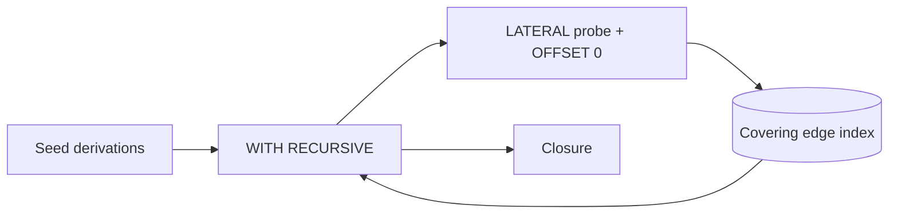
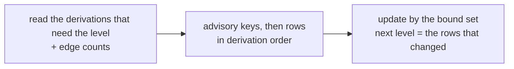

# Graph Queries

The dependency graph can be queried with SQL. Recursive walks traverse it, a fence bounds their cost, and dedicated indexes serve them. This file also documents counter updates, instance metrics and the graph API.



## Walks

All shared walks live in `gradient-db/src/graph/walks.rs` in the backend. Each caller passes in a seed and a direction, and the module returns a `WITH RECURSIVE` prelude. Walks run under `begin_walk`, with `work_mem` set to `64MB` for the statement. A root-array seed, such as the need update, follows a different path. It declares `DefaultWorkMem` and sticks with the PostgreSQL default of `4MB`. That default caps the dedup tables of the recursive `UNION`s.

| Walk | Generator | Fenced |
|---|---|---|
| Build closure, failure cascade | `dependency_closure_cte` | Yes |
| Runtime closure (`kind IN (1, 2)`) | `runtime_closure_cte` | Yes |
| GC keep-set | `live_cached_paths_cte` | Yes |
| Walk completeness | `graph/walk_completeness.rs` (hand-written) | Yes |
| Runtime recount | `graph/runtime_can_start.rs`, `recount_sql` | No |
| Task board dependency counts | `task_board/mod.rs`, `DEP_COUNTS_SQL` | No |

## The `OFFSET 0` Fence

```sql
WITH RECURSIVE closure(derivation) AS (
    SELECT unnest($1::uuid[])
  UNION
    SELECT s.next FROM closure c, LATERAL (
      SELECT e.dependency AS next FROM derivation_dependency e
      WHERE e.derivation = c.derivation OFFSET 0) s)
```

- Postgres will estimate a recursive working table at ten times the seed.
- A 44 000-node closure got 348 870 rows estimated against 2 439 actual.
- A merge join over the whole edge index will look cheaper than a nested loop at that estimate.
- The planner will then rescan four million edges per iteration.
- An `OFFSET 0` will stop the pull-up.
- A correlated lateral can only run as a nested loop with an index lookup per row.

| Walk (production) | Plain join | Fenced |
|---|---|---|
| Evaluation closure, 43 898 nodes | 5 278 ms | 955 ms |
| GC keep-set, 315 155 nodes | 40 069 ms | 9 746 ms |

**`UNION`, not `UNION ALL`:** The set operator will deduplicate the frontier each iteration. The walk up to the derivations needing a node can emit 940 000 rows for 68 000 distinct nodes. A `UNION ALL` would grow exponentially with depth on diamond graphs.

## Indexes

| Index | Shape | Use |
|---|---|---|
| `derivation_dependency_pkey` | `(derivation, dependency)` | Downward walks. The pair serves as the key, with no surrogate column |
| `idx-derivation_dependency-reverse-pair` | `(dependency, derivation)` | Upward walks |
| `idx-derivation_dependency-runtime` | `(dependency) INCLUDE (derivation) WHERE kind IN (1, 2)` | The complete-closure counter update. It goes from a dependency to the shared builds that count it |
| `idx-build_job-created_at`, `idx-entry_point-created_at` | `created_at INCLUDE (derivation)` | The GC freshness seed |

Every edge index covers its query, so walks read from indexes alone. For the GC freshness seed, the cutoff matches the start of the candidate scan. Almost no row can match the seed, and the engine must detect this without a scan.

## Counter Updates

The functions `ripple_missing_runtime_deps` and `ripple_unwalked_inputs` carry changes to `missing_runtime_deps` (or `derivation.unwalked_inputs`) one level up the graph. A single SQL function call handles one level. Each level runs three steps.



An early version derived the bound set inside the update statement. The planner then lacked a small driver table and fell back to a sequential scan of `cached_path`, taking row locks in physical order. That scan deadlocked the NAR commit against maintenance roughly every six minutes. Two changes fixed both problems. First, lock the bound set in `derivation` order before the update. Second, execute one level per statement. The bootstrap-leaf batch needed 163 round trips under that scheme, so the function now packs them into a single call.

## Instance Metrics

Nine `derivation_metric` values and four `dispatched_job` values feed the instance pass. It averages each value over three windows: 5 min, 1 h and 24 h. A 30 s schedule controls the pass through `GRADIENT_METRICS_INSTANCE_INTERVAL_SECS`.

- `missing_nar_size`, `missing_count` and `dependency_count` live as columns on `dispatched_job`.
- The `idx-dispatched_job-build-window` index stores these columns beside `ready_at`, so the aggregate can run as an index-only scan.
- In production, reading the same values from the `job_context` jsonb took 1.94M buffers and 1.6 s for 449k rows.
- No backfill of the columns is planned.
- The `AVG` aggregate skips nulls, the same way the jsonb read behaved on a missing key.
- The longest window is one day.

## Graph API

The endpoint `GET /builds/{build}/graph` lives in `gradient-web/src/endpoints/builds/graph.rs`. It performs a breadth-first walk over `derivation_dependency`, starting at the build's derivation.

| Aspect | Behavior |
|---|---|
| Frontier | `DerivationId`s. An evaluation lists only the derivations reached by its own walk plus their direct inputs, and the walk ignores `build_job` for that reason |
| Nodes | Derivation id, the status of the shared build or null when none exists, and `build`: the `build_job` of the same evaluation, or null |
| Cap | 500 nodes. The walk still reads the edges of every kept node |
| Cost | One query per wave, plus three for the nodes |
| Edges | No `kind` filter, so runtime dependencies appear as well. `DependencyEdge { source, target }`: `source` come first in build order, `target` second |

## SQL/PGQ

Gradient does not use the PostgreSQL 19 `GRAPH_TABLE` feature. Its first release can only match fixed-length patterns, while every walk in Gradient has unbounded depth.

- `derivation` and `derivation_dependency` already have the vertex and edge table shape that `CREATE PROPERTY GRAPH` needs.
- A migration would affect `graph/walks.rs` and the hand-written walks above.
- Revisit once quantified path patterns land.
