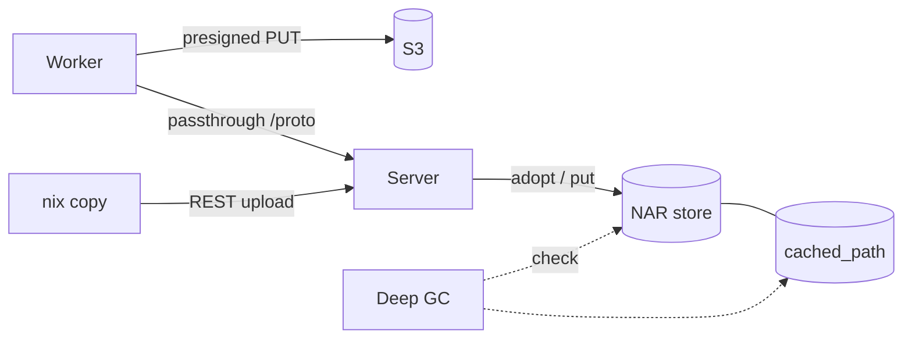

# NAR Storage

NAR object locations, the write path into storage and the sync between storage and database. Delivery of NARs to clients is on [Cache Serving](cache-serving.md) instead.



## Layout

```text
${baseDir}/nars/<2 chars>/<rest>.nar.zst
```

- Named by the **store-path hash**.
- The server will presign upload URLs before the worker has the content hash.
- The narinfo will advertise `nar/<file_hash>.nar.zst` as the URL.
- The `resolve_effective_hash_db` function will map the file hash back to the key.
- `last_fetched_at` and `fetch_count` on `cached_path` feed eviction.

## Writes

| Path | Write |
|---|---|
| Presigned upload (S3) | The worker is writing to S3 directly. The server is completing multipart on `UploadFinished` |
| Passthrough (local storage) | Every upload is streaming through the server. The commit is checking length and SHA-256, then moving the file in with `adopt_file` |
| REST upload (`nix copy`) | `import_nar_reader` -> `put_nar_idempotent_reader`: skipped for a stored path, see [First Content](#first-content) |

### First Content

Stored paths keep the first content they received, like valid paths in Nix. Non-reproducible builds can produce other bytes for one input-addressed path.

- **Stored:** A confirmed `cached_path` row with a `file_hash` (`MCachedPath::is_stored`).
- **Grant:** Workers asking to upload a stored path get a `Skip` grant. They drop the NAR and count the output as uploaded.
- **Writes:** Passthrough, REST and SSH leave the object of a stored path untouched. Only identical bytes can replace a missing object.
- **Commit:** The NAR commit must keep the content fields of a stored row. Only `deriver` can change.
- **Signatures:** Workers with other bytes get the stored content signed into their project caches. REST and SSH clients with other bytes get no signature.
- **SSH:** An `AddMultipleToStore` with other bytes must succeed. The server can drain and drop those bytes.
- **Concurrent Uploads:** Uploads of a path take turns on a server and check the row again on their turn, see [Transfer](../proto/transfer.md#upload).
- **Self-Heal:** The verify-on-read self-heal can demote a path with an object not matching its `file_hash`.

!!! warning "Bucket Requirements"
    - No object versioning, object lock or replication. Object lock and replication force versioning.
    - Versioned buckets keep a copy of every deleted NAR. No S3 GC can reclaim those copies.
    - An `AbortIncompleteMultipartUpload` lifecycle rule (e.g. 7 days). NARs over 1 GiB go up as multipart. A worker dying mid-upload will leave the parts behind.

## Build Logs

Build logs share the NAR backend (`gradient-storage/src/log.rs`). The shard is the last byte of the `BuildAttemptId` value. That byte is the random tail of a UUIDv7.

```text
logs/<last 2 chars>/<attempt>.log                  # live log
logs/<last 2 chars>/<attempt>/chunk_<n>.zst        # finalized
```

- **Live:** appended to `${baseDir}/logs/...` while the attempt is active, also with S3 (S3 has no append).
- **Finalized:** The `finalize_build_log` function will append the live file as zstd chunks after any earlier chunks. The function will index the chunks in `build_log_chunk` and drop the live file. The chunks go only to `<prefix>logs/...` with S3.
- **Finalize Triggers:** The shared build turning terminal. A new attempt replacing the latest one (abort, lost worker, retry). An upstream log arriving after the build (log substitution). Every trigger will queue a `LogFinalize` pending delivery (`pending_delivery` row) for the attempt.
- **Missing Chunks:** A `[log chunk unavailable]` line per indexed line for a chunk with a missing object. A single such line in its place after a re-finalize.
- **Reclaimed:** Logs together with the derivation for the orphan-derivation GC. Logs without a `build_attempt` row for the [deep GC](#deep-gc) log pass.

## Storage Migrations

Layout changes of NAR, log and blob storage are storage migrations, the storage counterpart of the database migrations (`gradient-cache/src/storage_migrations/`).

- **Units:** An ascending unit list per migration. Every unit is idempotent. Apply a cut unit again in full after a restart.
- **Ledger:** A row per migration in the `storage_migration` table, the last finished unit in `checkpoint`, the done mark in `applied_at`.
- **Order:** Registry order for pending migrations, a unit per `gc.deepPaceMs`, ahead of any [deep GC](#deep-gc) unit. The deep GC: the current layout only.
- **Readers:** For a migration moving live objects, the old location readable until completion.

## Deep GC

Every storage backend checked against the database, a unit at a time (`gradient-cache/src/deep_gc/`). A round: every unit once, in ascending key order.

| Unit | Removed |
|---|---|
| `blobs` | `build-request-blobs/...` objects and `build_request_blob` rows without a partner |
| `logs/<xx>` | Logs of a shard, named by `BuildAttemptId`, without a `build_attempt` row. An attempt without a log is legitimate |
| `nars/<xx>` | A two-character NAR shard out of the 1024. Objects past `gc.narUploadGraceHours` without a keeping row. Confirmed `cached_path` rows of the shard (an index range on `hash`) with a missing object. Maintenance: eviction of outdated live paths |
| `partials` | Unfinished uploads under `nar-partial`, `nar-upload-partial` and `source-upload-partial` older than `nar.partialTtlSecs` and directories left empty by the older nested layout. These roots: no other sweep. A walk on a session or request path: a stall of that path behind the filesystem |

- **Rounds:** an `admin_task` row, `kind = deep_gc`, `pending` -> `running` -> `completed`. A single active round per the partial unique index `admin_task_one_active_per_kind`.
- **Background:** A round `gc.deepIntervalSecs` after the last round, a value of `0` to disable background rounds, a unit per `gc.deepPaceMs` in a background round.
- **Requested:** A `POST /api/v1/admin/maintenance/deep-gc` call (superuser, `202`) for a round. A `POST` during an active round: back to the first unit. A requested round: units back to back.
- **Checkpoint:** The `admin_task.checkpoint` column for the last finished unit, the running report in `progress`.
    - Both for the `GET /api/v1/admin/tasks[/{task_id}]` endpoint.
    - A server restart: continuation after the checkpoint.
- **Restart Race:** A checkpoint saved only for the round that took the unit, with `started_at` unchanged since that round started. A `POST` in between: a reset of `started_at` and a win.
- **Failure:** The checkpoint in place after a failed unit. The same unit again on the next tick.
