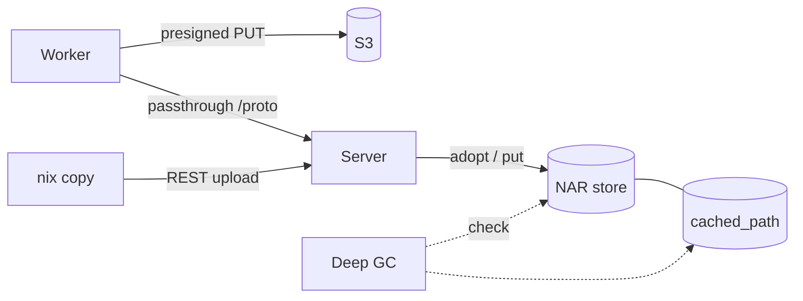

<!--
SPDX-FileCopyrightText: 2026 Wavelens GmbH <info@wavelens.io>
SPDX-License-Identifier: AGPL-3.0-only
-->

# NAR Storage

NAR objects live in dedicated storage. This page describes where they reside, how writes reach that storage, and how the storage and database stay in sync. [Cache Serving](cache-serving.md) handles delivery of NARs to clients.



## Layout

```text
${baseDir}/nars/<2 chars>/<rest>.nar.zst
```

- The storage key `<store-path hash>-<SHA-256 of the compressed file>` is the name of each stored NAR object. The keys live in column `cached_path.nar_object_storage_key`. Store path hashes map to one row per stored content.
- Presigned upload URLs point to `nar-uploads/<store-path hash>-<UUID>.nar.zst`, a temporary object. Hash and size checks run on the server before the move of that object to the storage key.
- The narinfo will advertise `nar/<store hash>.nar.zst` as the URL, with the hash as the client sees it.
- NAR requests keyed by file hash end with `404`. All copies of the same NAR share one file hash. Only the store hash can name a single path.
- `last_fetched_at` and `fetch_count` on `cached_path_signature` contribute to eviction for each cache.

## Writes

| Path | Write |
|---|---|
| Presigned upload (S3) | The worker writes directly to S3. On `UploadFinished`, the server completes the multipart upload. |
| Passthrough (local storage) | Every upload streams through the server. At commit time, the server checks length and SHA-256, then moves the file in with `adopt_file`. |
| REST upload (`nix copy`) | Uploads go through server staging into a temporary object. Hash and size checks follow. Next is the move to the storage key through `move_verified_upload_to_final_storage_key`. |

### Stored Contents per Path

Stored paths keep one `cached_path` row per stored content. Storage keys are unique per row. Non-reproducible builds sometimes generate different bytes for one input-addressed path.

- **Stored:** A `cached_path` row. Such rows contain the file hash, NAR hash and NAR size.
- **Grant:** A worker can upload the NAR of a stored path like any other NAR, without a skip grant.
- **Writes:** Uploads that carry the NAR hash of a stored row reuse that row. Server-side deletes drop uploaded objects with no referencing row.
- **Commit:** Commits with different NAR hashes add a new `cached_path` row with their own storage key. Existing row fields, including deriver, do not change.
- **Narinfo:** Narinfo requests get exactly one signed row in that cache. Rows that were uploaded to that cache come first. Rows that jobs built on Gradient workers come next. Rows with the oldest age come last.
- **Concurrent Uploads:** Uploads of a path take turns on a server, and each upload rechecks the row on its turn, see [Transfer](../proto/transfer.md#upload).
- **Self-Heal:** Missing objects retire only the `cached_path` row for that content.

!!! warning "Bucket Requirements"
    - No object versioning, object lock or replication. Object lock and replication force versioning.
    - Versioned buckets retain a copy of every deleted NAR. No S3 GC can reclaim those copies.
    - Configure an `AbortIncompleteMultipartUpload` lifecycle rule (e.g. 7 days). NARs over 256 MiB upload as multipart. A worker dying mid-upload leaves the parts behind.

## Build Logs

Build logs share the NAR backend with other artifacts (`gradient-storage/src/log.rs`). To pick a shard, take the last byte of the `BuildAttemptId` value. That byte form the random tail of a UUIDv7.

```text
logs/<last 2 chars>/<attempt>.log                  # live log
logs/<last 2 chars>/<attempt>/chunk_<n>.zst        # finalized
```

- **Live:** appended to `${baseDir}/logs/...` while the attempt is active, also with S3 (S3 has no append).
- **Finalized:** The `finalize_build_log` function will append the live file as zstd chunks after any earlier chunks. The function will index the chunks in `build_log_chunk` and drop the live file. The chunks go only to `<prefix>logs/...` with S3.
- **Finalize Triggers:** The shared build turning terminal. A new attempt replacing the latest one (abort, lost worker, retry). An upstream log arriving after the build (log substitution). Every trigger will queue a `LogFinalize` pending delivery (`pending_delivery` row) for the attempt.
- **Missing Chunks:** A `[log chunk unavailable]` line per indexed line for a chunk with a missing object. A single such line in its place after a re-finalize.
- **Reclaimed:** Logs together with the derivation for the orphan-derivation GC. Logs without a `build_attempt` row for the [deep GC](#deep-gc) log pass.

## Storage Migrations

Layout changes of NAR, log and blob storage are storage migrations, the storage counterpart of the database migrations (`gradient-cache/src/storage_migrations/`).

- **Units:** An ascending unit list per migration. Every unit is idempotent. Apply a cut unit again in full after a restart.
- **Ledger:** A row per migration in the `storage_migration` table, the last finished unit in `checkpoint`, the done mark in `applied_at`.
- **Order:** Registry order for pending migrations, a unit per `gc.deepPaceMs`, ahead of any [deep GC](#deep-gc) unit. The deep GC: the current layout only.
- **Readers:** For a migration moving live objects, the old location readable until completion.

## Deep GC

Every storage backend checked against the database, a unit at a time (`gradient-cache/src/deep_gc/`). A round: every unit once, in ascending key order.

| Unit | Removed |
|---|---|
| `blobs` | `build-request-blobs/...` objects and `build_request_blob` rows without a partner |
| `logs/<xx>` | Logs of a shard, named by `BuildAttemptId`, without a `build_attempt` row. An attempt without a log is legitimate |
| `nars/<xx>` | Two-character NAR shards out of 1024. Objects older than `gc.narUploadGraceHours` with no row to keep them. All `cached_path` rows of a shard with a missing object (index range on `hash`). Maintenance: eviction of outdated live paths. |
| `partials` | Unfinished uploads under `nar-partial`, `nar-upload-partial` and `source-upload-partial` older than `nar.partialTtlSecs` and directories left empty by the older nested layout. These roots: no other sweep. A walk on a session or request path: a stall of that path behind the filesystem |

- **Rounds:** an `admin_task` row, `kind = deep_gc`, `pending` -> `running` -> `completed`. A single active round per the partial unique index `admin_task_one_active_per_kind`.
- **Background:** A round `gc.deepIntervalSecs` after the last round, a value of `0` to disable background rounds, a unit per `gc.deepPaceMs` in a background round.
- **Requested:** A `POST /api/v1/admin/maintenance/deep-gc` call (superuser, `202`) for a round. A `POST` during an active round: back to the first unit. A requested round: units back to back.
- **Checkpoint:** The `admin_task.checkpoint` column for the last finished unit, the running report in `progress`.
    - Both for the `GET /api/v1/admin/tasks[/{task_id}]` endpoint.
    - A server restart: continuation after the checkpoint.
- **Restart Race:** A checkpoint saved only for the round that took the unit, with `started_at` unchanged since that round started. A `POST` in between: a reset of `started_at` and a win.
- **Failure:** The checkpoint in place after a failed unit. The same unit again on the next tick.
