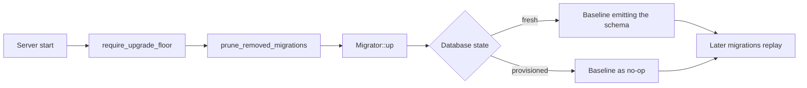

# Database Migrations

[SeaORM migrations](https://www.sea-ql.org/SeaORM/docs/migration/setting-up-migration/) power schema changes in Gradient. The migration files live in `backend/gradient-migration/src/` and get registered in that crate's `lib.rs`. At server start, the migrator checks the `seaql_migrations` table and applies every migration not yet recorded there.

## Adding a Migration

1. A new file `mYYYYMMDD_NNNNNN_<name>.rs` in `backend/gradient-migration/src/`, registered in the `lib.rs` file.
2. The matching entity in the `backend/gradient-entity/src/` directory.
3. A `down()` that is a real inverse, or an explicit `Err(DbErr::Migration("... is irreversible"))` for a lossy change. A silent no-op `down()` is not allowed. Such a `down()` would claim a reversibility missing from the migration.

## Baseline

Before the v2.0.0 release, `m20261013_000000_baseline` replaced the entire prior migration chain.

| Database | Baseline behavior |
|---|---|
| Fresh | The baseline emits the schema left behind by the old chain: a cleaned `pg_dump` of that chain, checked with a dump diff and the constant `cache_role` seed rows |
| Already provisioned | The baseline detects the existing schema and changes nothing. `prune_removed_migrations` removes the deleted files' `seaql_migrations` rows |

A database that stopped partway through the old chain sits behind the [Upgrade Floor](#upgrade-floor).

### Regenerating After a Future Squash

1. Apply the full chain to a scratch PostgreSQL: run `initdb`, then `DATABASE_URL=... cargo run -p gradient-migration -- up -n <boundary>`.
2. Dump the schema with `pg_dump --schema-only --no-owner --no-privileges --exclude-table=seaql_migrations`.
3. Remove the psql `\restrict` and `SET` prelude, then re-append the constant seed rows.
4. Check the result with a schema and data dump diff between a full-chain database and a baseline database.
5. Rename the baseline file and set `UPGRADE_FLOOR` to the last release that still carried the full chain, see [Upgrade Floor](#upgrade-floor).

## Upgrade Floor

A database behind a squash into the baseline has no migration files left to apply. `require_upgrade_floor` (`backend/gradient-db/src/connection/upgrade_floor.rs`) reads `seaql_migrations` on each server start, ahead of `prune_removed_migrations`. Servers refuse to start on a database behind the floor. Errors in the log name the missing migration and the release to start first.

| `seaql_migrations` | Server start |
|---|---|
| Empty | Fresh install, allowed |
| Holding the baseline of the running release | Same baseline, allowed |
| Holding `last_migration`, with all `storage_migrations` applied | Upgrade over the squash, allowed |
| Anything else | Refused |

`UPGRADE_FLOOR` in `backend/gradient-migration/src/lib.rs` is the floor.

| Field | Meaning | Value |
|---|---|---|
| `release` | Release to start first on a refused database | `v2.0.0` |
| `last_migration` | Last database migration of that release | `m20261012_000001_wildcard_grammar` |
| `storage_migrations` | [Storage migrations](internals/nar-storage.md#storage-migrations) of that release, each with `applied_at` in the `storage_migration` table | `m20261001_000000_shard_build_logs` |

- **Storage:** The `storage_migration` table apply to both an S3 store and a local NAR store, and the check include both.
- **Baseline Name:** On a squash, rename the baseline file. Databases from an earlier baseline lack the new name and stop before the floor.

## Cancelling Pairs

A column can ship in one release and disappear in a later one. The migration history then contains an `add_X` / `drop_X` pair, and every fresh install runs both migrations for nothing. Delete such a pair with the rules below.

### Removal Conditions

Both conditions must hold.

- `drop_X` shipped in a release, and at least one later minor release followed it. Live installs then had a window to apply the drop.
- No migration between the two touched `X` in a way that removal changes. Check this with `rg -n "<ColumnName>|<column_name>" backend/gradient-migration/`.

### Removal Limits

- Leave the original `create_table_*` migration of the table untouched. Editing it changes the schema on every install path.
- Restrict intermediate migrations to mechanical edits, such as removing a column declaration that the `drop_X` removed anyway.

### Existing Installs

- Rows for deleted files remain in `seaql_migrations` on live installs. SeaORM then fails with "Applied migrations not found in migration list".
- Call `prune_removed_migrations` (`backend/gradient-db/src/connection/mod.rs`) before `Migrator::up`. This removes every row absent from `Migrator::migrations()` and records the removed versions at `info` level.
- The full change: delete the migration file and its `lib.rs` entry.

## Removed Pairs

| Pair | Issue | Notes |
|---|---|---|
| `add_has_artefacts_to_build_output` / `drop_has_artefacts_from_derivation_output` | #71 | The migration `m20260408_000000_split_build_into_derivation` also declared this column again. That declaration got removed too. |
| `add_github_app_enabled_to_project` / `drop_github_app_enabled_from_project` | #71 | The two pair files held the only references to this column. |
