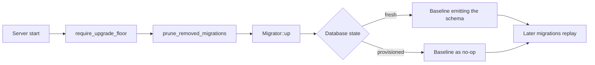

# Database Migrations

Gradient migrations are [SeaORM migrations](https://www.sea-ql.org/SeaORM/docs/migration/setting-up-migration/). Files live in `backend/gradient-migration/src/`, registered in its `lib.rs`. Each server start applies the migrations missing from `seaql_migrations`.

## Adding a Migration

1. A new file `mYYYYMMDD_NNNNNN_<name>.rs` in `backend/gradient-migration/src/`, registered in the `lib.rs` file.
2. The matching entity in the `backend/gradient-entity/src/` directory.
3. A `down()` that is a real inverse, or an explicit `Err(DbErr::Migration("... is irreversible"))` for a lossy change. A silent no-op `down()` is not allowed. Such a `down()` would claim a reversibility missing from the migration.

## Baseline

`m20261013_000000_baseline` replaced every migration before the v2.0.0 release.

| Database | Baseline behavior |
|---|---|
| Fresh | Emitting the schema left by that chain: a cleaned `pg_dump` of the real chain, verified by dump diff and the constant `cache_role` seed rows |
| Already provisioned | Detecting the schema and doing nothing. `prune_removed_migrations` drops the deleted files' `seaql_migrations` rows |

A database stuck earlier in that chain is behind the [Upgrade Floor](#upgrade-floor).

### Regenerating After a Future Squash

1. Run the full chain into a scratch PostgreSQL: `initdb`, then `DATABASE_URL=... cargo run -p gradient-migration -- up -n <boundary>`.
2. `pg_dump --schema-only --no-owner --no-privileges --exclude-table=seaql_migrations`.
3. Strip the psql `\restrict` and `SET` prelude and re-append constant seed rows.
4. Verify with a schema and data dump diff between a full-chain database and a baseline database.
5. Rename the baseline file and set `UPGRADE_FLOOR` to the last release holding the full chain, see [Upgrade Floor](#upgrade-floor).

## Upgrade Floor

A database behind a squash into the baseline has no migration files left to apply. `require_upgrade_floor` (`backend/gradient-db/src/connection/upgrade_floor.rs`) reads `seaql_migrations` on each server start, ahead of `prune_removed_migrations`. Servers refuse to start on a database behind the floor. Errors in the log name the missing migration and the release to start first.

| `seaql_migrations` | Server start |
|---|---|
| Empty | Fresh install, allowed |
| Holding the baseline of the running release | Same baseline, allowed |
| Holding `last_migration`, with all `storage_migrations` applied | Upgrade over the squash, allowed |
| Anything else | Refused |

`UPGRADE_FLOOR` in `backend/gradient-migration/src/lib.rs` is the floor.

| Field | Meaning | Value |
|---|---|---|
| `release` | Release to start first on a refused database | `v2.0.0` |
| `last_migration` | Last database migration of that release | `m20261012_000001_wildcard_grammar` |
| `storage_migrations` | [Storage migrations](internals/nar-storage.md#storage-migrations) of that release, each with `applied_at` in the `storage_migration` table | `m20261001_000000_shard_build_logs` |

- **Storage:** The `storage_migration` table is the same for an S3 and a local NAR store and both are part of the check.
- **Baseline Name:** Rename the baseline file on a squash. Databases of an earlier baseline lack the new name and stop before the floor.

## Cancelling Pairs

Some columns are added in a release and dropped in a later release. Such a column: an `add_X` / `drop_X` pair left behind. Every new install would run that pair for nothing. The rules below govern the removal of such pairs.

### Removal Conditions

Two conditions apply.

- The release with `drop_X` is out, with a later minor release on top of it. Live installs get a window to apply the drop.
- No change to `X` by a migration between the two that the removal would alter. The `rg -n "<ColumnName>|<column_name>" backend/gradient-migration/` command for this condition.

### Removal Limits

- No edit of the original `create_table_*` migration of the table. Such an edit would change the schema of every install path.
- Intermediate migrations: mechanical changes only, e.g. dropping a column declaration the `drop_X` would remove anyway.

### Existing Installs

- `seaql_migrations` rows for deleted files on existing installs. SeaORM would reject these rows ("Applied migrations not found in migration list").
- `prune_removed_migrations` (`backend/gradient-db/src/connection/mod.rs`) before the `Migrator::up` call: removal of every row not in `Migrator::migrations()`, with the removed versions logged at `info` level.
- Deleting the file and its `lib.rs` entry is the whole change.

## Removed Pairs

| Pair | Issue | Notes |
|---|---|---|
| `add_has_artefacts_to_build_output` / `drop_has_artefacts_from_derivation_output` | #71 | Also removed the column re-declaration in `m20260408_000000_split_build_into_derivation` |
| `add_github_app_enabled_to_project` / `drop_github_app_enabled_from_project` | #71 | Only the two pair files referenced the column |
