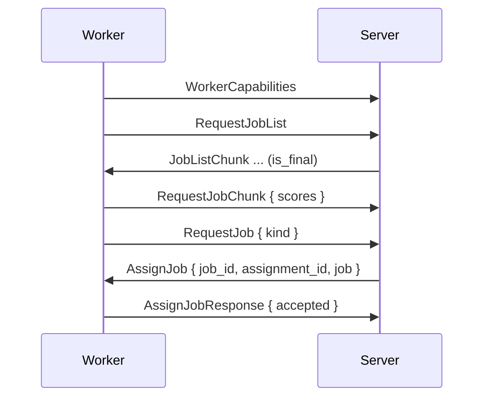

# Capabilities and Assignment

Worker capabilities, job offers and the server's job choice for each free slot. Assignment is pull-based. The server will only assign a job in answer to `RequestJob`.

## Capabilities

After the handshake, workers with the `build` capability send a `WorkerCapabilities` message. Workers without `build` never receive build jobs.

| Field | Meaning | Worker default |
|---|---|---|
| `architectures` | Nix systems the worker can build, as free-form strings | The host system (`macos` show up as `darwin`) |
| `system_features` | Nix system features | System features from the local Nix store plus extras that enabled experimental features add (`recursive-nix`)
| `max_concurrent_builds` | Number of build slots | `GRADIENT_WORKER_BUILD_MAX_CONCURRENT` (1) |
| `cpu_count`, `ram_total_mb` | Hardware details | Detected at startup |
| `cpu_core_score` | Relative single-core speed | A startup micro-benchmark, or `GRADIENT_WORKER_SYSTEM_CPU_CORE_SCORE` |
| `zone` | Locality label used for cluster placement. Workers without a zone share one implicit zone | `GRADIENT_WORKER_ZONE`, unset |
| `endpoint` | Address published for this worker in a cluster roster | `GRADIENT_WORKER_ENDPOINT`, unset |

- `GRADIENT_WORKER_SYSTEM_ARCHITECTURES` and `GRADIENT_WORKER_SYSTEM_FEATURES` replace the detected lists.
- List every system and feature the worker must accept in an override.
- A build can match a worker when the worker's `architectures` contain the build's system and its `system_features` contain every required feature.
- Every `builtin` build will bypass the system check.
- A later `WorkerCapabilities` message will replace the fields and start job assignment again. Running jobs and existing offers remain in place.

## Metrics and Liveness

- The `WorkerMetrics` fields (`cpu_usage_pct`, `ram_free_mb`, `disk_speed_mbps`, `upload_speed_mbps`, `download_speed_mbps`, `build_peak_ram_mb`) travel with the 10 s heartbeat.
- Workers without metrics get unknown values in scoring.
- The server will mark a worker as seen on every message.
- The `worker_liveness_pass` will drop workers silent for `proto.workerHeartbeatTimeoutSecs` (120 s, `0` disabling the check).
- A worker's own `Draining` will stop new assignments.
- Workers send `Draining` on `SIGTERM` and abort every running job. See [Worker Stop](jobs.md#worker-stop).

## Offers

| Message | When |
|---|---|
| `JobListChunk` | The server replies to `RequestJobList` with the full candidate list, split into pages of 1 000. The final page has `is_final` set. |
| `JobOffer` | The server offers the worker jobs it has not received before, up to 1 000 per message. This also covers requeued jobs that the server offers again. |

- Candidates represent evaluations or build jobs that the worker can run and has authorization for.
- Every `JobCandidate` message includes `required_paths` (with NAR sizes for cached paths), `drv_paths` and `output_paths`.
- Build candidates and their `BuildJob` messages include a `requirement` with the Nix system and the required system features. Evaluations omit this field.
- Workers do not cache candidates.
- Workers compare each offered candidate against the local store and score it.
- The worker then replies with a `RequestJobChunk` message. Set `missing_count`, `missing_nar_size` and `outputs_present` in that reply.

## Assignment

- A worker sends `RequestJob { kind }` for each free slot.
- While slots remain open, the worker repeats the request after every `AssignJob`, and every 10 s while idle.
- The server records an unanswered request as an idle slot for [cluster placement](../scheduler/clusters.md#tracking), not as a queued request.
- On each `RequestJob` message, the server scores every pending job of that kind for that worker.
- The [scheduling policy](../../reference/scheduler-policies.md) provides the score, and the server picks the highest. Ties go to the smaller job ID.
- Jobs below the assignment floor of 0 never leave the queue.
- The server claims the winner by inserting a new `dispatched_job` row.
- A lost race allows the server to move on to the next job, up to 3 attempts.
- Only after the claim does the server send the `AssignJob` message.
- The claim ID appears in `AssignJob.assignment_id`, and every report echoes that ID.
- The worker reports through `JobUpdate`, `JobCompleted`, `JobFailed`, `BuildProgress` and `EvalProgress`.
- The server discards reports with a stale ID.
- The worker answers with an `AssignJobResponse` message.
- On a decline (worker draining or full), the server re-queues the job and offers it again.
- An `AssignJob` with `cluster` set is one member of a [cluster job](../scheduler/clusters.md).
- Instead of answering a `RequestJob` message, the server pushes such a job.
- The worker keeps the slot and runs nothing until the `StartCluster` message.
- Without a `StartCluster` message within `cluster.hold_secs`, the worker releases the slot.

## Candidate Sources

| Kind | Pool Entry |
|---|---|
| Evaluation | Every 5 s, each `Queued` evaluation without an open assignment joins the pool. The worker caps this with `GRADIENT_WORKER_EVAL_MAX_CONCURRENT` (1) |
| Build | Every build ready to start joins the pool. A kick (a build that can now start, a capability change, a finished job) or a 5 s tick adds entries. A full resync happens every 60 s |
