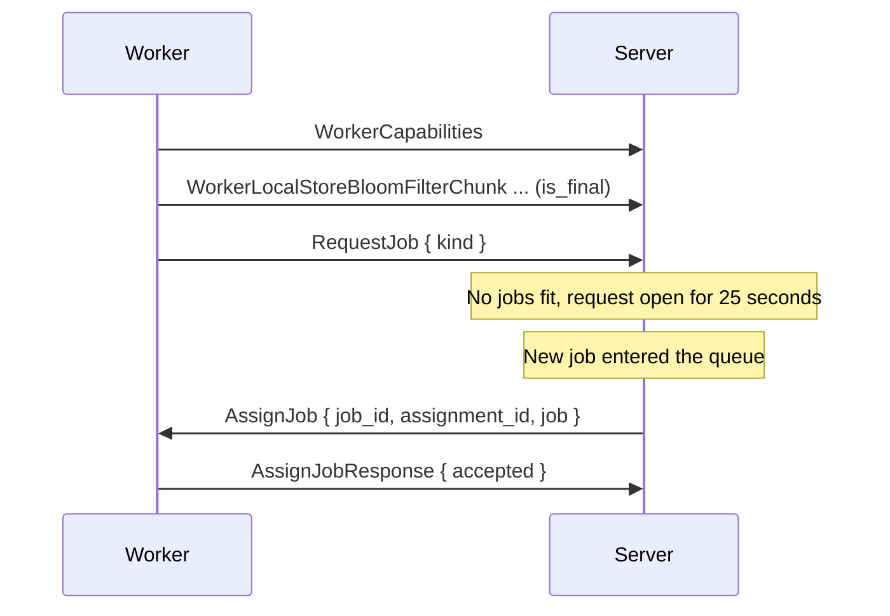

<!--
SPDX-FileCopyrightText: 2026 Wavelens GmbH <info@wavelens.io>
SPDX-License-Identifier: AGPL-3.0-only
-->

# Capabilities and Assignment

Worker capabilities, the store summary of each worker, and job selection for each free slot form the topic of this section. Assignment is pull-based. The server can assign a job only in response to `RequestJob`.

## Capabilities

After the handshake, workers with the `build` capability send a `WorkerCapabilities` message. Workers without `build` never receive build jobs.

| Field | Meaning | Worker default |
|---|---|---|
| `architectures` | Nix systems the worker can build, as free-form strings | The host system (`macos` show up as `darwin`) |
| `system_features` | Nix system features | System features from the local Nix store plus extras that enabled experimental features add (`recursive-nix`)
| `max_concurrent_builds` | Number of build slots | `GRADIENT_WORKER_BUILD_MAX_CONCURRENT` (1) |
| `cpu_count`, `ram_total_mb` | Hardware details | Detected at startup |
| `cpu_core_score` | Relative single-core speed | A startup micro-benchmark, or `GRADIENT_WORKER_SYSTEM_CPU_CORE_SCORE` |
| `zone` | Locality label used for cluster placement. Workers without a zone share one implicit zone | `GRADIENT_WORKER_ZONE`, unset |
| `endpoint` | Address published for this worker in a cluster roster | `GRADIENT_WORKER_ENDPOINT`, unset |

- `GRADIENT_WORKER_SYSTEM_ARCHITECTURES` and `GRADIENT_WORKER_SYSTEM_FEATURES` replace the detected lists.
- List every system and feature the worker must accept in an override.
- A build can match a worker when the worker's `architectures` contain the build's system and its `system_features` contain every required feature.
- Every `builtin` build will bypass the system check.
- A later `WorkerCapabilities` message can replace the fields. Job assignment can resume. Jobs in progress stay as they are.

## Metrics and Liveness

- The `WorkerMetrics` fields (`cpu_usage_pct`, `ram_free_mb`, `disk_speed_mbps`, `upload_speed_mbps`, `download_speed_mbps`, `build_peak_ram_mb`) travel with the 10 s heartbeat.
- Workers without metrics get unknown values in scoring.
- The server will mark a worker as seen on every message.
- The `worker_liveness_pass` will drop workers silent for `proto.workerHeartbeatTimeoutSecs` (120 s, `0` disabling the check).
- A worker's own `Draining` will stop new assignments.
- Workers send `Draining` with `SIGTERM` and abort all running jobs. See [Worker Stop](jobs.md#worker-stop).
- Drains of one worker by admins make the server send `Draining`. Cancellations of that drain by admins make the server send `DrainCancelled` (protocol 60). Workers then request jobs again.

## Store Summary

A worker can publish a store summary. This summary is a Bloom filter over store paths in the local Nix store. The server can score the inputs and outputs of each job against this summary. See [Scoring](../scheduler/scoring.md#contexts).

| Property | Value |
|---|---|
| Message | `WorkerLocalStoreBloomFilterChunk`, split into chunks of at most 1 MiB. The last chunk has `is_final` set. |
| Sent | The worker can rebuild the summary every hour and send the summary again. The first rebuild can come right after the handshake, before the first `RequestJob`. |
| Size | 20 bits per store path, a size for at least 1,024 paths. |
| Probes | The 14 bit positions per path come from enhanced double hashing over the first 16 bytes of the hash of the store path. |
| Server limit | 16 million paths (320 million bits). Workers with a larger store don't send a summary. |

- The latest complete summary is in server memory. Chunks with a wrong offset or a changed size discard only the chunks received so far.
- All inputs count as missing on that worker without a summary.
- Bloom filter false positives can count inputs or outputs as present on a worker without them.
- The summary can lag behind the store by up to one hour. Garbage collection can remove a path. The summary can still list the path as present until the next rebuild. Stale entries make a job look cheaper on that worker. The build can still fetch or build missing paths.
- False positives or stale summaries can mark all outputs of a build as present on a worker. That mark can remove the time and RAM estimates for the build. The scheduler can then ignore the estimates and reserve 0 MB of RAM for that job.

## Assignment

- A worker sends `RequestJob { kind }` for each free slot.
- While slots remain open, the worker repeats the request after every `AssignJob` and every 10 s while idle.
- Unanswered requests leave an idle slot valid for 25 seconds. That slot can act as a standing request. [Cluster placement](../scheduler/clusters.md#tracking) can read the same slot.
- New work arrivals cause the scheduler to send `SessionSignal::JobsAvailableForRequestedKinds` to each worker session with free capacity for that kind and a live idle slot. Signals stay inside the server. No new messages travel over the transport.
- The session can request a job from `Scheduler::fulfill_job_request_for_live_idle_slot` afterward. Expired slots get no assignment. The scheduler cannot extend an expired slot. Only the next `RequestJob` from the worker can refresh the slot.
- The server can scan pending jobs of that kind in dispatch order on request. Priority jobs come first, then the oldest `ready_at`, then the job ID. Jobs that the worker can't run or access never appear in that scan.
- A build job and its `BuildJob` message carry a `requirement` with the Nix system and required system features. Evaluation jobs for flakes leave out this field.
- The server can score at most 2,048 of the remaining jobs. It can stop after 512 jobs without a veto (`MAX_SCORED_JOBS_PER_REQUEST`). The rest wait for a later request.
- The [scheduling policy](../../reference/scheduler-policies.md) provides the score, and the server picks the highest. Ties go to the smaller job ID.
- Jobs below the assignment floor of 0 never leave the queue.
- The server claims the winner by inserting a new `dispatched_job` row.
- A lost race allows the server to move on to the next job, up to 3 attempts.
- Only after the claim does the server send the `AssignJob` message.
- The claim ID appears in `AssignJob.assignment_id`, and every report echoes that ID.
- The worker reports through `JobUpdate`, `JobCompleted`, `JobFailed`, `BuildProgress` and `EvalProgress`.
- The server discards reports with a stale ID.
- The worker answers with an `AssignJobResponse` message.
- The server can requeue a job after a decline (workers drain or are full).
- An `AssignJob` with `cluster` set is one member of a [cluster job](../scheduler/clusters.md).
- Instead of answering a `RequestJob` message, the server pushes such a job.
- The worker keeps the slot and runs nothing until the `StartCluster` message.
- Without a `StartCluster` message within `cluster.hold_secs`, the worker releases the slot.

## Candidate Sources

| Kind | Pool Entry |
|---|---|
| Evaluation | Every 5 s, each `Queued` evaluation without an open assignment joins the pool. The worker caps this with `GRADIENT_WORKER_EVAL_MAX_CONCURRENT` (1) |
| Build | Every build ready to start joins the pool. A kick (a build that can now start, a capability change, a finished job) or a 5 s tick adds entries. A full resync happens every 60 s |
