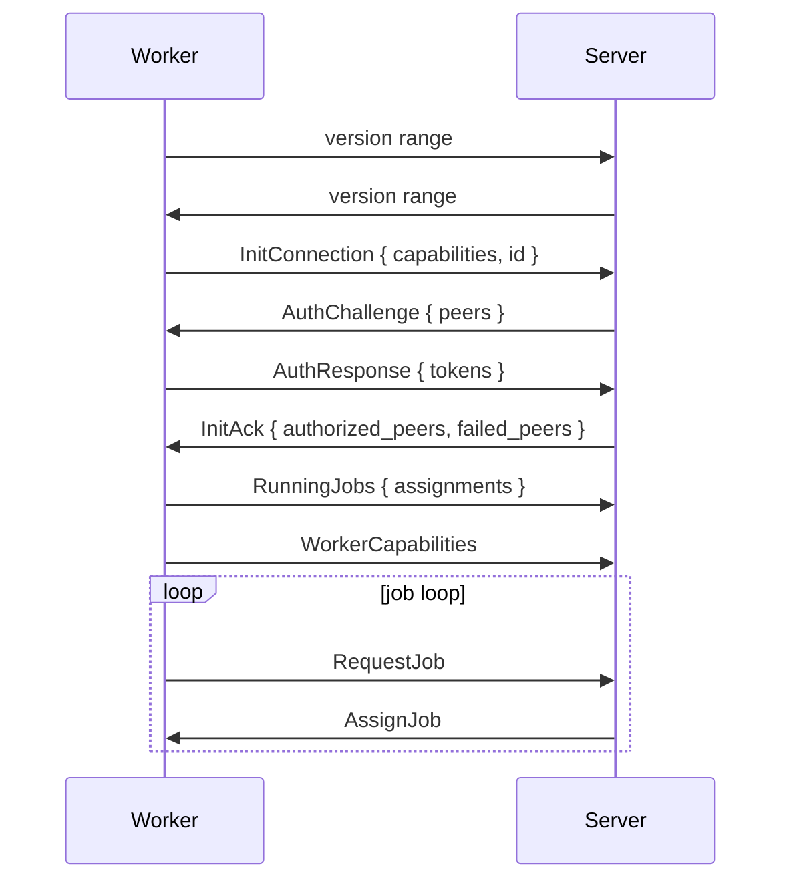
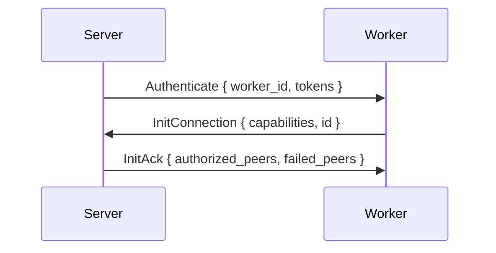

# Connection

A worker holds one WebSocket connection to the server at `/proto`. All frames are binary and encoded by the `Proto` derive. A session moves through five stages: **version agreement -> handshake -> authorization -> capabilities -> job loop**.



## Handshake

Four steps make up the handshake:

| Step | Message | Content |
|---|---|---|
| 1 | `InitConnection` | `capabilities`, the worker's persistent `id` |
| 2 | `AuthChallenge` | The peers that registered this worker ID |
| 3 | `AuthResponse` | A token for each challenged peer |
| 4 | `InitAck` or `Reject` | Authorized peers, failed peers with reasons |

Each worker stores its ID in `/var/lib/gradient-worker/worker-id`. The server can match reconnects by that ID, reject duplicates and label the worker in the UI and logs.

Handshake messages can be at most `MAX_HANDSHAKE_MESSAGE_SIZE` (64 KiB) in size. A larger message can end the session with close code `1002`, before any decoding.

**Rejections:** The server can end a session with the codes below. A connected worker can reject the server with `400`, `401`, `403` or `503`, see [Server-Initiated Handshake](#server-initiated-handshake).

| Code | Reason |
|---|---|
| `400` | An unexpected message during the handshake |
| `401` | `no valid peer tokens provided` |
| `403` | `unknown worker`, `worker is deactivated`, `no project grants this team's workers`, or the server is not accepting connections |
| `495` | `project has no cache subscribed`: every authorized project is lacking a cache |
| `496` | `worker already connected` |

## Server-Initiated Handshake

The server can open a connection to each registration and team worker with a `url`. Server tokens plus the worker's TLS certificate prove both sides.



| Step | Message | Content |
|---|---|---|
| 1 | `Authenticate` | The worker ID and one `(peer, token)` pair for each registration with a stored token at that URL |
| 2 | `InitConnection` or `Reject` | `401` on an unknown worker ID or a wrong token, `400` on any other first message |
| 3 | `InitAck` or `Reject` | The projects whose tokens the worker accepted, with no challenge round |

A side that refuses the handshake can reply with these codes.

| Code | Reason |
|---|---|
| `400` | A first message other than `InitConnection` |
| `401` | An unknown worker ID or a wrong token |
| `403` | `the link is disabled`, `the upstream is not allowed to run` |
| `503` | `the upstream is unreadable right now`, `the allowance is not checked yet` |

- Over `wss://` URLs, the server can send its tokens.
- Use a `ws://` URL only for local and operator setups. The server can still send the tokens there and log a warning.
- Workers verify server tokens against the hashes in `services.gradient.worker.acceptedServerTokensFile` on the worker. Workers without this file accept every server.
- A server-connected session that reauths receives `AuthUpdate`, never `AuthChallenge`.
- A reauth that discovers a new registration ends the session. The next connection can carry the new project's token.
- Projects granting a team's workers join the running session. All of them share the team worker's single token for the team ID.
- A registration cannot reuse the worker ID of a team worker. Each Gradient.CI worker ID can belong to exactly one registration or team worker.
- The server can hold the last failure of each worker ID in memory as that worker's offline reason.
- The server can hold a failure from before the token check only for a registered worker ID.

## Capabilities

Two sides of a connection negotiate capabilities during the handshake. A capability counts as active only when both sides support it. The server alone can enable `core` and `cache`.

| Capability | Meaning |
|---|---|
| `core` | The server side of the protocol. Always enabled on the server, disabled on workers |
| `cache` | Acting as a binary cache. Always enabled on the server |
| `network` | Internet access for clones, flake inputs, substitutions and fixed-output builds |
| `secrets` | Receiving project credentials such as the SSH key |
| `exec` | Declared and stored, with no behavior attached yet |
| `eval` | Running flake evaluations |
| `build` | Running Nix builds |
| `federate` | Reserved. Part of the handshake, with no behavior attached yet |

Capability flags mark feature support. They do not stand in for protocol versions.

## Authorization

A **peer** is anything registering a worker, such as a project, a cache or a proxy. Both sides consent. Peers register the worker ID and workers hold the peer's token.

1. A peer registered the worker ID. The server generated a token for that pair.
2. The peers file (`services.gradient.worker.peersFile`) is a list of `peer_id:token` lines.
3. The server can challenge every registering peer on connect and check each token on its own.

| Peer | Granted Access |
|---|---|
| Project | Jobs from the project's tasks |
| Cache | Serving and pulling from the cache |
| Proxy | Membership in the proxy's worker pool |

- The remaining peers keep the session open after some failed tokens.
- A failure of every token can reject the session.
- A project without a cache subscription can move to `failed_peers` in the reply.
- The reply is `495` when no peer remained.
- **Reauth** can add peers without reconnecting.
- The server can send `AuthChallenge` to a connected worker when a peer registered the worker.
- A cache subscription by a project is a reason for a reauth of the project's workers.
- The worker can send `ReauthRequest` when its peers file changed.
- Both end in `AuthUpdate` and reauth can never revoke granted peers.
- A single connection per worker ID. The server can reject a second connection with `496`.
- The server can drop a connection silent for `proto.workerHeartbeatTimeoutSecs` (120 s).
- The worker can drop a connection with data unacknowledged for 120 s and reconnect.
- The worker can abandon a connect after 10 s and a handshake after 15 s without an answer.
- A project's worker list can mark a worker as live when that worker authenticated for the project.

## Build Timeouts

The `timeout_secs` and `max_silent_secs` of a `BuildSpec` follow the derivation's own `timeout` and `maxSilent`. The fallbacks are `build.defaultTimeoutSecs` (14400) and `build.defaultMaxSilentSecs` (3600). A limit is off at a value of `0`. A build past a limit is a `FailedTimeout`. Evaluations have no timeout.

## Server Restart

Running builds and evaluations survive a lost connection and a server restart. Queued jobs survive as well.

| Side | Behavior |
|---|---|
| Worker | Keeps its running jobs. Reconnects with backoff that starts at 1 s, doubles each try, and caps at 60 s |
| Worker | Appends `LogChunk` payloads to `/var/lib/gradient-worker/job-logs/` while detached. At most 1 GiB of unsent log per job. Older bytes give way to one `bytes of log dropped` marker line |
| Worker | Queues every other job report in memory. Only the newest `BuildProgress` or `EvalProgress` of a job stays in the queue |
| Worker | Performs a full handshake, then sends `RunningJobs` with the assignment of each running job, an empty list included |
| Worker | Sends the queued reports first. Replays each buffered log next to the job loop, from the offset already sent |
| Worker | Sends `RequestJobList` plus one `RequestJob` per kind |
| Server | Runs `recover_interrupted_work` before the first session. Assignments outside cluster attempts stay open. Their builds remain `Building` |
| Server | Keeps the open assignments of a disconnected worker for `proto.assignmentReclaimGraceSecs` (600 s). The grace of a worker lost by a running server ends with its remaining `maxLifetime` at the latest |
| Server | Reattaches every listed assignment that is still open and belongs to this worker. Sends `AbortJob` for every other listed one |
| Server | Re-queues at once every open assignment of the worker absent from `RunningJobs`, as a [lost worker](jobs.md#abort-and-lost-workers) |
| Server | Drops every report whose `assignment_id` does not match the live dispatch of that job in the scheduler core |

- Cluster members and aborted jobs stay out of `RunningJobs`. Cluster members abort at the end of the session.
- `RunningJobs` can also list a job with its final `JobCompleted` or `JobFailed` still in the queue.
- Workers below protocol 42 abort every running job at the end of the session. The server can re-queue the open assignments of such a worker at once.
- Jobs of a server-dialed session end with the session. Such sessions never reclaim jobs.
- Workers empty `job-logs/` at process start. No job can outlive a worker process restart.
- Log bytes in flight at the moment the connection dropped can be missing from the build log.

## Server Stop

- `SIGTERM` shut down every server session at the same time.
- Workers keep their running jobs and list them in `RunningJobs` after the reconnect.
- [Startup recovery](../scheduler/waiting-and-recovery.md#startup-recovery) can re-queue the interrupted work without an open assignment on the next start.
- Workers reconnect after the server is back.
- A `Draining` message from the server can terminate the session. The worker process stay alive.

## Version Agreement

```text
"GRAD" | oldest: u16 LE | newest: u16 LE
```

- Both sides send this 8-byte frame before the first message. Future versions leave it alone.
- The `ProtoSocket` type can agree on the first send or receive. Both sides are sending first and reading second.
- The agreed version is the lower of both newest versions. Every later frame is for that version.
- Two ranges without overlap can end the session with close code `1002` and `no shared protocol version: ours 30..=30, peer 31..=32`.
- A first frame without `GRAD` came from protocol 26 or older. The session can end with `peer protocol is older than 30`.
- Supported versions start at 41. Older workers need an upgrade.
- Both sides are logging the reason at the `warn` level.
- A server connecting to a worker can keep the reason as the worker's offline reason.
- `gradient_wire::PROTO_VERSIONS` is the supported range, computed from the `#[proto]` annotations.
- The agreed version for feature checks is available through the `writer.version()` call.

## Changing a Message

| Change | Annotation | Effect |
|---|---|---|
| New field | `#[proto(N)]` | The field exist since version N. The oldest supported version rise to N |
| New field with a fallback | `#[proto(N, default)]` | Older peers omit the field. Decoding fill in `Default::default()` |
| New variant | `#[proto(N)]` on the variant | The variant get appended at the end. Sending it to a peer below N trigger an `EncodeError` |
| Removed or reordered field or variant, changed meaning | `#[proto(oldest = N)]` on `ClientMessage` and `ServerMessage` | The oldest supported version rise to N |

- A field without `default` count as mandatory. A missing `default` break compatibility, not correctness.
- New variant can only be appended. Placing a variant before an older one fail to compile.
- The files `gradient-wire/schema/v{N}.txt` describe the wire shape of each supported version. The `schema` test can check them against the code.
- `cargo run --example wire_schema` can write the file for a new version and remove files below the oldest version. Existing files remain untouched.

## Cache Sessions

A read-only session for one cache is available through the `/cache/{cache}/proto` endpoint. It serves the same frames as a normal session.

| Aspect | Rule |
|---|---|
| Public cache | Credentials are not required. The setting `proto.anonymousCache.enable` can turn this off |
| Private cache | The upgrade request needs the header `Authorization: GRAD<key>` |
| Handshake | The client sends `InitConnection`. The server answers with `InitAck` and no peers, without a challenge |
| Allowed | Requests permitted here are `CacheQuery` in `Normal` or `Pull` mode, and `NarRequest`. Everything else gets a `403` rejection |
| Limits | Each IP can hold `proto.anonymousCache.maxConnectionsPerIp` (32) anonymous connections. Every session also counts toward `proto.maxConnections` (256). Each message is limited by `SAFE_INFLIGHT_MESSAGE_SIZE` (2 MiB), which fits a `CacheQuery` with 1000 paths |
| Idle | The server closes the session after 120 s without a NAR transfer |

## Implementation

- A single handshake state machine in `gradient-wire/src/session/handshake.rs` is the driver of every session.
- The server can run `as_authority` for an incoming worker and `as_dialer` for a worker the server connected to. The worker can run `as_peer` and `as_dialed`.
- The cache session can agree on a version like every other session.
- The code in `session/frame.rs` can split each socket into a typed reader and a writer. The writer can hold a control lane and a bulk lane.
- Control frames go first. A bulk batch can hold no more than 256 KiB.
- A full bulk queue can never block control replies.
- Chunk payloads (`NarPush`, `UploadChunk`, `EvalCacheChunk`, `LogChunk`) arrive at the handler as slices of the frame, without a copy.
- The `client::dial` function can disable Nagle's algorithm on every socket. Small control frames go out without waiting for a delayed ACK.
