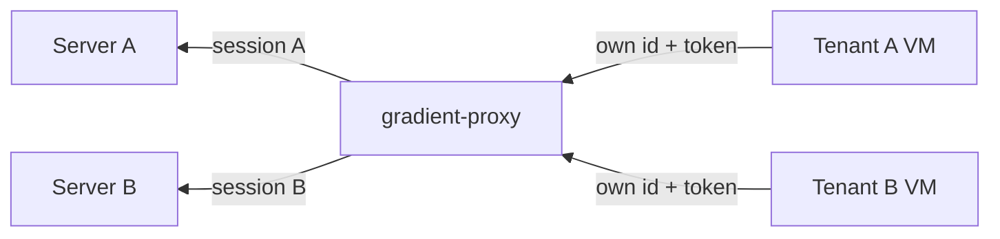

# Federation

The `gradient-proxy` service can join pools of workers to customers' Gradient servers. Customers (tenants) see the proxy as one worker. Both legs of the proxy use this protocol. The proxy is an authority to its own workers and a worker to every tenant's server.

`gradient-proxy` is a separate repository with its own NixOS module and `GRADIENT_PROXY_*` configuration. Full Gradient servers never connect to other servers.

## Upstream Leg

Each tenant gets one regular worker session toward the customer server. The handshake uses the standard flow from the [connection page](connection.md): `InitConnection`, `AuthChallenge`, `AuthResponse` and `InitAck`. On the customer side, the proxy registers as a normal worker with a worker ID and token. The operator stores both as the tenant's upstream link.

- The session remains open while the link state is `enabled` and the tenant has permission to run.
- A rejected auth response (401 or 403) marks the link `failing` and records the reason.
- Sessions cannot start again until an operator resets the link.

| Aspect | Behavior |
|---|---|
| Capabilities | A fixed set, `GRADIENT_PROXY_UPSTREAM_CAPABILITIES` (default `network,secrets,eval,build`) |
| Hardware | `gradient_pool::aggregate()` over the downstream workers, sent as `WorkerCapabilities` and `WorkerMetrics` |
| Aggregation | Capabilities OR'd, architectures and features unioned, slots, CPUs and RAM summed, fastest core score |
| Aggregation scope | Per tenant: only that tenant's workers count |
| Peer tokens | Per tenant, sealed with AES-GCM under `GRADIENT_PROXY_ENCRYPTION_KEY_FILE`, never returned by the admin API |

## Downstream Leg

Workers authorized by the proxy get recorded in a small local Postgres database.

- One row per authorized worker, with ID, name, tenant, argon2 token hash and allowed capabilities.
- An `AuthChallenge` names only the ID of the worker being challenged.
- Negotiated capabilities come from the worker's offer intersected with the allowed set, and `federate` remains off in all cases.
- Row deletion closes the live session of that worker.
- A worker can take jobs from any peer authorized by its tenant's server.

## Job Forwarding

| Step | Proxy behavior |
|---|---|
| Tenants | One hub per tenant. A worker row names its tenant, and frames never cross tenant boundaries |
| Offers | The upstream offer book gets mirrored, and candidates go out to capable workers |
| Scores | The best score per candidate gets forwarded as deltas, at most once per second |
| `RequestJob` | A worker poll turns into an upstream poll. The best capable waiting worker receives the `AssignJob`. Without such a worker, the proxy declines |
| Reports | Routing happens by `job_id`. Queries receive a fresh `query_id`. Reports for jobs outside a worker's ownership get dropped |
| Uploads | Every `UploadRequest` receives a fresh `request_id`. Grants, chunks and commits map back to the requesting worker |
| Cluster jobs | `StartCluster`, `ClusterSignal` and `AbortCluster` reach every worker that holds a member of the attempt. The roster names the worker behind the proxy, together with its zone and endpoint |
| Worker lost | A disconnect or a 120 s heartbeat timeout triggers an upstream `JobFailed` (transient) |
| Upstream lost | `AbortJob` goes to that tenant's workers, and open queries receive error responses. Worker sessions close after `Draining`. Other tenants remain unaffected |

## Passthrough

- NAR pulls, cache queries and uploads go to the tenant's own Gradient server, under the remapped `job_id`, `query_id` or `request_id`.
- Nothing is stored on the proxy.
- The tenant's server is the cache.
- Transfers over upstream presigned URLs bypass the proxy.
- No cache on the proxy is exposed to its upstream servers.

## Hetzner Workers

The proxy can boot Hetzner Cloud VMs, each dedicated to a single tenant. Every 60 s, a reconcile pass compares pending jobs per tenant with that tenant's VMs and with servers labelled `gradient-tenant`.

| Rule | Behavior |
|---|---|
| Scale up | The proxy targets `min(max VMs, ceil(pending / slots))` VMs per system with a configured server type |
| Boot | VMs start from the uploaded worker snapshot. User data carries the proxy URL, a worker ID and a one-time token, stored as an argon2 hash |
| Scale down | The proxy deletes idle VMs within the last 5 minutes of their billing unit (default 60 minutes) |
| Boot deadline | A VM that failed to connect within the boot deadline (default 5 minutes) gets deleted. Its usage row ends as `failed_boot` and no bill gets issued |
| Failing link or tenant may not run | The tenant stops upstream polls. Its VMs drain, and the proxy deletes them after the drain grace (default 15 minutes) |
| Leak guard | The proxy deletes a labelled server without a VM row, and closes a row whose server has gone missing |
| Rate limit | Hetzner `429` and `5xx` responses back the tenant off from 1 s to 5 minutes. Billing starts only after server creation |

Deletion of a VM revokes its token. The `vm_usage` table meters uptime for each VM, from creation to deletion.

## Access Control

Access control works at two levels.

| Level | Controlled by |
|---|---|
| Server -> proxy | Per project: the proxy's `worker_registration` rows, tokens and the `enable_*` capability grants |
| Proxy -> worker | Per worker: `authorized_peers` rows with tenant, token hash and allowed capabilities |

The handshake negotiates the `federate` capability. The server exposes this as `proto.federate`, the worker as `capabilities.federate`. The flag has no effect in the code yet.
