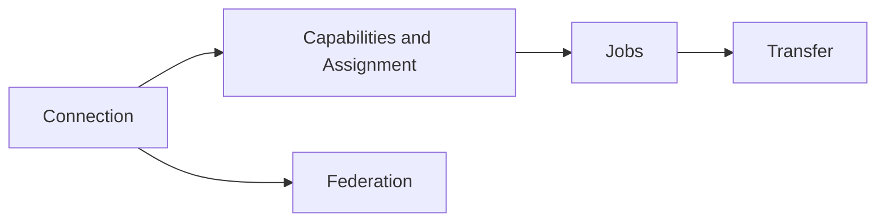

<!--
SPDX-FileCopyrightText: 2026 Wavelens GmbH <info@wavelens.io>
SPDX-License-Identifier: AGPL-3.0-only
-->

# Proto

Server and workers share one WebSocket at `/proto`. The `Proto` derive encodes all frames as binary. A session must pass version agreement, handshake, authorization and capability exchange before the job loop can start.

-   :material-handshake: **[Connection](connection.md)**

    Handshake, authorization, server restarts, server stop and cache sessions.

-   :material-clipboard-list: **[Capabilities and Assignment](capabilities-and-dispatch.md)**

    Worker capabilities, job offers and pull-based assignment.

-   :material-hammer-wrench: **[Jobs](jobs.md)**

    Flake and build jobs, progress reports, failure kinds and aborts.

-   :material-swap-horizontal: **[Transfer](transfer.md)**

    NAR uploads and downloads, logs, download progress and credentials.

-   :material-email-outline: **[Messages](messages.md)**

    Every message on `/proto` with its fields and lane.

-   :material-server-network: **[Federation](federation.md)**

    `gradient-proxy`: a pool of workers joined to a server as one worker.

## Related

- [Scheduler](../scheduler/index.md): how the next job for a worker gets picked
- [Add a Remote Worker](../../guides/remote-worker.md): the setup guide
