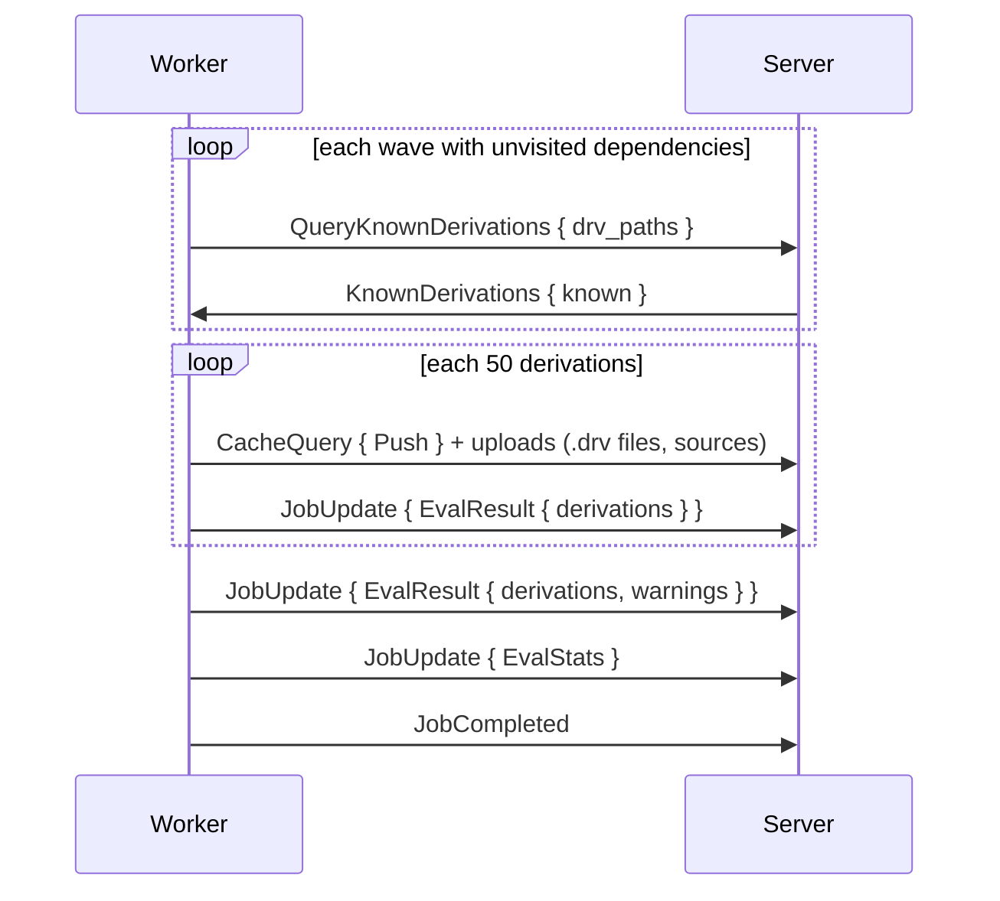
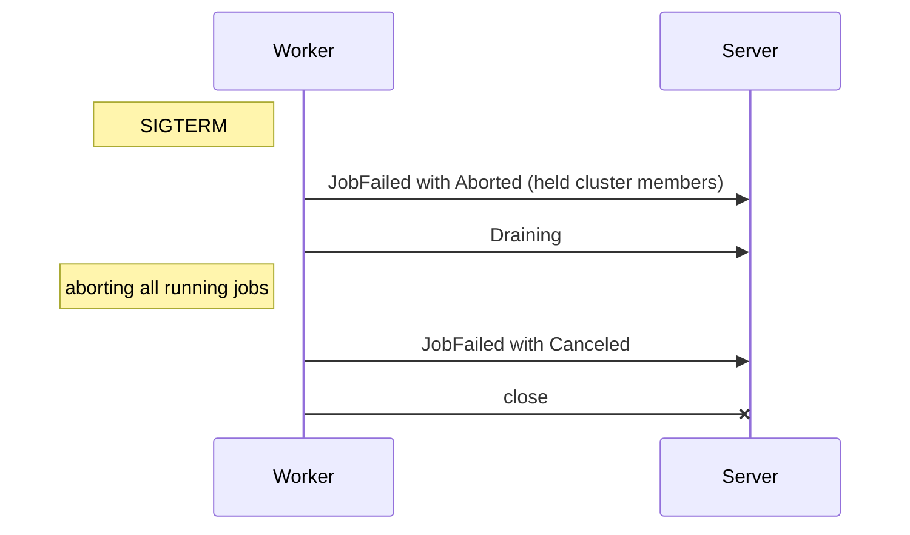

# Jobs

Workers process two job kinds: flake jobs and build jobs. The sections below document the messages, the reports, and failed, aborted and lost jobs.

- The server delivers work as `AssignJob { job_id, assignment_id, job, cluster }` messages.
- Echo the `assignment_id` in `JobUpdate`, `JobCompleted`, `JobFailed`, `BuildProgress` and `EvalProgress`. Reports with a stale `assignment_id` will be rejected by the server.
- Workers accept a re-sent `AssignJob` for a job already in progress. Reports for that job then echo the new `assignment_id`.
- Only [cluster members](../scheduler/clusters.md) receive a `cluster` field.
- Reports of a session go into a queue of 64 events, off the session's read loop. Reports apply in arrival order.

## Flake Jobs

Flake jobs fetch and evaluate a flake. The server can pick the steps at queue time.

| Situation | Steps |
|---|---|
| An idle evaluation-only worker is available, and the evaluation is no cluster member | `[FetchFlake]`, then a follow-up job `[EvaluateFlake, EvaluateDerivations]` on the `Cached` source |
| Otherwise | All three steps in a combined job |

| Field | Meaning |
|---|---|
| `steps` | `FetchFlake`, `EvaluateFlake`, `EvaluateDerivations` |
| `source` | `Repository { url, commit }`, or `Cached { store_path }` for a follow-up job or a `gradient build` upload |
| `wildcards` | Attribute patterns to evaluate |
| `timeout_secs` | Optional limit, sent as `None` by the server today |
| `input_overrides` | Flake input overrides of the task |
| `input_update` | Set for a [flake update](../../guides/flake-updates.md) |

### Fetch

1. Clone the repository. Skip the clone for a `Cached` source.
2. Run the flake update generator for a job with `input_update`.
3. Serialise the tree at the pinned commit as a NAR, without a nix process. Add the NAR to the store as `<narHash>-source`, the path of `nix flake prefetch` for the same tree.
4. Leave out inputs with an override. Overrides apply at evaluation. Override names without a matching input end up as `EvalMessage` warnings.
5. Pull missing locked inputs from the Gradient cache. Fetch the rest with `builtins.fetchTree` in an eval worker.
    - Inputs of the same second-level domain (such as `github.com`) download in sequence. Different domains download in parallel.
    - Failed inputs drop out with a warning.
6. Report `FetchResult { flake_source }`.
7. Upload the source and the inputs with a `Push` cache query. Upload and evaluation steps of the same job run side by side.

- Upload failures fail the whole flake job.
- Fetch-only jobs send `JobCompleted` after the upload, with `EvalProgress` resent meanwhile.
- The server can then queue the follow-up job. Evaluations without a `flake_source` fail instead.

### Evaluate

| Step | Worker action |
|---|---|
| `EvaluateFlake` | Status `EvaluatingFlake` only, no work |
| `EvaluateDerivations` | Eval cache pull, attribute discovery, closure walk, eval cache push |

- **Eval Cache:** Before discovery, workers pull the evaluation cache segments they lack. New rows travel up as segments every 30 s, plus once after a successful evaluation. See [Shared Eval Cache](../eval-worker.md#shared-eval-cache).
- **Eval Cache Segments:** Segments each belong to one cache. Pulls read segments from every readable cache of the project. Pushes write into the first writable cache. Compaction can then copy the result into the other writable caches.
- **Attribute Failures:** Workers send them as `EvalMessage { level: Error, source: "nix-eval:<attr>" }` before the last `EvalResult`.
- **Import From Derivation:** Workers send `ImportRequest { drv_paths }` during discovery and wait for `ImportResult`.
- **Missing Inputs:** Workers send `InputRequest { request }` for an input in neither the store nor the cache, and wait for `InputResult`. The server can send the download as `FetchInput` to a worker with `network`. That worker can push the input under the `fetch_id` and answer with `InputFetched`.
- **Walk:** Workers walk an entry point as soon as discovery returned it.
- **Waves:** Waves hold up to 256 of the most recently found derivations. Leaf derivations then come early in the walk, and their builds can start mid-evaluation.

- Derivations in `known` have complete closures in the graph. Workers skip their subtrees.
- Workers treat a failed `QueryKnownDerivations` as an empty `known`. **Full rewalks** get an empty `known` too.
- Batches upload their `.drv` files and input sources before their `EvalResult` message. Builds can start during the walk.
- Input `.drv` files travel with the batch walking the input.
- Walk and batch uploads run side by side. Uploads of consecutive batches overlap.
- `EvalResult` messages follow their own batch uploads, in walk order.
- Workers query and upload each path no more than once per evaluation, apart from the input upload of the fetch step.
- The server can store each batch in the graph and move each startable build to `Queued` right away.
- Consecutive `EvalResult` batches of a job, already waiting in the session queue, reach the graph writer together. Limits of the merge: 5000 derivations, and no other event in between.
- Evaluations in `EvaluatingFlake` or `EvaluatingDerivation` turn `Building` on `JobCompleted`.
- `EvalResult` errors (no derivation matched, a failed listing) become error messages. Error messages fail the evaluation at the end.

## Build Jobs

Each build job contains a single `BuildSpec` and maps to one shared build (a `derivation_build`).

| `kind` | Condition | Work performed |
|---|---|---|
| `Build` | Default | Prefetch the inputs, then build the derivation with the Nix daemon |
| `Substitute` | Outputs exist in an upstream cache | Fetch the outputs without a Nix store |
| `Download` | Fixed-output derivation on the `builtin` system | Download the file without a Nix store |

- `Substitute` and `Download` jobs can run on any worker, since these use the `builtin` system.
- Build jobs also receive `drv_path`, `outputs`, `is_fixed_output`, `timeout_secs` and `max_silent_secs` from the spec.
- Defaults: `build.defaultTimeoutSecs` (14400) and `build.defaultMaxSilentSecs` (3600).

1. Check for an abort request first. Then report `Building`, before anything that can fail.
2. If all outputs already exist in the local store, skip prefetch and build. Report `BuildOutput { substituted: true }` and upload the outputs anyway.
3. **Prefetch:** Read the `.drv`, drop inputs already present in the store, and fetch the remaining ones over the [transfer](transfer.md) protocol.
4. Run the build through the daemon. Stream the log as `LogChunk` messages.
5. Report `BuildOutput` with the outputs, `hydra-build-products` and metrics.
6. Upload the outputs, then send `JobCompleted`. An upload failure marks the job as `Transient`.

## Reports

| `JobUpdate` kind | Effect on the server |
|---|---|
| `Fetching`, `EvaluatingFlake`, `EvaluatingDerivations` | Evaluation status |
| `FetchResult { flake_source }` | Store the fetched source in `evaluation.flake_source` |
| `EvalResult` | Store a batch of derivations in the graph |
| `EvalStats` | Evaluation metrics |
| `InputUpdateResult` | Flake update candidate lock and bumped inputs |
| `InputUpdateExpansion` | Input names matched by a glob in a `discover_only` pass. A new evaluation per name |
| `Building { build_id }` | Build turned `Building`. Already aborted builds get `AbortJob` instead |
| `BuildOutput` | Output sizes, build products, metrics, the `substituted` flag |
| `Stage(Prefetch / Build / Upload)` | Live stage of the job in the worker pool, used for the [estimated time](../../reference/scheduler-policies.md#estimated-time). `Prefetch` and `Build` apply to the `Build` kind only |
| `Compressing` | No change. Workers no longer send it |

- `EvalProgress` messages hold one download row per flake input during fetch, and the live thunk count during evaluation.
- Download rows appear only with a missing input. Eval workers download the inputs themselves, with at most 1 download per second-level domain.
- `JobCompleted` and `JobFailed` hold the phase timeline shown on the [Job Board](../../ui/job-board.md#job-inspection).
- Build metrics also hold the number of concurrent builds on the worker, the cores of the build and the worker's CPU score.

## Failures

| `BuildFailureKind` | Result |
|---|---|
| `Transient` | Retried up to `build.maxAttempts` (3), backoff `build.retryBackoffSecs` (30 s) doubling. Builds available in a cache take the substitution miss path after the last attempt |
| `Permanent` | Failed. Builds needing the failed build turn `DependencyFailed` |
| `Timeout` | Timed out. Builds needing the timed-out build turn `DependencyFailed` |
| `SubstituteUnavailable` | Re-queued. Built normally after `build.substituteMissEscalationThreshold` (2) misses |
| `InputsUnavailable` | Self-heal, see below |
| `CorruptEvalCache` | Purging the evaluation cache segments and re-queuing the evaluation. A repeat within one hour of the purge, or with nothing to purge: evaluation `Failed`. For builds: `Permanent` |
| `Aborted` | Aborted by the server. No cascade |
| `Canceled` | Stopped by the worker. Re-queued without using an attempt, see [Worker Stop](#worker-stop) |

- **InputsUnavailable:** An input listed by the cache was missing. Causes are an uncached path, `404`/`410` on the URL, `NarUnavailable` or a NAR hash mismatch.
    - The server can delete the outdated cache row and object, reset the producing build and retry.
    - Inputs still present but without a producer stay in place.
    - Builds fail permanently after `build.inputsUnavailableMaxLoops` (3) loops. `InputsUnavailable` failures also use up attempts. Attempts and loops both default to 3. Attempts run out first.
- **DependencyFailed** can spread upward over the dependency graph from `Permanent` and `Timeout` failures, across evaluations.
- **Eval Job Outage:** Eval jobs failing `Transient` re-queue the evaluation, up to `build.maxAttempts` (3) attempts. Abandoned dispatches stay out of this count.
    - Typical causes are a dropped server connection, or an object PUT or `CacheQuery` without an answer.
- **Out of Memory:** Builds killed by the kernel for memory count as `Transient`, whatever kind the worker sent. The attempts close with the reason `Oom`.
    - Out-of-memory builds with more than 1 core in `BuildMetrics.build_cores` go back to `FailedTransient` without using up `build.maxAttempts`. The next attempt can get a third fewer cores.
    - A kill at 1 core can end the build as `FailedPermanent` with the message `ran out of memory with 1 core`.
    - Out-of-memory builds from workers without a core count use up attempts like other `Transient` failures.
- **Not Enough Resources:** A queued build can turn `FailedPermanent` after 5 minutes without a worker able to hold the build. Such attempts close with the reason `NotEnoughResources` and without a dispatched job.
    - The predicted peak memory of such builds at 1 core is above the free memory of every connected worker able to build them.
    - Workers with memory reserved for running jobs are large enough while the total memory can take the build.
    - Unmeasured builds and workers without a sample stay out of this check.
- Evaluations end `Completed`, or `Failed` with a build in `Failed`, `Aborted` or `DependencyFailed`, or with an error message present.

## Cluster Members

[Cluster members](../scheduler/clusters.md) reach workers in an `AssignJob` with `cluster = { attempt, role, index, hold_secs }`.

| Event | Worker |
|---|---|
| `AssignJob` with `cluster` | The worker reserves the slot without running the job, then accepts it. A second member of the same attempt gets rejected |
| `StartCluster { attempt, roster }` | The worker starts the held member. The roster opens the member's signal route |
| `ClusterSignal` from the server | The worker delivers the signal to the inbox of the running member of that attempt. After that member finished, the worker drops signals. No executor reads the inbox yet |
| `ClusterSignal` to the server | The worker forwards signals on the wire only. The server handles routing. No executor sends signals yet. `to = None` reaches all other started members |
| `AbortCluster { attempt }` | The worker drops a held member without a report and aborts a running member with `JobFailed { Aborted }` |
| `AbortJob` for a held member | The worker releases the slot and reports `JobFailed { Aborted }` with `aborted by server` |
| No `StartCluster` within `hold_secs` | The worker releases the slot and reports `JobFailed { Aborted }` with `cluster start timed out`. The check runs on the 10 s heartbeat, so detection can lag by up to 10 s |
| Worker stop | The worker releases all held members the same way, with `worker draining` |

- Held members count against `eval.maxConcurrent` / `build.maxConcurrent` like running jobs.
- `hold_secs`: the server's `scheduler.clusterPrepareTimeoutSecs` (30 s) plus a 10 s margin.

### Split Evaluation Members

A cluster member with the role `split-evaluation-primary` or `split-evaluation-companion` can evaluate part of one flake (`gradient-worker/src/executor/eval_split.rs`).

| Member | Steps |
|---|---|
| Primary | Fetch the flake as usual. Push the inputs during planning, then send `EvalSourceReady`. Ask with `EvalShardRequest { have_source = true }`. On `Plan`: plan the shards, report the plan errors, upload the new eval cache rows, send `EvalShardsPlanned`. Then take shards |
| Companion | Ask with `have_source = false` until `Source` arrives. Fetch that store path from the cache. Then take shards |
| Taker loop | Per shard: pull new eval cache segments, pull `drv_paths` in one batch, list the shard across the local subprocesses, stream `EvalResult` batches. The next request can carry `finished` with the deferred sets. The segment upload of the shard takes place during that request |
| End | `Finished`: send `EvalStats`, then `JobCompleted` |

- `Wait` answers pause the member for `retry_after_ms` (1 000 ms).
- Only the primary can report `EvaluatingFlake` and `EvaluatingDerivations`.
- The 30 s eval cache flush timer is for standalone evaluations only.
- Message shapes: [Split Evaluation Messages](messages.md#split-evaluation-messages).

## Abort and Lost Workers

- **API Abort:** The evaluation receive the status `Aborted`. Pending jobs of the evaluation leave the queue.
    - `AbortJob` messages go to the evaluation job and to running builds that no other live evaluation want.
    - The decision count all live evaluations that want a build, not the evaluation that dispatched the build.
- **Newer Evaluation:** A task with `hard_abort` concurrency abort the older evaluation of the branch in the same way as an API abort. A task with `soft_abort` cancel only its eval job.
    - A task with `auto` concurrency act like `hard_abort`. The abort take place after the newer evaluation moved to `Building`.
- **Unbuildable Evaluation:** An evaluation with no worker for its systems also finish `Aborted`.
- Workers stop the daemon build at once and answer with `JobFailed { Aborted }`.
- Assignments of an unconfirmed abort close as abandoned after 5 min.
- **Reclaim Grace:** A disconnected worker keeps its open assignments for `proto.assignmentReclaimGraceSecs` (600 s). A grace can't outlast the worker's remaining `maxLifetime`.
    - Workers list their running jobs in `RunningJobs` after the reconnect. The server reattaches each listed assignment, and the job continues.
    - The `unreclaimed-job-sweep` pass checks every 10 s on every server instance. A job can outlast the grace by up to 10 s.
    - Open assignments left by a server restart get the same grace.
    - Cluster members, workers below protocol 42 and a grace of `0` skip the wait.
    - A worker back after the grace receive `AbortJob` for its listed jobs. That loss can increase the lost-worker streak by one at most.
- **Lost Worker:** A job without a reclaim within the grace has a lost worker. A job missing from `RunningJobs` has one at once. Open assignments close as abandoned.
    - Each build in `Building` return to `Queued`. Its running attempt close as `Aborted` with the reason `WorkerLost`.
    - A build with 10 lost workers in a row finish `FailedPermanent`. An attempt closed in any other way reset the row. A requeue after an ended cluster attempt do not count as a lost worker.
    - Running evaluations move to `Waiting` and back into the queue.
    - An evaluation with 10 recorded eval dispatches fail on the next lost worker. Dispatches of all outcomes count, fetch-only and canceled jobs included.

## Worker Stop

- Workers release held cluster members first, then send `Draining` and abort all running jobs.
- Aborted jobs report `JobFailed { Canceled }` with their phase timeline. Failures during a stop all report as `Canceled`.
- Workers wait up to 5 s for these reports.
- Jobs without a report within the 5 s re-queue with the closed session, as for a lost worker.
- Canceled builds return to `Queued`. Their attempts close as `Aborted` and stay out of `build.maxAttempts` and the substitution miss count.
- Canceled eval jobs return their evaluation straight to `Queued`.
- Their assignments close as abandoned. These stay out of `build.maxAttempts`, but still count toward the 10 eval dispatches above.
