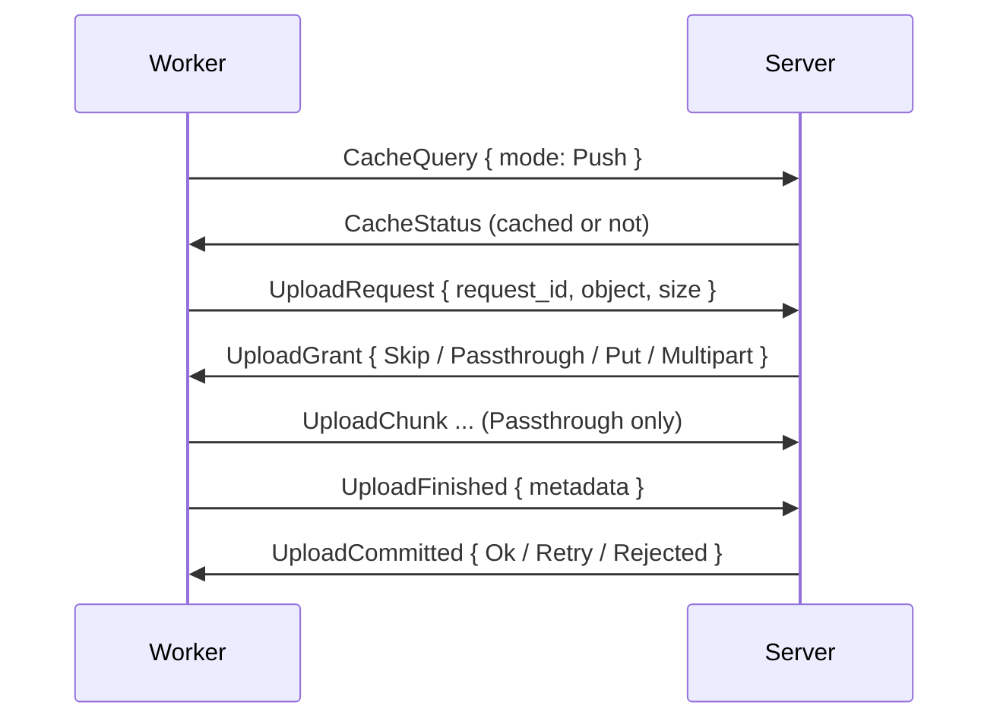

# Transfer

Worker and server exchange four kinds of data: NARs, logs, build progress and credentials.

Workers always compress NARs with zstd. The server never re-compresses them.

## Upload

| Grant | When | Transfer |
|---|---|---|
| `Skip` | The path is already stored, or the project has no writable cache for an evaluation cache segment | Nothing |
| `Passthrough { resume_offset }` | Local NAR storage | `UploadChunk` frames of `worker.nar.chunkBytes` into `<baseDir>/nar-partial`, resuming after a break |
| `Put { url }` | S3, NAR up to 1 GiB | One presigned PUT, valid 1 h |
| `Multipart` | S3, NAR over 1 GiB | Presigned parts of at least 64 MiB |

- **Admission** applies server-wide and treats all sessions fairly.
    - The limits are `upload.concurrency` (8) large uploads and `upload.bytesBudget` (8 GiB) at once.
    - Small uploads of at most 1 MiB of NAR (`SMALL_UPLOAD_BYTES`) get a window of their own, `SMALL_UPLOADS_IN_FLIGHT` (128).
    - Each `EvalResult` batch of an evaluation must wait for the push of its own `.drv` files, so a small upload cost two round trips.
    - Small uploads go ahead of larger ones within their session. Sessions with a waiting small upload get served first.
    - Count and bytes of a permit come back after the object landed in storage, ahead of the graph record.
    - Requests for a path coalesce across workers, REST and SSH. Followers get `Skip` once the graph recorded the first upload.
    - After a failed first upload, followers take over the path.
- **Worker Side:** `worker.nar.maxConcurrentUploads` (16) slots for large uploads and 128 for small ones.
    - One job can hold at most half of the large slots.
    - A slot is busy from the request until the worker sent `UploadFinished`. The commit does not count.
    - Commits reach the graph writer in bursts, and it batch them.
    - The worker can retry a `Retry` up to 3 times. A `Rejected` answer made the upload fail.
    - Both rules also hold for an answer arriving before the grant.
    - A failed transfer or an abandoned request led to an `UploadCancel` message.
- **Commit:** For a passthrough upload, the server checked length and SHA-256, then moved the upload into the NAR store.
    - For a presigned upload, the commit completed the multipart transfer and checked the object size.
    - A full digest check happened only with `nar.verifyDigest` set.
- **Leases:** A passthrough upload expired after `upload.leaseIdleSecs` (300 s) without progress. A failed job or closed session released its uploads.
- **Evaluation cache segments** reuse the same handshake, with `UploadObject::EvalCacheSegment` and `UploadMetadata::EvalCache` as the payload types.
    - A request over 8 MiB (`SEGMENT_MAX_BYTES`) got `Rejected`.
    - Every grant carried a fresh object key `eval-cache-segments/<cache>/<fp>/<uuidv7>`. The commit wrote to that key.
    - A commit can produce an `eval_cache_store` row. A delayed compaction for the cache in the key can follow, see [Shared Eval Cache](../eval-worker.md#shared-eval-cache).

## Download for a Build

Before any build work starts, workers fetch all inputs that the local store does not have yet.

1. Query missing paths with `CacheQuery { mode: Pull }`. A path without a cache entry aborts the build with failure kind `InputsUnavailable`.
2. Download paths with a presigned `url` directly: 8 downloads in parallel, 4 attempts each. The timeout applies to the time without a byte (30 s), not to total length.
3. Fetch all other paths through `NarRequest`. The server answers each path with `NarStreamHeader` followed by `NarPush` frames of `nar.chunkBytes`, or with a `NarUnavailable` / `NarAbort` message.
4. Recover a broken stream with `NarRequestResume { received_bytes, stream_token }`, based on the partial data in `<baseDir>/nar-partial`.
5. Import the NARs into the Nix store in dependency order.

- Presigned downloads and `NarPush` streams both stage the compressed NAR under `<baseDir>/nar-partial`.
- Jobs on the same worker share the transfer of a path, presigned or streamed. Later jobs read the same staged file.
- The staged file disappears with its last job, including failed or aborted jobs.
- Jobs waiting on a failed transfer fail with it.
- A NAR that does not pass the size and hash check leaves the shared transfers. The next job downloads it again.
- Workers decompress each NAR from its staged file as a stream, first for the size and hash check, then into the Nix daemon.
- Workers skip the import of a path that another job imported in the meantime.

| Condition | Delivered As |
|---|---|
| S3 store, confirmed NAR above `nar.smallBytes` (1 MiB) | Presigned GET URL |
| Anything else | Stream over `/proto`, at most `nar.maxConcurrentServes` (8) paths per connection and `nar.maxConcurrentDownloads` (16) across all connections |

- Small NARs come from an in-memory hot cache, `nar.hotCacheBytes` (512 MiB).
- A `NarUnavailable` answer also removes the stale cache row on the server.
- A storage error or timeout answers with `NarAbort` and leaves the row and object in place.
- A substitute build can obtain an upstream URL through a single-path `Pull` query with `external` set.

## Logs

- Workers stream build output over the bulk lane as `LogChunk { job_id, data }` messages with no acknowledgement.
- The server can append every chunk to the open attempt of the job's build.
- Chunks for evaluations or finished attempts get dropped by the server.
- Workers cap each build's log at `worker.log.burstBytesPerMin` (8 MiB) and `worker.log.sustainedBytesPerHour` (64 MiB).
- Past either limit, the worker halts forwarding and adds a truncation note.
- A build already in the store can forward its stored Nix log with `worker.log.fetchFromStore` (on by default).
- The log ends up as zstd chunks of `log.chunkBytes` (256 KiB), each carrying a chunk index after the build.

## Build Progress

- One `BuildProgress` message can report the transfers of a single build. It splits them into three phases, and each phase reports bytes and paths done and total.

| Phase | Transfer | Bytes |
|---|---|---|
| `Prefetch` | Missing inputs pulled from the Gradient cache before the build | Compressed NAR files, totals growing with each closure round |
| `Download` | A substitute or `builtin:fetchurl` download | Compressed NAR file or the downloaded file |
| `Upload` | Uncached outputs of the build, sent at the end of the job | NAR bytes read from the store |

- Workers report on a change at most once per second, plus one final report at the end of each phase.
- `bytes_total` can be `None` when a size is unknown.
- `paths_total` can be `None` during prefetch, while path discovery is still in progress. The final report of a phase always includes the total.
- A retried or failed transfer count only once.
- The server keeps the latest value per build in memory for 15 s.
- The build response shows the value only while the build has the `Building` status.
- A build stays `Building` until its job has finished the upload.
- The server also sends `BuildProgress` events to the live endpoints.
- Eval workers report fetch rows or live thunks through `EvalProgress`, at most once per second on a change.
- After 30 s without a change, the worker repeats the unchanged value.
- The server keeps `EvalProgress` values the same way for 60 s. They appear only during the fetch and evaluation steps.
- The server sends `EvalProgress` as `evaluation.activity` events to the evaluation and task live endpoints.

## Credentials

- The project's SSH key serve as the sole credential. Clones of private repositories and inputs depend on it.
- Right before the `AssignJob` message, the server decrypt the key and send `Credential { SshKey }`.
- Only a flake job with a fetch step on a worker with `secrets` can receive the credential.
- A project without a key receive no credential.
- Workers hold the key in locked memory and zero it on drop.
- At job completion, workers clear the key.

## Memory

- A `Put` upload or a presigned download keeps the full compressed NAR (up to 1 GiB) in memory at once.
- Passthrough and multipart uploads from a store path pass data through a packer in chunks, so the whole NAR never has to fit in memory.
