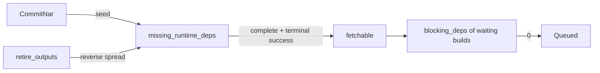

# Cache Closure

One invariant governs the cache: an output served from the cache must include its full runtime closure, stored alongside it. Per-shared-build counters enforce this invariant across the graph, and every start condition checks those counters. A self-heal can then fix anything a failed build exposed.

## Complete Closure

Runtime dependencies live in `derivation_dependency` alongside build dependencies, with `EdgeKind::Runtime` = 1 and `Both` = 2. The predicates live in `gradient-db/src/graph/predicates.rs`.

| Term | Definition |
|---|---|
| Present (`present_predicate`) | The shared build has output rows, and each one links to a `cached_path` row with a set `file_hash` |
| `missing_runtime_deps` | Runtime dependencies of the shared build that lack a complete closure |
| Complete closure (`shared_build_complete_predicate`) | Present, and `missing_runtime_deps = 0` |
| `fetchable` (`fetchable_predicate`) | Terminal success plus a complete closure. A copy from upstream does not count |
| `.drv` present (`drv_present_predicate`) | The build's own `.drv` NAR exists with a backed `cached_path` row. This marks presence only, not a complete closure |

- **Build start condition:** `blocking_deps = 0` and `.drv` present. `blocking_deps` counts direct dependencies without a set `fetchable` flag. The `fetchable` flags of those dependencies already cover their own closures, so the condition needs no recursion.
- **Passthrough start condition:** shared builds available in a cache can start without either term. Their jobs carry no `required_paths` (`gradient-scheduler/src/loops/build.rs`).
- **Push:** jobs upload only their own outputs. Everything below them held a complete closure before assignment. A worker therefore need not push a closure for the invariant to hold.

## NAR Commit

`commit` (`gradient-graph/src/nar.rs`) runs inside the graph writer's transaction for each `CommitNar`. A pooled handle cannot be used here.

1. Upsert the `cached_path` row under `FOR NO KEY UPDATE` and read `was_backed` while holding that lock. No later statement can recover this endpoint.
2. Overwrite `references` with the line the worker reported, in order. From that line alone, `references_for_hash` can rebuild the narinfo `References:` line and the signature fingerprint byte for byte.
3. Insert an add-only runtime dependency for each path in `references`, then update `wanted` for the producers. Skip a reference that points to a twin or that closes a cycle. Real Nix references never form either, and such an edge can block both closures.
4. `seed_runtime_deps` (`gradient-db/src/graph/runtime_can_start.rs`): recount the producers from scratch. Paths with no earlier NAR become `freshly_present`; re-pushing a backed path only triggers a recount.
5. Spread the newly complete closures to the shared builds that need them at runtime. `ripple_shared_builds_complete` can count down their missing dependencies level by level in one call of `ripple_missing_runtime_deps`, a SQL function. Then `became_fetchable` sets `fetchable` and moves the `blocking_deps` counter.
6. Run `ripple_shared_builds_incomplete`, then `lost_fetchability`, on shared builds that a new dependency on a missing path left incomplete.
7. Write a `cached_path_signature` row per target cache and sign each row with the cache's key. The row remains unsigned without a key or when all producing tasks keep the path private. Mark matching `derivation_output` rows cached.

- **Transitions only:** Start the spread only from rows with a state change reported by the seed. Spreading from a state can drive a counter below zero, and a negative counter can never read `= 0` again.
- **Deadlocks:** the graph writer can retry a transaction that hits `40P01`, `40001` or `25P02` up to `GRAPH_TX_ATTEMPTS` (3) times (`gradient-graph/src/writer.rs`).

## Retire

`retire_outputs` in `gradient-db/src/graph/runtime_can_start.rs` is the only path that removes `cached_path` rows. The steps:

1. Lock the hashes `FOR NO KEY UPDATE` in a single hash-ordered statement, with the producers' advisory keys held exclusive.
2. Read the producers with a complete closure (`complete_among`) before the delete can remove that endpoint.
3. Remove the rows, with a cascade to `cached_path_signature`.
4. Call `ripple_shared_builds_incomplete` from the shared builds that had a complete closure.
5. Apply `lost_fetchability` over the producers and every build left incomplete. Reset only the producers of deleted paths to `Created`.

| Caller | Trigger |
|---|---|
| `demote_cached_output` (`gradient-db/src/caches/demotion.rs`) | Self-heal, operator invalidation, a cache dropping its last claim, a NAR missing from storage |
| `GcRequest::Paths` (`gradient-graph/src/gc.rs`) | Stale-path eviction and zombie purge |

- **One cache's claim:** `Demotion::CacheClaim` can remove only the `cached_path_signature` row of that cache. The retire can follow only after the last signing cache is gone.
- **Graph writer only:** all callers operate inside the graph writer. The GC scans take place on the pool and hand the deletes to the graph writer.
- **Lock order:** `cached_path` rows (by hash), then `derivation_build` rows (by `derivation`), with advisory keys ahead of rows. Always write the cache availability flag (`cache_available`) before the retire in `demote_cached_output`. Always take both lock passes first. Details are in [Shared Builds](shared-builds.md#counter-locking).

## Consistency Check

A lost move has one backstop: `graph_consistency_report` in `gradient-db/src/graph/consistency.rs`.

- `recount_missing_runtime_deps`: recount `missing_runtime_deps` across the whole table. This also backfills the column.
- `repair_fetchable` and `repair_can_start`: rewrite `fetchable` and `blocking_deps` over the start-condition scope. That scope covers pending shared builds and the rows they wait on.
- `recount_walk_completeness` and `recount_wanted`: recount the walk bit and the needs-build mark across the whole table. `settle_skipped` then settles the queue against that mark.

## Self-Heal

When a build reports `InputsUnavailable`, the error names the missing paths. `repair_missing_inputs` (`gradient-graph/src/self_heal.rs`) can resolve each case in the table.

| Case | Action |
|---|---|
| Reported missing, object gone | `demote_cached_output`: retire the row, delete the object, clear `cache_available`. Builds that need the path block again until the producer can push anew |
| Reported missing, object present | Kept. Storage acts as the judge, and a worker with an outdated view of the cache deletes nothing. The failed build retries |
| Producer without a `build_job` (orphan) | Also `unwalk_parents_of`: the parents keep their cached outputs, the next evaluation walks them again and names the orphan |
| No producer (`.drv` or source) | Purged only when the object is truly gone. The failed derivation gets unwalked, so the next evaluation walks it again and pushes its sources |

- **Corrupt NAR:** Always check every fetched input against its `nar_size` and `nar_hash` (`verify_nar`, `gradient-worker/src/proto/nar_daemon_import.rs`). A mismatch is a `CorruptCachedNar`, classified `InputsUnavailable` in prefetch and Substitute alike. The same self-heal can rebuild the producer with consistent metadata.
- **Requeue:** `requeue_failed_shared_builds` can thaw demoted producers in a terminal failure all at once.
- **Circuit breaker:** Without the self-heal, the build failed after `build.inputsUnavailableMaxLoops` (`GRADIENT_BUILD_INPUTS_UNAVAILABLE_MAX_LOOPS`, default 3) prior `InputsUnavailable` attempts (`inputs_unavailable_attempt_count`).
- **Failure text:** All failures store the worker's error, capped, on `build_attempt.failure_message`.

## Garbage Collection

The `cache-maintenance` pass in `gradient-cache/src/schedule.rs` runs on a schedule. The interval comes from `gc.intervalSecs` (3600 s). Each run computes a keep-set with `reachable_derivations_cte`: the closure of all `entry_point` and `build_job` derivations over `derivation_dependency` edges. Rows that carry a `build_job` of their own do not belong to this set.

| Pass | Reclaimed | Bound |
|---|---|---|
| Evaluation GC | Evaluations beyond the task's `keep_evaluations` newest terminal ones | Waiting during an active evaluation of the task, unless wedged longer than `gc.wedgedEvalHours` (24) |
| Derivation GC | `derivation` rows outside the keep-set, their attempt logs | Created before `gc.orphanDerivationHours` (24) |
| Stale-path eviction | `cached_path` rows outside `live_cached_paths_cte`, then their objects | Last fetch (or commit) older than `max(gc.narTtlHours, gc.narUploadGraceHours)` (336 h) |
| Zombie purge | Confirmed rows with the object missing from storage | Storage probe per row. A probe error will preserve the row |
| Orphan NAR files | Objects without any referencing row | Older than `gc.narUploadGraceHours` (24 h) |

- **Derivation re-check:** the graph writer can delete a listed derivation only if the current rows still leave it unreachable. Any job, entry point or dependent outside the list will keep the derivation and its listed closure alive.
- **Path re-check:** re-check each chunk of paths against roots created after the scan (`scanned_at`). Remove objects only for rows the graph writer reported as retired.
- **Live paths:** outputs of the keep-set's runtime closure, plus the `.drv` NAR and `inputSrcs` of every reachable derivation.
- **Fetch time:** every NAR download bumps `cached_path_signature.last_fetched_at` and `fetch_count` (`gradient-web/src/endpoints/caches/nar.rs`).

## Access

| Endpoint | Rule |
|---|---|
| `GET /builds/{build}`, `/log`, `/graph`, `/closure`, `/downloads` | The project must be public, the requester must belong to the build's project, or the requester must belong to any project with a `build_job` for the same derivation (`BuildAccessContext::load`, `gradient-web/src/endpoints/builds/mod.rs`) |
| `GET /builds/{build}/download/{filename}` | The same rule as above, or a download token for the derivation |
| Narinfo, NAR, `ls` and `serve` on `/cache/{cache}` | A signed `cached_path_signature` row for that cache must exist and the path must carry a `file_hash` (`signed_in_cache`, `gradient-db/src/cached_paths.rs`) |
| `GET /cache/{cache}/log/{drv}` | The log can be served only if the cache can hand out an output of the derivation under the same rule (`derivation_signed_in_cache`). Otherwise the request fall through to the upstream caches (`caches/build_log.rs`) |

## Related

- [Shared Builds](shared-builds.md)
- [Upstream Substitution](upstream-substitution.md)
- [Waiting and Recovery](waiting-and-recovery.md)
- [Jobs](../proto/jobs.md#failures)
