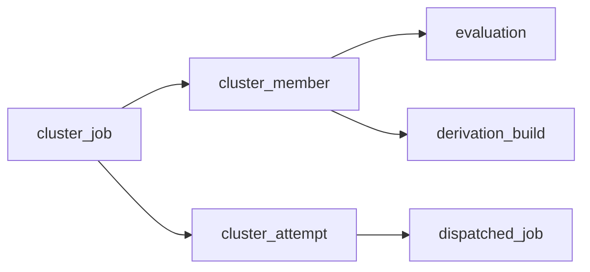

<!--
SPDX-FileCopyrightText: 2026 Wavelens GmbH <info@wavelens.io>
SPDX-License-Identifier: AGPL-3.0-only
-->

# Cluster Jobs

A cluster job bundles existing jobs, such as evaluation jobs and build jobs, so they start together on separate workers. The group either starts in full or not at all. Members stay regular jobs and carry a reference to their cluster. Every try of the whole group counts as a cluster *attempt*.

## Tables

| Table | Links to | Role |
|---|---|---|
| `cluster_job` | - | The group record. Holds `status` (`Queued`, `Running`, `Completed`, `Failed`, `Aborted`), `same_zone`, `attempts`, and `retry_budget` |
| `cluster_member` | `cluster_job` | One job in the group. Names exactly one of `evaluation` or `derivation_build` (the shared build), plus `role`, `primary`, and `pin` |
| `cluster_attempt` | `cluster_job` | One try of the group. Tracks `created_at`, `started_at` (set only after every member accepted), `finished_at`, and `outcome` (`Succeeded`, `Failed`, `PrepareFailed`, `Aborted`) |
| `dispatched_job` | `cluster_attempt` | The assignment row for a single member. Stays `NULL` for a standalone assignment |

| Constraint | Effect |
|---|---|
| `CHECK (num_nonnulls(evaluation, derivation_build) = 1)` | A member names exactly one job. Both or neither count as invalid |
| `idx-cluster_member-evaluation`, `idx-cluster_member-derivation_build` (unique, partial) | A job can belong to at most one cluster |
| `idx-cluster_attempt-open` (unique on `cluster_job WHERE finished_at IS NULL`) | A cluster can hold at most one open attempt |
| `dispatched_job.cluster_attempt` `ON DELETE SET NULL` | Member rows survive their attempt as plain telemetry |
| `cluster_member`, `cluster_attempt` `ON DELETE CASCADE` | The hourly retention pass can remove a finished cluster job past [`retentionDays`](../../reference/configuration.md#general). Once evaluation garbage collection removed the members, deletion happens immediately. Active cluster jobs never get deleted by the pass |

## Claim

The `claim_cluster` function in `backend/gradient-db/src/scheduling/cluster/claim.rs` runs all of its steps inside a single transaction.

1. Insert the `cluster_attempt` row, on the condition `cluster_job.status = Queued`. A conflict on `idx-cluster_attempt-open` will insert nothing (`ON CONFLICT`).
2. Claim each member with the single-assignment claim statement (`claim_assignment`): its own job key (`eval:<evaluation>`, `build:<shared_build>`), its own start condition, and `cluster_attempt` set.
3. The first statement inserting nothing will roll the whole transaction back. The return value of `claim_cluster` is then `false`.

- `idx-cluster_attempt-open` can arbitrate between server instances claiming one cluster. `idx-dispatched_job-open-job` can do the same for a single job.
- A member already open as a single assignment will lose its claim, and the whole attempt will roll back.

## Close

`close_cluster_attempt` can close an attempt with its outcome only while the attempt is open. The same transaction must mark every open member row of the attempt as `Abandoned` too.

- A second close (a prepare timeout racing a member failure) will return `false` without touching anything.

## Tracking

| Stage | Where a member is | Rule |
|---|---|---|
| Can start | Cluster book, under its own key | The eval and build assignment passes fetch each batch's memberships with one query (`cluster_membership`). Members of a `Queued` cluster enter the book. Members of any other cluster wait for that cluster. Non-members queue as before. |
| Waiting | Cluster book | A cluster can start only after every member arrived. A member key in the book count as tracked. A member that can no longer run (resync removal, evaluation cancel) hold its cluster back until the feed bring the member back. |
| Offered | Job offers | Workers score members under their own key. Single assignment (`take_best_of_kind`) never see them. |
| Running | Active jobs, marked with its attempt | A reject, a revoked peer or a disconnect can never requeue a member as a single job. |

- Member evaluations always run in one job, never as a split fetch-only job. A split job would place its follow-up outside the cluster.
- An empty answer to `RequestJob` record an idle slot `(worker, kind)` for the worker. An assignment, a full worker or a disconnect clear the slot. The planner can ignore entries older than 25 s (two worker heartbeats). Idle slots give the planner the only view of free capacity.

## Placement

The `cluster-dispatch` pass can run every 5 s. It can also run whenever `RequestJob` messages go unanswered. Expire overdue prepares first. Then place all clusters that can start, prioritized clusters before the oldest ones.

- A worker can seat a member when three conditions hold. It must have an idle slot of the member's kind, match the member's `pin`, and be able to run the job (capabilities, project access).
- Bipartite matching: each member sits on its own worker, one worker per member.
- Under `same_zone`, all members sit in one zone. Workers without a zone form a zone of their own.
- Among zones able to seat every member, pick the one with the lowest summed missing NAR size.
- Once the pass seats a worker for one cluster, it cannot offer that worker to the next cluster.
- A cluster that cannot fill all seats must wait. Single assignment follow separate rules and remain unchanged.

## Prepare and Start

1. The scheduler can claim the cluster and all its seats in a single step. It refuse the claim when a seat's worker turned busy after the snapshot.
2. `claim_cluster` write the attempt plus a `dispatched_job` row for every member. Each build member get an `Assigned` transition.
3. Every seat session send `AssignJob` with `cluster` (`attempt`, `role`, `index`, `hold_secs`). The worker hold the job and do not start it.
4. Once every member accept, `start_cluster_attempt` mark the attempt started and the cluster `Running`. All member then receive `StartCluster` with the roster.

| Event | Result |
|---|---|
| Every member accepted | `StartCluster` to every member |
| A member rejected | Attempt closed `PrepareFailed`, `AbortCluster` to every member, cluster waiting again after 30 s |
| `scheduler.clusterPrepareTimeoutSecs` passed without every acceptance | Same as a reject |
| A held member reporting `JobFailed` before the start (hold expired, drain, `AbortJob`) | Same as a reject. The report never reach the build or evaluation |
| The claim is lost | Nothing written. The member go back to the assignment pass, and those pass re-read their cluster |

- A failed prepare do not consume the cluster's retry budget.
- Set `hold_secs` to `clusterPrepareTimeoutSecs` plus 10 s. A worker that never receive `StartCluster` release the slot on its own.

## Signals

- A `ClusterSignal` can be forwarded by the server only from a member of a started attempt. In every other case the server discards the signal.
- Set `to` to target a single member by role and index. Omit `to` to deliver the signal to every member.

## Recovery

When a member reports `JobCompleted` or `JobFailed`, its job can be released. The build or evaluation transition has to wait for the attempt verdict. The first deciding report settles the attempt, and that verdict then applies to every member.

| Verdict | When | Attempt | Cluster | Members |
|---|---|---|---|---|
| Complete | Every member succeeded, or the primary succeeded | `Succeeded` | `Completed` | Reported members settle. Still-running ones end `Aborted` |
| Retry | A member failed or was lost, budget left, every member can still start | `Failed` | `Queued` | Every member job going back to the assignment passes |
| Fail | Same as Retry without budget, or a member can no longer start | `Failed` | `Failed` | Members settle with their own outcome. Requeueing failure kinds become `Permanent`. Survivors end `Aborted` |
| Abort | An evaluation abort reached a member | `Aborted` | `Aborted` | Survivors end `Aborted` |

- Reports that arrive while the attempt is being settled follow the decided verdict.
- A member with an open attempt count as tracked, so `abandoned-dispatch-sweep` and the evaluation watchdog skip them.
- `cluster_job.retry_budget` set the number of automatic retries after the first start (`attempts <= retry_budget` permit a requeue). This budget is separate from the per-evaluation assignment budget. A user retry of a build disregard it.
- Members lost with their worker, or reaped after an unconfirmed abort, report into the same verdict.

## Aging Reservations

A cluster can be ready to start while no set of workers remain idle long enough to satisfy `scheduler.clusterReserveAfterSecs` (600 s). In that case, the cluster reserve a placement instead of waiting for idle workers to line up by chance.

- Target: the planner select a match across all connected eligible workers, seating idle workers first.
- Seats: a reserved worker keeps its current jobs, but the scheduler assign no new job of the reserved kind to it.
- Commit: once every seat reach an idle state, the reservation commit like a normal placement.
- One at a time: a single cluster can hold a reservation at any moment. Other clusters plan over the unreserved idle workers.
- Release: the reservation expire after `scheduler.clusterReserveTimeoutSecs` (1800 s), when a seated worker disconnect, or when the cluster leave the queue. The next planning pass can reserve again.

## Related

- [Shared Builds](shared-builds.md)
- [Waiting and Recovery](waiting-and-recovery.md)
- [Workers: Zones](../../concepts/workers.md#zones)
- [Jobs: Cluster Members](../proto/jobs.md#cluster-members)
- `nix/tests/gradient/cluster/`: the `gradient-cluster` VM test
