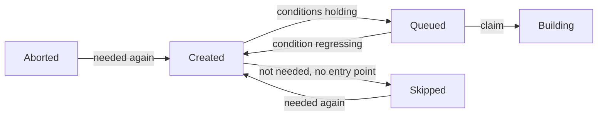

# Queueing and Counters

A shared build (`derivation_build`) moves from `Created` to `Queued` once its queue conditions hold. Counters tell an evaluation to keep waiting. Every queue condition reads maintained columns, so the event that changes a fact must update the column as well. A consistency check acts as the only backstop against missed updates.

## Start Condition Columns

All on `derivation_build`, moved by transitions and never derived by a per-row walk.

| Column | Meaning | Moved by |
|---|---|---|
| `missing_runtime_deps` | Runtime dependencies (`kind IN (1, 2)`) leading to a shared build without a complete closure | `runtime_can_start`: seeded on a NAR landing, spread up and down through the SQL function `ripple_missing_runtime_deps` |
| `fetchable` | Terminal success (`Completed`, `Substituted`) with a complete closure | `can_start::became_fetchable`, `can_start::lost_fetchability` |
| `blocking_deps` | Direct dependencies (every edge in `derivation_dependency`) that are not `fetchable` | One-hop spread from the shared builds a `fetchable` change returned |
| `wanted` | Shared build still wanted by some open entry point, unless its evaluation or the build was aborted there | `can_start::update_need` |

- **Complete closure** (`graph_sql::shared_build_complete_predicate`): a shared build counts as complete when every output with a NAR is present in the cache and `missing_runtime_deps = 0`. The `EXISTS` over `derivation_output` must stay readable for shared builds without output rows.
- An upstream copy never counts as `fetchable`. A build that needs a shared build held in an upstream cache must wait for the passthrough, because every build must draw its inputs from the Gradient cache.
- A flag change must write the flag with a `RETURNING` clause that reports exactly the changed rows, and only those rows may spread further. A spread driven by a state instead of a transition pushed a counter below zero, and `= 0` never held for that counter again.
- The flag change and the spread ran in one transaction under `can_start::lock_shared_builds`, which took `derivation`-ordered `FOR NO KEY UPDATE` locks. The lock must return the `SharedBuildLock` proof required by both functions.
- Complete closures propagate transitively, one level at a time. `blocking_deps` moved a single hop and then halted. Reaching zero queued the waiting build, and it never made that build `fetchable`.
- A transitive spread ran as one SQL function call (current bodies in `m20261001_000001_plain_concept_names.rs`). The function can count, lock in order and advance every level on its own. A chain of 163 levels cost one round trip instead of three per level. Unit tests in `graph/runtime_can_start.rs` and `graph/walk_completeness.rs` verified that the function bodies match the module predicates. A predicate change demanded a migration.

## Queue Conditions

`graph_sql::gates_predicate` act as the single source of truth for these conditions. `graph_sql::promotable_predicate` can layer `status = Created` on top.

| Condition | Build | Passthrough (`cache_available`) |
|---|---|---|
| `derivation.walked` | Required | Required |
| A `build_job` naming the derivation | Required | Required |
| `wanted` | Required | Required |
| `probed` (upstream probe answered) | Required | - |
| `blocking_deps = 0` | Required | - |
| Own `.drv` NAR in the cache (`drv_present_predicate`) | Required | - |

### Queueing Events

Queue every touched shared build through `can_start::promote`. The call embeds the queue condition, and the candidate list acts only as a bound.

- An imported batch: run `seed_blocking_deps`, then `promote` over the batch and over whatever the needs-build update of the batch gained.
- A dependency turned `fetchable`: `became_fetchable` can queue each build that need the dependency, once its counter reached zero.
- A `.drv` NAR arrival: `gradient-graph/src/nar.rs` can queue the `.drv` owners.
- Any newly needed build, through `update_and_settle_need` (see [Skipped and Thaw](#skipped-and-thaw)).
- Stream completion and the graph-stuck heal: `can_start::promote_closure` over the evaluation's closure (see the [repair pass](repair-pass.md)).

## Queued Invariant

- The assigner can read the status column alone. It cannot re-check the queue conditions. A `Queued` mark must therefore mean the conditions held at write time.
- Every writer of `Queued` must either embed `promotable_predicate` or settle its rows with `can_start::unpromote_ungated` in the same call.
- `unpromote_ungated` can move only `Queued` rows with no open assignment. A `Building` shared build can finish undisturbed.
- `lost_fetchability` must raise `blocking_deps` on the builds that need the changed ones. The same statement (`RIPPLE_UP`) will move the `Queued` rows without an open assignment back to `Created`. After that, update the needs-build marks from the changed shared builds.
- `assignment_record::claim_assignment` can insert an assignment row only while the shared build is still `Queued` with the expected `cache_available` value. The claim will drop a regressed job instead of handing it out.
- `can_start::repair_can_start` act as the consistency check's backstop for a lost move.

## Needs Build

A shared build is **open** (`graph_sql::open_predicate`) when `fetchable` is false and its status is not `BuildStatus::TERMINAL_FAILURE`. Builders, `Skipped`, `Aborted`, and `Completed` shared builds with a missing dependency in the closure all qualify as open.

- `graph_sql::open_closure_cte_body` defines one walk behind both the needs-build mark and its naming. Seeds step over runtime dependencies. A **builder** (`builder_predicate`: walked, probed, absent from a cache, in `BUILDER_STATUSES`) can also step over build dependencies.
- Only open shared builds are reachable. A `fetchable` or failed shared build ends the walk.
- The walk can reach a passthrough but cannot step through it on a build dependency. No job ever builds the input closure of a passthrough output.
- The needs-build mark lives in a column. The mark flows down from the entry points, while the can-start counters flow up from the leaves. A one-hop predicate cannot carry the downward direction.
- `update_need` walks the region below the given roots (roots included) in one statement. `WRITE_NEED` then writes the answer as a bound `unnest` array. Recursive CTEs carry no usable row estimate, and a membership subquery degrades into a sequential scan.
- The write returns each changed row with its new value, split into gained and lost sets for the caller.

### Callers of `update_need`

Follow each call with a `settle_need` call.

- **Status transitions:** the transition-effects emitter (`status/effects.rs`) for every transition that moves into or out of `BUILDER_STATUSES`.
- **Unchanged status:** `update_and_settle_need`, for events that move the needs-build mark without a status change.
    - Batch import (new builder, new entry point, adopted runtime dependencies, upstream hit, probe answer)
    - `demote_cached_output` and `lost_fetchability`
    - An exhausted substitution
    - New runtime dependencies from a NAR
    - The per-task evaluation GC and every adoption

## Skipped and Thaw

Apply each needs-build move in `can_start::settle_need` in a fixed order.

| Side | Steps |
|---|---|
| Gained | `thaw_wanted` (`Skipped`/`Aborted` -> `Created`, `attempt = 0`), then `adopt_below_named`, then `promote` |
| Lost | `unpromote_ungated`, then `skip_unwanted` (`Created`, not needed, no `entry_point` -> `Skipped`) |

- `Skipped` counts as settled work. Queue conditions cannot affect a skipped build, and no evaluation waits for one.
- A thaw can end at `Created`, never at `Queued`. Read the queue conditions in the `promote` call after the thaw.
- An `Aborted` shared build can thaw the same way. An abort is no verdict.
- An entry point with `build_job.aborted` set needs nothing until a retry removes the mark.
- Entry points of an `Aborted` evaluation need nothing. Otherwise the aborted evaluation keeps its own builds wanted, and the next check thaws them.
- Entry points of a `Completed` or `Failed` evaluation still need the closure below them. The retire step builds a retired output under such an entry point again.
- Call `status::release_evaluation_need` to update the need below the entry points of an aborted evaluation, inside the abort transition. Every abort sends it: hard aborts after aborting the unshared builds, soft aborts and the stuck-evaluation recovery without touching builds.
- `update_need` and `settle_need` are crate-private. Other crates call `update_and_settle_need` and every needs-build move can skip and thaw inline. The consistency check's `settle_skipped` acts as the table-wide backstop and reports `skipped_moves`.
- The batch writer can call `gain_and_settle_need` instead. Its region walk will not enter a shared build already wanted. Its naming walk (`adopt_unnamed_below`) will stop at a shared build the evaluation already named. Both walks then cost about the batch's own rows, not the whole closure.
- Writers of `Created` call `can_start::settle_created` on the rows they wrote. Unwanted rows go to `Skipped`, startable rows to `Queued`. The retire step, the batch writer, the thaws and the retries count as such writers.

## Evaluation Verdict

- `graph_sql::blocks_evaluation` blocks an evaluation in two cases. Either the status sits in `NEED_BUILD_STATUSES` while the shared build is `wanted`, or the status is `Queued` or `Building` (the assigner hands those out regardless of need).
- A pending shared build with no wanters can never block anything. No code path can queue such a build.
- `Aborted` does not appear in `NEED_BUILD_STATUSES`. So no evaluation can wait for an aborted shared build, and a later need can still thaw it.
- Once no blocking shared build remains, `check_evaluation_done` can write a verdict. Any named shared build in `BuildStatus::REQUEUEABLE` (`Aborted` included) or a present error message yields `Failed`. Everything else yields `Completed`.
- A lost needs-build mark leaves every status unchanged. Finalize, in the emitter, the evaluations that name the shared builds which lost the mark.

## Evaluation Counters

The `evaluation` table holds five counter columns. They cover the shared builds named through its `build_job` rows.

| Column | Counts |
|---|---|
| `named_shared_builds` | Every named shared build |
| `active_shared_builds` | `blocks_evaluation` |
| `failed_shared_builds` | `BuildStatus::REQUEUEABLE` |
| `queued_shared_builds` | `Queued` |
| `building_shared_builds` | `Building` |

- **Triggers** (current bodies in `m20261001_000001_plain_concept_names.rs`): `evaluation_shared_build_moved` fires per row on `AFTER UPDATE OF status, wanted`. `evaluation_shared_build_named` and `evaluation_shared_build_unnamed` fire per statement on `build_job` insert and delete. Raw SQL and ORM changes both pass through these triggers.
- Triggers append signed rows to `evaluation_shared_build_delta`, for live evaluations only, and take no lock.
- **Membership:** the SQL function `evaluation_shared_build_counts(status, wanted)` (current body in `m20261009_000000_build_job_aborted.rs`). Keep its body in sync with `graph/predicates.rs` through a unit test in `evaluations/counters.rs`. A predicate change will require a migration.
- **Fold:** `fold_shared_build_deltas` can run at the start of every waiting-state pass. One fold is a single `DELETE ... RETURNING` under advisory lock `640`. An instance that sees the lock taken can skip the fold. Rows held by another transaction (`SKIP LOCKED`) get skipped as well, and their deltas wait for the next pass. The fold never blocks on an evaluation row, so it cannot deadlock with the graph writer.
- **Read:** `eval_counters` should return the folded columns plus the unfolded deltas.
- **Counters answer only "not yet":** a naming and a transition in flight together can miss each other. Confirm a zero with `reachability::eval_blocked`. `recount_evaluations` can recount a contradicted value under the fold lock. The recount, like the fold, will skip an evaluation held by another transaction. The next contradicting read will recount that evaluation.
- The consistency check can recount every in-flight evaluation. `eval_counter_drift` reports only the evaluations where folded columns plus pending deltas disagree with the recount.

## Naming and Adoption

- Always name every walked derivation plus the direct inputs in a batch. Stop descending at `walked AND unwalked_inputs = 0`. Only the evaluation that walked a cut-off subtree names its interior.
- Deleting that evaluation cascades those names away. Start the open-closure walk from every `build_job` of a live evaluation with `reachability::adopt_pending_closures`. Insert the missing `(evaluation, derivation)` rows with `ON CONFLICT DO NOTHING`.
- Name a build with `reachability::adopt_below_named` at the moment it gains the needs-build mark. Every live evaluation naming a wanted open parent then names the build and the open closure below it. A build below a cut-off subtree can therefore queue during the evaluation.
- Further callers: the per-task GC, the [repair pass](repair-pass.md) and the consistency check. The GC can call through `settle_after_delete`, but only when a cascaded name belonged to an open shared build. The repair pass can call `adopt_pending_closure` for one evaluation. The consistency check can call once `pending_orphan_frontier` detects an unnamed open shared build one edge below a named one.

## Walk Completeness

- `derivation.walked`: the derivation carries its own walk record, covering outputs, all edges and the sources of every input. The inserting transaction must add unknown inputs as stubs in the same transaction. The queue never picks up a stub and workers never receive one.
- `derivation.unwalked_inputs`: direct build inputs, matched by `kind IN (0, 2)`, with no recorded subtree. The import step seeds these rows. As inputs finish, the SQL function `ripple_unwalked_inputs` spreads updates. The consistency check (`walk_drift`) recounts the set.
- Two events can clear `walked`: the missing-input self-heal and the demote path (`can_start::unwalk_derivations`). The orphan derivation GC also clears `walked` for derivations that survive a deleted dependency they require. `unpromote_ungated` runs afterwards.

## Dependency Failure

- A fresh terminal-failure transition lets `cascade_dependency_failed` mark every `Created`, `Queued` and `FailedTransient` derivation that wants the failed build as `DependencyFailed`.
- `repair_dependency_failed` can repeat that walk inside the closure of an evaluation, at stream completion and during the graph-stuck heal. A shared build thawed after its dependency failed gets caught by this repeat.
- The repeat can also take each shared build the evaluation aborted (`build_job.aborted`) as a starting point. Derivations wanting such a build end as `DependencyFailed`.
- Both walks skip any shared build available in a cache (`graph_sql::non_passthrough_predicate`).

## Build Abort and Retry

Two endpoints, `POST /builds/{id}/abort` and `POST /builds/{id}/retry`, act on a build of an evaluation. Both run inside the graph writer (`status::evaluation_build`).

| Action | Allowed Status | Effect |
|---|---|---|
| Abort | `Created`, `Queued`, `Building` | Set `build_job.aborted`, mark the shared build `Aborted`, mark dependents in the closure `DependencyFailed`, send `AbortJob` to the worker |
| Retry | `FailedPermanent`, `FailedTimeout`, `Aborted`, `DependencyFailed` | Move failed builds back to `Created` and clear their `build_job.aborted`, move dependents failed through them back to `Created` (`RETRY_BUILD_CLOSURE`), repeat the dependency-failure walk, queue the closure |

Rules for aborts:

- The evaluation need to run.
- A shared build that other live evaluations still name can not be aborted.

Rules for retries:

- A retry of a `DependencyFailed` build can also retry each failed dependency below the build. The walk can only pass `DependencyFailed` dependencies.
- A retry can reopen a `Failed` or `Aborted` evaluation past its evaluation phase. The evaluation go back to `Building` (`REOPEN_EVALUATION`) and can finish again.
- Newer or still active evaluations of the same task keep the evaluation closed.
- Retries wait until the worker confirmed the earlier abort. A late abort report can move a retried build back to `Aborted`.
- The `Eval` and `Unstick` thaws of the [repair pass](repair-pass.md) skip the aborted build and everything above the build in the closure.
- Retry thaws skip the deterministic-failure block. The user asked for the rebuild.

## Consistency Check

The `consistency::graph_consistency_report` gets built through a sequence of recounts. Each step depends on the previous one.

| Step | Reports |
|---|---|
| `unwalked_inputs` | `walk_drift` |
| `missing_runtime_deps` | `runtime_drift` |
| `fetchable` (`repair_fetchable`) | `counter_drift` (with `blocking_deps`) |
| `wanted` (`recount_wanted`) | `need_drift` |
| `settle_skipped` | `skipped_moves` |
| `blocking_deps` + queue (`repair_can_start`) | `counter_drift`, `unpromoted_startable` |
| Adoption | `adopted` |
| Evaluation counters | `eval_counter_drift`, `wedged_building_evals` |
