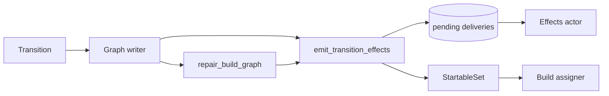

# Repair Pass

Some graph state sits beyond the reach of any event. The `repair_build_graph` function heals that state. Background loops in the scheduler re-drive what a lost message left behind.

Every status move on a shared build carries consequences. One emitter, `emit_transition_effects`, covers all of them. Both functions live inside the graph writer.

## Repair Scopes

Run `gradient_db::graph::repair::repair_build_graph(ctx, scope)` (`backend/gradient-db/src/graph/repair.rs`) as `Transition::Repair` in the graph writer. A repair pass and a batch import cannot interleave. Each scope targets one evaluation. The pass bounds every statement to that evaluation's dependency closure.

| Scope | Sent by | Thaw |
|---|---|---|
| `Eval(id)` | `EvalStreamCompleted` | Every `REQUEUEABLE` shared build in the closure, a reproducible builder exit included, minus the `kept_failed` subtree |
| `Unstick(id)` | A `Building` evaluation judged graph-stuck (`waiting_state::attempt_graph_unstick`), and the `graph-stuck-reheal` pass | Same, minus the `deterministic_build_failure` subtree too |
| `Retry(id)` | An evaluation retry starting `Building` (`POST /evals/{id}/retry`) | Every `REQUEUEABLE` shared build in the closure, without exception |

- A recorded failure counts only for the evaluation that recorded it. A fresh evaluation rebuilds the shared build once. An unstick of the same evaluation leaves the shared build alone.
- Base the `kept_failed` set on the shared builds a user aborted in the evaluation (`build_job.aborted`). Turn on the task's `retry_failed_builds` or the `FailedPermanent` shared builds of the closure also join the start set.
- An evaluation retry never walks. `inherit_names` copies the `build_job` rows of the retried evaluation, and the `Retry` heal operates on those copied rows.
- Never start a repair pass from a tick, and never iterate a step to a fixpoint.

## Repair Steps

All steps share the graph writer's transaction. The first failed step will end the pass and fail the transition. The graph writer can roll back and retry a deadlock or serialization failure.

| # | Function | Effect |
|---|---|---|
| 1 | `promotion::requeue_failed_closure` | Resetting `FailedPermanent`, `Aborted`, `DependencyFailed`, `FailedTimeout` shared builds to `Created`, `attempt = 0` |
| 2 | `promotion::repair_cached_shared_builds_for_eval`, then `can_start::advance_fetchable` | Shared builds with every output in the cache turn `Completed`. The counters of the builds needing them advance |
| 3 | `promotion::repair_dependency_failed` | Failing every non-terminal shared build reachable from a lasting failure |
| 4 | `reachability::adopt_pending_closure` | Inserting `build_job` rows for open shared builds reachable by the evaluation and named by nobody. Updating and settling the needs-build marks. Bumping `graph_version` |
| 5 | `can_start::promote_closure` | Moving the closure to `Queued` |

- Cache presence is the ground truth for "built" in step 2.
- All steps feed their `TransitionChange` values to `emit_transition_effects`.

## Transition Effects

Every status change reports a `(derivation, from, to)` move to `emit_transition_effects` (`backend/gradient-db/src/status/effects.rs`). Two kinds of callers exist: the single-row path `update_derivation_build_status`, and the bulk passes for queueing, cascades, repairs, abort and GC. Each move of a shared build carries its consequences.

| Effect | Condition |
|---|---|
| `StartableSet::record` | A shared build entered or left `Queued` |
| `bump_graph_version` | Once per emit, for each evaluation with a `build_job` on a moved shared build (`from != to`) |
| Board `build::StatusChanged` | Every `build_job` of a moved shared build |
| `build::Reported` event, written as an `Event` pending-delivery row | An entry-point `build_job` that reached `Queued`, `Building` or a terminal status |
| `cache::Changed` | Any move into `Completed` or `Substituted` |
| `check_evaluation_done` | Each evaluation of a shared build that turned terminal |
| `LogFinalize` pending-delivery row | The latest attempt of each shared build that really finished |
| Needs-build update, queue settle, upstream probe request | A shared build crossed the `BUILDER_STATUSES` boundary. A second round will announce shared builds with re-checked queue conditions |

- Write the `pending_delivery` rows in the same transaction as the shared build move. The `gradient-effects` actor can expand `Event` rows into Git host, action and webhook deliveries, and send them with retries.
- Stage `StartableSet` moves inside a graph transaction and publish them after the commit. The assigner can read on its own connection.
- `collapse_transitions` can reduce two moves of one shared build in one transaction to the net move.

## Task Page Histogram

Changes to `evaluation.graph_version` can invalidate the per-entry-point status histogram (`backend/gradient-db/src/task_board/dep_counts.rs`).

| Bumped by | Scope |
|---|---|
| `emit_transition_effects` | Evaluations of every moved shared build |
| Imported batch | Its own evaluation, plus every evaluation holding a derivation whose edge set grew |
| Adoption (repair pass, consistency check, evaluation GC) | The adopting evaluations |
| Startup recovery | Evaluations of re-queued and aborted shared builds (no emitter in recovery) |

- `task_board::entry_point_dep_counts` can walk one page of entry points. Each walk stores rows in `entry_point_dep_count` with the `dep_counts_computed_at` timestamp and the `entry_point.dep_counts_version` value.
- A read can trigger a refresh only when the version has moved and the stored rows predate `DEP_COUNTS_REFRESH_SECS` (120 s).
- A read can claim the refresh before the walk starts. Concurrent reads keep the stored rows until the walk has finished.
- A walk that never stored its rows can leave the claim to expire after `DEP_COUNTS_REFRESH_SECS`.
- Rows older than `DEP_COUNTS_MAX_AGE_SECS` (600 s) refresh regardless. This forced refresh can heal a bump that the emitter logged and swallowed.

## Consistency Check

`graph_consistency_report` (`backend/gradient-db/src/graph/consistency.rs`) can start every `metrics.graphConsistencyIntervalSecs` (300 s, `GRADIENT_METRICS_GRAPH_CONSISTENCY_INTERVAL_SECS`). Events move the counters, and no other code can derive them. This check is their only backstop. Each step must complete before the step reading its column.

| # | Step | Report field |
|---|---|---|
| 1 | Recount `unwalked_inputs` | `walk_drift` |
| 2 | Recount `missing_runtime_deps`, table-wide | `runtime_drift` |
| 3 | Correct `fetchable` over the repair scope, moving each parent's `blocking_deps` along | `counter_drift` |
| 4 | Recount `wanted`, table-wide | `need_drift` |
| 5 | `settle_skipped`: settle shared builds wanted by no evaluation to `Skipped`, thaw needed ones | `skipped_moves` |
| 6 | Recount `blocking_deps` over the repair scope, then un-queue and queue | `counter_drift`, `unpromoted_startable` |
| 7 | Adopt pending shared builds reachable by a live evaluation and named by nobody | `adopted` |
| 8 | Count unbacked outputs of terminal-success producers (read-only) | `unbacked_trusted_outputs` |
| 9 | Recount evaluation shared-build counters | `eval_counter_drift` |
| 10 | Count `Building` evaluations with `active_shared_builds = 0` (read-only) | `wedged_building_evals` |

- **Repair scope:** pending shared builds, their direct dependencies, `fetchable` rows with `missing_runtime_deps > 0`, and terminal-success rows without a set `fetchable` flag. Every pass must log the scope size under the `scope` field.
- Steps 1 and 2 first compare each counter with its direct inputs. The full recount can only start on a mismatch.
- Agreeing counters already equal the recount result on the acyclic dependency graph.
- Each chunk of 3 and 6 is its own transaction, with `lock_shared_builds` (ordered `FOR NO KEY UPDATE`) first and the recount second. A cancelled check can lose one chunk.
- A recount can read one snapshot and spread nothing. A chain of drifted rows will converge one level per interval.
- Drift counts are rows already repaired. A warning naming only those rows is a successful self-repair.
- Interval `0` will disable the check and the `graph-stuck-reheal` pass.

## Watchdogs

Scheduler loops live in `backend/gradient-scheduler/src/loops/background.rs`. A pass never touches a job that the scheduler tracker still holds.

| Pass | Every | Target | Action |
|---|---|---|---|
| `eval-completion-watchdog` | 60 s | Evaluation in `EvaluatingFlake`/`EvaluatingDerivation` whose newest eval assignment closed `Completed`/`Failed`, unwritten for 900 s | Re-sending `EvalStreamCompleted` or `EvalFailed` |
| `stranded-build-sweep` | 60 s | `Building` shared build whose newest attempt's assignment closed `Abandoned`, unwritten for 900 s | Sending `OrphanedBuilds` (moving only rows still `Building`) |
| `abandoned-dispatch-sweep` | 60 s | Open `dispatched_job` row older than 1800 s | Reaping aborts unconfirmed after 300 s first, then closing the row `Abandoned` |
| `graph-stuck-reheal` | Consistency check interval | `Waiting` evaluations with reason `GraphStuck` | Sending `Repair { Unstick }` |

- The graph writer can hold a queued transition for up to 900 s. A re-send that races such a transition does no harm.
- Both re-sent transitions can run repeatedly with the same result.

## Closers of Assignment Rows

A `dispatched_job` row records that a job went out. `claim_assignment` writes the row as part of a claim. The index `idx-dispatched_job-open-job` allows at most one open row per job key (`build:<shared_build>`, `eval:<evaluation>`).

| Closer | Outcome |
|---|---|
| Terminal report from the worker, matched on the assignment ID | `Completed` / `Failed` |
| Worker `JobFailed` of kind `Aborted` (confirmed server abort) or `Canceled` (worker stopped), with `failed_job_outcome` | `Abandoned` |
| Claim whose `Assigned` transition failed or exceeded its budget (`assignment.rs`) | `Abandoned` |
| Worker rejection of the assignment (`withdraw_assignment`) | `Abandoned` |
| Reclaim grace over (`unreclaimed-job-sweep`), or the job missing from `RunningJobs` | `Abandoned` |
| Session end without reclaim (cluster members, server-dialed sessions, protocol below 42, grace `0`) | `Abandoned` |
| Revoked project access for a worker (`abort_project_jobs_on_worker`), limited to that worker's jobs in the project | `Abandoned` |
| Registration without reclaim (server-dialed session, protocol below 42): rows assigned before the process started | `Abandoned` |
| Startup recovery (`abandon_open_cluster_assignments`), limited to cluster attempts | `Abandoned` |
| Overdue abort reap, `abandoned-dispatch-sweep` | `Abandoned` |

- `Abandoned` and `Failed` differ. The build can have succeeded before the server lost contact. These rows stay out of the board's failure rates and of history-based scoring.

## Missing Inputs

A build that reports `InputsUnavailable` must call `self_heal::repair_missing_inputs` (`backend/gradient-graph/src/self_heal.rs`) once for every missing path. Four cases can apply:

1. `demote_cached_output`: clear `external_url`, clear `cache_available`, retire the `cached_path` row, and delete the NAR.
2. Producerless path (`.drv`, source): the path can stay while its NAR exists. Call `demote_parents_of` to demote the rebuildable outputs that reference it.
3. Unreachable producer: demote the outputs that reference the path and un-walk them. When no such output exists, call `demote_output_only_cached_deps` to demote the output-only-cached direct deps of the failing build.
4. Terminal-failed producer: re-queue it on the spot with `requeue_failed_shared_builds`.

- The failed build itself retries in-eval as `FailedTransient` with the transient backoff. A raised `blocking_deps` counter keeps it out of the queue until the input returns.
- After `build.inputsUnavailableMaxLoops` (3) prior `InputsUnavailable` attempts, skip the self-heal. The build then fails with `Permanent` status.

## Cache Deletions

A `cached_path` row can be removed by exactly one code path: `runtime_can_start::retire_outputs`, which run inside the deleting transaction.

The function work through these steps:

- Lock the `cached_path` rows in hash order, then lock the shared builds. A concurrent signature insert can delay the lock, so the DELETE cannot open its snapshot before that insert finish.
- Raise `missing_runtime_deps` on every shared build that trusted the deleted rows. The spread then compute the complete closure and `fetchable` from the builds referencing those rows.
- Reset producers to `Created` only if their artifact has actually vanished. A referencing build that merely lost its complete closure keep its terminal status.
- Un-queue the owners of a retired `.drv` file.

| Caller | Path |
|---|---|
| Stale-path eviction, zombie purge | `GcRequest::Paths` -> `retire_stale_paths` in the graph writer |
| Missing inputs, path invalidation | `demote_cached_output` |

Gradient prevent an unbacked terminal-success output instead of repairing one. On a failed NAR commit, the build answer `Retry` and fail. `JobCompleted` wait for every `UploadCommitted` message. A substitution can succeed only with a complete closure for every output. Every retire reset the producers of the deleted paths. A non-zero `unbacked_trusted_outputs` count as a bug report.

## Garbage Collection

| Pass | Reclaimed |
|---|---|
| Evaluation GC (`gc_task_evaluations`, per task, keeping `keep_evaluations`) | Old evaluations. Live evaluations first adopt pending shared builds via `adopt_pending_closures` |
| Derivation GC (`collect_orphan_derivations`) | Derivations outside the dependency closure of every `entry_point` and `build_job` once they exceed `gc.orphanDerivationHours` (24). This pass also removes their attempt logs from log storage |
| Stale-path eviction (`evict_expired_cached_paths`) | Unreachable paths with no fetch in `gc.narTtlHours` (336) |
| Orphan NAR files | Stored NARs referenced by no row, probed in batches of 5000 and older than `gc.narUploadGraceHours` (24) |

- Keep the `.drv` and input-source NARs of any derivation with a shared build, regardless of status. Only an evaluation can re-push them.
- An active evaluation blocks GC of its task. Skip the block only when the current phase is older than `gc.wedgedEvalHours` (24). Age comes from the phase stamps, not `updated_at`.
- Inside the graph writer, always re-check roots created since the Derivation GC scan. Un-walk surviving derivations that need a deleted derivation.
