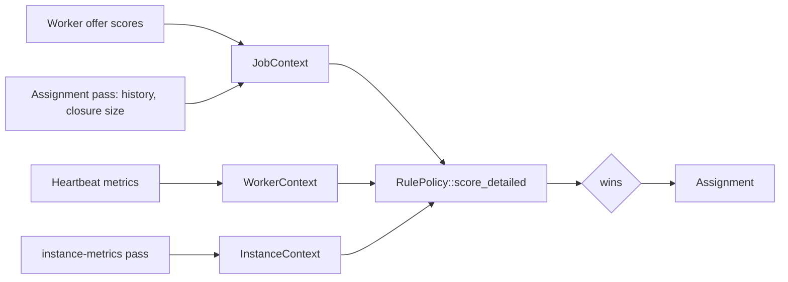
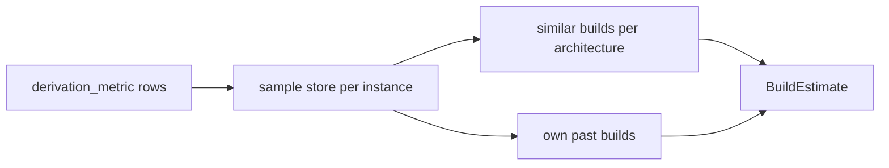

# Scoring

To pick a job for a worker, the scheduler scores every eligible pending job with a `ScoringPolicy` implementation and picks the top candidate. The scoring code is in `backend/gradient-pool/src/score`. The scheduler in `backend/gradient-scheduler` fills in the inputs. For the rule list and weights, see [Scheduler Policies](../../reference/scheduler-policies.md).

## Traits

| Item | File | Role |
|---|---|---|
| `ScoringPolicy` | `policy.rs` | `name`, `score`, `score_detailed`, `uses_history`, `uses_project_work_share` |
| `RulePolicy` | `policy.rs` | Named `Vec<Box<dyn ScoreRule>>`. `score` can sum the rules. `score_detailed` can also collect per-rule scores and vetoes |
| `ScoreRule` | `rule.rs` | `name` (persisted key), `score`, `veto`, `uses_project_work_share`, `description` |
| `ScoreBreakdown` | `breakdown.rs` | `rules`, `total`, `vetoes`, stored in `dispatched_job.score_breakdown` |
| Weights | `weights.rs` | Every rule magnitude and `ASSIGN_FLOOR` in one file |

- `policy_by_name` maps `scheduler.scoringPolicy` to a `RulePolicy` value. An unknown name logs a warning and falls back to the `resource-aware` policy.
- Policies are declarative tables (`simple_table`, `resource_aware_table`) of `spec(enabled, rule)` rows. `FairShareRule` is present there with `enabled = false`.
- The enabled rules determine `uses_project_work_share`. `uses_history` is a constructor flag of `RulePolicy::new`.

## Contexts

| Context | Fields | Filled by |
|---|---|---|
| `JobContext` | `ScoredJob` (kind, architecture, `prefer_local_build`, `is_fixed_output`, `pname`, closure size, history), `missing_count`, `missing_nar_size`, `outputs_present`, `substitute_outputs`, `dependency_count`, `queued_at`, `ready_at`, `project_work_share`, `prioritized`, `build_request`, `ifd`, `rescore_count`, `now` | `JobTracker::score_candidates` in `gradient-scheduler/src/jobs.rs` |
| `WorkerContext` | `architectures`, `system_features`, `fetches_flakes`, `metrics` | `worker_context_of` from the worker's `WorkerCaps` |
| `WorkerMetricsView` | `cpu_count`, `cpu_core_score`, `ram_total_mb`, `ram_free_mb`, `cpu_usage_pct`, `disk_speed_mbps`, `upload_speed_mbps`, `download_speed_mbps`, `running_builds`, `ram_reserved_mb`, `ram_reserved_unused_mb`, `ram_reserved_for_waiting_build_mb` | `WorkerCapabilities` (static), the 10 s `WorkerMetrics` heartbeat, the build stages, the assigned jobs and the waiting build (live) |
| `InstanceContext` | 13 `Windowed` averages, `active_builds`, `pending_builds`, `total_workers`, `idle_workers`, `cpu_core_score_mean`, `upload_speed_mean_mbps`, `download_speed_mean_mbps`, `storage_read_mbps`, `storage_write_mbps`, `compression_ratio`, `per_path_secs`, `substitute_cost`, `download_slots`, `upload_slots`, `downloads_in_flight`, `uploads_in_flight` | `instance_metrics_pass`, see below. The two in-flight counts come from the build stages at assignment time |

- Three fields, `missing_count`, `missing_nar_size` and `outputs_present`, are per worker. Each worker scores every offered candidate against its own store and reports a `CandidateScore` (see [Offers](../proto/capabilities-and-dispatch.md#offers)). Until that report, the values stay `None`.
- `dependency_count` counts direct input derivations (`derivation_dependency` rows without runtime-only edges), not builds needing the derivation.
- `ready_at` marks the moment the dependencies finished. `WaitTimeRule` measures from that moment, not from `queued_at`.
- `ifd` marks a build of an imported derivation and its unfinished dependencies while evaluations wait on the import. `import_lifted_shared_builds` can walk that set from the builds of the open import requests.
- Every 5 s assignment timer tick (`BumpRescore`) adds one to `rescore_count`. Reactive kicks leave the count unchanged.
- Pass `now` in as a caller. Rules never read the wall clock.
- `JobContext::build_estimate` can only give an empty estimate, for a job with `outputs_present`. A worker holding every output has nothing to build.
- `ram_reserved_mb` sums over the jobs assigned to the worker. Per job, count the larger of `RamNeed::reserved_mb` and its observed peak.
- `WorkerMetrics::build_peak_ram_mb` holds the `memory.peak` of each running build, read from the cgroup `nix-build@<derivation hash>-<build user>`. A worker without `worker.build.cgroup` reports `None`.
- `ram_reserved_unused_mb` sums reserved minus observed memory per job, on a worker reporting build memory. A build absent from the report has not started and counts as 0.
- `SchedulerCore::unregister` can raise the estimate of a lost build to its observed peak. The graph writer can store that peak as a `derivation_metric` row.
    - `Predicted` is the predicted peak RAM of a build.
    - `Unmeasured` is a build without a prediction, held at `InstanceContext::unmeasured_build_ram_mb`. That value is the 24 h mean of `peak_ram_mb`, or the 1 h mean.
    - `Negligible` is a substitution, a fetch without a prediction or an evaluation. An evaluation can hold the worker while it waits on a build of an imported derivation.
- `WorkerMetricsView::ram_available_mb` takes the lower of `ram_free_mb - ram_reserved_unused_mb` and `ram_total_mb - ram_reserved_mb`, then subtracts `ram_reserved_for_waiting_build_mb`. The measured value alone lags behind a burst of assignments.
- `ResourceSaturationRule` can veto a build that fits `ram_total_mb` but not `ram_available_mb`, while `WorkerMetricsView::will_release_ram` is true.
- `JobTracker` can keep the reserved RAM of a held build free on a worker, as `ram_reserved_for_waiting_build_mb`.
    - Prioritized builds qualify at once. Other builds qualify `HELD_BUILD_RESERVES_RAM_AFTER_SECS` (60 s) after `ready_at`.
    - Each worker can wait for a single build, and each build on a single worker. Prioritized builds go first, then the oldest `ready_at`.
    - Scoring of the waiting build excludes its own kept memory, so the build wins the round as soon as it fits.
    - The wait ends on an assignment anywhere, on a lost or draining worker, or on a round without a RAM veto for the build.

## Build Stages

A build job passes through `Prefetch`, `Build` and `Upload`. On each entry into one of these stages, workers report `JobUpdateKind::Stage` to the pool. The pool can record the stage with each job assignment.

| Count | Meaning |
|---|---|
| `running_builds` | Jobs of this worker in `Build` |
| `downloads_in_flight` | Jobs of every worker in `Prefetch`, presigned downloads included |
| `uploads_in_flight` | Jobs of every worker in `Upload`, jobs waiting for their grant included |

A released job drops out of these counts together with its slot.

## Build Estimates and Closure Size

`ScoredJob` can borrow values only. Scoring alone can compute nothing. `BuildAssignMaps::load` in `loops/build.rs` can only attach both values to the pending job, when `policy.uses_history()` is true.

| Value | Source |
|---|---|
| Closure size | `derivation.closure_size`, or one batched `transitive_closure_sizes` walk as fallback. The graph writer can persist computed sizes |
| Build estimate | `BuildHistory::estimate` per pname, input pnames and architecture. Section [Build Estimates](#build-estimates) has the details |
| Output size | The model's output NAR size. Once all of the job's own outputs have a `nar_size`, their sum replaces the estimate |
| Evaluation estimate | `compute_eval_history`: per-task p95 of `evaluation_metric.peak_rss_mb` over 24 h and the mean run time of the task |

- Only real builds can write a `derivation_metric` row. Substituted outputs write none.
- Failed builds can only write a row, after an out-of-memory kill.
- Each row records `concurrent_builds`, `build_cores`, `cpu_core_score` and the `input_pnames` of the direct build inputs.

### Build Estimates

- **Samples:** build-assign passes read the rows added since the last read. Rows count once per id, also across instances.
- **Lower bounds:** out-of-memory rows and rows without a build time set a lower bound for RAM only.
- **Similar builds:** the 10 pnames whose newest build shares the most input pnames, at least 30 %. The weight of each is the square of that overlap. Lower-bound rows stay out.
- **No similar build:** the median over the newest build of every pname.
- **Cores:** values move to 16 cores by `log(cores / 16)` times `+0.5` for RAM and `-0.5` for build time.
- **Own builds:** the last 20 rows of the pname and architecture with at least 30 % input overlap, weighted by that overlap. torch and torch-bin share no inputs and stay apart.
- **Targets:** peak RAM, build time at `REFERENCE_CORE_SCORE` without concurrent builds, and output NAR size, all in log space.
- **Refresh:** `BuildHistoryRefit` can rebuild the similar builds every 300 s on each instance.
- **Blend:** the estimate is `(W * own + 0.1 * similar) / (W + 0.1)`, with `W` the summed weight of the own samples. Own samples keep the core count of their run. Never-measured derivations still get the estimate of their similar builds.
- **RAM reserve:** `BuildEstimate::ram_mb(cores)` can give the 90th percentile at that core count. Core counts at or above an own out-of-memory kill keep at least 1.1 times its killed peak.
- **No samples:** architectures without rows give no estimate. Their builds count as `RamNeed::Unmeasured`.

### Core Choice

`choose_cores` can pick the core count per candidate worker. The steps start at the worker's `build_cores`, else its CPU count, and each step is `min(c - 1, ceil(2c / 3))` down to 1.

| Fit of a step | Result |
|---|---|
| Some step fits `ram_available_mb` now | The largest such step |
| No step fits now, some fits once RAM is released | The largest such step, and the build waits for the worker |
| No step fits | RAM proportional to cores picks the step. Kills take the steps down from there |
| Not even 1 proportional core fits | 1 core, penalized |

- `EstimatedTimeRule` can score the build time at the chosen cores.
- The assignment can carry the chosen cores in `BuildSpec.build_cores`. The worker can build with the smaller of that value and its own `max_cores`.
- `ram_shortage` can use the same choice per worker. Only a build too large at 1 proportional core can reach `fail_build_no_worker_fits`.
- The next attempt after an out-of-memory kill can get at most `next(c)` cores. Here `c` is the fewest cores among its kills.

## Instance Windows

Every `metrics.instanceIntervalSecs` (30 s), `instance_metrics_pass` can run and publish a snapshot through an `ArcSwap` value.

| Source table | Windows |
|---|---|
| `derivation_metric` | `peak_ram_mb`, `cpu_time_ms`, `avg_cpu_pct`, `disk_bytes`, `build_time_ms`, `build_time_median_ms`, `closure_size`, `oom_rate`, `completed` |
| `dispatched_job` (builds with `ready_at`) | `wait_secs`, `nar_size_mb`, `missing_paths`, `dependency_cnt` |

- `STORAGE_PEAK_THROUGHPUT`: read the `NarFetch` and `NarPush` spans of the last hour. Between start and end on the server clock, each span contributes its rate. The maximum sum of rates gives `storage_read_mbps` or `storage_write_mbps`.
- `PREFETCH_TIME_FIT`: fit the `Prefetch` seconds of the last 24 hours over a constant, megabytes and paths. Least squares on these sums yield `per_path_secs` from 100 spans on.
- The same fit on C3D2 gave the fallback of 0.18 s per path. The data were 16938 prefetches in 3 days, with 3.6 s fixed and 29 MB/s.
- `SUBSTITUTE_TIME_FIT`: fit the `SubstituteFetch` seconds of the last 24 hours over a constant and megabytes. Spans carry the NAR bytes of their output. Least squares yield `substitute_cost` from 20 spans on.
- `EVAL_HISTORY_DURATION`: average the top-level `Fetch` span and the remaining time of completed eval jobs per task over 7 days. Only jobs with an evaluation span contribute the remaining time. Tasks without runs of a part use the mean of all runs.
- `STORED_TO_NAR_RATIO`: divide the `NarPush` bytes by the NAR bytes of their parent `Compress` span. Spans record stored bytes. This ratio can convert the throughput into NAR bytes.
- Each `Windowed` value can hold 5 min, 1 h and 24 h averages. `None` means no samples. A measured zero stays zero.
- Rules read `w1h_or(fallback)` or `w24h_or(fallback)` for instance-relative thresholds.
- A failed query leaves its windows empty. The in-memory counts always survive.

## Assignment Floor and Vetoes

- The scheduler can sort candidates by `total` value, and the smaller job id will break ties.
- The scheduler will assign the first candidate passing `wins` as its check. A passing candidate is unvetoed, with `total >= ASSIGN_FLOOR` (0.0). A vetoed higher candidate will stay pending. The worker will idle this round without a passing candidate.
- A veto is a hold independent of the sum. Large bonuses cannot outvote the veto. `RescoreWaitRule` and `ResourceSaturationRule` are the vetoing rules. `RescoreWaitRule` will score 0 and hold a build while `missing_nar_size` is `None` and `rescore_count < 4` holds.
- Every decision, rejected candidates included, will go into a 200-entry ring for the [Job Board](../../ui/job-board.md#job-inspection).

## Worker Speed Signals

| Signal | Measured in | Formula |
|---|---|---|
| `upload_speed_mbps` | Every NAR upload batch (`upload_all`), for passthrough, presigned PUT and multipart uploads | NAR bits / seconds from the first grant to the end of the batch, packing and compression included / 10^6 |
| `download_speed_mbps` | Every NAR fetch round (`fetch_round`) and every substitution from an upstream cache | NAR bits / transfer seconds / 10^6 |
| `disk_speed_mbps` | `build_metrics.rs` after each build | Daemon `io_read_bytes + io_write_bytes` in MiB / build seconds |
| `cpu_core_score` | Startup micro-benchmark, or `GRADIENT_WORKER_SYSTEM_CPU_CORE_SCORE` | Static, sent with `WorkerCapabilities` |

- Upload, download and disk throughput live in `gradient-worker-client/src/throughput.rs` as EWMAs with `alpha = 0.3`. They hold `None` until the first sample.
- Upload and download speeds exclude batches under 1 MiB. Connection setup dominates their measured time.
- Eval-cache blobs contribute to neither speed.
- `cpu_core_score_mean`, `upload_speed_mean_mbps` and `download_speed_mean_mbps` average over connected workers with a measured value.
- The wait for the server's upload grant has its own `UploadWait` span. The `NarPush` span can only begin at the first grant.
- Substitutions measure the worker's own link, the same link a cache download uses. `EstimatedTimeRule` models the server side as the storage share.
- For a worker without a measurement, `EstimatedTimeRule` can use the fleet mean speed.

## Adding a Rule

1. Add the magnitudes in `weights.rs`.
2. Implement `ScoreRule` in `rules/<area>.rs`. Give the rule a stable `name` and a `description`. Override `veto` to place a hold, and `uses_project_work_share` when the rule reads that share.
3. Re-export the rule from `rules/mod.rs`. Add a `spec(true, ...)` row to a policy table in `policy.rs`.
4. For new policies, add a `policy_by_name` arm and the enum value in `nix/modules/gradient.nix`. Set `uses_history = true` when the rule reads history.
5. Keep unit tests in a `#[cfg(test)] mod tests` block next to the rule.

`rule_catalog` (`GET /board/scoring/rules`) can list every rule in the `resource-aware` table, including disabled ones. The board can use this list to explain any rule named in a recorded breakdown.

## Related

- [Scheduler Policies](../../reference/scheduler-policies.md): all rules with their weights
- [Capabilities and Assignment](../proto/capabilities-and-dispatch.md): offers, candidate scores and assignment
