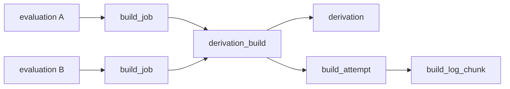

# Shared Builds

The system builds each derivation once, globally. That build lives in a single `derivation_build` row, the *shared build*. Every evaluation of the derivation points at this one row. All writes to shared builds and the surrounding graph must pass through the single graph writer (`backend/gradient-graph`).

## Tables

| Table | Key | Role |
|---|---|---|
| `derivation` | UNIQUE `(hash, name)` | A node in the global graph. `walked` and `unwalked_inputs` track whether the subtree has been explored |
| `derivation_build` | UNIQUE `derivation` | The shared build itself: `status`, `attempt`, `cache_available`, `probed`, `fetchable`, `wanted`, `blocking_deps`, `missing_runtime_deps`, and limits |
| `build_job` | `evaluation`, `derivation_build` | Ties a single evaluation to a shared build and stores the assignment `score` |
| `build_attempt` | `derivation_build`, `dispatched_job` | A single execution, with `outcome`, `reason`, timings, and `build_context` |
| `build_log_chunk` | `build_attempt` | Holds the log output of an attempt |

| Foreign key | On delete | Effect |
|---|---|---|
| `derivation_build.derivation` | `CASCADE` | A shared build gets removed together with its derivation |
| `build_job.evaluation` | `CASCADE` | Garbage collection of an evaluation also removes its links |
| `build_attempt.build_job` | `SET NULL` | An attempt and its log can outlive the evaluation that drove them |
| `build_attempt.derivation_build` | `CASCADE` | Attempts get removed together with their shared build |

## Sharing

- One derivation can serve several evaluations, even across projects. They all share the same build. No leader, follower or link row exists. The global graph itself handles sharing.
- `BatchWriter::resolve_shared_builds` (`record.rs`) inserts new shared builds with `ON CONFLICT (derivation) DO NOTHING` semantics. A shared build from an earlier evaluation stay untouched.
- The first assignment triggers the build. Every other evaluation see the result once the shared build reach `Completed` or `Substituted` (`BuildStatus::TERMINAL_SUCCESS`).
- A `Completed` shared build reused later keep its attempts and logs until garbage collection of the derivation.

## Graph Writer

`GraphWriter` lives in `gradient-graph/src/writer.rs`. As a root child of the supervision tree, it stop after every sibling. Callers reach it through the `Graph` handle in `lib.rs`. One message count as one transaction. Queued `Record` and `CommitNar` messages share a single transaction instead.

| `GraphMsg` | Written |
|---|---|
| `Record` | One worker batch: derivations, stubs, edges, outputs, input sources, shared builds, `build_job` rows, features, messages, entry points, the can-start counters and the needs-build marks |
| `UpstreamHits` | Probe results: narinfo on `derivation_output`, the runtime dependencies named in the narinfo, `cache_available`, the needs-build marks moved |
| `UpstreamProbed` | `probed = true` on answered shared builds, and the needs-build marks set below them by a miss |
| `CommitNar` | The `cached_path` row, its references, signed `cached_path_signature` rows, the backed outputs |
| `Transition` | Evaluation and shared build state: stream completed, eval failed, build started/output/completed/failed, assigned, orphaned, can start, repair, abort, prioritize |
| `Requeue` | `FailedTransient` shared builds whose backoff elapsed, back to `Created`, queued once they can start |
| `Demote` | `MissingNar`, operator `Path` invalidation, one cache dropping its `CacheClaim` |
| `Gc` | Bounded deletes of derivations, stale paths and evaluations, re-checked against the current rows |

Every other message flush the queue first. A write after a batch or a commit can see that batch or commit.

`Graph::known_derivations` bypass the message path. The call read straight from the pool to find which `drv_hashes` hold a recorded subtree (`walked` and `unwalked_inputs = 0`). The next wave of a walk can then start before the writer record the previous batch. A recorded subtree only ever gain its record. A read that skip a queued write skip less, never wrongly.

## Batching

- Queued batches to record share one transaction with a savepoint each (`record_one`). A batch failing for its content will fail only its caller.
- The graph writer can execute the queued `CommitNar` messages set-based under one savepoint (`nar::commit_batch`). Each step is one statement for the whole batch instead of a dozen per NAR. The cost of a commit is round trips. A failed batch will commit its NARs one by one (`commit_one`), each under its own savepoint. A bad NAR will fail only its uploader.
- A flush can take place on the next mailbox turn. The flush is immediate once the queue is at `RECORD_ROW_BUDGET` (5000 derivations) or `NAR_COMMIT_BUDGET` (128 commits). After `NAR_FLUSH_TIME` (100 ms) a flush will take no more NAR commits and leave the rest to the next mailbox turn. The flush must hold the shared build locks of every commit until its end.
- The wire of the worker is without an acknowledgement to retry on. A failed batch will fail its evaluation (`fail_evaluation`) instead of leaving the graph incomplete.
- The graph writer can look up the stored derivations of a batch in the batch transaction itself (`stored_derivations`). Stored derivations have every output in our cache, with a complete closure. New and `Created` shared builds of stored derivations go to `Substituted`. Ids come from the transaction alone.
- Upstream availability is not part of a batch. The probe can answer through `UpstreamHits` for shared builds needing a build. A batch can write `cache_available = false` on new shared builds only.
- Post-commit (`record::after_commit`): entry point statuses, per-task evaluation GC, probe requests, the `evaluation::Progress` event.

## Timeouts and Retries

| Constant | Value | Meaning |
|---|---|---|
| `CALL_TIMEOUT` | 30 s | Wait for the graph writer to exist after a restart |
| `GRAPH_TX_BUDGET` | 120 s | Per transaction. Past this budget, the transaction will roll back and the caller will receive `graph transaction exceeded 120s` as an error. Also set as the transaction's `statement_timeout`. The rollback must wait for the running statement, and only Postgres can end that statement |
| `GRAPH_TX_ATTEMPTS` | 5 | Attempts of a transaction aborted with SQLSTATE `40P01`, `40001` or `25P02`. The writer will wait 250 ms times the attempt count before the next attempt |

- Callers wait for replies with no deadline. The graph writer can still apply a message from a caller that gave up. A caller-side timeout would report a write that later lands as failed. A worker session stuck behind a backlog will block its reader as backpressure.
- A deadlock inside one batch will fail the whole flush (`escalate_retryable`), and `transact` will retry that flush.
- Status updates and their effects return every database error to the `transact` function. A `SELECT 1` probe before `COMMIT` can convert a transaction aborted with a merely logged error into a `25P02` error. Postgres would otherwise roll back silently on that `COMMIT`.
- A retry can re-send board events and probe requests already sent in an aborted attempt.
- `Transition::Repair` (`gradient_db::graph::repair::repair_build_graph`), `Transition::ConsistencyCheck` (`graph_consistency_report`) and cache demotion all run inside the graph writer.
- No batch can block the consistency check and a deadlock between the two is impossible. Its chunk locks still never wait, for a second instance of the writer.
- The graph writer can keep no state between messages. A restart will lose only batches still queued, and their callers will get an error.

## Concurrent Walks

- Two walks of overlapping graphs converge on one `derivation` row per `(hash, name)` pair. `WALKED_UPSERT` and `STUB_INSERT` use `ON CONFLICT (hash, name)`.
- Edge inserts (`derivation_dependency`) use `ON CONFLICT DO NOTHING`. Two walks of one node record the same set.
- `accepts_batches` can take batches only while the evaluation is `Fetching`, `EvaluatingFlake` or `EvaluatingDerivation`. Other batches get dropped as stale (`RecordReport.skipped`).
- Two walks of an evaluation differ in the assignment id minted at dispatch. Workers echo the id on every report. Sessions forward a report once the scheduler core confirmed the id as the live dispatch of the job on that worker (`Scheduler::owns_dispatch`). Sessions drop reports of any other dispatch.

## Cache Availability Flag

`cache_available` can mark a shared build with outputs available in an upstream cache.

- Set only by the `FLIP_CACHE_AVAILABLE` statement (`UpstreamHits`, `record.rs`), only on shared builds not in `TERMINAL_SUCCESS`.
- One project's probe can add a substitution for another project's walk.
- Cleared by `exhaust_substitution` (`transition.rs`) once substitute misses escalate. The shared build will return to `Created` as an ordinary build.
- Cleared by `CLEAR_CACHE_AVAILABLE_TRUST` (`gradient-db/src/caches/demotion.rs`) for an output proven unfetchable.

## Counter Locking

The counters stay correct even without serialisation by the graph writer. Multiple writers can operate on shared builds at the same time (`gradient-db/src/graph/shared_build_guard.rs`).

- Advisory keys live in the namespace `SHARED_BUILD_LOCK_NAMESPACE` (643). The key value is `hashtext(derivation id)`. Take all keys, sorted, in one pass before any row lock.
- Take the dependency keys in shared mode for a seed that has `blocking_deps` or `missing_runtime_deps`.
- Hold the shared build key exclusively for a change to the complete-closure state or to `fetchable`. Place this exclusive hold before the spread reads edges into the shared build.
- Two transactions of this kind can collide: a seed and a concurrent state change. The second one waits for the first to commit and then reads its rows.
- Shared keys never block each other. A dependency referenced by every `.drv` (`source-stdenv.sh`) therefore causes no queueing.
- `wanted` is the exception. `update_need` can lock only its roots. The `recount_wanted` step of the consistency check can correct drift. A lost update can leave a shared build in the `Skipped` state until the next check runs.

## Related

- [Jobs](../proto/jobs.md) - how job reports trigger `Transition`
- [Architecture](../architecture.md)
