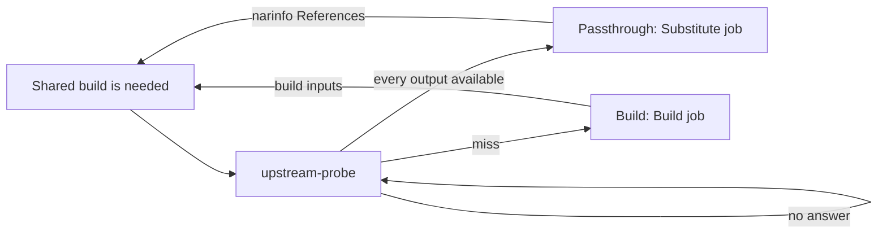

# Upstream Substitution

A build with outputs already available in an upstream cache is fetched, not built. The `upstream-probe` loop will ask upstream caches only about [shared builds](shared-builds.md) wanted by another build or an evaluation. The answer must decide between a passthrough (fetched from upstream, `cache_available`) and a real build.

## Probe Loop

Probe work happens over HTTP, in `gradient-scheduler/src/probe.rs`. The loop is a supervised periodic child, kept outside the [graph writer](shared-builds.md#graph-writer). A round trip inside a graph transaction can block the single graph writer, so the two stay apart.

| Constant | Value | Role |
|---|---|---|
| `PROBE_TICK` | 1 s | Pass interval while no request arrived |
| `PROBE_BUDGET` | 120 s | Supervision budget of one pass |
| `PROBE_DESCENT` | 60 s | A pass will stop descending after this. The rest must wait for the next tick |
| `PROBE_BATCH` | 256 | Outputs per request round, and rows per recovery check |
| `PROBE_SWEEP` | 60 s | Recovery check interval, only on an idle tick |

- **Requests:** probe work enters through an in-memory channel (`ProbeRequests`). Batch recording must enqueue every shared build the batch walked, plus the needs-build marks the batch moved. The transition emitter (`gradient-db/src/status/effects.rs`) and the graph writer after `UpstreamHits` / `UpstreamProbed` enqueue as well.
- **Wake-Up:** requests inside a graph transaction stay staged until the commit. The commit can then wake the loop without waiting for the tick.
- **Descent:** each round answer can update the needs-build marks and hand back the next level directly. One pass can follow the closure down instead of one level per tick.
- **Look-Ahead:** a round can also ask about the unanswered dependencies of the wanted shared builds. A miss makes these dependencies needed, and the next level then costs no extra round. Only the dependencies of an upstream hit go unused.
- **Recovery check:** every walked shared build needing a build, with `probed = false` set. The check must cover a process stopped between a commit and the channel send.
- **Retry:** `probed` is the only memory of an answer. User retries of an evaluation or a build clear the flag on every requeued shared build missing from the caches. The probe can then ask again.

## One Round

Two functions handle the round. `plan_probes` build the plan, `probe_round` apply it.

1. Keep every wanted shared build without an answer (`wanted`, `probed = false`). Add dependencies that lack an answer and that no cache hold.
2. Drop each shared build without `derivation_output` rows. These unwalked stubs remain unanswered until a later batch walk the stub and send it again.
3. Skip outputs already stored in our cache (a `cached_path` row of the hash with a `file_hash`) or with an `external_url`.
4. Group the remaining outputs by the evaluation that name the shared build (`build_job`). The project of that evaluation pick the upstream caches.
5. `probe_outputs` (`gradient-scheduler/src/eval.rs`) must request the `<hash>.narinfo` for each output and flush `upstream_metric` afterwards.
6. Send hits as a `GraphMsg::UpstreamHits` message. Then send all shared builds from step 2 in a `GraphMsg::UpstreamProbed` message, hit or miss, unless one of their outputs got [no answer](#no-answer).

A shared build with `probed = false` do not count as a real build yet. Nothing below such a shared build can get built or handed out before the answer arrive. A build queued with "no answer yet" cannot be recalled after a worker take the job.

### No Answer

A miss count as final only after every upstream cache answered with `404` or with an unsigned narinfo. A timeout, an error status, a tripped breaker or an unreadable upstream list do not count as an answer.

- The shared build keep `probed = false` and stay unbuildable.
- The recovery check ask again within one `PROBE_SWEEP` interval.
- The server log one warning per silent upstream cache and round.
- The evaluation show that warning once per upstream cache, with `upstream-probe` as the source.
- An admin can deactivate a silent upstream cache. The next round then ask only the remaining upstream caches.

## Applying a Hit

`apply_upstream_hits` in `gradient-graph/src/record.rs` does the following.

- **Persist:** write `external_url`, `nar_hash`, `file_hash`, `file_size`, `references_list` and `deriver` to every `derivation_output` row with the same hash and no cache entry. Also write `nar_size` and `ca` where unset.
- **Runtime dependencies:** record the narinfo `References:` line as runtime dependencies on the referenced producers.
- **Passthrough:** set `cache_available = true` only if every output of the shared build is available upstream. A terminal-success shared build with this flag can skip its build. A failed one can become a passthrough.
- **Needs build:** update the mark for touched shared builds and for builds newly available in a cache. Send the newly needed set back to the probe.

`mark_probed` must set `probed = true` (`MARK_PROBED`) and update the needs-build marks. On a miss, the shared build remains a real build and from then on needs its build inputs.

## Upstream Selection

`gradient-core/src/upstream.rs` holds this logic. The probe and the worker cache query both use it.

| Rule | Detail |
|---|---|
| Candidates | Rows in `cache_upstream` with `kind = Http` and a URL. Rows with `WriteOnly` on the upstream or project subscription get excluded (`upstream_endpoints_for_project`) |
| Trust | A hit needs a `Sig` that verifies against the upstream `public_key` and a `StorePath` that matches the asked hash (`verified_narinfo`). An upstream without a key can never produce a hit |
| Order | Hit rate first, then average latency over the last 60 min of `upstream_metric`. Upstream caches without measurements rank last |
| At most 4 upstream caches | Queried in parallel. The fastest hit wins |
| More than 4 | Queried in order. The first hit wins |
| Timeout | 2 s per narinfo request. 30 s for a `upstream_query` semaphore permit |
| Concurrency | `GRADIENT_CACHE_UPSTREAM_QUERY_CONCURRENCY` (default 32), server-wide |

**Breaker:** 3 consecutive errors trip an upstream for 60 s. Transport failures count, as do any status codes outside 2xx except 404. After the cooldown, requests pass again and a single further error trips the breaker again. A 404 counts as a miss and resets the error count. Breakers live process-wide and the cache narinfo endpoint shares them.

**HTTP/1.1 only:** requests offer HTTP/2 by default. Some upstream caches negotiate HTTP/2 and then reset streams mid-body. A NAR passed through then breaks after the `200`. Nix clients then see `HTTP error 200 (curl error: Stream error in the HTTP/2 framing layer)`.

- The add and edit forms of an HTTP upstream cache write the `cache_upstream.http1_only` column.
- Declared caches take the value from `http1_only` in `services.gradient.state`.
- Requests to such an upstream cache use a client limited to the HTTP/1.1 ALPN (`upstream_download_client` in `gradient-util/src/http.rs`).
- These upstream caches get an `HTTP/1.1` badge in the upstream list.
- `POST /caches/{cache}/upstream-caches/{id}/test` (`probe_protocol` in `gradient-core/src/upstream_source.rs`) can fetch `nix-cache-info` twice. Both requests use a single-protocol ALPN, HTTP/1.1 only or HTTP/2 only. The test leaves `http1_only` untouched. A small `nix-cache-info` over HTTP/2 can prove nothing about resets inside large NAR bodies.

## Substitute Jobs

`decide_build_spec_kind` in `gradient-scheduler/src/assign_mode.rs` reads the flag alone. No other input enters that decision.

| Shared build | Kind | Worker |
|---|---|---|
| `cache_available` | `Substitute` | Any |
| `builtin` system, fixed-output | `Download` | Any, no Nix store |
| Everything else, `builtin:buildenv` included | `Build` | Matching system |

The `(name, store_path)` pairs have to travel inside the `BuildSpec`. The worker never opens the `.drv` file (`gradient-worker/src/executor/substitute.rs`).

1. Skip outputs the Gradient cache already stored.
2. Locate each remaining output with `CacheQuery { external: true }`, one path per query. The server can answer from the persisted `external_url`. Without that, it probes `Http` upstream caches first, then `GradientProto` upstream caches.
3. Download with the redirect-following client. A body length other than the declared `file_size` can still pass, but only, if the decompressed bytes match `nar_hash`. Every other body means a missing output.
4. Detect compression from the magic bytes, with the URL extension as fallback.
5. Check the NAR against `nar_hash`, then push the bytes like any other output.

The job fetches nothing below the outputs. The referenced paths are shared builds in their own right, and the server marked them as needed. Build jobs keep `use_substitutes = false` in the daemon.

## Failures and the Miss Budget

| Worker error | Kind | Server |
|---|---|---|
| No upstream held the output | `SubstituteUnavailable` | Requeue to `Queued` with no penalty |
| Upstream NAR missing, wrong size, or not matching `nar_hash` (`CorruptCachedNar`) | `InputsUnavailable` | Run a self-heal repair pass, then retry |
| Everything else, including hash mismatch | `Transient` | Retry |

### Escalation to a Build

- A passthrough that used up its `InputsUnavailable` / `Transient` retries enter the same budget instead of moving to `FailedPermanent` status.
- After `build.substituteMissEscalationThreshold` (default 2) missed substitutions within one evaluation, `exhaust_substitution` take action. The function clear `cache_available`, the upstream columns of the outputs, and `attempt`. The function also set the shared build to `Created` status.
- The shared build then build through the ordinary queue conditions.

## Cache Endpoints

The code is in the `gradient-web/src/endpoints/caches/` directory. All endpoints ask only the upstream caches of their cache that workers would substitute from (`kind = Http`, a URL, not `WriteOnly`, per `substitution_sources` in `gradient-core/src/upstream_source.rs`). All endpoints also skip tripped upstream caches and feed the shared breakers. Redirects are followed for NAR and log downloads.

| Endpoint | Upstream behaviour |
|---|---|
| `narinfo.rs` | The endpoint will ask every such upstream with a `public_key` in parallel for a narinfo missing from the cache. The `Sig` must verify against `public_key`, and the `StorePath` must match the asked hash. The endpoint will rewrite `URL:` to `nar/upstream/<id>/...` and append the cache's own `Sig` next to the upstream's |
| `nar.rs` (`upstream_nar`) | Trying the named upstream first, then every other one. The NAR path is content-addressed, and an upstream row may have been deleted |
| `build_log.rs` | `/log/<drv>` will answer with the local log (`X-Cache: HIT`), else the first non-empty upstream log (`X-Cache: MISS`) |

## Build Log Substitution

The code is in the `gradient-scheduler/src/log_substitution.rs` file. The scheduler will fetch the build log of the upstream after `BuildCompleted` on a `cache_available` shared build.

- **Source:** `<upstream>/log/<drv basename>` from the project's candidates (`upstream_endpoints_for_project`, best first), through `fetch_upstream_log`, the same fetch as in the cache log endpoint.
- **Limits:** the first non-empty body will win. 10 s timeout, capped at 16 MiB with a `[truncated]` marker.
- **Target:** appended to the latest `build_attempt` log, only while that log is still empty.
- **Errors:** logged and ignored.

## Related

- [Shared Builds](shared-builds.md)
- [Jobs](../proto/jobs.md)
