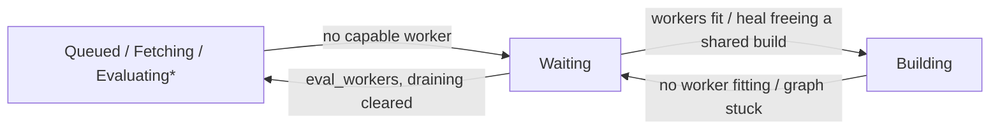

# Waiting and Recovery

The scheduler covers four recovery cases: it splits a flake job across several workers, parks an evaluation that makes no progress, re-offers a job a worker returned, and cleans up leftover state after a server restart.

## Fetch and Eval Split

`assign_queued_evals` (`gradient-scheduler/src/loops/eval.rs`) can ask the pool once per pass for an idle evaluation-only worker (`WorkerPool::has_idle_eval_only_worker`). Such workers are active, with `eval`, without `network` and without a job.

| Pool at assignment | Job steps |
|---|---|
| An idle evaluation-only worker present | `[FetchFlake]`, then a follow-up `[EvaluateFlake, EvaluateDerivations]` |
| Otherwise | `[FetchFlake, EvaluateFlake, EvaluateDerivations]` in one job |

- **Decision per pass:** one idle worker will split every evaluation queued in that pass.
- **Source:** a repository evaluation must carry `FlakeSource::Repository` as source. A `/nix/store/...` source (`gradient build` upload) must carry `FlakeSource::Cached` as source. That source will still run `FetchFlake` to resolve inputs with the project SSH key (`flake_job_for_eval_source`).
- **Routing:** `WorkerCaps::can_eval` (`gradient-pool/src/worker_caps.rs`) will require `network` for a `FetchFlake` step and `eval` for an evaluation step. Repositories behind an SSH URL also need `secrets` (`WorkerCaps::can_fetch`).
- **Follow-up:** `handle_job_completed` (`job_handlers/build_status.rs`) will react to `JobCompleted` of a fetch-only job (`is_fetch_only`). The handler must read `evaluation.flake_source` and enqueue `PendingEvalJob::cached_followup` under the same `eval:{id}` key. The follow-up will carry `FlakeSource::Cached` plus the source as a required path. A missing `flake_source` will fail the evaluation permanently.
- **Worker side:** the evaluating worker will substitute the source from the cache and evaluate `path:<store path>` (`gradient-worker/src/executor/eval.rs`).
- **Steering:** `ReserveFetchWorkersRule` (`gradient-pool/src/score/rules/builtin.rs`) will score a worker with `network` at `-300 * (1 - idle / total)` for a job without `FetchFlake`. The penalty will fade as workers go idle. The rule will never refuse the job. See [Scoring](scoring.md).

## Waiting Reasons

The waiting pass `refresh_waiting_state` (`gradient-scheduler/src/waiting_state.rs`) can run at the end of every build assignment pass (5 s tick or kick). It scans all in-flight evaluations. It writes a reason into `evaluation.waiting_reason` only when the JSON changes.

| `WaitingReason` | Parked from | Unparked | Owner |
|---|---|---|---|
| `eval_workers { capability, connected_workers }` | `Fetching` with no `network` worker, or no worker with `network` and `secrets` for an SSH repository (capability `secrets`). `Queued`, `EvaluatingFlake`, `EvaluatingDerivation` with no `eval` worker | To `Queued` once the capability can connect | Waiting pass |
| `workers { unmet, connected_workers, available_architectures }` | `Building` with no worker that can fit the `(architecture, required_features)` of any blocking shared build | To `Building` once one worker can fit. To `Aborted` after 300 s on the same `unmet` set, unless `wait_for_workers` can be set on the task | Waiting pass |
| `graph_stuck { pending_shared_builds }` | `Building` with a fitting worker for every blocking shared build, yet none can be handed out | To `Building` once the heal can free a shared build | Waiting pass |
| `upstream_caches { pending_shared_builds, failing_upstream_caches }` | `Building` with a fitting worker, but a blocking shared build without an [upstream answer](upstream-substitution.md#no-answer). The list holds every upstream cache with errors in the last 5 minutes | To `Building` once every upstream cache can answer | Waiting pass |
| `draining` | Every in-flight evaluation during an instance drain | At the end of draining or at startup (`resume_drained_evals`): to `Building` when the walk had finished (`status_after_draining`), otherwise to `Queued` | Waiting pass |
| `approval`, `no_cache`, `cache_storage_full` | Trigger conditions | Webhook and cache hooks (`gradient-ci/src/unpark.rs`) | Never touched by the waiting pass |

- **Pre-build parks** can skip each shared build the evaluation already batched. A stall mid-walk can still park.
- **Blocking builds** name the shared builds kept by `blocks_evaluation`, in a status that can still be wanted. The pass can leave out a shared build that nothing wants.
- **Counters first:** `phase_from_counters` can decide without reading a shared build. `named = 0` can hand the evaluation to the pre-build rules. `active = 0` can let `check_evaluation_done` finalize the evaluation. `building > 0` can keep the `Building` status.
- **Unbuildable abort:** `unbuildable` (`gradient-scheduler/src/unbuildable.rs`) can hand a `workers` park with a non-empty `unmet` set back to the scheduler. Two conditions apply: the park is older than 300 s, and the task can have `wait_for_workers = false` set. `abort_unbuildable_evaluation` can mark the evaluation `Aborted` and abort its shared builds. The function can also record a warning naming each missing architecture and feature set. The grace period can keep a server restart or worker redeploy from aborting work before the pool is back.
- **Shared build read:** otherwise `BuildabilityChecker` can read every blocking shared build. `AssessmentMemo` can reuse the verdict for up to 60 s while the counters and the pool fingerprint stay equal. An empty read can recount the drifted counters and finalize.

## Graph-Stuck Heal

A `workers` verdict with an empty `unmet` set triggers the heal. `attempt_graph_unstick` then sends `Transition::Repair { scope: RepairScope::Unstick }` to the [graph writer](shared-builds.md#graph-writer) and re-assesses without the memo. The [repair pass](repair-pass.md) `repair_build_graph` (`gradient-db/src/graph/repair.rs`) performs the steps below. The first failed step fails the transition.

1. `requeue_failed_closure`: thaw failed shared builds in the closure back to `Created`. Under `Unstick`, a deterministic build failure and its subtree stay untouched.
2. `repair_cached_shared_builds_for_eval`: complete shared builds whose outputs all sit in the cache, then run `advance_fetchable` for the builds that need it.
3. `repair_dependency_failed`: mark builds as failed when they depend on a build with a lasting failure.
4. `adopt_pending_closure`: name orphaned pending shared builds for the evaluation, then update their needs-build marks.
5. `promote_closure`: queue every build that now meets the queue conditions.

| Driver | When |
|---|---|
| Waiting pass | On entry to `graph_stuck` and on every change of `pending_shared_builds` (`unstick_due`) |
| `graph-stuck-reheal` pass | Every `metrics.graphConsistencyIntervalSecs` (300 s) for each `graph_stuck` evaluation |
| Counters | Queueing the set the moment its queue conditions hold |

- **Lost `.drv`:** `recover_drv_stuck_evals` checks evaluations stuck in `graph_stuck` for over 120 s. The target is a walked shared build that needs a build and is not available in a cache. Such a build has every dependency done and no `.drv` NAR. `trigger_drv_recovery` starts a `DrvRecovery` evaluation of the same commit for it. A `DrvRecovery` evaluation stuck the same way fails.

## Re-Offering Returned Jobs

An offer carries only a delta: the server sends a worker only the candidates absent from its `sent_candidates` set. Score every offered candidate. Each offer replaces the set with the candidates currently visible to the worker. Claimed, finished and aborted jobs drop out of the set. Returning a job to the pool clears its sent flag.

| Event | Mechanism |
|---|---|
| Enqueue | `SchedulerMsg::Enqueue` calling `remove_sent_candidate` for every worker, also for the cached follow-up reusing `eval:{id}` |
| Reject | `SchedulerMsg::Rejected` returning the job to pending and clearing its sent flag |
| Assignment pass | `SchedulerMsg::ReOffer` bumping the offer generation while any job is pending. Sessions then pull the delta |

## Startup Recovery

At server start, `gradient-web/src/lib.rs` runs `recover_interrupted_work` (`gradient-db/src/maintenance/recovery.rs`) one time. `unpark_draining_evals` can only start after that. The function restores work left behind by the previous run.

1. **Assignments:** open `dispatched_job` rows of a cluster attempt go to `Abandoned`. Other open rows stay open so their worker can [reclaim](../proto/jobs.md#abort-and-lost-workers) them.
2. **Attempts:** build attempts in `Running` state go to `Aborted`.
3. **Shared builds:** shared builds in `Building` state go to `Queued` first. `unpromote_ungated` then moves builds with failing queue conditions back to `Created`.
4. **Evaluations:** evaluations in `Fetching`, `EvaluatingFlake` or `EvaluatingDerivation` state turn `Queued`, each with a phase event. Their eval job lived on a worker. Evaluations in `Building` state keep their status and their re-queued builds.
5. **Clusters:** every open [cluster attempt](clusters.md) closes (`PrepareFailed` when it never started, `Aborted` otherwise). A cluster in `Running` state goes back to `Queued`, or to `Aborted` when a member evaluation or shared build can no longer finish.

- Jobs with an open assignment skip steps 2-4. They keep their status and attempt.
- Kept assignments wait in the scheduler for `proto.assignmentReclaimGraceSecs`. Rows with no reclaim inside the grace return to the queue as a lost worker.
- A worker below protocol 42 can never reclaim. Its kept rows return to the queue as a lost worker at registration.
- `Queued` evaluations come back from the eval assignment pass. The waiting pass returns `Waiting` ones.
- Recovery omits the live effects of `update_evaluation_status` calls. The rows stay consistent on their own.
