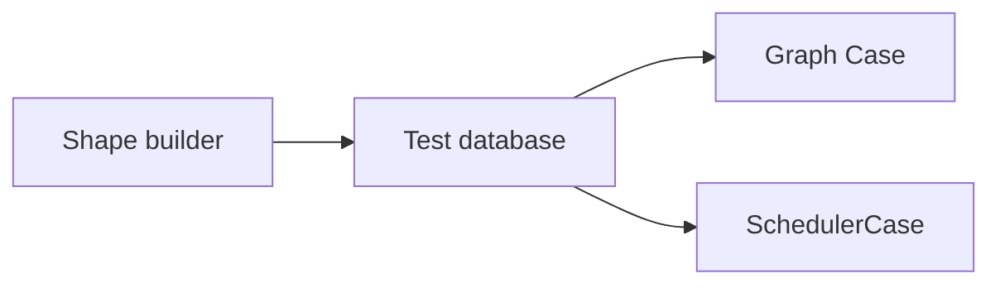

# Tests

Test structure and the patterns new tests follow. The source tree is the catalogue of individual tests, and per-test lists fall behind the code.

## Layers

| Layer | Location | Coverage |
|---|---|---|
| Backend unit | `#[cfg(test)] mod tests` next to the code | Pure logic with no I/O |
| Backend integration | `backend/gradient-*/tests/*.rs` | Real router and handlers on top of a mocked database |
| Shape tests | `backend/gradient-graph/src/cases/`, `backend/gradient-scheduler/src/cases/` | Graph writer and scheduler on a real Postgres 18 database ([Shape Tests](#shape-tests)) |
| Test support | `backend/gradient-fixtures/`, `backend/gradient-test-support/` | Test database, shape builder, fakes and fixtures for all suites ([Test Support](#test-support)) |
| CLI | `cli/tests/*.rs` | The `gradient` binary against a stubbed HTTP server |
| Frontend | `frontend/src/**/*.spec.ts` | Components and services under vitest |
| Report inspector | `nix/tools/report-inspector/tests/` | Inspector commands on a report fixture built during the test |
| NixOS VM | `nix/tests/gradient/<name>/`, `nix/tests/harness/` | A booted machine with the packaged server, or a module against a scripted API |
| SQL plan check | `backend/src/sql_gate/`, started by the e2e VM test | The plan of every registered statement at production scale |
| Mock daemon | `backend/gradient-daemon/`, `nix/tests/store-spec/`, `nix/tests/gradient/scheduler/`, `nix/tests/gradient/cluster/` | Scheduler and workers against a scripted Nix store |
| Nix headers | `nix/tests/nix-headers/` | Header tests of the patched Nix built with libc++ (clang, macOS) - skip the ones that also fail with libstdc++ |
| Eval benchmark | `nix/tests/bench/evalbench/`, on request | Evaluation speed per stage, with a capture bundle per round ([Eval Benchmark](eval-benchmark.md)) |

- Put tests for public entry points (an HTTP route, a CLI call) in a crate's `tests/` directory. Keep all other tests in a `#[cfg(test)]` module next to the code.
- Build the inspector fixture at test time. Committed `.db` binaries drift from the schema.

## Running

| Command | Checks |
|---|---|
| `nix flake check` | All checks listed below |
| `nix build .#checks.x86_64-linux.unittest` | Backend tests (nextest, followed by doc tests) against a disposable Postgres 18 |
| `nix build .#checks.x86_64-linux.cli-unittest` | CLI tests |
| `nix build .#checks.x86_64-linux.gradient-<name>` | A single VM test |
| `nix build .#gradient-evalbench` | The eval benchmark, kept outside `nix flake check` |
| `pnpm -C frontend exec ng test --watch=false` | Frontend tests |

!!! warning
    A full `cargo test` or `cargo nextest` run over the backend workspace can exhaust the memory of a typical workstation. The Nix checks are the supported path.

- The cargo suites exist as checks and not as the packages' check phase. `nix build .#gradient` can only build the binary.
- The `[profile.test]` profile compiles tests unoptimised and without the full DWARF of a released binary. Dependencies remain optimised through `[profile.dev.package."*"]`.
- Each folder under `nix/tests/gradient/` becomes a check named `gradient-<folder>`, with no extra wiring required.
- VM tests write NARs to local disk. S3 storage has no VM test.

## Shape Tests

Tests cover the graph writer and the scheduler against a real Postgres 18 database. Each test declares its rows as a shape. The real graph writer and scheduler then work on those rows, and assertions on every table follow each step.



### Test Database

`TestDatabase` (`backend/gradient-fixtures/src/database.rs`) can create a fresh database per test.

| Aspect | Behavior |
|---|---|
| Server | `PGHOST`, `PGUSER` and `PGDATABASE`. The role must hold the `CREATEDB` attribute |
| Template | Every migration applied to `gradient_template` by the first test on a server, under an advisory lock |
| Clone | A `test_<uuid>` database per test, created with `CREATE DATABASE ... TEMPLATE gradient_template` |
| Cleanup | `finish()` with `DROP DATABASE ... WITH (FORCE)`. Tests without `finish()` panic on drop |
| Failure | Failing tests leave the database behind for inspection and print the name |
| Readers | `rows::<E>()`, `find::<E>(id)`, `shared_build(path)`, `attempts(path)`, `output_of(path, name)` and more |

The `unittest` check can bring up Postgres 18 through `postgresqlTestHook`, with `fsync = off` and 500 connections.

### Shape Builder

Shapes (`backend/gradient-fixtures/src/shape/`) declare the rows of a test as a chain of setters.

```rust
let seed = shape()
    .evaluation(e1)
    .evaluation_status(EvaluationStatus::Building)
    .derivation(A)
    .walked()
    .entry_point("pkg.a")
    .job()
    .output(A_OUT)
    .build_status(BuildStatus::Queued);
```

- Each setter acts on the evaluation, derivation, cache or assignment named last.
- Every new evaluation receives a fresh project, task and commit. All projects share a single owner.
- `into_database()` can create the test database and insert the rows. `insert_into(connection)` can add a second shape to a running test.
- `declared_statuses()` can list the declared build statuses. Once the seed has settled, the case layers assert those statuses.
- Scheduler setters (`shape/scheduling.rs`) add triggers, clusters, eval assignments, metrics, upstream caches and worker registrations.

### Case Layers

Case layers start the real component on a shape. Tests read like the case steps, with assertions after each step.

| Layer | Location | Start | Per step | End |
|---|---|---|---|---|
| Graph `Case` | `gradient-graph/src/cases/mod.rs` | Seed settled, graph writer spawned, zero drift | Graph operations, `zero_drift(after)` | `finish()`: writer stopped, zero drift, database dropped |
| `SchedulerCase` | `gradient-scheduler/src/cases/mod.rs` | Seed settled, graph writer and scheduler core spawned, zero drift | Worker sessions, passes, admin calls, `check(after)` | `finish()`: core and writer stopped, invariants checked, database dropped |

- Zero drift means an empty report from the [consistency check](scheduler/repair-pass.md#consistency-check).
- Files of `SchedulerCase`: `session.rs` for worker sessions, `control.rs` for passes and admin calls, `readers.rs` for rows and core state.
- `second_instance()` can start a second scheduler with its own memory, core and graph writer on the same database.
- `start_with(shape, config)` can change the runtime config before the start.
- `signals(worker)` can drain the signals of a worker since the last call.
- `aliases.rs` can wrap production names with banned words.
- External services are local doubles in `outside.rs`: a temporary Git repository and an upstream cache over HTTP.

`check(after)` can wait for detached tasks, expect zero drift and assert the invariants below. Failure messages name the invariant and the step.

| Id | Invariant |
|---|---|
| S1 | A single open row per job |
| S2 | Open rows without an outcome. Closed rows stay closed |
| S6 | No open row of a disconnected worker |
| S7 | No open row of a connected worker dispatched before the start |
| S8 | Open build rows within the build slots of a worker |
| S11 | A single core list per job key (pending, active, cluster book) |
| S12 | No pending job with an open row. Rows of workers on another instance stay out |
| S14 | A single running attempt per shared build |
| S18 | Evaluation statuses along allowed transitions, also with more than a single move per step |
| S19 | A waiting reason only on `Waiting` evaluations |
| S20 | A single active evaluation per task, concurrent evaluations aside |
| S21 | A single open attempt per cluster |
| S22 | No open row of a closed cluster attempt |
| S23 | A started attempt per running cluster, with a row per member |
| S24 | A single open row per attempt and worker. Pinned members stay on the pinned worker |
| S27 | A single undelivered firing per trigger key |
| S28 | `last_fired_at` moving forward only, after a delivered firing |

**Conventions**

- Test names start with the case id: `c01_a_won_claim_opens_the_row_and_leaves_the_build_queued_until_the_start`.
- Assertion messages name the step: `"after 2: sb(A).status"`.
- Row assertions go first, then signals, then `case.check("step 2")`.
- Second instances finish first: `second.finish()`, then `case.finish()`.

## Test Support

Shared test code lives in two crates. Place new helpers there instead of inside individual test files.

| Crate | Module | Contents |
|---|---|---|
| `gradient-fixtures` | `database.rs`, `shape/` | Test database plus a shape builder |
| | `rows/`, `ids.rs` | Entity models with stable IDs (`project()`, `user()`, `task()`, ...) |
| | `mock.rs` | `MockDatabase` helpers for suites that still use a mocked database |
| `gradient-test-support` | `fakes/` | In-memory doubles such as `FakeDrvReader`, `FakeWorkerStore`, `RecordingJobReporter` |
| | `fakes/store_fixture.rs` | `StoreFixture`: a real 951-derivation `hello` closure from `backend/test-store/` |
| | `state.rs` | `TestState` and `test_state()`: a wired `ServerState` |
| | `web.rs` | `make_test_server()`, `make_token()`, `signed_in()` for authenticated requests |
| | `cli.rs`, `log_storage.rs`, `cache_fixture.rs` | `test_cli()`, log storage doubles, populated cache states |

The common items and the scripted protocol peers (`MockProtoServer`, `ProtoPeer`) come in through `use gradient_test_support::prelude::*`.

## Patterns

### Scope

- **Test what we wrote.** Tests asserting that serde serialised a field, or that SeaORM returned the handed row, only check a dependency. Tests without effect on our confidence stay out.
- **Fakes, not a mock framework.** Calls into nix, git, the filesystem or the network go through a trait. Fakes implement the trait and log each call. Tests can then assert the sequence of effects.
- **Fakes for a single algorithm stay local.** Some traits only lift a single algorithm out of its I/O (`UpstreamIo` in the substitute executor of the worker). The fakes of such traits stay in the tests of that module.
- **Actors with side effects sit behind small traits.** The `gradient-effects` actor can take `PendingDeliveryStore` and `Handoff` as inputs. The actor's one promise is at most the worker count in flight, with one pass per burst of wakes. In-memory fakes are asserting this promise with no database and no clock.
- **Closure logic outside the shape tests must use `StoreFixture`**, a genuine derivation graph instead of a hand-built three-node tree.

### VM Tests

- **Modules under test get a scripted API.** Some modules only consume the HTTP API (`gradient-client/deploy.nix`). Tests of such modules talk to a stdlib-only stub, steered through the `/control` endpoint.
- The stub's `/control` endpoint can swap the scripted state and push the matching WebSocket event. The VM needs no Postgres and no builder.
- **Assert on the database's own accounting.** The e2e test can check plan shapes (`EXPLAIN`: nested loop, no merge join). The test can also bill the round through `pg_stat_statements`. Thresholds stay loose (pathology detectors on a slow VM). The top statements appear in the output.
- **Two database sessions prove a lock.** The setup can use two FIFO-fed `psql` sessions from a single script. A third connection can poll `pg_stat_activity` for `wait_event_type = 'Lock'` rows. The test can play the same interleaving twice, with and without the lock, and assert the contrast.
    - Waits have a bound. Failures print a `pg_stat_activity` dump.
    - Every exit path can tear down both backends. Locks apply to synthetic rows only.
    - Rows offered by no fixture go into a phase-owned schema: `CREATE TABLE <schema>.<t> (LIKE public.<t> INCLUDING DEFAULTS INCLUDING INDEXES)` plus `SET search_path = <schema>, public`.
    - Statements stem from `gradient-sql-gate --print <NAME>`, not from a pasted copy. Pasted copies still pass after a code change.

### SQL Plan Check

Hand-written statements go through `gradient_db::sql!` with parameter kinds and tier. `backend/clippy.toml` can forbid every other way of building a `Statement` value. The last phase of the e2e test can amplify the database to production scale and then start `gradient-sql-gate`. The check can pick real parameters and explain each statement in a rolled-back transaction.

| Tier | Scope | Extra |
|---|---|---|
| `Hot` | Default | |
| `Bulk` | Cost following a working set: dashboards, metric scrapes, batches over id arrays, the build assigner's ranking | |
| `Walk` | Recursive closure walks | Asserting the `OFFSET 0` fence in the recursive term |
| `Sweep` | Timer-driven work allowed to scan | |

- **Failures:** A sequential scan of a large relation throwing most of its read away. A buffer or amplification budget overrun. A per-row rescan. A disk spill.
- **Exceptions:** Aggregates, statements returning nothing and batches each have their own rule.
- **No wall-clock budgets:** CI runners are slow and busy with other jobs.
- **Unmeasured statements** (empty relations) end up in the report, not in the passed list. More than 40 fail the phase.
- **Tables filled only by users** (stars) get rows through the real API before the check. Values differing per round (commit hash prefixes) are parameter kinds with random draws.
- **Draws are ordered**, not in heap order. Kinds other than the evaluation take the oldest rows by id.
- **The evaluation is a copy** of the evaluation naming the most shared builds. That copy is the worst case for evaluation statements.
- **The copy is newer than the statistics.** The check can write the copy after the last ANALYZE, like a new evaluation in production. The planner can then estimate the copy from the evaluations outside the most common values. A plain VACUUM after the copy can mark its pages all-visible and leave the statistics as they were.

### CLI and Lints

- **CLI tests drive the real binary.** The `assert_cmd` crate can run `gradient` with `HOME` and `XDG_CONFIG_HOME` in a `TempDir` with a seeded `config.toml` file. The `wiremock` crate can stand in for the server.
- **`unwrap` only with a reason.** Both workspaces deny `clippy::unwrap_used` calls. Test scaffolding can opt out per file with the attribute below.

```rust
#![expect(
    clippy::unwrap_used,
    reason = "test scaffolding: a fixture helper that cannot build its value should fail the test loudly"
)]
```

- Bare `#[allow(unused)]`, `#[allow(dead_code)]` and `#[allow(unused_imports)]` fail CI everywhere, tests included.

## Mock Daemon

The `gradient-scheduler` and `gradient-cluster` suites drive the real server and workers. To test without that, `gradient-daemon serve --backend mock` can replace the `nix-daemon` of each worker on the stock socket. Both suites share the server node (`scheduler/server.nix`) and the script helpers (`scheduler/helpers.py`). Enable the `mock` feature of `backend/gradient-daemon` to add the binary to the `daemon` output of the `gradient` package.

| Aspect | Behavior |
|---|---|
| Store spec | A plain attrset: `derivations.<id>` with `deps`, `outputs.<o>.references` (`"<node>.<output>"`), `build.outcome` (`success`, `fail`, `hang`), `present.workers`, `present.cache`, `sameAs` (a twin: another `.drv` with the same name, output paths and FOD content). Defaults and invariants in `nix/tests/store-spec/default.nix`. Presets `chain n`, `diamond`, `fanOut n`, `wide depth width` |
| Paths | `derivations.nix` will feed both the published flake and the daemon config. The `store-spec` check can assert that drv and output paths agree |
| Downloads | `download = true` will turn a node into a real `<nix/fetchurl.nix>` call with an SRI hash. The server node will host its content under `/downloads/` and a worker can fetch it without the mock daemon |
| Presence | `present.workers` is seeded at boot. `present.cache` will become a signed file cache used as upstream cache |
| Timing | Seeded lognormal delays (median 40 ms). `GRADIENT_DAEMON_SEED` can replay a round |
| Violations | A build with a missing input, a rebuild of a valid output, an unknown derivation, an unmodelled op. Every phase must end with `violations == []` |
| Control | `gradient-daemon ctl` with the query commands `journal`, `builds`, `latency`, `violations` and `running` and the steering commands `seed`, `forget`, `outcome` and `release` |
| Latency | Each phase will append to `latency.jsonl` the spreads from can-start to assignment and of builds, the critical path and the overhead factor |

As in Nix, every reference points inside the runtime closure of the requested inputs.

**Production replay:** `gradient-report <report.db> store-spec -o spec.nix` can turn a report into a store spec with edges, references, sizes and scaled durations. Pass `--allow-failed` to replay failures. Pass `--anonymize` to rename packages to `n0`, `n1`, ...

## Topologies

The scheduler and e2e suites are `mk.nix { self, pkgs, topology }`. Both suites take `nix/tests/harness/topologies/direct.nix` as the topology in `default.nix`. The flake can export both as `lib.tests.{scheduler,e2e} { system, topology }` for other repositories.

- A topology is `{ pkgs, lib, workers, token, ... }: { nodes, upstreamPeers, upstreamUrls?, workerNodes, provides, pythonPrelude }`.
- The optional `upstreamUrls` attribute can map each upstream peer dialed from the server to its URL.
- The `server` node (e2e also `client`) and each worker's role belong to the suite.
- The way workers reach the server and the IDs registered by the server belong to the topology.
- Assertions on the contract in `nix/tests/harness/contract.nix` (`lib.tests.contract`) take place at evaluation. The `test-topologies` check in `check.nix` can pin the direct topology.
- Scripts use the prelude, never a hardcoded unit or ID: `WORKER_NODES`, `wait_workers_ready()`, `fleet_units()`, `requires(what, *tags)`.
- Some assertions need the server to see each worker directly. These go under `requires(..., "distinct-upstream-workers")`.
- `requires` conditions belong on the assertion, not the phase, when later phases need the state.
- Both suites run in the proxy repository over its `proxied` and `server-dials` topologies as `scheduler-proxied`, `e2e-proxied`, `scheduler-server-dials` and `e2e-server-dials`.

## Conventions

- Each contract lives in its own file, named after the contract: `cache_roles.rs`, `auth_middleware.rs` or `body_size_limit.rs`.
- Module doc comments describe the scope and the setup of the file. A suite built on a mocked database records the replayed query script there.
- Test names state the asserted behaviour, as in `a_refused_session_backs_off`.
- Regression tests start with a one-line comment: the defect plus the issue number.
