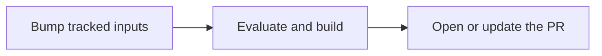

# Update Flake Inputs

Pull requests carry `flake.lock` bumps. Successful builds of the updated flake precede them.

**Requirements:**

- A task with an outbound Git host integration, see [Connect GitHub](github.md), [Connect Gitea or Forgejo](gitea.md) or [Connect GitLab](gitlab.md)
- A **Polling** or **Time (cron)** trigger, for the update interval

## 1. Track the Inputs

=== "UI"

    On the task, go to **Settings -> Flake Inputs -> New Override**. Fill in the **Input Name** and turn on **Force update using the URL declared in flake.nix**.

=== "Declarative"

    ```nix
    services.gradient.state.tasks.web-app.flake_input_overrides = {
      nixpkgs.keep_url = true;
      "home-manager*".keep_url = true; # (1)!
    };
    ```

    1.  `*` and `?` act as wildcards across input names. A bare `*` tracks every input.

Supported input types: `github`, `gitlab` and `git`, including `git` over SSH with the project's SSH key.

!!! warning
    An override with a **URL** pins that input at the given address. No update round of the task can run while pins exist. No pull request can land while the pin is in place.

## 2. Add the PR Action

=== "UI"

    On the task, go to **Actions -> New Action**. Select **PR** as the type and choose the **Outbound Integration**. Default settings work for most repositories.

=== "Declarative"

    ```nix
    services.gradient.state.tasks.web-app.actions = [{
      name = "flake-update";
      type = "open_pr";
      config.integration = "github-acme";
    }];
    ```

| Field | Default | Effect |
|---|---|---|
| Granularity | `per_run` | With `per_input`, one pull request gets opened per input rather than a single one for all inputs |
| Verify Gate | `build` | With `eval` or `none`, the pull request opens after evaluation of the updated flake, before builds complete |
| Branch Pattern | `gradient/flake-lock-update` | With `per_input`, `{input}` must appear in the pattern |
| Title Template | `flake.lock: update <inputs>` | Accepts the placeholders `{input}`, `{inputs}`, `{count}` |
| Body Template | Old and new revision for each input | Accepts the same placeholders as the title |
| Update existing PR | on | An open pull request gets refreshed instead of a second one being opened |

## Update Run

- A trigger fire and a **Fire Now** click start the update evaluation alone.
- Clicks on **Start Evaluation** start the update evaluation alongside the normal evaluation.



- A force-push can land each branch as a single commit on top of the current base.
- Pull requests never lag behind.
- Unchanged `flake.lock` files trigger no pull request.
- A failed build with the default `build` check blocks pull request creation.

## Update in an Exec Job

The update can run as a script in an [exec job](exec-jobs.md). Any check can happen before the pull request. The PR action in Step 2 can handle the integration. Step 1 can stay unused.

```nix
# flake.nix
apps.x86_64-linux.update = {
  type = "app";
  program = "${pkgs.writeShellScript "update" ''
    nix flake update
    gradient build 'nixosConfigurations.*.config.system.build.toplevel' # (1)!
    gradient pr open --title "flake: update inputs" --branch update/flake flake.lock
  ''}";
  passthru.gradient = { network = true; };
};
```

1. A failed build can end the script before the pull request.

A loop can create one pull request per input.

```sh
for input in $(nix flake metadata --json | jq -r '.locks.nodes.root.inputs | keys[]'); do
  nix flake update "$input"
  gradient build && gradient pr open --title "update $input" --branch "update/$input" flake.lock
  git checkout -- flake.lock
done
```

- Choose the exec job for custom checks or one pull request per input. Use the PR action for a plain lock bump.
- Find details on `gradient pr open` and the job token in [Use Exec Job Results](exec-job-results.md).

## Verify Deployment

- The task's **Start Evaluation** can run a second evaluation of the update.
- Pull request bodies carry the old revision and the new revision of each input.

## Next Steps

- [Notify with Actions](actions.md): update failures trigger mail and web requests
- [Use Exec Job Results](exec-job-results.md): exec jobs open pull requests
- [Projects and Tasks](../concepts/projects-and-tasks.md): how triggers and actions work together
